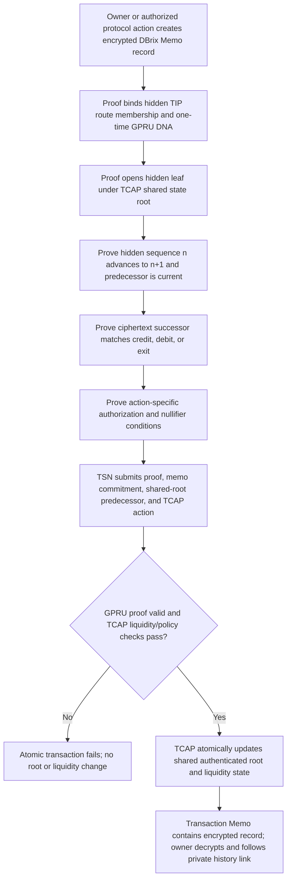

# Historical hidden-head design and unresolved unlinkability target

**Status: HISTORICAL October 29 checkpoints plus PROPOSED privacy goals.** The original design below records architectural evolution; its eight-input ABI, rolling-root descriptions, Ristretto portfolio proposal and absent-prover observations are superseded for current native credit. Read the [current source brief](architecture-source-brief.md), [credit ABI](../docs/laboratory/credit-abi.md) and [cryptography](../docs/laboratory/cryptography.md) before using its ideas.

Current source implements thirteen-input funded-note Groth16 credit, owner delta recovery, authenticated hidden-map updates and root-selected local witness/prover adapters. The [November 2 development experiment](../docs/laboratory/experiments/EXP-20261102-hidden-head.md) records bounded later evidence; it does not establish production or a complete payment. Retained debit/exit/portfolio capabilities require separate caller/account/proof review.

The funded-note source removes the older public signature-to-nullifier calculation by proving funding membership, asset/amount and a private-secret nullifier. Local evidence and operator activation are separate; registry/head and amount/timing correlations remain. See the current credit ABI and cryptography records. Do not execute the original implementation order as a standing task, generalize credit to debit/exit, or remove unique retained capabilities without a verified replacement and user-authorized scope. [Change policy](architecture-change-policy.md) and [maintenance manual](../docs/DOCUMENTATION_MAINTENANCE.md) govern further work.

## Original historical design and checkpoints

# GPRU and TCAP unlinkable balance-state design

This note records the intended protocol architecture for future work. It is a design target, not a claim that the current programs already implement or verify it. For behavior and ABI, inspect the active Rust programs, SDK, Receiver, Node, and Cranker contracts as required by `.agents/architecture-change-policy.md`.

## Goal

Prevent a public observer from grouping two balance-changing actions as belonging to the same TIN by comparing a stable TIN/TIP address, a per-TIN sequence, a predecessor commitment, a balance-state PDA, or a repeated GPRU address. This target applies to every accepted balance change: credit, debit, and exit. Encrypted transaction records are carried in transaction Memo data and linked for the owner inside the encrypted record; TCAP does not create a per-transfer or per-TIN balance PDA.

“Unlinkable” here means that protocol fields do not expose a deterministic per-TIN link. It cannot hide public protocol participation, visible token transfers, amounts, timing, or other external metadata. Those may still permit statistical correlation.

## Roles and state ownership

- **TIP** owns TIN identity and route registration. The TIN is the identity label; TIP is the protocol. A settlement must establish that the route/key is valid without putting the stable TIP registry address in the public transaction account list.
- **GPRU** proves that a one-time DNA/key is valid for a TIP-registered route and verifies that the encrypted balance transition starts from the TIN’s actual latest state. It does not custody funds or own TCAP balances.
- **TCAP** owns liquidity and is the authority for accepting balance changes. TCAP checks reserve/liability constraints and atomically commits the accepted state transition.
- **TSN** coordinates verified intents and authorized execution. Its funding-derived authorization binds a credit to the confirmed funding event.
- **DBrix Memo** stores the encrypted action record in transaction data. The decrypted record includes the action and a private predecessor reference so the owner can walk history. No visible predecessor reference, TIP/TIN address, stable head key, or per-TIN counter may be emitted as a transaction field.

## Intended state model

Use one protocol-wide authenticated state root, not a `TCapTinTip` account per TIN. The root represents a map with one private leaf per TIN route. That leaf authenticates the latest portfolio-envelope commitment and the private logical sequence for the route; token IDs are entries inside the portfolio envelope, not independent outer heads. A transaction updates the selected token's encrypted balance and refreshes the ciphertexts for the other existing token entries. Route identifiers, per-TIN sequence, predecessor Memo references, and the hidden leaf key remain private in the proof or owner-readable encrypted record. Every settlement writes the same TCAP root account. This publicly marks TCAP protocol activity and its global order, but it is not a per-TIN address or stable identifier; the proof hides which leaf changed. The shared writable account also serializes transitions and is a throughput tradeoff.

The root must be an authenticated map/accumulator with a proof-verifiable update, not merely a rolling hash of settlement events. A rolling event hash proves ordering of global events but cannot prove that a supplied memo is the latest memo for a particular hidden TIN. The ZK proof must establish the hidden leaf’s membership under the old root and produce the correct new root after changing only that leaf. Any path, index, TIN-derived key, sequence, predecessor, and successor that could repeat for one TIN must remain private.

## Action flow

Credits, debits, and exits use the same hidden-head transition contract. The action-specific public checks differ: a credit must bind to confirmed funding; a debit must prove a nonnegative successor and valid spend authorization; an exit must additionally bind the authorized destination and exact reserve payout. All state-root changes and TCAP liquidity effects must occur atomically.

## Proof requirements

GPRU must verify a proof whose public inputs are limited to shared protocol state and action data needed by TCAP. The private witness includes the TIP route membership opening, hidden TIN leaf key, previous sequence and portfolio head, selected token entry, encrypted balance opening as required by the proof system, and the authenticated-map paths. The proof must establish:

1. The route is active and its one-time GPRU DNA/key is correctly derived and owner-recoverable, without revealing the stable TIP registry account or route identifier.
2. The single per-TIN leaf is present under the current shared root and commits to the actual latest portfolio envelope, not an older memo chosen by the caller.
3. The private sequence increments exactly once and the predecessor portfolio commitment is the one authenticated by that leaf.
4. The selected accepted token entry changes by the requested action, other entries remain semantically unchanged, and the full successor envelope is bound to the new Memo. For debits and exits, the proof also establishes sufficient balance/non-negativity without exposing the balance.
5. The memo commitment matches the encrypted Memo payload submitted in that transaction.
6. The action authorization is valid. Credits bind to the confirmed funding-derived commitment; debit/exit proofs bind to the owner-authorized operation and destination rules.
7. Replay constraints hold. A repeated root transition fails atomically. If the design must also prevent one funding event or action nullifier from being consumed under a newly prepared root, the authenticated state must include a nullifier set/accumulator and the proof must atomically prove non-membership and insert the nullifier. Do not claim this stronger property from a global root sequence alone.

No stable per-TIN nullifier, sequence, commitment, memo predecessor, PDA, or route account may be exposed. Action nullifiers must be unlinkable and domain-separated; uniqueness is enforced through the shared authenticated state transition.

## Why the current rolling root is not enough

The existing `TcapCommitmentRootStateV1` layout contains a global current/previous root and global sequence. A hash-chain update over public transition fields prevents replay of the same stale global-root transition, but it is not a map of hidden per-TIN heads. It cannot by itself prove that a selected memo is the latest for one TIN, and it does not establish funding-nullifier non-reuse across a newly authorized root. The replacement needs a specified authenticated-map construction and a real proof verifier.

## Current source gaps observed on 2026-10-29

- GPRU `apply_credit_transition_v1` currently receives the TIP registry account directly and parses the stable route key from it. This account is public in the transaction and defeats cross-action unlinkability.
- The current credit transition exposes per-route previous/new commitments and sequence in instruction arguments. The current TCAP shared root is updated as a rolling hash, not as a hidden-leaf authenticated map.
- TCAP still exports `debit_tcap_balance_v1`, `debit_tcap_gpru_tip_v2`, `exit_tcap_liquidity_v1`, `debit_tcap_exit_v1`, and `payout_tcap_exit_v1`; at least the GPRU debit and exit-liquidity paths still take `TCapTinTipV1`. `register_tcap_debit_authorization_v2` also passes `tin_tip` to TCAP.
- Debit and exit proof gates are fail-closed (`ProofSystemNotEnabled`). Existing source is therefore not a completed debit/exit implementation.
- Legacy tip/liability and one-time-tip instructions may have unique liquidity, payout, migration, or recovery behavior. Before removal, trace each capability and provide its replacement through the GPRU/shared-root design; do not leave a runtime fallback to the TCapTinTip path.
- GPRU currently has a custom Ristretto ElGamal/Chaum-Pedersen key proof and initial-balance proof code. These are not a zero-knowledge authenticated-map update verifier and must not be represented as one.
- TIP previously had no shared route-membership root. The current working changes add one TIP-wide append-only Poseidon route tree, updated by direct and staged TIN creation, with a private route index in later proofs. Its SBF build and proof compatibility are not yet verified.

## Groth16 implementation checkpoint (2026-10-29)

The selected design uses a Groth16 proof over BN254 and one TCAP-wide authenticated root. The intended circuit has eight public inputs: old and new TCAP roots, the Memo commitment, the action commitment, an action nullifier, the TIP route-membership root, and action data binding the selected encrypted-balance transition. The hidden witness contains the route opening, one per-TIN outer leaf, a private token-map update, sequence, sparse-map paths, nullifier non-membership path, and private balance openings for debit/exit constraints. The active `main.circom` remains the earlier per-route/per-asset Pedersen prototype; its point commitment is not encryption and it does not implement the single-envelope model.

The source changes currently wire TCAP's `credit_gpru_memo_v1` through TSN to the GPRU verifier and update the shared root plus pending/settled reserve liabilities atomically for credit. The Memo uses the `TSN_GPRU_HEAD_V1:<x>:<y>:` prefix; GPRU binds those coordinates and the complete Memo bytes to the proof, and the SDK reader strips the prefix before Ledger decoding. The Cranker instruction builder serializes the eight public inputs and Groth16 proof and uses that Memo format.

The SDK defines the single portfolio-envelope contract in `tsn-sdk/src/gpru/portfolio-envelope.ts`; the Node crypto adapter can add a credit to the selected Ristretto ElGamal ciphertext, initialize a newly credited token entry, and rerandomize the other existing entries. DBrix Memo serialization now accepts exactly one public `portfolio` object and validates its sorted token-ID/ciphertext entries without publishing route, sequence, or predecessor linkage. The old per-token GPRU `apply_credit_transition_v1` instruction was removed. These pieces are not yet wired into the Node settlement constructor or Cranker transaction, and no Groth16 witness binds the portfolio envelope. The active circuit remains per-route/per-asset and proves over a BabyJubjub Pedersen point, not the Ristretto ElGamal vector. Settlement remains fail-closed with `GPRU_GROTH16_PROVER_NOT_CONFIGURED`; the circuit and proving artifacts must be replaced together before enabling credit, debit, or exit.

Do not call the path operational until the circuit, verifier key, and proof provider are reproducibly built; public-input order, curve encodings, root initialization, and Memo commitment reduction match across Circom/Rust/TypeScript/Python; and adversarial tests plus all affected builds pass. A Devnet deployment is a separate step and is not authorized by this note.

## Implementation order

1. Compile the TIP route tree and Circom circuit, then verify Poseidon parameter, field encoding, route leaf and append-root parity.
2. Add proof generation and transport in SDK/Node/Cranker. Do not pass the TIP registry account as an action account.
3. Add TCAP’s shared-root atomic update entrypoint. It must invoke GPRU, verify memo and action binding, enforce TCAP policy/liquidity, and commit the circuit's new root. It must not create or read a `TCapTinTip` account.
4. Route credit, debit, and exit through this contract; thread the same ABI through TSN, SDK, Receiver, Node, Cranker, and DBrix Memo construction/recovery.
5. Remove superseded TCapTinTip-based runtime instructions and callers only after each unique supported behavior has a verified replacement. Keep genuinely required one-time migrations separate from normal actions.
6. Add adversarial tests for stale memo/head, wrong route, old sequence, altered ciphertext, reused funding/action nullifier, failed payout, and atomic rollback. Then build all affected programs and SDK/service packages. Deployment and live-chain verification are separate steps.

## Guardrails for future work

- Do not add a per-TIN or per-transfer TCAP PDA to hold balance, sequence, memo, or replay state.
- Do not put stable TIP registry addresses, GPRU route keys, per-TIN sequences, or predecessor commitments in public action account metas or arguments.
- Do not describe encrypted Memo data alone as a proof of a valid balance transition; encryption protects contents but does not prove arithmetic or freshness.
- Do not claim “zero correlation” from unique addresses or ciphertexts alone. The proof and state-update contract must hide the identity-to-head relation, and public amount/timing side channels remain.
- Do not start services, alter Receiver data, sign/submit transactions, deploy, or push code unless explicitly requested.
