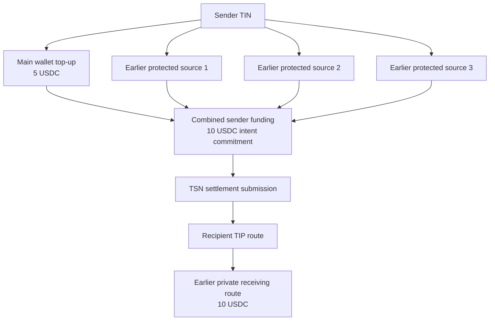

# TrustLink Labs / TSN

The [Laboratory engineering record](docs/laboratory/README.md) connects current architecture, source references, experiments and decisions. The [public SDK handbook](tsn-protocol/tsn-docs/sdk/index.mdx) provides developer guidance, and [documentation status](docs/DOCUMENTATION_STATUS.md) records verification and remaining gaps. Contributors and future Codex sessions use the [documentation maintenance manual](docs/DOCUMENTATION_MAINTENANCE.md).

TrustLink Labs is building foundational infrastructure for the **Internet of
Value** through **TSN (Transfer Settlement Network)**, a hybrid, identity-aware
settlement network designed to make value transfer interoperable across
applications and blockchain networks. TSN combines off-chain coordination and
verification with on-chain authorization and settlement enforcement. **TSNP
(Transfer Settlement Network Protocol)** is its on-chain settlement protocol
program. TIP, GPRU, TCAP, and DIP have separate responsibilities; Circle's CCTP
is an external cross-chain protocol used only at supported integrations.
**TSN XP** is the active user-facing experience being built on that network.
The separately hosted TrustLink Pay site is an earlier application surface.
**TCAP (Transfer Confidential Asset Protocol)** provides the commitment-backed private
balance accounting used by the current credit architecture.

## TrustLink Labs resources

- [Build and operate your own TSN](docs/RUN-YOUR-OWN-TSN.md)

- [Earlier hosted TrustLink Pay application](https://trustlink-pay.vercel.app/)
- [TSN research blog](https://tsn-protocol.blogspot.com/)
- [TrustLink Labs GitHub organization](https://github.com/Trustlink-Labs)
- [Service hosting and deployment map](docs/SERVICE-HOSTING.md)
- [Live testing and contributor guide](docs/GETTING-STARTED-LIVE.md)
- [TSN XP and protocol-flow guides](docs/protocol-flows/README.md)
- [TIN ownership and identity](docs/identity-and-tin.md)
- [Cranker operator guide](docs/CRANKER-OPERATOR-GUIDE.md)
- [Receiver, Node and settlement verification](docs/tsn-receiver-verification-settlement.md)
- [GPRU ownership and TCAP custody](docs/laboratory/components.md)

TSN separates identity addressing, sender approval, durable coordination,
verification and Solana execution. TIP owns identity and route membership;
Node checks authorization and prepares a root-matching proof; Cranker submits
permitted transactions. TCAP governs accepted assets, reserves and liabilities
and calls GPRU before applying the hidden-head transition atomically. Shared
TIP/TCAP roots replace public per-TIN latest-balance references in this credit
call, while funding, amounts and transaction metadata remain observable.

## Native wallet-to-TIN credit architecture

This diagram describes the current source-bound credit sequence. Deployment,
initialized roots/verifier/assets, matching witness snapshots and a complete
payment require separate evidence; the [status record](docs/DOCUMENTATION_STATUS.md)
keeps dated observations. Epoch Treasury, vault payout and reimbursement are a
distinct retained instruction family rather than stages of native credit.

```mermaid
flowchart TB
    subgraph DEVICE["1. Sender device — TSN XP and SDK"]
        direction TB
        A["Review recipient identity<br/>TIN, display name and resolved owner commitment"]
        B["Create private funding note; approve payment<br/>TIN, asset, amount, fee, nonce, expiry and note commitment"]
        C["Refresh blockhash after amount approval<br/>Sign exact TCAP reserve deposit<br/>deposit_private_funding_v1; wallet-signed wire"]
        A --> B --> C
    end

    subgraph INGRESS["2. TSN Receiver — durable ingress and leases"]
        direction TB
        D["Node POST /intents forwards ingress<br/>Authorization and signed deposit"]
        E["Create AUTHORIZED_FUNDING: RECEIVED<br/>Pre-create linked SETTLEMENT: RECEIVED"]
        F["Node leases funding verification<br/>Versioned work and authenticated payload"]
        D --> E --> F
    end

    subgraph NODE["3. TSN Node — funding verification"]
        direction TB
        G["Verify signed message and recipient binding<br/>Registered asset, decimals, exact deposit and simulation"]
        H["Return signed VERIFIED projection<br/>Cranker receives permitted execution fields"]
        G --> H
    end

    subgraph FUNDING["4. First Solana transaction — reserve funding"]
        direction TB
        I["Cranker checks attestation and leases funding<br/>Submit unchanged owner-signed wire"]
        J["TCAP verifies exact vault transfer delta<br/>Append funded leaf; increase assets and pending liability atomically"]
        K["Receiver records funding CONFIRMED<br/>Linked settlement becomes eligible for Node verification"]
        I --> J --> K
    end

    subgraph PROVING["5. TSN Node — independent settlement verification"]
        direction TB
        L["Lease linked settlement and recheck funding<br/>Read TIP, TCAP state/funding roots and V2 verifier"]
        M["Synchronize membership and select matching state<br/>Prove funding, asset/amount and secret-derived nullifier; bind Memo"]
        N["Return signed VERIFIED settlement<br/>Thirteen public inputs and bound Memo"]
        L --> M --> N
    end

    subgraph SUBMISSION["6. Cranker and Mother authority — settlement submission"]
        direction TB
        O["Cranker checks attestation and leases settlement<br/>Obtain authorization bound to current lease"]
        P["Build exact TSNP call followed by Memo<br/>Mother authority co-signs inspected message"]
        Q["Cranker signs and submits second transaction<br/>Mother authorization is distinct from Node decision signing"]
        O --> P --> Q
    end

    subgraph PROGRAMS["7. Solana — nested validation and atomic credit"]
        direction TB
        subgraph CHECKS["TSNP → TCAP → GPRU"]
            direction TB
            R["TSNP checks Mother authority and digest<br/>Invokes TCAP with authorization signer"]
            S["TCAP checks asset, reserves, slots and shared root<br/>Invokes GPRU before root and epoch mutation"]
            T["GPRU checks roots, verifier and Groth16 proof<br/>Binds action and immediately following Memo"]
            R --> S --> T
        end
        U["TCAP atomically advances shared root<br/>Append blinded epoch digest; reserve unchanged"]
        T --> U
    end

    subgraph EVIDENCE["8. Confirmation and owner recovery"]
        direction TB
        V["Confirm settlement signature and chain result<br/>Reconcile shared root and owner action"]
        W["Owner SDK scans and validates encrypted Memo history<br/>Recover action delta and reconcile private balance"]
        V --> W
    end

    C -->|"Signed request"| D
    F --> G
    H --> I
    K -->|"Funding confirmation gates proving"| L
    N --> O
    Q --> R
    U --> V
    U --> AA["Grouped accepted-credit openings<br/>Node proves complete 2–64-credit epoch"]
    AA --> AB["Receiver verifies and leases accounting work<br/>Cranker obtains Mother signature and submits"]
    AB --> AC["TCAP and separate GPRU epoch verifier<br/>One authenticated liability reclassification"]
    G -->|"Invalid authorization or deposit"| X["Reject funding work<br/>No verified Cranker execution"]
    M -->|"Missing snapshots, artifacts or account prerequisites"| Y["Fail closed; resolve prerequisites<br/>Reverify before settlement submission"]
    T -->|"Invalid proof or binding"| Z["Credit transaction fails atomically<br/>Earlier confirmed funding remains separate"]

    classDef device fill:#edf3ec,stroke:#284c36,color:#17251b;
    classDef receiver fill:#f6f0df,stroke:#8b7131,color:#30240d;
    classDef node fill:#e9efed,stroke:#4e6e60,color:#14241c;
    classDef funding fill:#f2eee6,stroke:#6b6254,color:#211f1a;
    classDef chain fill:#e7eee9,stroke:#1f5038,color:#10251a;
    classDef evidence fill:#fbf6e9,stroke:#8b7131,color:#30240d;
    class A,B,C device;
    class D,E,F,K receiver;
    class G,H,L,M,N node;
    class I,O,P,Q funding;
    class J,R,S,T,U chain;
    class V,W,X,Y,Z evidence;
    class AA node;
    class AB receiver;
    class AC chain;
```

The first transaction transfers sender assets into the TCAP reserve; the
second advances confidential state after independent settlement verification.
Receiver pre-creates settlement work at ingress but gates verification on
confirmed funding. Credit does not pay a recipient wallet. If settlement fails,
its state mutations roll back; the earlier confirmed deposit remains separate.
An expired owner-signed funding wire requires fresh wallet approval and a
new signature, and a stale proof/root or lease requires re-verification rather
than reuse of the old execution projection.

The private-credit replacement proves exact funded-note asset/amount membership with secret-derived nullifiers and fresh blinded amount commitments. It omits public note/leaf/index/opening and plaintext credit amount. Pool capture needs two positive unspent members and two wallet sources; zero-value actors cannot qualify it. Separate epoch totals, deposits, token/roots/points/ciphertext/timing and Node knowledge remain observable or trusted. Full unlinkability and recipient-registry privacy remain unproven. [November 7 offline validation](docs/laboratory/experiments/EXP-20261107-private-credit-epoch.md) passed real credit/epoch proofs; SBF build, rekey/epoch activation and complete live flow remain unverified.

## Core terms and authority boundaries

[Architecture terminology](.codex/architecture-terminology.md) owns the names.
TSN is the complete infrastructure; TSNP is the on-chain authorization program
whose internal crate remains `trustlink_escrow`. TIP manages TIN identity,
recovery and route membership. GPRU verifies hidden state/proof relations; TCAP
owns accepted-asset governance and atomic reserve/liability accounting.

Receiver stores restricted durable work and coordinates leases/status; it does
not make the Node's verification decision. Node resolves routes and checks
funding/proofs. Cranker validates the signed execution projection and submits
the permitted transaction. Mother authority co-signs inspected settlement
through Mother Escrow; its key/role differs from Node decision signing. Solana
validators supply execution, ordering, consensus and finality. The
[component reference](docs/laboratory/components.md) covers SDK, identity,
epoch/DNA, ingress and external integration responsibilities separately.

## Shared-root credit and retained authorization families

Current experimental native credit uses `tsn_register_tcap_credit_authorization_v3` → TCAP `credit_gpru_memo_v2` → GPRU `verify_hidden_head_transition_v2`. It advances the authenticated head/nullifier root and blinded epoch transcript with no tokens moving or liability counters changing. Separate Node/Receiver/Cranker epoch work proves the complete 2–64-credit total before TCAP reclassifies existing pending obligations once. No recipient token account or identity initialization is part of credit.

`AcceptedIntent`, epoch commitments, Settlement DNA, private payout/refund and
reimbursement remain separate retained capabilities with their own contracts.
Older receipt/per-TIN tip instructions must not be described as this hidden-head
credit flow; their unique behavior and state obligations need caller/deployment
review before removal. See [state and route diagrams](docs/laboratory/state-and-route-diagrams.md).

## Supported route boundaries

1. **Wallet-to-TIN native credit:** implemented approval/deposit, verification
   and hidden-head construction/submission path, with one independently finalized
   Devnet credit in the baseline. Owner recovery and the replacement sender's live
   HTTP confirmation remain separately unverified.
2. **TIN-funded debit/credit and exit:** retained source/API/proof surfaces need
   their own enabled-caller, account and execution evidence. Wallet credit does
   not prove these routes work.
3. **Wallet-to-wallet and funding commitments:** distinct public transfer and
   commitment-backed capabilities; preserve their separate account contracts.
4. **DIP/CCTP and other external routes:** route-specific integrations whose
   code/configuration/deployment and destination confirmation must be verified
   individually.

## Historical architecture boundary

ZK-PRU was an earlier protected receiving and spending experiment. It was
superseded by the privacy-receiving-root, GPRU and TCAP model and is retained
only for historical auditability. New integrations must not target ZK-PRU as a
receiving, balance or spending architecture. See the [ZK-PRU retirement note](docs/ZK-PRU-RETIRED.md).

## Evidence and Devnet policy

TrustLink distinguishes code evidence, build evidence, Devnet transaction
evidence and production-readiness evidence. A checked-in helper or successful
simulation does not prove that a program is deployed. Reviewers should record
the program ID, cluster, upgrade authority, deployment slot, transaction
signature and post-transaction account state.

Program-dependent testing is Devnet-only. After an on-chain code or ABI change,
build and compare the SBF artifact with the target deployment before testing
against that program. Program upgrades, initialization and signed tests require
explicit operator authorization; source/build evidence alone cannot establish
a matching deployment or current account readiness. See [Devnet build and deploy](docs/DEVNET-BUILD-DEPLOY.md), the [TCAP V2 Devnet preparation](docs/TCAP-V2-DEVNET.md), the [TCAP V2 debit and credit design](docs/TCAP-V2-DEBIT-CREDIT-DESIGN.md), and the [legacy TCAP smoke notice](docs/tcap-devnet-credit-smoke.md).

## Historical Devnet evidence: first wallet-assisted TIN-to-TIN test

The project&#8217;s first recorded Devnet payment test used the earlier ZK-PRU
receiving path. It is preserved here as historical transaction evidence only;
it is not the current TSN receiving or TCAP credit architecture. The test used a
sender TIP route and recipient TIP route, combined a 5 USDC main-wallet top-up
with the sender-side sources for a 10 USDC intent, and settled into a new
private receiving route.

| Stage                    | Recorded role                                                                      | Devnet signature                                                                                                                             |
| ------------------------ | ---------------------------------------------------------------------------------- | -------------------------------------------------------------------------------------------------------------------------------------------- |
| Wallet funding           | 5 USDC main-wallet top-up used in the sender funding set                           | [5u9HmqD5...](https://solscan.io/tx/5u9HmqD5wNmBmHWfDWmw3vhpMhN42j15YPTmUVgpcMtbuwdGdhqRVqGrZAVF5ic1CiS1ZzuF1D2tMyVaanf4eqye?cluster=devnet) |
| Protected source batch A | Earlier protected source movement; part of the sender funding set                  | [3wgVPZYz...](https://solscan.io/tx/3wgVPZYzEqvht5pkPRetF8tFsXoWmy8obbSSqYYTmxaR1fw6oci2y93P96GhK4xXqu4ttSSD7mMYPyEoDjXVporU?cluster=devnet) |
| Protected source batch B | Earlier protected source movement; completed the recorded source set               | [2M26JcpS...](https://solscan.io/tx/2M26JcpSVhKAQvB5yC3Pp4L6NYLHiU8UTMFMsrMbJwt2Jj23dd3pqRG8nWTxerYrcXqm7R78Jt4992smK7jh7eWJ?cluster=devnet) |
| Settlement               | 10 USDC settlement into the recipient TIN&#8217;s recorded private receiving route | [46wGVb9s...](https://solscan.io/tx/46wGVb9sfBqWWonk3CQ14xZCc6Qzf2ksYyZMpG4TDhqzhh49pRS59CjhCgq9oPVnfEVhSKdJyb3Rib7HM99A8TfU?cluster=devnet) |

These signatures are preserved as supplied Devnet evidence. They document the
earlier route and must not be used as evidence that the current GPRU, TSN Epoch
Treasury and TCAP credit path has been deployed or validated.

Current Devnet program IDs:

| Program                                 | Address                                       |
| --------------------------------------- | --------------------------------------------- |
| TSN / `trustlink_escrow`                | `TSN31jddtsmUg4D5aEdhY31nwB1e53VJJg9X8NoRP8V` |
| TCAP / `tcap`                           | `tCaP5R8LZFL1ridm3JCAtiqFzNnZCQYj3Hb7kw42YZF` |
| TIP / Transfer Identity / TIN registrar | `TinseNnU588NkmRZBe4ADJbxqrqQma92678UFP6VuwT` |

## Repository map

| Path                                                | Purpose                                                       |
| --------------------------------------------------- | ------------------------------------------------------------- |
| `protocol-tests/ui/`                                | TSN XP user experience and SDK integration lab                 |
| `frontend/`                                         | Earlier TrustLink Pay application                              |
| `backend/`                                          | API, application records and notifications                    |
| `tsn-protocol/programs/transfer-identity-protocol/` | TIP/TIN registrar and SDK                                     |
| `tsn-protocol/programs/`                            | Solana TSNP, TCAP, TIP and GPRU programs                      |
| `tsn-protocol/sdks/`                                | Canonical TSN SDK and Cranker SDK                             |
| `tsn-protocol/services/`                            | Node, Receiver, RPC, Cranker, Cross-chain and UI services     |
| `tsn-protocol/programs/tcap-protocol/`              | TCAP program, SDK and credit tooling                          |
| `docs/`                                             | Architecture, security, operations and evidence documentation |

## Milestones and ecosystem support

TrustLink Pay has progressed through StableHacks, and received support through
the Superteam Agentic Engineering Grant program for fraud-protection
development. The factual project history and acknowledgements are in [Project
Journey](https://github.com/bigdreamsweb3/trustlink-pay/blob/bb833d563f283bc9690963faa5a3c2c16b9e1d5f/docs/PROJECT-JOURNEY.md).

See what people are saying about the project: [Community Mentions](https://github.com/bigdreamsweb3/trustlink-pay/blob/bb833d563f283bc9690963faa5a3c2c16b9e1d5f/docs/mentions.md).

## Maintainer

TrustLink Pay is created and led by **Agbaka Matthew Daniel U. E. (Big Dreams Web3)**.

- [X / @0xbigdream](https://x.com/0xbigdream)
- [GitHub / @bigdreamsweb3](https://github.com/bigdreamsweb3)
- [LinkedIn / Big Dreams Web3](https://www.linkedin.com/in/bigdreamsweb3/)
- [TrustLink Labs](https://github.com/Trustlink-Labs)

## License

[MIT](LICENSE)
