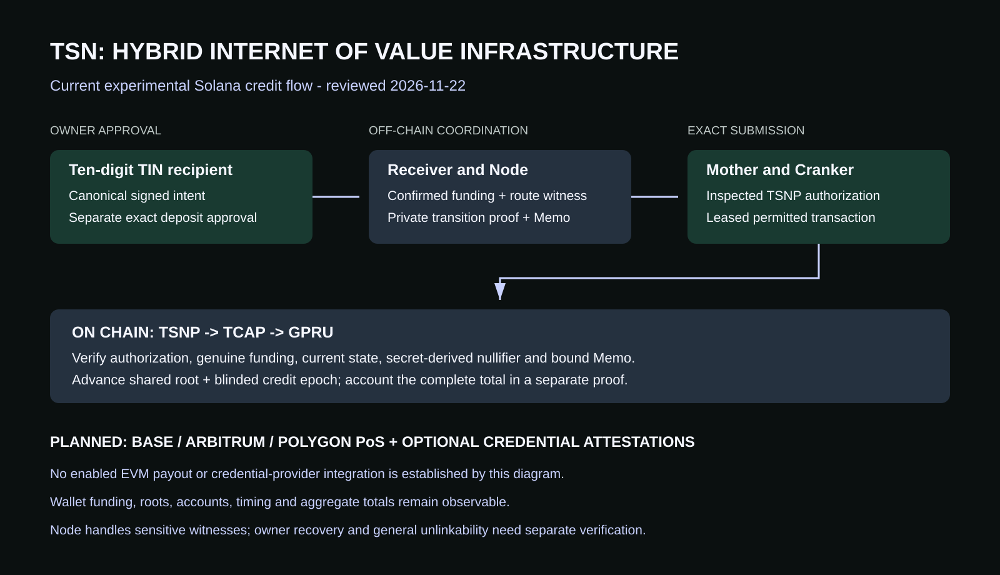

# Transfer Settlement Network: Blockchain Identity and Settlement for Digital Value

Transfer Settlement Network (TSN) is the hybrid decentralized blockchain settlement protocol infrastructure we are building for the Internet of Value. A ten-digit TIN gives people and businesses a recognizable payment identity; owner-consented attested credentials help senders confirm the intended recipient. Users share a TIN for payments rather than treat a public wallet address as their everyday identifier, while applications connect identity to confidential value and supported settlement environments.

**Track:** DeFi: payments and settlement infrastructure.

**Pitch deck:** [TSN protocol pitch](https://trustlink-labs.github.io/TSN-Pitch-Deck/)

**Documentation:** [TSN handbook](https://trust-link-tsn.mintlify.site/)

## The payment experience

A Transfer Identity Number (TIN) makes the recipient human-facing. The intended product lets a person fund a payment identity, send value, confirm who should receive it and follow a clear settlement receipt. Wallet and payment developers can build familiar interfaces while TSN coordinates exact approval, private state, asset accounting and chain-specific delivery.

Owner-consented, issuer-verified personal and business names are part of the recipient-assurance direction. Verification must bind the intended identity, supported issuer and claim, validity and revocation, with selective disclosure. A chosen name or wallet-control proof is not treated as legal-identity verification.

## Why hybrid infrastructure

TIP manages payment identity and authenticated route membership. TSNP authorizes on-chain settlement. TCAP governs accepted assets, reserve custody and confidential accounting, while GPRU verifies hidden route, amount, balance and nullifier relations. Receiver coordinates durable work, Node verifies and prepares private witnesses, and Cranker submits exact permitted transactions. This separation connects an accessible payment experience to explicit settlement responsibilities.

## Settlement network priorities

Solana is the settlement foundation. Base, Arbitrum and Polygon PoS are lower-fee EVM integration priorities for the settlement network we are building. Base and Arbitrum are Ethereum Layer 2 networks; Polygon PoS is an EVM sidechain with different security assumptions. Each route must preserve exact recipient and asset authorization, finality, replay protection, actual value delivery and recovery. Ethereum Layer 1 is outside the present low-fee focus.

Gas sponsorship can simplify the user experience, but network and liquidity costs still exist. Stablecoins are the intended payment asset; proof or message infrastructure does not create funds. A supported asset-transfer mechanism or destination liquidity must supply value on the payout network.

## Development and evidence

This revised project copy describes the end-state product and its technical foundation; it is not evidence of a new external submission. The first release remains under development. The retained November 16 Solana Devnet checkpoint verifies two private wallet-funded TIN credits and complete aggregate accounting. Broader confidential spending, complete owner recovery, EVM delivery, credential-provider integration and production readiness need separate implementation and verification.

The current native flow separates canonical intent approval, exact sender-wallet deposit approval, confirmed funding, private settlement proving and complete aggregate accounting. A single genuine confirmed deposit can support an individual private credit; the 2-64-credit minimum applies to the separate complete accounting proof. Wallet funding, roots, token identifiers, ciphertext, accounts, timing and aggregate totals remain observable, and Node handles sensitive witnesses.

## Demo and resources

Demo video 1 covered TIN creation. Demo video 2 will demonstrate wallet deposit to TIN credit after documentation publication, with actual approval, funding and settlement evidence. Earlier media templates are historical planning assets rather than current settlement proof.

- [Current whitepaper](../../docs/TSN-WHITEPAPER.md)
- [Current credit ABI](../../docs/laboratory/credit-abi.md)
- [November 16 bounded evidence](../../docs/laboratory/experiments/EXP-20261116-private-credit-epoch.md)
- [TSN implementation repository](https://github.com/bigdreamsweb3/trustlink-pay)
- [TSN public protocol repository](https://github.com/Trustlink-Labs/TSN-Protocol)
- [Research publication](https://tsn-protocol.blogspot.com/)
