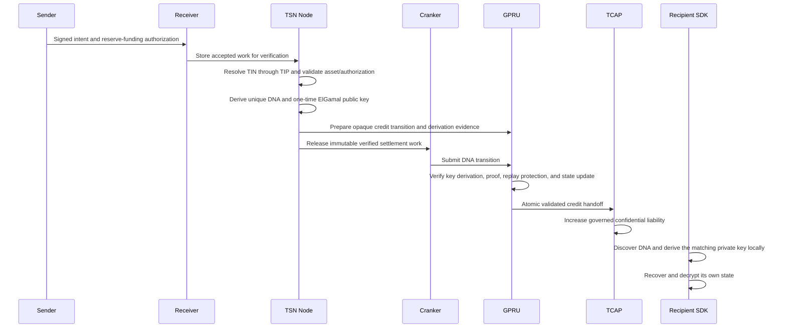

# TIP, GPRU, and TCAP architecture

This document separates the deployed/source-backed system from the target GPRU design. It is an architecture overview, not a claim that every target component is already implemented or deployed. The executable program instructions and account layouts remain the implementation source of truth.

## The protocol layers

- **TIP (Transfer Identity Protocol)** manages transfer identities and route metadata. A **TIN (Transfer Identity Number)** is one identity issued within TIP; it is not the protocol itself.
- **GPRU (Guarded Privacy Routing Unit)** is a standalone protocol design for per-transaction, unlinkable routing and confidential-state transitions. Each transaction uses a unique DNA and a one-time ElGamal public key.
- **TCAP (Transfer Confidential Asset Protocol)** governs asset reserves and will apply validated GPRU credit/debit transitions to confidential liabilities.
- **TSN** coordinates signed intents, verification, and settlement work. Receiver stores ingress work; Node validates it; Cranker submits the exact authorized transaction.

## What is implemented today

TIP V1 stores a versioned GPRU ElGamal scan public key and its commitment, alongside TIP route and policy commitments. The scan key is stable for a TIN route. It is suitable for discovering recipient-specific outputs, but publishing or repeatedly using it in settlement instructions would create a linkability concern.

The GPRU source contains a Rust key-derivation core, a native C ABI for the Python Node, and an SDK recovery helper. The derivation uses the TIP scan key to produce a fresh transaction DNA, an ephemeral public point, and a one-time ElGamal public key. The owner can derive the corresponding private key locally from the owner-held scan secret and the public DNA inputs. This cryptographic primitive is not connected to an on-chain GPRU program or TCAP settlement instruction.

TCAP's current deployed/source-backed instructions remain authoritative for current behavior. Existing TIP-rooted credits do not prove that a confidential balance successor is valid; debit and exit remain fail-closed. The current GPRU directory is a Rust library, not a deployable Solana program. No claim in this document means the new DNA flow is live on chain.

## Target credit flow

The sender provides the payment authorization and funding transaction. It does not resolve the recipient's private TIP route or choose the TCAP destination state. Receiver performs ingress acceptance; Node performs protocol verification and route resolution; Cranker only submits immutable authorized work. Cranker does not hold the recipient's decryption key or authority to alter a transition.

## Target debit and transfer flow

A TIN debit requires a proof that the encrypted source balance covers the requested amount and that the successor balance is the correct subtraction. A TIN-to-TIN transfer additionally proves conservation between the source debit and destination credit without exposing the amount or linking their public DNA records. TCAP updates reserve liabilities only after GPRU verifies the state transition, proof, asset binding, and replay protection atomically. A wallet exit remains publicly visible at the wallet boundary.

The owner SDK may check a locally decrypted balance to give the user a useful error, but that check is not an authorization rule. The program-level proof is the enforcement boundary. No homomorphic balance format, proof circuit, GPRU account ABI, or TCAP CPI for this target flow is claimed complete yet.

## One-time ElGamal keys and privacy boundary

TIP's stable ElGamal public key is a scan key, not the transaction encryption key. For each fresh DNA, Node uses new randomness to derive a separate ephemeral point and one-time public key. The recipient later combines the ephemeral point with owner-held secret material to derive the corresponding private key locally. A domain-separated commitment binds the derivation version, DNA, ephemeral point, and one-time public key.

The Node must not receive the recipient's long-term private key or plaintext balance. The derivation primitive alone does not provide a secure encrypted-balance transition: the eventual GPRU program must verify derivation evidence and the balance proof, prevent replay, and atomically update state. Public timing, public wallet funding, and public wallet exits can still reveal transaction metadata.

## Status boundary

The GPRU program, encrypted-state proof verification, and atomic TCAP handoff are not deployed. Node, Cranker, and SDK are not yet connected to a shared on-chain DNA ABI. This design describes those protocol boundaries; current program instructions and account layouts remain authoritative for live behavior.

See [GPRU and TCAP target architecture](./gpru-tcap-route.md), [TCAP debit and credit design](./TCAP-V2-DEBIT-CREDIT-DESIGN.md), and the [TIP/GPRU/TCAP docs site pages](../tsn-protocol/tsn-docs/architecture/gpru-confidential-balances.mdx).
