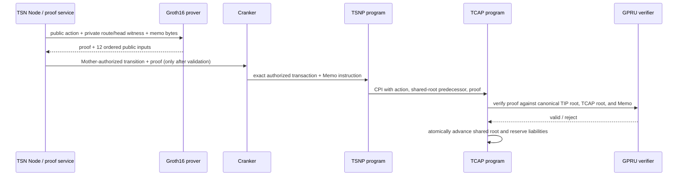

# GPRU Groth16 prover and key artifacts

This guide explains the proof-generation component used by the current twelve-input GPRU hidden-head contract. The local Node witness/prover adapters are implemented, and the November 2 experiment verified the matching November 1 development setup, local proofs and four SBF builds. Runtime configuration, deployed verifier/root state and confirmed settlement are separate gates; see [the dated readiness record](./laboratory/experiments/EXP-20261102-hidden-head.md). The older October 31 eight-input setup is incompatible; the verified November 1 development setup is reusable for its matching source. Production keys/ceremony and independent review are not established.

## What the prover does

The circuit defines the exact statement that GPRU accepts. For one balance-changing action, a prover supplies private witness data for TIP route membership, the current hidden per-TIN head, predecessor sequence and Memo/action commitments, the predecessor portfolio root, selected-token and nullifier paths, and the one-time encrypted-delta opening. The circuit checks the transition and emits a Groth16 proof plus twelve public inputs. It proves that the Memo's one-time ciphertext encrypts the same private Pedersen blinding delta used in the transition, without revealing the delta, private route, or head witness.

The prover is an off-chain program or service. It receives a valid witness and the circuit-specific proving key, computes the witness, and creates the proof. It cannot make an invalid transition pass: GPRU checks the proof against the verifying key stored in its global verifier PDA, and TCAP invokes that check before changing its shared root or reserve liabilities. If verification or any later TCAP condition fails, Solana rolls back the whole instruction transaction.

The proof is designed to hide the per-TIN route/head witness; protocol-wide shared roots are not individual TIN identifiers. The current ABI exposes the action kind, asset/token ID, amount, nullifier, old and new shared roots, memo commitment, action commitment, TIP route root, and successor Pedersen point. Transaction accounts, timing, and encrypted Memo bytes are also public chain data, but do not provide a public pointer to the hidden TIN or its private predecessor. The proof path remains fail-closed until its artifacts and end-to-end execution are verified, so this design is not yet a verified runtime guarantee.

## Public-input contract

The order is fixed by `main.circom`, GPRU, TSN, and TCAP. Every proof producer and verifier must use this exact sequence:

1. `oldGlobalRoot` — current TCAP shared root.
2. `newGlobalRoot` — root after updating the hidden head and inserting the nullifier.
3. `memoCommitment` — SHA-256 of the Memo instruction, reduced to a canonical BN254 scalar.
4. `actionCommitment` — Poseidon commitment to action kind, token ID, amount, authorization commitment, and nullifier.
5. `nullifier` — one-time public value used to prevent reuse of this action.
6. `tipRouteRoot` — the current shared TIP route-membership root.
7. `successorPortfolioRoot` — updated root of the hidden per-TIN token commitment map.
8. `successorBalanceX` — X coordinate of the selected token's successor Pedersen commitment.
9. `successorBalanceY` — Y coordinate of the selected token's successor Pedersen commitment.
10. `encryptedBlindingDelta` — one-time ciphertext of the private blinding delta.
11. `deltaEphemeralPublicX` — X coordinate of the ciphertext's ephemeral point.
12. `deltaEphemeralPublicY` — Y coordinate of the ciphertext's ephemeral point.

The corresponding Memo prefix has these seven fields after `TSN_GPRU_HEAD_V1`: successor portfolio root, successor balance X/Y, action commitment, encrypted blinding delta, and ephemeral point X/Y. The owner-encrypted Ledger record excludes the delta. The TIP-registered BabyJubjub scan key lets the owner recover the delta, and the circuit proves that recovered value is the one used by the balance commitment transition.

The Memo prefix is `TSN_GPRU_HEAD_V1:<successorPortfolioRoot>:<successorBalanceX>:<successorBalanceY>:<actionCommitment>:<encryptedBlindingDelta>:<deltaEphemeralPublicX>:<deltaEphemeralPublicY>:` followed by the DBrix Ledger stream. GPRU checks the prefix against public inputs 7-12, hashes the complete Memo for input 3, checks inputs 1 and 6 against canonical TCAP and TIP accounts, and recomputes input 4 from action fields. The Rust verifier expects canonical 32-byte big-endian BN254 scalar encodings. A producer must not reorder, truncate, or reinterpret these values.

## Proving and verifying keys

Groth16 needs a circuit-specific setup. The circuit source is compiled to an R1CS constraint system and a witness calculator (WASM or another supported runtime). A Powers of Tau contribution supplies the universal setup input; a second, circuit-specific phase generates the Groth16 proving key and its corresponding verifying key. The proving key is used off-chain to make proofs. The verifying key is smaller and is installed in GPRU so the program can check proofs on chain. The circuit and key versions must match exactly.

The setup has toxic-waste risk: if all setup contributors retain or collude around the secret randomness, they may undermine proof soundness. A production setup must use a documented multi-party ceremony, verify every contribution and the final key against the exact circuit, and publish a reproducible transcript. A developer's one-person local setup is suitable only for local experiments; it is not a production key ceremony. See the [Circom proving workflow](https://docs.circom.io/getting-started/proving-circuits/) and [Circom compilation outputs](https://docs.circom.io/getting-started/compiling-circuits/) for the toolchain stages.

## Artifact lifecycle

Use a pinned Circom compiler, pinned `circomlib`, and pinned `snarkjs` version. The required pipeline is:

1. Compile `tsn-protocol/programs/gpru/circuits/hidden_head_v1/main.circom` to R1CS, witness-calculator output, and symbols. Record the compiler/library versions, build command, source hashes, and measured constraint count for this updated source; older metrics are stale.
2. Review the circuit constraints and public-input order. Confirm that the Rust verifier's twelve-input layout and the generated verification key's input count match.
3. Run the Powers of Tau and circuit-specific setup. Preserve the public ceremony transcript and contribution verification output; securely discard contributor secret randomness.
4. Verify the final zkey against the exact R1CS and Powers of Tau artifact, then export the verification key. Record hashes for the final R1CS, WASM, zkey, and verification-key file.
5. Convert the exported verification key into the exact fixed-width G1/G2 byte encoding expected by `InitializeHiddenHeadVerifierArgsV1`. This adapter must be checked against the `groth16-solana` verifier's point format and proof serialization before any on-chain initialization. The repository does not yet provide this validated converter.
6. Independently prove that the exported verification key corresponds to the reviewed R1CS and ceremony transcript. The current on-chain circuit commitment hashes `main.circom` and a fixed library label; it does not commit to every included library source, compiler version, flags, or generated R1CS. The verifier initializer records the supplied key commitment but cannot establish on chain that the key was generated from the intended circuit.
7. Initialize GPRU's `gpru:hidden-head-verifier:v1` PDA with the Mother-authorized `initialize_hidden_head_verifier_v1` instruction. The program checks the source-derived circuit commitment and a commitment to the supplied verification-key bytes.
8. Configure the off-chain prover with the final proving key and witness source. Keep proving keys and witness data out of the public repository; proving keys are not owner secrets, but their integrity and version must be controlled. Publish only the verification key, commitments, and ceremony/build metadata needed for independent verification.
9. Verify generated test proofs off chain and through the deployed GPRU verifier before enabling Node settlement authorization. The test vectors must cover first credit, subsequent credit, debit, exit, stale predecessor, reused nullifier, wrong Memo, wrong route root, and mismatched amount/action.

The following is a command template for a controlled development run. Pin and record tool versions first, choose the Powers of Tau power only after measuring the circuit, and write generated files to an ignored local build directory:

```sh
npm --prefix tsn-protocol/programs/gpru/circuits/hidden_head_v1 ci
npm run gpru:circuit:compile
npm run gpru:circuit:info
cd tsn-protocol/programs/gpru/circuits/hidden_head_v1
snarkjs powersoftau new bn128 18 build/hidden_head_v1/pot_0000.ptau -v
snarkjs powersoftau contribute \
  build/hidden_head_v1/pot_0000.ptau build/hidden_head_v1/pot_0001.ptau \
  --name="local development only" -v
snarkjs powersoftau prepare phase2 \
  build/hidden_head_v1/pot_0001.ptau build/hidden_head_v1/pot_final.ptau -v
snarkjs groth16 setup \
  build/hidden_head_v1/main.r1cs build/hidden_head_v1/pot_final.ptau \
  build/hidden_head_v1/hidden_head_0000.zkey
snarkjs zkey contribute \
  build/hidden_head_v1/hidden_head_0000.zkey \
  build/hidden_head_v1/hidden_head_final.zkey \
  --name="local development only" -v
snarkjs zkey verify \
  build/hidden_head_v1/main.r1cs build/hidden_head_v1/pot_final.ptau \
  build/hidden_head_v1/hidden_head_final.zkey
snarkjs zkey export verificationkey \
  build/hidden_head_v1/hidden_head_final.zkey \
  build/hidden_head_v1/verification_key.json
```

Proof generation for a circuit-valid private input is then:

```sh
snarkjs wtns calculate \
  build/hidden_head_v1/main_js/main.wasm \
  witness-input.json build/hidden_head_v1/witness.wtns
snarkjs groth16 prove \
  build/hidden_head_v1/hidden_head_final.zkey \
  build/hidden_head_v1/witness.wtns \
  build/hidden_head_v1/proof.json build/hidden_head_v1/public.json
snarkjs groth16 verify \
  build/hidden_head_v1/verification_key.json \
  build/hidden_head_v1/public.json build/hidden_head_v1/proof.json
```

The following manual ceremony/proof commands illustrate the toolchain stages; use the circuit package scripts and explicit artifact paths for reproducible development setup. The measured constraint count fits a power-18 Powers of Tau file. These commands create only a local experimental setup; a one-person local setup is not production ceremony evidence and must not be treated as production key material. The local proof must also be verified with GPRU's Rust verifier and exact point encoding before it is evidence of compatibility.

## Prover request and settlement flow



The local Node witness/prover adapters are implemented, and the November 2 experiment verified the matching November 1 development setup, local proofs and four SBF builds. Runtime configuration, deployed verifier/root state and confirmed settlement are separate gates; see [the dated readiness record](./laboratory/experiments/EXP-20261102-hidden-head.md). The six artifact settings and witness-directory setting must be explicitly applied; local evidence does not prove active service or chain execution.

## Repository status and completion gates

The repository now includes scripts to create a **local development-only** Powers of Tau/Groth16 setup, export the verifying key into the byte layout required by `groth16-solana 0.0.2`, and calculate/prove/verify when supplied a complete circuit witness. The generated files live under the ignored `build/hidden_head_v1/dev/` directory. This is not a production ceremony or reviewed key. The implemented root-selected witness store and local prover adapter validate chain-root/key bindings. The dated pre-deployment observation found an uninitialized verifier and unapplied Node settings; the complete SDK/Receiver/Node/Cranker chain path remains unverified here. Debit and exit must remain disabled until their proof relation, authorization, payout/liquidity checks, and atomic root transition are verified together.

Enabling live credit requires the artifact pipeline above, program and SDK builds, proof-vector verification, transaction-size/compute checks, security review, and explicit Devnet account/signature evidence.

## Devnet program deployment command

### One-time verifier initialization and root activation

The November 2 setup follow-up found that the original twelve-input verifier initializer encoded **1,356 bytes of instruction data**, exceeding Solana's 1,232-byte transaction packet limit before signatures/accounts. The GPRU setup ABI now creates a disabled verifier with its fixed header, uploads thirteen IC points in chunks of at most four, then enables it only after the complete key matches its circuit/key commitments. Its proof ABI, verifier account layout, program IDs and circuit/proving key are unchanged. The earlier deployed GPRU binary needs a rebuild/redeployment for this initializer change; do not regenerate the matching development setup merely to upload it.

Root setup commands are `gpru:verifier:info`, `gpru:verifier:init:devnet` and `tcap:root:activate:devnet`. Mutations require explicit `--send`; without it the script reads accounts and prints the exact transaction plan. Verifier enrollment is six packets (790, 506, 506, 506, 313, 244 bytes); matching disabled enrollment can be resumed. Enabled keys cannot be overwritten. TCAP activation requires its stored governance signer, a paused sequence-zero root, and uses the existing program instruction to install the canonical empty root and clear the pause. A root with existing transitions is refused.

For this WSL checkout, the observed Mother signer is `FnTrWDNgsXedkoCxpgKvwmEF3By4G6wzu9oyoU1n9xUG` at `tsn-protocol/services/tsn-node/keys/mother-node-keypair.json`; TCAP governance is `78AacdSEWquuus5QyU654C7Gjb6gFb8okLNb8v1hn5MX` at `/home/bigdream/.config/solana/id.json`. Paths/authorities are local observations, not portable defaults. The script rechecks stored authority and refuses a wrong signer. Run these operator commands after deploying the corrected GPRU binary:

```bash
cd /mnt/c/Users/codepara/Desktop/trust-link
npm run gpru:program:deploy:devnet
npm run gpru:verifier:init:devnet -- --rpc https://api.devnet.solana.com --wallet "$PWD/tsn-protocol/services/tsn-node/keys/mother-node-keypair.json" --send
npm run tcap:root:activate:devnet -- --rpc https://api.devnet.solana.com --wallet /home/bigdream/.config/solana/id.json --send
npm run gpru:verifier:info -- --rpc https://api.devnet.solana.com
```

These are user-executed signed operations. The assistant's follow-up performed source fixes, build/tests and read-only account/planning checks; it did not deploy or initialize accounts. See the [setup verification record](laboratory/experiments/EXP-20261102-verifier-initialization.md). Node artifact settings, root-matching snapshots, recipient creation and complete credit/recovery remain separate steps. Legacy config proof flags are not a replacement for the GPRU hidden-head verifier account used by the native credit handler.

For an operator-authorized upgrade, the root script rebuilds and deploys TIP Registrar, TSNP, TCAP and GPRU:

```sh
npm run programs:devnet:deploy:all
```

This command uploads program binaries; it does not perform the Groth16 setup, initialize the GPRU verifier PDA, or configure the TSN Node prover. Those actions must be completed and verified before testing wallet-to-TIN credit. The deploy command is provided for the completed integration workflow and does not mean the current proof path is ready.

## Source files

- Circuit: `tsn-protocol/programs/gpru/circuits/hidden_head_v1/main.circom`
- Circuit notes: `tsn-protocol/programs/gpru/circuits/hidden_head_v1/README.md`
- GPRU verifier and initializer: `tsn-protocol/programs/gpru/src/hidden_head.rs`
- GPRU instruction ABI: `tsn-protocol/programs/gpru/src/lib.rs`
- TSN credit CPI: `tsn-protocol/programs/tsn/protocol/programs/trustlink-escrow/src/tsn/instructions/register_tcap_credit_authorization_v2.rs`
- TCAP atomic transition: `tsn-protocol/programs/tcap-protocol/programs/tcap/src/instructions/credit_gpru_memo_v1.rs`
- Node fail-closed boundary: `tsn-protocol/services/tsn-node/server.py`
