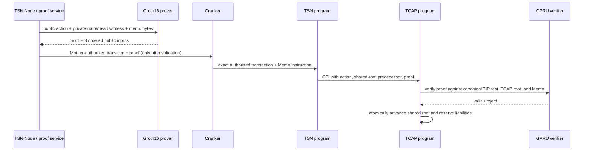

# GPRU Groth16 prover and key artifacts

This guide explains the proof-generation component used by GPRU's hidden-head V1 contract. The circuit and on-chain verifier interface exist in source, but this repository does not yet contain a compiled circuit, production proving/verifying keys, a prover service, or a verified deployment of the verifier configuration. The Node settlement authorization endpoint therefore fails closed until those pieces are built and connected.

## What the prover does

The circuit defines the exact statement that GPRU accepts. For one balance-changing action, a prover supplies private witness data for TIP route membership, the current hidden TIN-and-asset head, predecessor sequence and memo/action commitments, sparse-map paths, and the nullifier's unused path. The circuit checks the transition and emits a Groth16 proof plus eight public inputs. It does not reveal the private route or head witness.

The prover is an off-chain program or service. It receives a valid witness and the circuit-specific proving key, computes the witness, and creates the proof. It cannot make an invalid transition pass: GPRU checks the proof against the verifying key stored in its global verifier PDA, and TCAP invokes that check before changing its shared root or reserve liabilities. If verification or any later TCAP condition fails, Solana rolls back the whole instruction transaction.

The proof does not hide every transaction field. The current ABI exposes the action kind, asset/token ID, amount, nullifier, old and new shared roots, memo commitment, action commitment, TIP route root, and successor Pedersen point. Transaction accounts, timing, and the encrypted Memo bytes are also public chain data. This design hides the per-TIN route/head witness; it does not promise zero linkability.

## Public-input contract

The order is fixed by `main.circom`, GPRU, TSN, and TCAP. Every proof producer and verifier must use this exact sequence:

1. `oldGlobalRoot` — current TCAP shared root.
2. `newGlobalRoot` — root after updating the hidden head and inserting the nullifier.
3. `memoCommitment` — SHA-256 of the Memo instruction, reduced to a canonical BN254 scalar.
4. `actionCommitment` — Poseidon commitment to action kind, token ID, amount, authorization commitment, and nullifier.
5. `nullifier` — one-time public value used to prevent reuse of this action.
6. `tipRouteRoot` — the current shared TIP route-membership root.
7. `successorBalanceX` — X coordinate of the successor Pedersen balance commitment.
8. `successorBalanceY` — Y coordinate of the successor Pedersen balance commitment.

The GPRU verifier also checks that inputs 0 and 5 match the canonical TCAP and TIP accounts, inputs 2 and 6–7 match the Memo instruction, and input 3 matches the action fields passed by the caller. The Rust verifier expects canonical 32-byte big-endian BN254 scalar encodings. A producer must not reorder, truncate, or reinterpret these values.

## Proving and verifying keys

Groth16 needs a circuit-specific setup. The circuit source is compiled to an R1CS constraint system and a witness calculator (WASM or another supported runtime). A Powers of Tau contribution supplies the universal setup input; a second, circuit-specific phase generates the Groth16 proving key and its corresponding verifying key. The proving key is used off-chain to make proofs. The verifying key is smaller and is installed in GPRU so the program can check proofs on chain. The circuit and key versions must match exactly.

The setup has toxic-waste risk: if all setup contributors retain or collude around the secret randomness, they may undermine proof soundness. A production setup must use a documented multi-party ceremony, verify every contribution and the final key against the exact circuit, and publish a reproducible transcript. A developer's one-person local setup is suitable only for local experiments; it is not a production key ceremony. See the [Circom proving workflow](https://docs.circom.io/getting-started/proving-circuits/) and [Circom compilation outputs](https://docs.circom.io/getting-started/compiling-circuits/) for the toolchain stages.

## Artifact lifecycle

Use a pinned Circom compiler, pinned `circomlib`, and pinned `snarkjs` version. The required pipeline is:

1. Compile `tsn-protocol/programs/gpru/circuits/hidden_head_v1/main.circom` to R1CS, witness-calculator output, and symbols. Record compiler/library versions, build command, source hashes, and constraint count.
2. Review the circuit constraints and public-input order. Confirm that the Rust verifier's eight-input layout and the generated verification key's input count match.
3. Run the Powers of Tau and circuit-specific setup. Preserve the public ceremony transcript and contribution verification output; securely discard contributor secret randomness.
4. Verify the final zkey against the exact R1CS and Powers of Tau artifact, then export the verification key. Record hashes for the final R1CS, WASM, zkey, and verification-key file.
5. Convert the exported verification key into the exact fixed-width G1/G2 byte encoding expected by `InitializeHiddenHeadVerifierArgsV1`. This adapter must be checked against the `groth16-solana` verifier's point format and proof serialization before any on-chain initialization. The repository does not yet provide this validated converter.
6. Independently prove that the exported verification key corresponds to the reviewed R1CS and ceremony transcript. The current on-chain circuit commitment hashes `main.circom` and a fixed library label; it does not commit to every included library source, compiler version, flags, or generated R1CS. The verifier initializer records the supplied key commitment but cannot establish on chain that the key was generated from the intended circuit.
7. Initialize GPRU's `gpru:hidden-head-verifier:v1` PDA with the Mother-authorized `initialize_hidden_head_verifier_v1` instruction. The program checks the source-derived circuit commitment and a commitment to the supplied verification-key bytes.
8. Configure the off-chain prover with the final proving key and witness source. Keep proving keys and witness data out of the public repository; proving keys are not owner secrets, but their integrity and version must be controlled. Publish only the verification key, commitments, and ceremony/build metadata needed for independent verification.
9. Verify generated test proofs off chain and through the deployed GPRU verifier before enabling Node settlement authorization. The test vectors must cover first credit, subsequent credit, debit, exit, stale predecessor, reused nullifier, wrong Memo, wrong route root, and mismatched amount/action.

The following is a command template for a controlled development run. Pin and record tool versions first, choose the Powers of Tau power only after measuring the circuit, and write generated files to an ignored local build directory:

```sh
circom circuits/hidden_head_v1/main.circom \
  --r1cs --wasm --sym \
  -l node_modules \
  -o build/hidden_head_v1

snarkjs r1cs info build/hidden_head_v1/main.r1cs
snarkjs powersoftau new bn128 <power> build/hidden_head_v1/pot_0000.ptau -v
snarkjs powersoftau contribute \
  build/hidden_head_v1/pot_0000.ptau build/hidden_head_v1/pot_0001.ptau \
  --name="local development only" -v
snarkjs powersoftau prepare phase2 \
  build/hidden_head_v1/pot_0001.ptau build/hidden_head_v1/pot_final.ptau -v
snarkjs groth16 setup \
  build/hidden_head_v1/main.r1cs build/hidden_head_v1/pot_final.ptau \
  build/hidden_head_v1/hidden_head_0000.zkey
snarkjs zkey contribute \
  build/hidden_head_v1/hidden_head_0000.zkey \
  build/hidden_head_v1/hidden_head_final.zkey \
  --name="local development only" -v
snarkjs zkey verify \
  build/hidden_head_v1/main.r1cs build/hidden_head_v1/pot_final.ptau \
  build/hidden_head_v1/hidden_head_final.zkey
snarkjs zkey export verificationkey \
  build/hidden_head_v1/hidden_head_final.zkey \
  build/hidden_head_v1/verification_key.json
```

Proof generation for a circuit-valid private input is then:

```sh
snarkjs wtns calculate \
  build/hidden_head_v1/main_js/main.wasm \
  witness-input.json build/hidden_head_v1/witness.wtns
snarkjs groth16 prove \
  build/hidden_head_v1/hidden_head_final.zkey \
  build/hidden_head_v1/witness.wtns \
  build/hidden_head_v1/proof.json build/hidden_head_v1/public.json
snarkjs groth16 verify \
  build/hidden_head_v1/verification_key.json \
  build/hidden_head_v1/public.json build/hidden_head_v1/proof.json
```

These commands create only a local experimental setup. `<power>` is intentionally unspecified until circuit sizing; do not copy an arbitrary ceremony size or use a development key for Devnet. The local proof must also be verified with GPRU's Rust verifier and exact point encoding before it is evidence of compatibility.

## Prover request and settlement flow



This is the intended proof path. At present the Node deliberately returns `GPRU_GROTH16_PROVER_NOT_CONFIGURED`, so no valid prover response reaches Cranker. Source-level CPI code is not evidence that the entire sequence builds or runs.

## Repository status and completion gates

The current source contains the Circom circuit, GPRU Groth16 verification and verifier-initialization instructions, and proof-shaped TSN/TCAP credit arguments. The circuit has not been compiled or independently reviewed; no setup artifacts or proving-key/verifying-key converter are present; there is no configured witness provider/prover; the on-chain verifier PDA has not been initialized as part of this work; and the SDK/Receiver/Node/Cranker path has not passed an end-to-end proof test. Debit and exit must remain disabled until their proof relation, authorization, payout/liquidity checks, and atomic root transition are verified together.

Do not enable the Node settlement path or deploy a new program build on the basis of these source files alone. Completion requires the artifact pipeline above, program and SDK builds, proof-vector verification, transaction-size/compute checks, security review, and explicit Devnet account/signature evidence.

## Source files

- Circuit: `tsn-protocol/programs/gpru/circuits/hidden_head_v1/main.circom`
- Circuit notes: `tsn-protocol/programs/gpru/circuits/hidden_head_v1/README.md`
- GPRU verifier and initializer: `tsn-protocol/programs/gpru/src/hidden_head.rs`
- GPRU instruction ABI: `tsn-protocol/programs/gpru/src/lib.rs`
- TSN credit CPI: `tsn-protocol/programs/tsn/protocol/programs/trustlink-escrow/src/tsn/instructions/register_tcap_credit_authorization_v2.rs`
- TCAP atomic transition: `tsn-protocol/programs/tcap-protocol/programs/tcap/src/instructions/credit_gpru_memo_v1.rs`
- Node fail-closed boundary: `tsn-protocol/services/tsn-node/server.py`
