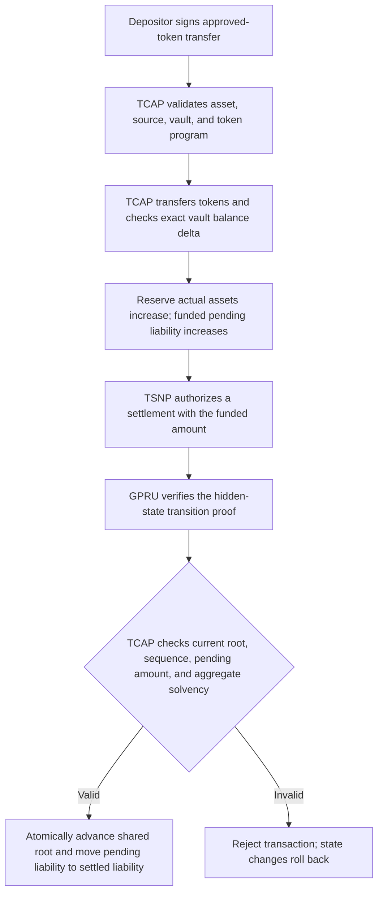

# How TCAP protects reserve funds

TCAP is the authority for accepted assets, reserve liquidity, and recognized liabilities. GPRU guards the integrity and privacy of the user's private state presented to TCAP for a balance-changing action. TSNP authorizes settlement work, and the Cranker submits the exact authorized transaction. These roles combine so a private-state proof cannot move funds by itself, and an authorized settlement cannot exceed TCAP's funded accounting limits.

This page explains the intended protection model and distinguishes it from capabilities that are not yet verified end to end. The protocol source and account layouts remain authoritative for implementation status.

## Protection path

The funding and private credit are distinct protocol actions. Funding places real tokens in the TCAP vault and creates a pending liability. A later credit can convert only an already funded amount from pending liability to settled confidential liability. If the credit proof or any TCAP condition fails, the credit and root update do not commit.

## What TCAP accounts for

For each accepted asset, TCAP's reserve state records the vault's actual token balance and liability categories. The aggregate liability calculation includes funded credits awaiting private settlement, settled confidential liabilities, pending private transfers, authorized withdrawals, and reserved refunds. On the proof-gated GPRU credit path, TCAP rejects the transition if recorded assets do not cover the recognized liability total or if arithmetic overflows.

The key funding rule is **pool-wide and asset-specific**: a credit amount must be no greater than funded pending liabilities for that asset. When accepted, TCAP subtracts that amount from pending liabilities and adds the same amount to settled confidential liabilities, preserving the aggregate obligation while the recipient's private state advances. It does not have to consume a deposit from the same epoch. This allows a valid settlement to complete across an epoch boundary while preserving the reserve-wide solvency limit. TSNP's operator epoch treasury is separate from TCAP's asset reserve; closing that treasury does not, by itself, reconcile TCAP's deposit pool.

The TCAP reserve is not a per-TIN balance ledger. The hidden-head design uses transaction Memo data for encrypted records and a protocol-wide TCAP commitment root for ordered state transitions. It does not require a TCAP balance PDA for each TIN.

## What GPRU proves and what TCAP decides

GPRU's role is to guard the user's private state as it is presented to TCAP. The intended Groth16 statement binds the current hidden head, the proposed successor, the balance action and amount, the relevant asset, the Memo commitment, and replay protection. A valid proof should establish that the new private state follows from the latest valid predecessor without exposing the TIN or its private history.

TCAP remains the fund regulator. It validates the approved asset, TSNP authorization, current shared-root sequence, funded liability capacity, and reserve solvency. It then updates the shared root and reserve liability counters in one atomic transaction. GPRU does not custody reserve tokens, and TCAP does not treat a prover's output as a substitute for its own authorization or accounting checks.

Aggregate accounting is a backstop, not a replacement for the proof. If a proof incorrectly allowed a user's hidden balance to be inflated while TCAP recorded only the funded transition amount, the reserve totals would not necessarily reveal that individual mismatch. The circuit and verifier must bind the exact action and amount to the valid predecessor and successor; TCAP must update the corresponding liability by that same amount. A proof that is mathematically valid for an incomplete statement is not sufficient protection.

## Failure handling

An invalid proof, stale root or sequence, unsupported asset, insufficient pending liability, arithmetic overflow, or failed solvency check must reject the transaction. Solana transaction atomicity rolls back account mutations from a failed instruction, so the root and reserve counters cannot be half-updated.

A failed transaction cannot also persist a halt flag in the same rolled-back state update. Monitoring can record the failed signature and alert operators. If an on-chain pause is required, an authorized follow-up instruction must pause the affected asset or protocol after the failure is observed. TCAP must not automatically rewrite or rebalance a user's hidden head; the evidence should be investigated and the state transition should remain rejected.

## Debit and exit gate

The same protections apply before a debit or exit can be enabled: GPRU must prove that the exact amount is affordable from the current hidden balance and that the successor state is valid; owner authorization must be checked where required; TCAP must check reserve solvency and update liabilities atomically with the state transition and payout. The current debit and exit paths remain fail-closed until their complete proof, authorization, accounting, and payout paths are connected and verified. A disabled path cannot be described as protected operationally merely because the circuit contains debit or exit constraints.

## Current implementation boundary

The checked-in TCAP GPRU credit instruction requires the amount to fit within funded pending liabilities, checks aggregate reserve solvency, invokes the GPRU verifier, then advances the shared root and transfers accounting from pending to settled liabilities. The token deposit instruction checks the reserve's recorded balance against the vault before transfer, checks the exact post-transfer delta, and increases actual assets and pending liabilities.

The source also contains the proof-shaped hidden-head circuit and verifier integration, but a complete Node witness/prover configuration, matching verifier setup, and end-to-end proof-backed settlement must be established before calling this full protection path operational. Debit and exit remain disabled. See [current architecture](./CURRENT-ARCHITECTURE.md), [TCAP balance transitions and GPRU proof boundary](./TCAP-V2-DEBIT-CREDIT-DESIGN.md), and [GPRU prover and key artifacts](./GROTH16-PROVER-AND-KEY-ARTIFACTS.md).

## Source references

- TCAP reserve liability fields and aggregate calculation: `tsn-protocol/programs/tcap-protocol/programs/tcap/src/state.rs`
- Token deposit and exact vault-delta checks: `tsn-protocol/programs/tcap-protocol/programs/tcap/src/instructions/deposit_asset_v2.rs`
- GPRU proof, funded pending-liability, solvency, and atomic root update: `tsn-protocol/programs/tcap-protocol/programs/tcap/src/instructions/credit_gpru_memo_v1.rs`
- TSNP authorization CPI: `tsn-protocol/programs/tsn/protocol/programs/trustlink-escrow/src/tsn/instructions/register_tcap_credit_authorization_v2.rs`
- Fail-closed debit and exit paths: `tsn-protocol/programs/tcap-protocol/programs/tcap/src/instructions/debit_tcap_balance_v1.rs` and `exit_tcap_liquidity_v1.rs`
