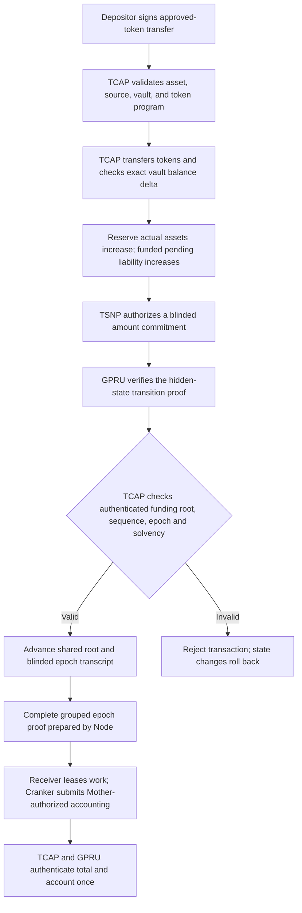

# How TCAP protects reserve funds

TCAP is the authority for accepted assets, reserve liquidity, and recognized liabilities. GPRU guards the integrity and privacy of the user's private state presented to TCAP for a balance-changing action. TSNP authorizes settlement work, and the Cranker submits the exact authorized transaction. These roles combine so a private-state proof cannot move funds by itself, and an authorized settlement cannot exceed TCAP's funded accounting limits.

This page explains the intended protection model and distinguishes it from capabilities that are not yet verified end to end. The protocol source and account layouts remain authoritative for implementation status.

## Protection path

Funding moves real tokens into the vault and creates funded pending obligations. Individual private credits prove exact funded-note amount/asset membership, consume their nullifiers and atomically advance head/root plus blinded epoch transcript, without tokens moving or liability counters being reclassified. Only a complete separate 2–64-credit epoch proof authenticates the aggregate amount for one pending-to-settled reclassification. Failure rolls back the affected transaction while earlier confirmed deposits remain backed.

## What TCAP accounts for

For each accepted asset, TCAP's reserve state records the vault's actual token balance and liability categories. The aggregate liability calculation includes funded credits awaiting private settlement, settled confidential liabilities, pending private transfers, authorized withdrawals, and reserved refunds. On the proof-gated GPRU credit path, TCAP rejects the transition if recorded assets do not cover the recognized liability total or if arithmetic overflows.

The funding contract combines exact note membership and asset-level backing. TCAP rejects insolvent credit preconditions; GPRU binds private amount to the observed deposit and valid recipient arithmetic. Aggregate epoch proof opens every ordered accepted amount commitment; only that total is subtracted from pending and added to settled confidential liabilities, preserving total obligations and uncredited funding. Native credit epoch is distinct from retained TSNP Epoch Treasury/payout APIs.

The TCAP reserve is not a per-TIN balance ledger. The hidden-head design uses transaction Memo data for encrypted records and a protocol-wide TCAP commitment root for ordered state transitions. It does not require a TCAP balance PDA for each TIN.

## What GPRU proves and what TCAP decides

GPRU's role is to guard the user's private state as it is presented to TCAP. The intended Groth16 statement binds the current hidden head, the proposed successor, the balance action and amount, the relevant asset, the Memo commitment, and replay protection. A valid proof should establish that the new private state follows from the latest valid predecessor without exposing the TIN or its private history.

TCAP remains the fund regulator. It validates the approved asset, TSNP authorization, current shared-root sequence, funded membership and reserve solvency. Individual accepted credit atomically updates the shared root and blinded epoch transcript while the reserve remains readonly. Separate aggregate proof verification authorizes liability reclassification. GPRU does not custody reserve tokens, and TCAP does not treat a prover's output as a substitute for its own authorization or accounting checks.

Reserve solvency alone cannot prove a recipient balance is correct. Credit proof binds funded note, amount commitment, asset, predecessor and successor arithmetic, while complete epoch proof binds the accounting total to every accepted commitment. Omitting either relation would permit a valid proof for an incomplete statement to pass the wrong obligation boundary. Owner recovery separately validates the encrypted amount opening against that commitment.

## Failure handling

An invalid proof, stale root or sequence, unsupported asset, insufficient pending liability, arithmetic overflow, or failed solvency check must reject the transaction. Solana transaction atomicity rolls back account mutations from a failed instruction, so the root and reserve counters cannot be half-updated.

A failed transaction cannot also persist a halt flag in the same rolled-back state update. Monitoring can record the failed signature and alert operators. If an on-chain pause is required, an authorized follow-up instruction must pause the affected asset or protocol after the failure is observed. TCAP must not automatically rewrite or rebalance a user's hidden head; the evidence should be investigated and the state transition should remain rejected.

## Debit and exit gate

The proof-backed balance-debit and liquidity-exit handlers remain fail-closed until their complete proof, authorization, accounting and payout contracts are connected and verified. The circuit's debit/exit arithmetic does not enable those handlers. Retained `debit_tcap_exit_v1` and `payout_tcap_exit_v1` are separate one-time-TIP/permit entrypoints without that unconditional proof gate; their source includes public liability changes and vault payout. Their live reachability and protection properties require separate review, so the entire TCAP library must not be described as uniformly disabled.

Generalizing the current credit batch to debits or transfers is a [proposed contract](laboratory/decisions/ADR-005-private-amount-and-adaptive-pools.md#proposed-mixed-action-accounting). An internal debit/credit pair must conserve total obligations, while withdrawals, fees and refunds require correct category deltas and payout binding. No mixed-action accounting capability follows from the existence of debit instruction names.

## Current implementation boundary

The experimental replacement checks authenticated current/retained funding membership, asset policy, current root/epoch and reserve solvency, then invokes GPRU before atomically updating shared root/transcript. Deposit verifies vault balance/delta and increases assets/pending obligations. Separate epoch accounting invokes its five-input GPRU verifier before aggregate reclassification and replay marking. [The November 16 checkpoint](laboratory/experiments/EXP-20261116-private-credit-epoch.md) verifies two finalized private credits and their completed aggregate accounting; varied-amount multiwallet privacy, complete owner recovery and mixed-action accounting remain unverified.

The confirmed reference flow establishes its required proof acceptance and accounting for that scoped run. It does not establish complete privacy, every retained debit/exit path, or clean independent-network operation. See [current architecture](./CURRENT-ARCHITECTURE.md), [TCAP balance transitions and GPRU proof boundary](./TCAP-V2-DEBIT-CREDIT-DESIGN.md), and [GPRU prover and key artifacts](./GROTH16-PROVER-AND-KEY-ARTIFACTS.md).

## Source references

- TCAP reserve liability fields and aggregate calculation: `tsn-protocol/programs/tcap-protocol/programs/tcap/src/state.rs`
- Token deposit and exact vault-delta checks: `tsn-protocol/programs/tcap-protocol/programs/tcap/src/instructions/deposit_asset_v2.rs`
- GPRU proof, funded pending-liability, solvency, and atomic root update: `tsn-protocol/programs/tcap-protocol/programs/tcap/src/instructions/credit_gpru_memo_v1.rs`
- TSNP authorization CPI: `tsn-protocol/programs/tsn/protocol/programs/trustlink-escrow/src/tsn/instructions/register_tcap_credit_authorization_v2.rs`
- Fail-closed debit and exit paths: `tsn-protocol/programs/tcap-protocol/programs/tcap/src/instructions/debit_tcap_balance_v1.rs` and `exit_tcap_liquidity_v1.rs`
