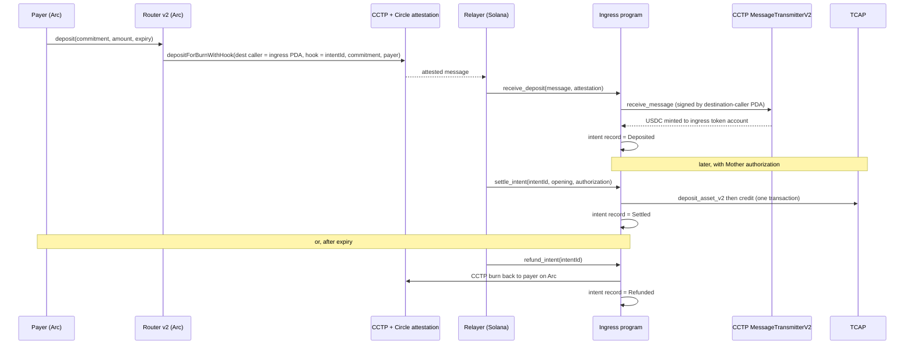

# DIP Ingress: Circle CCTP deposits into TCAP within TSN

## 1. Metadata

- Status: Draft (design only, no code written)
- Target chains: Arc (EVM, Solidity, router v2) and Solana (Rust program, **specified here, not implemented in Arc Studio**)
- Systems touched: TSNArcDepositRouter (Arc), CCTP V2, TCAP `deposit_asset_v2`, TSN Node
- Review tracker: [ ] Design  [ ] Security  [ ] Ops  [ ] Compliance

This document is the deliverable for the Solana side. Arc Studio builds the Arc half only. The Solana program is written and deployed by the TSN infrastructure team against this spec.

## 2. Action items (living)

- Confirm the unverified items in section 14 before implementation.
- Codex to confirm the TCAP credit path can be called in the same transaction as `deposit_asset_v2` (section 10, `settle_intent`).
- Codex to confirm whether the existing TIN registry lookup lets a payer verify a route-key commitment at resolve time (section 10, step 3 of settlement).

## 3. Goals and non-goals

Goals
- **No loss of user funds** across the Arc to Solana path. Section 19 defines this precisely and lists the controls that enforce it.
- A CCTP-minted USDC deposit is bound to its intent by Circle-attested data, and recorded on-chain before anything is credited.
- The TCAP vault never receives USDC outside `deposit_asset_v2`, so `actual_assets` always equals the vault balance.
- The program, not the Node, decides that a deposit exists, that it is credited at most once, and that it cannot be redirected to a different route.
- Every unsettled deposit has an automatic way back to the payer.

Non-goals
- Hiding the payer, amount or timing on Arc.
- Which recipient a TIN maps to. The Node still holds the TIN-to-route mapping.
- Refunds on Arc itself. A burn is final on the Arc side; the way back is a CCTP burn from Solana.
- Epoch batching and equal-denomination deposits (roadmap).

## 4. Requirements

Functional
- F1. The Arc router burns USDC with `depositForBurnWithHook`, a fixed `destinationCaller`, and 96 bytes of hook data: `intentId (32) || routeCommitment (32) || payer (32, left-padded)`.
- F2. The Solana ingress program completes the CCTP receive and records the intent in one transaction (`receive_deposit`). It does not touch TCAP at that point.
- F3. Settlement (`settle_intent`) deposits into TCAP and credits the recipient in one transaction, only for a Deposited intent, only with a valid commitment opening and Mother authorization.
- F4. An unsettled intent past its window is refunded to the recorded payer through a CCTP burn (`refund_intent`), callable by anyone.
- F5. Each intent ends in exactly one terminal state: Settled or Refunded.

Security (each is a testable assertion)
- S1. No path mints CCTP USDC into a TCAP vault.
- S2. The recorded amount equals the ingress token account balance delta in the same transaction.
- S3. A message whose remote sender is not the registered Arc router is rejected.
- S4. A message whose mint recipient is not the ingress token account is rejected.
- S5. The same `intentId` or CCTP nonce cannot be processed twice.
- S6. If any step of `receive_deposit`, `settle_intent` or `refund_intent` fails, the whole transaction reverts.
- S7. No key can move funds out of the ingress token account. Only the program can sign for its authority.
- S8. A credit cannot exceed the recorded amount, and cannot happen without a Deposited record.
- S9. Settlement fails unless the opening recomputes the recorded `routeCommitment`.
- S10. `refund_intent` can only pay the recorded payer, and only while the intent is Deposited and expired.
- S11. Pause never blocks `refund_intent`.
- S12. The ingress token account balance is always at least the sum of recorded amounts for Deposited intents.

## 5. Terminology and actors

- Ingress authority: a program-derived address (PDA), no private key. Owns the ingress token account and signs TCAP deposits and refund burns.
- Ingress token account: the associated token account of the ingress authority for Circle USDC. This is the CCTP mint recipient.
- Hook data: bytes attached to the CCTP burn message and covered by Circle's attestation.
- Intent record: a PDA created on first successful processing, seeded by `intentId`.
- Opening: the pair (route key commitment, nonce) whose hash is the Arc `routeCommitment`.

| Actor | On/off-chain | Trust | Can do |
| --- | --- | --- | --- |
| Payer | Arc | Untrusted | Calls `deposit` on the router |
| Arc router | Arc | Trusted contract | Burns with hook data and fixed destination caller |
| Circle attestation | Off-chain | Trusted | Signs the burn message |
| Relayer (anyone) | Solana | Untrusted | Submits receive, settle or refund transactions |
| Ingress program | Solana | Trusted code | Receives, records, settles, refunds |
| TCAP program | Solana | Trusted | Accounts the deposit and credit |
| Config admin | Solana | Semi-trusted | Registers the router address, pauses |
| TSN Node / Mother authority | Off-chain | Semi-trusted | Maps commitment to route; authorizes a settlement. Cannot create deposits, exceed an amount, double-settle, or change the committed route |

## 6. Language and runtime

- Arc: Solidity 0.8.28, OpenZeppelin 5.x, Foundry. Router v2 is a new deployment, not an upgrade.
- Solana: Rust program (Anchor or native, team choice). Classic SPL Token program for USDC. Token-2022 mints are rejected. The program is **upgradeable** under a multisig with a timelock, so its address (and therefore the destination-caller PDA) never changes. See section 19.

## 7. Transaction and execution model

Each Solana instruction is atomic. All cross-program calls in it (CCTP receive, TCAP deposit and credit, CCTP burn for refunds) commit or revert together.

On Arc, `deposit` follows checks, effects, then interactions, with a reentrancy guard, as in router v1.

## 8. Architecture

Flow of funds

| Step | Who moves what | Invariant |
| --- | --- | --- |
| 1 | Payer to router | Router balance is 0 after the transaction |
| 2 | Router burns USDC | Allowance to messenger returns to 0 |
| 3 | CCTP mints to ingress token account | Balance delta equals attested amount minus fee; recorded as Deposited |
| 4a | Settle: ingress deposits recorded amount into TCAP vault, then credits | Vault balance equals `actual_assets`; record becomes Settled |
| 4b | Refund: ingress burns recorded amount to the payer | Record becomes Refunded; no TCAP effect |

Resting state: the ingress token account holds exactly the sum of Deposited amounts (S12).

## 9. Arc router v2 (what changes from v1)

Router v1 stays deployed on Arc Testnet and is not modified. Router v2 is a new contract.

| Item | v1 | v2 |
| --- | --- | --- |
| Burn call | `depositForBurn(..., destinationCaller = 0, ...)` | `depositForBurnWithHook(..., destinationCaller, ..., hookData)` |
| Destination caller | none | `destinationCaller` (bytes32): the ingress program's destination-caller PDA |
| Hook data | none | 96 bytes: `intentId \|\| routeCommitment \|\| payer` (payer as 32-byte left-padded address) |
| Mint recipient | placeholder | ingress token account (32-byte public key) |
| Config changes | recipient timelock | recipient AND destination caller changes both use the 2-day timelock |

Unchanged: intent id derivation, `IntentDeposited` event, pause, two-step ownership, renounce disabled, no allowlist, 6-decimal USDC amounts.

Function changes
- `deposit(routeCommitment, amount, expiry)`: builds `hookData = abi.encodePacked(intentId, routeCommitment, bytes32(uint256(uint160(msg.sender))))` and calls `depositForBurnWithHook` with the stored `destinationCaller`. Reverts if `destinationCaller` is zero, because a zero caller would let anyone complete the mint outside the ingress program.
- `proposeDestinationCaller / applyDestinationCaller / cancelDestinationCaller`: owner only, 2-day delay, same pattern as the recipient change.
- Constructor adds `destinationCaller_` (nonzero).
- Pilot safety controls (see section 19): router starts with deposits disabled; `setDepositsEnabled(bool)` is owner only and is switched on only after a canary deposit completes on Solana. `maxDepositAmount` (owner set, default small) rejects larger deposits. Both are checked inside `deposit`.

Event: `IntentDeposited` unchanged. Add the hook layout to NatSpec so indexers can reproduce it.

## 10. Solana ingress program

### Accounts

| Account | Seeds / address | Purpose |
| --- | --- | --- |
| Config | `["dip_config"]` | Admin, paused flag, registered Arc router (32 bytes), USDC mint, CCTP and TCAP program ids |
| Ingress authority | `["dip_authority"]` | PDA that owns the ingress token account and signs TCAP deposits |
| Destination-caller PDA | `["dip_caller"]` | The address Arc names as `destinationCaller`; signs the CCTP receive call |
| Ingress token account | ATA(ingress authority, USDC mint) | CCTP mint recipient |
| Intent record | `["dip_intent", intentId]` | One per intent: status (Deposited, Settled, Refunded), commitment, payer (Arc address), minted amount, expiry, slot |

Program ids for CCTP and TCAP are stored in Config at initialization and checked on every call. They are never taken from the caller's accounts.

### Instructions

| Instruction | Caller | Effect |
| --- | --- | --- |
| `initialize(admin, router, usdc_mint, programs...)` | Deployer, once | Creates Config, authority, ingress token account |
| `receive_deposit(message, attestation)` | Anyone | Completes the CCTP mint into the ingress token account and records the intent as Deposited. Does not touch TCAP. |
| `settle_intent(intentId, opening, mother_authorization)` | Anyone holding a valid Mother authorization | In one transaction: checks the commitment opening, calls `deposit_asset_v2` for the intent's amount, credits the recipient, marks the intent Settled |
| `refund_intent(intentId)` | Anyone, after expiry | If the intent is still Deposited and past `expiry + grace`, burns the amount through CCTP back to the recorded payer on Arc and marks it Refunded |
| `set_router / accept_router`, `set_paused`, `transfer_admin / accept_admin` | Admin, two-step | Config changes. Pause blocks `receive_deposit` and `settle_intent`, never `refund_intent` |

Terminal states are exclusive: an intent ends as Settled or Refunded, never both, and never twice.

### `receive_deposit` sequence

1. Reject if paused.
2. Parse the CCTP message. Check: source domain is Arc (26), burn message `messageSender` equals Config.router, `mintRecipient` equals the ingress token account, `destinationCaller` equals the destination-caller PDA, hook data length is exactly 96.
3. Read `intentId`, `routeCommitment` and `payer` from hook data. If the intent record exists, fail.
4. Record the ingress token account balance as `before`.
5. Call CCTP `receive_message(message, attestation)`, signing as the destination-caller PDA.
6. `delta = after - before`; require `delta > 0`.
7. Create the intent record: status Deposited, commitment, payer, `delta`, expiry (from the Arc event, carried via the Node-free rule below), slot. Emit an event.
8. Any failure reverts the whole transaction including the CCTP receive.

Expiry source: the hook data does not carry the expiry. The program uses `slot_received + MAX_INTENT_WINDOW` (7 days plus grace, matching the Arc router limit). It never trusts a caller-supplied expiry.

### `settle_intent` sequence

1. Load the intent record; require status Deposited and not expired.
2. Require a Mother authorization that names this `intentId` and the recipient route, verified the way the existing TSN credit caller verifies it.
3. Recompute `sha256("TSN_DIP_ROUTE_V1" || gpruElgamalKeyCommitment || nonce)` from the opening and require it equals the recorded `routeCommitment`. This stops the Node redirecting the deposit to a different recipient than the payer's resolve produced.
4. Call TCAP `deposit_asset_v2` for exactly the recorded amount, with the ingress authority as depositor. The vault and `actual_assets` move together.
5. Call the TCAP credit instruction for that amount and route.
6. Mark Settled. Any failure reverts all steps.

### `refund_intent` sequence

1. Require status Deposited and `now > expiry + grace`.
2. Call CCTP `deposit_for_burn` from the ingress token account for the recorded amount, destination domain Arc, mint recipient the recorded payer, destination caller zero (anyone can complete the Arc mint).
3. Mark Refunded in the same transaction. If the burn fails, the status stays Deposited.

Because TCAP is only touched at settlement, a refund never needs a TCAP withdrawal instruction.

### CCTP burn message layout (to confirm against Circle's reference)

Header: version, source domain, destination domain, nonce, sender, recipient, destination caller, finality threshold fields. Body: version, burn token, mint recipient, amount, message sender, max fee, fee executed, expiration block, hook data. The implementer must take exact offsets from Circle's published V2 message format and not from this summary.

## 11. Security considerations

| Vulnerability | Applicable | Mitigation |
| --- | --- | --- |
| Missing signer check | Yes | Admin instructions require the stored admin signer; `receive_deposit`, `settle_intent` (beyond its authorization) and `refund_intent` have no trusted caller by design |
| Missing owner check | Yes | Verify owners of Config, token accounts, mint and TCAP accounts |
| Arbitrary CPI / program substitution | Yes | CCTP and TCAP program ids read from Config and compared before every CPI |
| PDA seed spoofing / non-canonical bump | Yes | Derive PDAs on-chain with canonical bumps; reject supplied bumps |
| Account substitution (wrong vault, wrong mint) | Yes | Check mint equals Config.usdc_mint and token program is classic SPL Token; check the vault belongs to the registered TCAP asset entry |
| Reinitialization | Yes | Intent record creation fails if it exists; `initialize` runs once |
| Replay | Yes | CCTP used-nonce account plus intent record keyed by `intentId` |
| Fee or balance-delta mismatch | Yes | Use measured delta (S2) |
| Token-2022 extensions (transfer fee, hooks) | Yes | Reject non-classic token program |
| Remaining-account injection | Yes | Fixed account order; no unchecked remaining accounts passed to CPIs |
| Front-running the relayer | Yes | Harmless: any relayer produces the same result; no value extraction |
| Admin key compromise | Yes | Admin can pause or repoint the router only; cannot move funds (S7) |
| Centralization | Yes | Two-step admin, recommended multisig |

## 12. Trust model and threat analysis

| Actor | Worst case if compromised | Mitigation | Detection |
| --- | --- | --- | --- |
| Arc router owner | Repoints destination caller or mint recipient so new burns cannot complete | 2-day timelock on both; deposits cap; canary gate; Solana only accepts messages whose `messageSender` is the registered router | Alert on every `*Proposed` event |
| Solana config admin | Registers a malicious router address | Two-step change; pause available; multisig | Alert on router change |
| Mother authority / Node | Authorizes a settlement for the wrong recipient route | Cannot: S9 binds the route to the payer-resolved commitment. Can only delay a settlement, which then refunds | Audit log of authorizations versus intent records |
| Program upgrade authority | Ships a malicious upgrade that drains the ingress account | Multisig plus timelock; announce upgrades; do not burn the authority until audited | Alert on any upgrade proposal |
| Ingress program bug | Burns that cannot complete, or a wrong credit | Audit before mainnet; atomic instructions revert instead of mis-crediting; upgradeable so a stuck burn can be completed later | Reconcile Arc events versus intent records and ingress balance (S12) |
| Circle | Freezes the ingress token account, or fails to attest | Outside our control; documented residual risk | Alert on failed receive for an attested message |

## 13. Failure scenarios

- TCAP asset not approved, paused, or vault missing: `settle_intent` reverts. The deposit stays Deposited and safe in the ingress account. Settlement retries after the fix, or the intent refunds after expiry.
- Relayer never submits `receive_deposit`: the burn is attested but not received. Anyone can submit. No loss, only delay. If the attestation passed its 24-hour `expirationBlock`, request a fresh one (Circle documents no deadline for re-attestation while the burn exists).
- Ingress program unavailable or buggy: burns with the restricted destination caller cannot complete until the program is upgraded. Funds are not lost. The program address stays the same across upgrades, so the destination-caller PDA still matches.
- Ingress token account does not exist or is frozen: the mint fails. The account is created at `initialize` and never closed. A Circle freeze is outside our control (section 19).
- Fee deducted by Circle: the recorded amount is the observed delta, and everything downstream (settle, refund) uses it.
- Hook data malformed: length check fails and the transaction reverts before any receive call.
- Duplicate message or intent: nonce or intent record already exists, transaction fails.
- Router paused on Arc: blocks new deposits only. Already attested burns still complete on Solana.
- Node never authorizes a settlement: the intent expires and `refund_intent` returns the USDC to the payer on Arc.
- Payer address cannot receive USDC on Arc (blocklisted): the refund mint cannot complete on Arc. The USDC stays in the pending CCTP message until the block is lifted. Residual risk, documented.

## 14. Unverified items (must be confirmed before building)

1. A PDA can sign as the CCTP destination caller through a call from another program. This is the standard Solana pattern, but Circle's documentation I read does not show it.
2. **Circle's V2 interface documents no way for the original sender to change the destination caller or mint recipient after a burn.** Assume none exists. That is why the program must be upgradeable and its address permanent (section 19).
3. Exact byte offsets of the CCTP V2 burn message and how `feeExecuted` interacts with the minted amount on Solana.
4. Which TCAP asset entry and vault apply to Circle USDC on Devnet, and who approves it. Circle's Solana Devnet USDC mint is `4zMMC9srt5Ri5X14GAgXhaHii3GnPAEERYPJgZJDncDU`. The repo labels it a test fixture, which is wrong.
5. Whether `deposit_asset_v2` accepts a program-derived depositor signing through a call from another program.
6. Whether the TCAP credit instruction can run in the same transaction as `deposit_asset_v2`, and how the Mother authorization is verified inside a call from another program.
7. Whether the TIN registry lets a payer verify a route-key commitment at resolve time (for the opening check).
8. Whether `deposit_for_burn` on Solana can be called by a program-derived authority for refunds, and what Solana CCTP requires for the Arc recipient field.

## 15. Priorities and tradeoffs

| Decision | Tradeoff | Rejected alternative |
| --- | --- | --- |
| Separate ingress token account, TCAP only at settlement | Two Solana steps instead of one | Mint into the TCAP vault: breaks `deposit_asset_v2` (verified: next deposit fails at `actual_assets == vault_before`, and no sweep instruction exists) |
| Restrict destination caller to the ingress PDA | Burns depend on one program; no documented way to re-point | Open caller: anyone could complete the mint without the program recording the intent, so the binding to the intent is lost |
| Upgradeable program under multisig and timelock | Upgrade authority is a trust point | Immutable program: a bug would strand every pending burn permanently |
| Refund path through CCTP burn back to Arc | Needs payer address in hook data and a working Solana burn | Hold unsettled funds forever, or depend on a TCAP withdrawal that does not exist |
| Record on receive, deposit and credit on settle | Funds sit in ingress for a while | Deposit into TCAP at receipt: would need a TCAP withdrawal to refund |
| Commitment is a hash of route key commitment plus nonce, opened at settlement | Payer must be given the opening | Stable per-TIN commitment: links all deposits; or opaque random value: the Node could redirect |
| Credit the observed delta | Credited amount can be below the Arc amount | Credit the attested amount: could overstate reserves |

## 16. Testing strategy

Arc router v2 (Foundry): all v1 tests, plus hook data bytes (including payer), nonzero destination caller, timelocked destination caller change, deposit cap, deposits disabled by default, and a mock messenger that records every argument of `depositForBurnWithHook`. Run `forge test`.

Solana ingress program: unit tests for message parsing and every rejection in the three instructions; invariant tests for S12 and for exclusive terminal states; localnet integration with CCTP and TCAP fixtures; one Devnet end to end with a canary deposit, then a settle, and a separate refund run. Static analysis for Solana. Coverage target: every instruction and every rejection branch.

End to end gate: Arc Testnet burn, Circle sandbox attestation, `receive_deposit`, `settle_intent`, TCAP `actual_assets` equals vault balance, recipient credit visible. Repeat for the refund path ending in a mint on Arc to the payer.

## 17. Rollout order

1. Confirm the unverified items in section 14.
2. Register and approve Circle Devnet USDC as a TCAP asset; create its vault. (TSN governance step.)
3. Implement, test and deploy the ingress program to Devnet under a multisig upgrade authority; initialize Config and the ingress token account.
4. Derive the ingress token account and the destination-caller PDA; convert both to 32 bytes.
5. Deploy router v2 to Arc Testnet with those values, deposits disabled, a low `maxDepositAmount`.
6. Canary: enable deposits, send 0.10 USDC, confirm `receive_deposit`, settle, and a refund run. Only then raise the cap.
7. Mainnet only after an independent audit of both sides and a repeat of step 6 on mainnet with 0.10 USDC.

## 18. Stakeholders

- TSN infrastructure team: DIP ingress, TCAP asset registration, Node mapping and credit.
- Arc app owner: router v2, app changes, deployment.
- Security reviewer: both sides before mainnet.

## 19. Funds-safety design: no burn without a way to a final state

### The guarantee, stated precisely

CCTP burns on the source chain and mints on the destination, so there is a window where USDC exists only as an attested message. "Never loses funds" is therefore defined as a conservation rule, not a promise about speed:

> For every USDC burned by the Arc router, exactly one of these holds at all times: (a) a CCTP message that can still be completed on Solana, (b) USDC held in the ingress token account against a Deposited intent, (c) USDC settled into TCAP and credited, (d) USDC burned back toward the payer on Arc. No state exists where the USDC is destroyed with no path to (a) through (d).

Delay is allowed. Loss is not. The design enforces this at four points.

### Point 1: before the burn (Arc side, where loss can actually happen)

A burn aimed at a wrong or non-existent destination is the one case CCTP cannot undo. Controls:

| Control | What it prevents |
| --- | --- |
| Mint recipient and destination caller both set at deploy and changed only through a 2-day timelock | An instant redirect by a compromised owner |
| Deposits disabled at deploy; owner enables only after a canary deposit completes | A mis-set recipient or caller burning real funds |
| `maxDepositAmount` per deposit during the pilot | Blast radius of an undiscovered configuration error |
| Deploy-time assertion that derives the ingress token account and the destination-caller PDA from the program id and USDC mint, and fails the deploy on mismatch | Pasting a wrong address |
| App preflight that confirms the ingress token account exists on Solana before enabling the Deposit button | Burning toward an account that does not exist (Circle lists this as a Solana mint failure) |
| Destination caller is never zero | Anyone completing the mint outside the program, losing the intent binding |

### Point 2: while the message is pending

- Minting is idempotent and permissionless. Anyone can submit `receive_deposit`; a failed attempt consumes nothing.
- An attestation older than its 24-hour `expirationBlock` is refreshed through Circle's re-attest endpoint, with no deadline while the burn exists.
- The destination caller is the ingress program's PDA. Because the program is **upgradeable under a multisig with a timelock**, its address never changes, so the PDA stays valid and a program bug can be fixed without orphaning any pending burn. Do not freeze the upgrade authority until after the audit and a period of production use.
- Reconciliation job: list Arc `IntentDeposited` events older than N minutes with no matching intent record on Solana; alert and run the relayer.

### Point 3: once minted

- Funds sit in the ingress token account, owned by a keyless PDA. No key can move them (S7).
- Each Deposited intent has a recorded amount, payer, and expiry. The ingress balance must cover the sum of those amounts (S12). An on-chain check in each instruction and an off-chain monitor both assert it.
- Settlement is atomic: TCAP deposit and credit commit together or not at all (S6, S8).
- Exactly one terminal state per intent (F5). Settle and refund both require status Deposited and flip it in the same transaction.

### Point 4: the way home

- `refund_intent` is permissionless after expiry. It pays only the recorded payer (S10) and is never blocked by pause (S11).
- The payer address is carried in the Circle-attested hook data, so the refund destination cannot be altered by the Node or a relayer.
- The refund is itself a CCTP burn, so it inherits the same properties: idempotent, permissionless to complete, re-attestable.

### Residual risks that remain (stated, not hidden)

| Risk | Why it remains | Mitigation |
| --- | --- | --- |
| Circle freezes or blocklists the ingress token account or the payer | Issuer control over USDC | Disclosure; use an account that is not exposed to flagged counterparties |
| Upgrade authority compromised | An upgradeable program has an upgrader | Multisig, timelock, public upgrade alerts, audit before mainnet |
| Program bug in the first release | Rust code is new | Canary and cap on the pilot, audit, upgradeable fix path |
| No documented way to re-point an existing burn (section 14, item 2) | Circle's V2 interface lists none | Permanent program address plus upgradeability |
| Payer is a contract that cannot receive on Arc | Out of our control | Refund goes to the recorded payer address; document |

### Invariant checks to implement as tests

1. After any sequence of receive, settle and refund calls: ingress balance = sum of Deposited amounts.
2. No intent is both Settled and Refunded; no intent changes state after a terminal state.
3. Total credited + total refunded + total still Deposited = total minted into ingress.
4. For every Arc `IntentDeposited` there is at most one Solana intent record and at most one terminal event.
5. A router configured with a zero destination caller cannot deposit.
