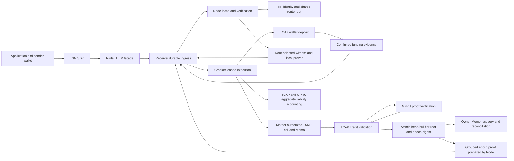
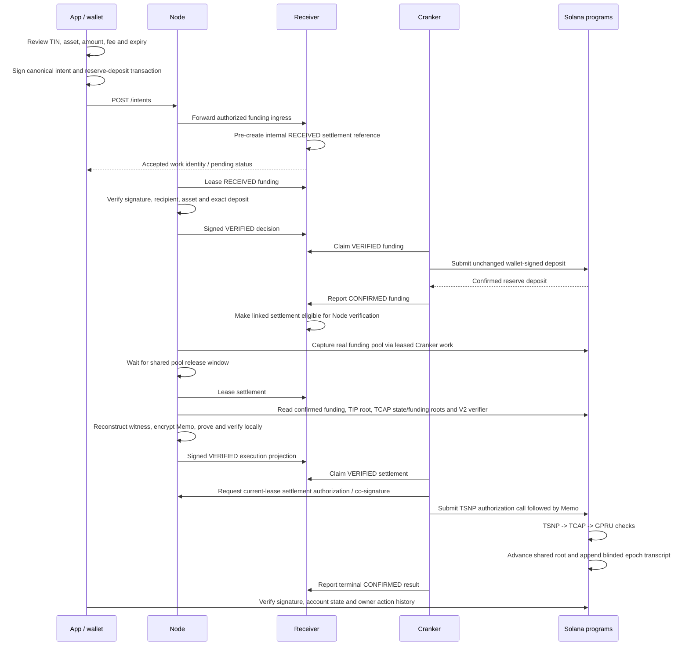

# Canonical implementation map

**Status: EXPERIMENTAL private-credit replacement, reviewed 2026-11-07.** This map follows the current source contract in [ADR-005](decisions/ADR-005-private-amount-and-adaptive-pools.md) and [credit ABI](credit-abi.md). The [November 7 validation](experiments/EXP-20261107-private-credit-epoch.md) separates offline proof/build checks from unverified SBF, activation and complete live settlement. November 2–5 receipts remain evidence for their historical amount-public ABIs.

## Repository boundaries

The workspace root is `trust-link`. Independent `.git` boundaries exist at the root, `tsn-protocol`, `research/Trustlink-Research`, and `pitch-deck`. No separate `.git` boundary was found inside `tsn-protocol/tsn-docs` or the individual service directories during this inspection. Some paths are represented in overlapping parent checkouts; inspect the owning checkout before making a Git operation. Package repository metadata and `.gitmodules` are declarations, not proof of a present independent checkout.

The root `.gitmodules` lists Node, mempool UI and epoch-record paths, while package metadata refers to other service repositories. The [docs pull script](../../scripts/pull-tsn-docs.mjs) requires a clean standalone docs checkout and refuses an existing non-standalone directory. It must not be used to refresh this populated documentation tree. The root has no `.github` directory; the inspected protocol checkout contains [a Mintlify trigger workflow](../../tsn-protocol/.github/workflows/trigger-docs.yml), not a documentation correctness pipeline.

## Components and control flow

The Node's HTTP facade accepts application intents and forwards them to Receiver. Receiver owns durable coordination, not private balance authority. Node independently resolves the recipient route and verifies funding. Cranker validates Node's signed execution projection and submits the permitted transaction. Mother authority co-signs the inspected settlement; TCAP calls GPRU as part of its own validation. GPRU does not receive custody of reserve tokens.

## Native credit sequence

The sequence is a source description. The Node cannot prepare a usable settlement without pinned proving artifacts, root-matching witness snapshots and a matching initialized verifier. Receiver pre-creates a settlement reference at funding ingress, but leasing its verification requires confirmed funding. That confirmation does not itself confer settlement authorization.

Node's authorization response binds the exact verified transition to Receiver's current lease ID/version/expiry and includes Cranker's required kind. The earlier incomplete envelope was corrected and tested locally. Node automatically reconstructs missing TIP membership snapshots from confirmed, indexed creation history before proving. Missing TCAP state snapshots or unavailable TIP history still stop preparation; a guarded authenticated retry can requeue an unsubmitted settlement rejected for missing snapshots or the exact repaired TCAP asset-preflight reason while preserving confirmed funding and requiring fresh Node verification. The diagram describes the source contract; the November 5 finalized reference receipt verifies one credit, with owner recovery still a separate check.

## State and public boundaries

Receiver work uses `RECEIVED`, `NODE_VERIFYING`, `VERIFIED`, `REJECTED`, `CRANKER_LEASED`, `SUBMITTED`, `CONFIRMED`, and `FAILED`. Its `stateVersion`, actor checks and leases control coordination. SDK intent statuses are a separate vocabulary (`pending`, `executed`, `settled`, failure variants); an application must not equate the two sets of strings.

TIP maintains commitment-addressed private identity records, owner recovery accounts and an append-only shared route root. TCAP maintains an asset registry, reserve state, accepted assets, a shared state root and a distinct global funded-note root. A successful `deposit_private_funding_v1` appends a leaf bound to its registered token and observed amount. Hidden-head credit proves that leaf's membership and a deterministic private-secret nullifier before changing the shared state root. GPRU's V2 verifier stores circuit/key commitments and fourteen IC points for thirteen public inputs; the funding root is appended last.

The [private-credit ABI](credit-abi.md) has one current runtime and separate historical receipt readers. Individual credits use immutable sealed funding roots, so later deposits do not invalidate them. Admission rechecks at least two positive unspent member notes from two wallets at capture; Mother attests those counts. Shared-root or epoch races before signing cause fresh verification; signed attempts require exact receipt reconciliation. Signature-only old deposits lack funded membership and require separate handling.

The credit exposes token, blinded amount commitment, roots, nullifier, successor points and encrypted Memo. Its actual amount is private, and its readonly reserve has no per-credit liability mutation. Separate proof-verified accounting publishes a complete 2–64-credit epoch total; sparse or known-amount pools can still permit inference. Wallet deposits and endpoints remain observable, Node knows openings/routes, and recipient-registry/head correlation requires separate review.

## Distinct instruction families

The TSNP library still exposes epoch-treasury funding, `AcceptedIntent`, Settlement DNA, private payout and refund instructions. They have distinct accounts and authorization requirements. They are not stages of the inspected TCAP hidden-head credit sequence. TCAP still exposes one-time-tip, debit, exit, governance and migration entrypoints; their presence does not establish current runtime reachability or production readiness.

DIP and cross-chain services occupy separate ingress, route and destination-execution boundaries. Circle CCTP is an external integration. A configured destination route, compiled adapter or published research paper does not prove a completed source-to-destination settlement.

## Evidence links

- [Receiver work contract](../../tsn-protocol/services/tsn-receiver/lib/work-contract.ts) and [store transitions](../../tsn-protocol/services/tsn-receiver/lib/store.ts).
- [Node verification and settlement functions](../../tsn-protocol/services/tsn-node/server.py), [witness store](../../tsn-protocol/services/tsn-node/hidden_head_witness.py), and [prover adapter](../../tsn-protocol/services/tsn-node/hidden_head_prover.py).
- [Cranker execution](../../tsn-protocol/services/tsn-cranker-op-daemon/scripts/cranker.ts).
- [TSNP library](../../tsn-protocol/programs/tsn/protocol/programs/trustlink-escrow/src/lib.rs), [TCAP library](../../tsn-protocol/programs/tcap-protocol/programs/tcap/src/lib.rs), and [GPRU verifier](../../tsn-protocol/programs/gpru/src/hidden_head.rs).
- [Existing TIN issuance flow](../protocol-flows/tin-creation/README.md) and [component records](components.md).
