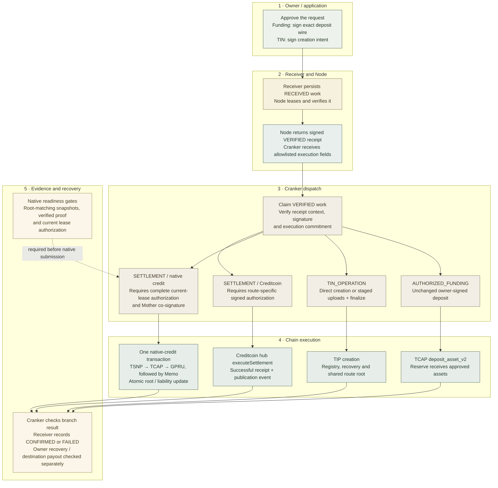

# Cranker transaction submission map

**Status: CURRENT source map, reviewed 2026-11-02; live evidence covers TIN creation and the confirmed reserve deposit below.** This guide maps every submission branch in the current [Cranker daemon](../../tsn-protocol/services/tsn-cranker-op-daemon/scripts/cranker.ts). The [successful staged TIN record](experiments/EXP-20261102-tin-staged-finalization.md) explains the user's six finalized Devnet transactions individually. Native settlement and Creditcoin execution remain unverified; the authorization-envelope correction has local test evidence.

## Work, transaction and instruction boundaries

A Receiver work item is a durable service task. A transaction is a signed message submitted to a chain and identified by a signature or transaction hash. Instructions execute inside that transaction; a cross-program invocation (CPI) lets one Solana program call another without creating a new transaction. One TIN work item can therefore produce several upload transactions, while one native-credit transaction can execute TSNP, TCAP, GPRU and Memo instructions atomically.

Receiver persists work and controls versioned leases. Node verifies the request and signs an execution receipt. Cranker claims verified work, validates that receipt against its pinned Node public key, submits the permitted chain message and reports its result. Mother authority is a separate settlement transaction signer. An HTTP acceptance, Node decision, lease or `tx sent` message establishes its own boundary; successful chain execution and the expected account state need separate evidence.



The settlement arrows describe the implemented submitter branches and their required inputs. Local envelope tests and successful funding do not establish target-cluster acceptance of native settlement.

## Dispatcher coverage

`main()` requests `AUTHORIZED_FUNDING`, `TIN_OPERATION` and `SETTLEMENT`, runs `verifyNodeAttestation()` before processing, and dispatches as follows. Transaction counts exclude setup/deployment and retries.

| Receiver work / branch | Normal chain transactions | Transaction signer and fee payer | Submission path | Result evidence |
| --- | --- | --- | --- | --- |
| `AUTHORIZED_FUNDING` | One owner-approved TCAP deposit | Signers and payer already fixed in the wallet-signed wire; the current SDK sets the depositor as payer | Web3 legacy `sendRawTransaction`, byte-for-byte unchanged | `TCAP_DEPOSIT_ASSET_V2_CONFIRMED` and deposit signature |
| `TIN_OPERATION`, direct | One creation transaction | Cranker signs and pays; owner approval is an Ed25519 instruction | Web3 legacy transaction, complete size at most 1,232 bytes | `TIN_V1_REGISTRY_CREATED` and final signature |
| `TIN_OPERATION`, staged | Initializer + bounded uploads + finalizer | Cranker signs and pays each transaction; owner approval is checked at finalization | Separate Web3 legacy transactions, each at most 1,232 bytes | Final signature, stage address and all staging signatures |
| `SETTLEMENT`, native | One TSNP credit call followed by its Memo | Cranker is fee payer; Mother authority also signs the exact message | Installed DBrix `sendInstructionsV1` transport | `TCAP_GPRU_MEMO_CREDIT_V1_CONFIRMED`, signature and root sequence |
| `SETTLEMENT`, Creditcoin | One EVM hub call | Configured Creditcoin executor wallet signs and pays gas | Ethers `executeSettlement()` | `CREDITCOIN_SETTLEMENT_SUBMITTED`, transaction hash and message ID |

The daemon does not pay the owner-signed funding transaction's network fee merely because it broadcasts that wire. TIN account rent is distinct from transaction fees. Native credit reclassifies TCAP liabilities after an earlier deposit; its Cranker network fee is distinct from asset amounts and protocol fee policy.

## Common service gates and reporting

The daemon selects Receiver, establishes its wallet challenge/session authentication and resolves RPC using the existing configuration. `lease()` calls Receiver `/api/cranker/work` for supported kinds. Receiver returns a privacy-minimized view, the active Cranker lease, Node attestation and, for settlement, a freshly requested authorization. A settlement authorization failure can occur inside that POST before a work item reaches the daemon.

`verifyNodeAttestation()` requires the pinned Node key, checks version/algorithm, work ID/kind, `VERIFIED` decision, input commitment, verification type and key ID, recomputes the execution commitment from the branch's allowlist, and verifies the Ed25519 receipt. These are off-chain checks. The chain independently enforces transaction signatures and the called programs' account/proof constraints.

Typical successful coordination is `RECEIVED → NODE_VERIFYING → VERIFIED → CRANKER_LEASED → CONFIRMED`. Node rejection uses `REJECTED`; processing exceptions cause the daemon to attempt `FAILED`. Receiver also supports `SUBMITTED`, but this daemon's `report()` sends terminal `CONFIRMED` or `FAILED` reports. A console `tx sent` entry does not itself transition Receiver to `SUBMITTED`.

Reports use the leased work's `stateVersion`, operator identity and evidence. An HTTP report failure cannot reverse a chain transaction. After a submission timeout or a later account-read failure, reconcile the known signature and account state before retrying; a service-level `FAILED` result alone does not prove that nothing executed.

Source: [daemon](../../tsn-protocol/services/tsn-cranker-op-daemon/scripts/cranker.ts), [Cranker API](../../tsn-protocol/services/tsn-receiver/app/api/cranker/work/route.ts), [Receiver transitions](../../tsn-protocol/services/tsn-receiver/lib/store.ts), [execution projection](../../tsn-protocol/services/tsn-receiver/lib/work-contract.ts).

## 1. Wallet reserve funding

`processAuthorizedFunding()` accepts only verified `senderFundingMode=tcap_deposit_v2` work containing the sender-signed wire. It decodes canonical base64, parses a legacy transaction, requires all transaction signatures to verify, and requires reserialization to match the original bytes. Cranker never changes the payer, blockhash, instruction accounts or amount.

The current SDK's deposit builder sets the depositor as payer. Its TCAP `deposit_asset_v2` instruction supplies eight accounts in order: depositor, config, approved asset entry, reserve state, source token account, vault token account, mint and Token Program. TCAP validates the governed asset/reserve relationships, pause/deposit policy and amount, transfers the approved assets into its vault through Token Program CPI, and updates reserve assets/pending liability accounting. Node's prior deposit verification supplies the authorization boundary; broadcasting does not create a replacement approval.

The daemon uses `sendRawTransaction(wire, {skipPreflight: false, preflightCommitment: "confirmed"})`, requires the returned signature to equal the existing transaction signature, then polls signature status until `confirmed` or `finalized` with no error. Success reports `TCAP_DEPOSIT_ASSET_V2_CONFIRMED`. Confirmed funding makes the linked settlement eligible for independent Node verification; it does not complete recipient credit.

An `already processed` response triggers status reconciliation of the existing signature. A `Blockhash not found` response may send the **same wire** through `TSN_RPC_FALLBACK_URL`, or public Devnet when that variable is absent, provided it differs from the selected RPC. This handles an RPC visibility difference; it cannot revive an expired signature. Expiry requires a rebuilt transaction and fresh owner approval/signature through the normal application flow.

Source: [deposit builder](../../tsn-protocol/sdks/tsn-sdk/src/tcap-gpru-credit.ts), [deposit accounts/serializer](../../tsn-protocol/sdks/tsn-sdk/src/tcap-one-time-credit.ts), [TCAP deposit handler](../../tsn-protocol/programs/tcap-protocol/programs/tcap/src/instructions/deposit_asset_v2.rs), `processAuthorizedFunding()` in the daemon.

## 2. Direct TIN creation

`processTinOperation()` executes only verified `intentType=tin_creation` work with the current route/key versions and encrypted identity, recovery and master-seed envelopes. It validates the ElGamal public-key commitment, derives the registry from the keyed lookup commitment and builds the owner approval instruction from the already signed canonical intent. The private envelopes remain encrypted in instruction data.

The complete direct transaction contains, in order, a **1,400,000-unit Compute Budget request**, **owner Ed25519 approval**, and **TIP `CreateTinV1`, tag 17**. Size selection includes all three instructions, account keys, blockhash and transaction signatures. At most 1,232 bytes uses the direct branch; a larger candidate selects staging before submission.

TIP receives Cranker payer, global state, shared route root, commitment-addressed registry, owner recovery PDA, instructions sysvar and System Program. It verifies expiry, current route/key/policy fields, intent hash, preceding owner approval and account derivations, and rejects an existing registry or owner recovery account. It creates registry/recovery accounts, appends the authenticated route leaf and increments the global sequence within the same transaction.

The daemon calls `confirmTransaction(..., "confirmed")`, reads the registry and checks TIP ownership, registry version **1**, active status and lookup commitment before reporting `TIN_V1_REGISTRY_CREATED`. For independent evidence, also inspect the transaction's chain error and recovery/root state; a creation log is less complete than that check. The owner is an approval-message signer here, not a second transaction fee payer or a Mother-authority signer.

## 3. Staged TIN creation

`submitStagedTinV1Creation()` splits the **encrypted bytes** across transactions while preserving the same owner-bound creation contract:

1. **Initialize, tag 19.** Cranker funds a staging PDA derived from owner and intent hash, supplies declared envelope lengths and public creation commitments, and allocates zero-filled buffers. This creates temporary storage, not an active registry.
2. **Append chunks, tag 20.** The daemon uploads identity (`kind=0`), owner recovery (`kind=3`) and master seed (`kind=1`) in that order, using at most 700 bytes per instruction. Each transaction confirms before the next is sent. TIP checks the stage owner/layout/PDA, expiry, bounds and sequential written offsets; an already written identical chunk can be accepted, while conflicting bytes or gaps are rejected.
3. **Finalize, tag 21.** One transaction contains the 1,400,000-unit compute request, owner Ed25519 approval and finalize instruction. TIP requires all buffers complete, reconstructs and verifies the owner-bound request, creates registry/recovery accounts and appends the route leaf through the same creation handler. It closes the stage and returns its lamports to the finalization payer atomically with creation.

For nonempty envelope sizes `I`, `R` and `S`, this daemon submits `2 + ceil(I/700) + ceil(R/700) + ceil(S/700)` transactions. The recorded run used 76, 91 and 874 bytes, yielding **six** transactions. The direct candidate was 2,315 bytes; the largest submitted packet was 987 bytes.

Initializer and upload transactions already confirmed remain on chain if finalization fails. They do not establish an issued TIN, and the staged sequence as a whole is not one atomic transaction. Program-level initializer/chunk idempotency does not establish automatic daemon restart/resumption or authorize replaying an expired owner request. An expired-stage close instruction exists as tag 22, but this daemon does not dispatch it; use a separately reviewed cleanup procedure.

After finalization, the result stores the final signature separately from `stagingSignatures`, whose first entry is the initializer. In the run, five staging signatures mean **one initializer plus four uploads**. The `TIN stage initialized workId=...` log prints `payload.intentId`; other work logs use Receiver `work.id`. Preserve that distinction when correlating records.

Source: [TIP staging handler](../../tsn-protocol/programs/transfer-identity-protocol/tin-registrar/program/src/processor/tin_v1_creation_staging.rs), [shared creation handler](../../tsn-protocol/programs/transfer-identity-protocol/tin-registrar/program/src/processor/create_tin_v1.rs), [state/layout versions](../../tsn-protocol/programs/transfer-identity-protocol/tin-registrar/program/src/state.rs), [SDK serializers](../../tsn-protocol/sdks/tsn-sdk/src/tins.ts), [six-transaction evidence](experiments/EXP-20261102-tin-staged-finalization.md).

## 4. Native hidden-head credit settlement

`processSettlement()` requires authorization kind `TSN_TCAP_GPRU_CREDIT_AUTHORIZATION_V2`, a transition, exact current lease ID/version/expiry and an unexpired authorization. It reads Mother Escrow's authority, checks the twelve-input proof, derives TIP route-root/GPRU-verifier accounts and builds TSNP `tsn_register_tcap_credit_authorization_v2` followed immediately by the canonical Memo instruction. Cranker reconstructs the DBrix Ledger encoding and compares its bytes, prefix fields and commitment with the Node-verified transition.

Before signing, Cranker reads the TCAP commitment-root account and checks its owner, discriminator, 124-byte layout, previous-root value and next sequence. `sendMotherNodeCoSignedInstruction()` makes Cranker the payer and requests a remote signature for the exact message through Receiver `/api/cranker/settlement-signature`. Node's Mother signer verifies the leased statement; the returned authority must match Mother Escrow and the signature must be correctly encoded. The Mother private key is not provided to Cranker.

Within that one transaction, TSNP checks Mother authority, digest, slots and proof agreement, derives its authorization signer PDA and invokes TCAP `credit_gpru_memo_v1`. TCAP validates asset/reserve/root/slot/pending-liability constraints and invokes GPRU `verify_hidden_head_transition_v1`. GPRU checks current roots, verifier, action and proof-bound following Memo. Only after verification does TCAP advance the shared root/sequence and move the equal amount from pending to settled confidential liability. These CPIs are not additional chain submissions, and this credit does not transfer tokens to a recipient wallet.

After the transport confirms, Cranker reads the root again and requires the expected old-root predecessor, new root and sequence before reporting `TCAP_GPRU_MEMO_CREDIT_V1_CONFIRMED`. Failure of this credit transaction cannot undo the earlier reserve deposit. Owner Memo scanning/decryption and balance reconciliation remain separate completion checks.

### Installed transport and unverified cluster support

The installed `@dbrix/solana` implementation actually calls `createTransactionMessage({version: 1})`; V1 is more than the helper's name. It obtains a confirmed blockhash, adds payer/Mother signers, configures 1,400,000 compute units and a 64 MiB loaded-account limit, signs, checks transaction size and applies a 4,096-byte package limit, then uses `sendAndConfirmTransactionFactory` at confirmed commitment. Funding/TIN use the separate legacy 1,232-byte transport.

This is an observation of the locally installed package, not a claim that a target cluster accepts that encoding or packet size. The successful TIN run used legacy transactions throughout and did not exercise DBrix native-credit transport. Verify installed package/version, Node transaction parsing/signing, RPC validator support and a real successful credit before treating that branch as operational. Local package source is [DBrix implementation](../../tsn-protocol/services/tsn-cranker-op-daemon/node_modules/@dbrix/solana/dist/index.js); that dependency path may be absent until dependencies are installed.

### Node/Receiver lease authorization

The earlier November 2 source checkpoint returned only `{transition, workStateVersion}`, omitting Receiver's lease fields and Cranker's authorization kind. The corrected `create_settlement_authorization()` returns `kind=TSN_TCAP_GPRU_CREDIT_AUTHORIZATION_V2`, the exact verified transition, `workStateVersion`, `leaseId`, `leaseVersion`, `leaseExpiresAt` and `expiresAtTs`. Expiry is bounded to the current Receiver lease, and a changed lease/version during proof reverification rejects the response.

[Local authorization tests](../../tsn-protocol/services/tsn-node/tests/test_hidden_head_authorization.py) exercise the actual handler with synthetic funding/proof services, checking envelope fields, unrelated/expired leases and lease rotation. Existing attestation tests separately reject substituted transition/Memo/proof data. These tests do not submit settlement or establish DBrix V1 cluster support.

Source: [Node authorization/signing handlers](../../tsn-protocol/services/tsn-node/server.py), [Receiver authorization attachment](../../tsn-protocol/services/tsn-receiver/lib/store.ts), [Cranker API forwarding](../../tsn-protocol/services/tsn-receiver/app/api/cranker/work/route.ts), [Memo builder](../../tsn-protocol/services/tsn-cranker-op-daemon/src/dbrix/settlement-memo.ts), [complete program/account ABI](credit-abi.md).

### Confirmed funding and missing TIP snapshot, 2026-11-02

Funding work `66a4e481-b473-4815-9bf2-93f8afd59a9e` reached Receiver `CONFIRMED`, version 5. Its deposit signature `5HyuhK9HA56cwwtbykeTQLKRT6FNwQqeg4Ncb52zdkNwAKUEWpyZtzvMzDqWVtyWXejMShQu7utgJ5566nvZJN7o` independently returned successful Devnet execution at slot 517892485, `err=null`, fee 5,000 lamports. This establishes the authorized 0.1 Devnet USDC reserve funding, not recipient credit.

Settlement `settlement-9ca206a7be1e5fca870e6a32e5ef7e1d` reached `REJECTED`, version 3, with `GPRU_HIDDEN_HEAD_WITNESS_UNAVAILABLE: no snapshot for the chain-selected root`. The TCAP sequence-zero snapshot existed. TIP's confirmed root had advanced to two leaves while the local TIP snapshot contained one. [The snapshot utility](../../scripts/sync-tip-witness.py) verified the old ordered root, decoded the new active registry's route fields while skipping encrypted envelopes, appended its leaf and required an exact match to the current root/count. A second confirmed root read preceded immutable publication of `tip-01971b68089c1e95637ee522bd72678df2e7d2c20e5d5fc7354b58122c94e63d.json`; the original snapshot was preserved.

Repairing a snapshot does not requeue rejected work. The authenticated `POST /api/internal/node/work/retry` accepts `{id, expectedVersion}` only for an unsubmitted settlement rejected for missing snapshots or the exact TCAP asset-preflight reason described below, with its original confirmed funding and deterministic lineage intact. It preserves the payload/commitment and rejection in `retryHistory`, increments the version, clears verification/leases and wakes Node for a new independent verification/proof. [Retry tests](../../tsn-protocol/services/tsn-receiver/tests/settlement-retry.test.mjs) use an isolated store and check both supported reasons, authentication, stale versions, funding/lineage, ambiguous execution, existing leases/authorization, duplicate rejection and funding/history preservation.

From the root, [the operator utility](../../scripts/retry-settlement-snapshot.py) reads Node's configured Receiver credential without displaying it. This command uses the later observed version 10; version 3 above is the historical snapshot rejection:

```powershell
.\.venv\Scripts\python.exe scripts/retry-settlement-snapshot.py --work-id settlement-9ca206a7be1e5fca870e6a32e5ef7e1d --expected-version 10
```

The default command is read-only. After loading the corrected Node/Receiver source and checking the existing services, adding `--execute` explicitly requeues this settlement and can cause Cranker submission. It never resends reserve funding. The live record was inspected but not requeued by this repair; settlement, liability mutation, DBrix acceptance and owner balance recovery remain unverified. Do not make a second deposit to recover this funded work.

### Corrected TCAP asset preflight, 2026-11-02

After the operator requeued the version-3 snapshot rejection, later verification rejected the same settlement at version 10 with `TCAP settlement asset is unavailable or its reserve binding is invalid`. Node's preflight incorrectly required bytes 245–248 to equal `(1,1,0,0)`, mixing deposit/withdrawal flags with pause/transfer-fee policy. The [Borsh asset layout](../../tsn-protocol/programs/tcap-protocol/programs/tcap/src/state.rs) instead places status at 283, risk at 284 and deprecated at 285, after governance approval. The [credit handler](../../tsn-protocol/programs/tcap-protocol/programs/tcap/src/instructions/credit_gpru_memo_v1.rs) requires Active, Approved, unpaused and nondeprecated state plus the correct reserve; it does not require withdrawals enabled or zero policy flags.

The [Node preflight](../../tsn-protocol/services/tsn-node/server.py) now matches those credit predicates. Its regression fixture serializes the declared Borsh field order, accepts disabled withdrawals/nonzero policies and rejects actual status/risk/pause/deprecation or reserve-binding violations. Read-only Devnet validation at slot 517908759 passed the corrected config/root/asset/reserve/slot/solvency checks for 100000 base units. The asset was Active/Approved, unpaused and nondeprecated, with withdrawals disabled; TCAP's root sequence remained zero. Funding remained CONFIRMED at version 5, with no recorded settlement signature.

The existing retry endpoint and utility now admit this exact repaired asset-preflight rejection as well as missing-snapshot rejection. Other reasons remain excluded, and a retry cannot bypass new Node verification or program checks. Reload Node and Receiver in their existing service terminals using `npm run tsn:node:dev` and `npm run tsn:receiver:dev`, then inspect the latest version and explicitly add `--execute` to the command above. Version 10 is an observation, not a permanent retry value. This repair did not requeue work, sign a transaction or implement a refund; live settlement and owner recovery remain unverified.

## 5. Retained Creditcoin settlement branch

When authorization kind is `TSN_CREDITCOIN_PAYOUT_AUTHORIZATION`, the daemon passes the supplied authorization and signature to `CreditcoinCranker.submit()`. The adapter validates payout fields/signature format, reads fresh route/liquidity evidence, compares authorized route, executor and token with the registry, checks available liquidity and expiry, and sends the EVM hub `executeSettlement()` call from its configured executor wallet.

The adapter waits for a receipt with `status=1` and requires a `SettlementMessagePublished` event. The daemon reports Receiver `CONFIRMED` with result stage `CREDITCOIN_SETTLEMENT_SUBMITTED`, transaction hash and Attestcoin message ID. Here CONFIRMED describes the successful **hub publication transaction**; destination payout needs its own receipt/state evidence. The current native Node authorization endpoint accepts hidden-head verification only and does not supply this branch's envelope, so its presence in the dispatcher does not establish a working service handoff.

No Creditcoin route, hub deployment, gas transaction or destination payout was verified for this map. Use the [adapter](../../tsn-protocol/services/tsn-crosschain/src/creditcoin-cranker.ts), [payout validator](../../tsn-protocol/services/tsn-crosschain/src/settlement.ts) and [existing route guide](../team/cross-chain/creditcoin-cranker-adapter.md) for that separate scope.

## Instructions outside this daemon's dispatch

Program upgrades, GPRU verifier initialization/IC writes/enable, TCAP root activation, TIP resolver tag 18 and expired-stage close tag 22, epoch treasury/AcceptedIntent/payout/refund/reimbursement, TCAP debit/exit and one-time migrations are not normal dispatch branches in this daemon. Exports and program entrypoints describe capabilities; enabled callers and execution evidence determine whether another tool can use them.

Use [operations](operations-and-verification.md), [verifier setup record](experiments/EXP-20261102-verifier-initialization.md), [program declarations](onchain-reference.md) and [distinct component families](components.md) for those boundaries. Setup transactions must retain their own authority and account evidence; they must not be counted as transactions from the successful TIN work item.

## Evidence to retain for another run

Keep work ID and payload intent ID separately, kind/state version, Node decision and commitment-check result, lease context, branch/packet sizes, public chain signatures, chain error/confirmation status, and the expected account/root/liability effects. For staging, retain every initializer/upload signature plus the distinct final signature. For Creditcoin, retain hub and destination evidence separately.

Do not copy private TINs, display names, seeds, encrypted envelopes, owner authorization signatures, service credentials, witnesses or raw stores into shared documentation. Public signatures and account references support inspection but still expose timing/account relationships. The [TIN completion guide](../protocol-flows/tin-creation/05-evidence.md) and [successful run](experiments/EXP-20261102-tin-staged-finalization.md) show the bounded evidence used here.
