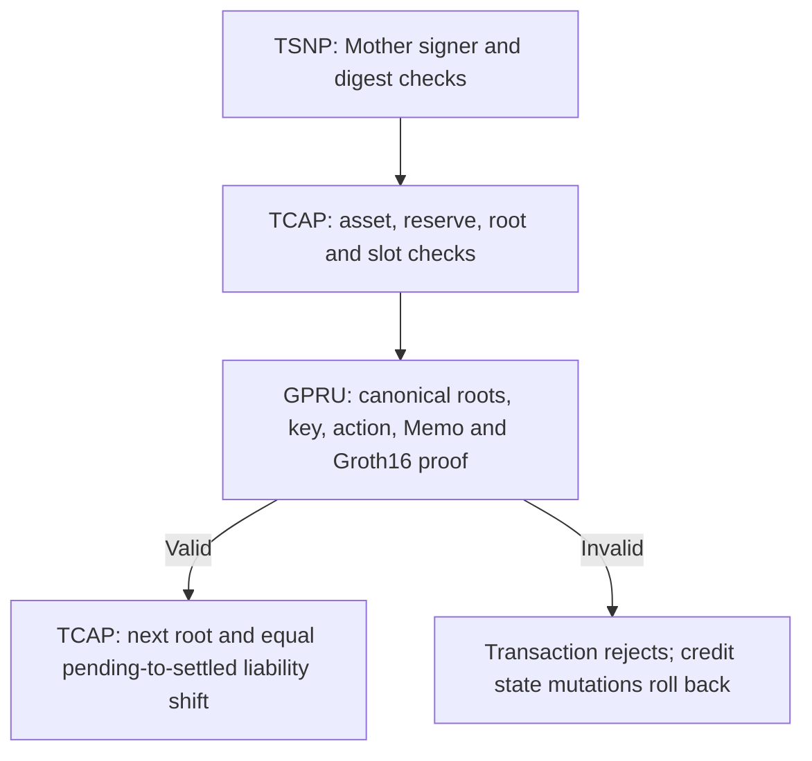

# Native credit ABI and atomic execution

**Status: CURRENT source ABI; no new deployment or transaction was performed for this documentation work.** The source handler and account constraints are authoritative. This guide explains the nested call used by the current credit path; it is not a replacement serializer or IDL.

## TSNP outer authorization

`RegisterTcapCreditAuthorizationV2Args` contains authorization digest, validity slots, previous root, next root sequence, token ID, base-unit amount, nullifier and `HiddenHeadProofArgsV1`. The proof contains twelve 32-byte inputs, Groth16 A/B/C arrays of 64/128/64 bytes, action kind, token ID, amount and authorization commitment. Action kind must be credit (`1`) in this handler.

The thirteen outer accounts, in order, are authority signer, Mother Escrow, TCAP program, TSNP program, TCAP config, TCAP asset entry, writable commitment root, writable reserve state, TCAP authorization signer PDA, TIP route root, GPRU verifier, instructions sysvar and GPRU program. Mother Escrow must identify the authority signer. The program IDs and instructions sysvar are constrained; unchecked accounts passed through to TCAP/GPRU are validated at those boundaries.

TSNP recomputes a domain-separated authorization digest from the commitment-root account, old root, next sequence, validity slots, amount, token ID and nullifier. The proof's authorization commitment must equal the scalar-reduced digest, and its action/token/amount/old-root/nullifier must match the outer arguments. TSNP then derives its authorization signer from the digest and invokes TCAP with that PDA's signer seeds.

## TCAP inner credit

The eleven TCAP accounts are payer signer, config, writable commitment root, asset entry, writable reserve state, TSNP program, TSNP authorization signer, TIP route root, GPRU verifier, instructions sysvar and GPRU program. TCAP checks governed account relationships, active/approved asset policy, pause flags, root version and next sequence, slot validity, proof argument agreement, pending liability and solvency.

`TcapAssetEntryV1` stores reserve bytes at 148–179, pause at 247, status at 283, risk at 284 and deprecated at 285. Credit requires status Active (`1`), risk Approved (`1`), unpaused and nondeprecated state; deposit/withdrawal switches and transfer-fee policy are separate fields. The corrected Node preflight uses these credit predicates rather than requiring withdrawals enabled. [The dated correction](cranker-transaction-map.md#corrected-tcap-asset-preflight-2026-11-02) records the false rejection, regression tests and bounded read-only Devnet validation.

The inner call does not take a recipient TIN account, per-TIN latest tip or recipient token account. Credit settlement changes a hidden recipient head through the proof and the global root. The previously confirmed deposit supplied reserve assets; this credit moves liability classification rather than transferring tokens to an exposed recipient wallet.

## GPRU validation and commit

GPRU receives TIP route root, TCAP commitment root, verifier and instructions sysvar. It verifies owner/PDA/layout where applicable, approved top-level context, twelve canonical input scalars, current roots and action binding. It requires the following top-level instruction to be the canonical Memo and binds its full bytes and seven fixed prefix fields to the proof. The initialized verification key must contain thirteen IC points.

Only after that CPI succeeds does TCAP update `previous_root`, `current_root`, sequence/root version and the reserve's pending/settled confidential liabilities. The equal amount preserves total liability through the credit classification change. A failed inner check rejects the enclosing transaction. A previously confirmed funding transaction is separate and cannot be rolled back by this failure.

## Compatibility and upgrade evidence

Older eight/nine-input proof layouts and TIP registrations lacking the balance scan key cannot be treated as compatible with the twelve-input contract. Fresh SBF binaries, SDK serialization, Node projection and Cranker transaction format must agree. Existing account capacity and a successful build do not prove that chain accounts or key initialization are correct. No owner migration into the current TIN layout was found during this source investigation. Current registry version is 1, distinct from global-state version 3; the [later TIN run](experiments/EXP-20261102-tin-staged-finalization.md) verifies fresh creation and its changed shared TIP root. Refresh the ordered witness snapshot before credit.

The [Cranker map](cranker-transaction-map.md) records the locally tested lease-authorization correction and the confirmed-funding snapshot recovery. This ABI describes the program call; local tests do not establish a live service handoff or accepted DBrix V1 transaction on the target cluster.

Read [TSNP handler](../../tsn-protocol/programs/tsn/protocol/programs/trustlink-escrow/src/tsn/instructions/register_tcap_credit_authorization_v2.rs), [TCAP handler](../../tsn-protocol/programs/tcap-protocol/programs/tcap/src/instructions/credit_gpru_memo_v1.rs), [GPRU validation](../../tsn-protocol/programs/gpru/src/hidden_head.rs), [SDK serialization](../../tsn-protocol/sdks/tsn-sdk/src/tcap-gpru-credit.ts), and [Cranker execution](../../tsn-protocol/services/tsn-cranker-op-daemon/scripts/cranker.ts). The [declaration catalog](onchain-reference.md) covers the other retained instruction families separately.
