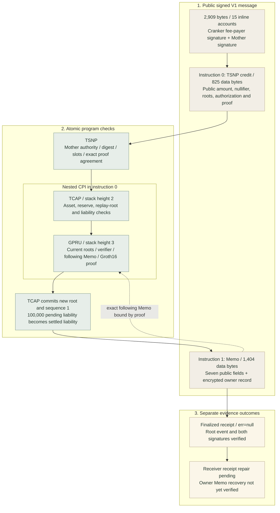

# EXP-20261102: first finalized native-credit baseline

**Date: 2026-11-02. Outcome: VERIFIED for this finalized Devnet credit and its public field relationships; a second-credit comparison and owner recovery remain unverified.** The transaction accepted a hidden-head proof, advanced TCAP's shared root and included its encrypted owner action record atomically. This is a concrete milestone toward the user's reported six-month privacy research objective. The same evidence establishes public deposit-to-credit correlation and a public credited amount, so it cannot support a claim of complete unlinkability or amount confidentiality.

## Objective and retained evidence

The objective is to preserve the first successful credit before another trial, explain each account and field, and establish a reproducible comparison baseline. The [public capture](../../references/native-credit-baseline-20261102.json) retains the parsed V1 envelope, exact public account values, Borsh byte ranges, proof, Memo metadata, CPIs, event and asset observation. The [field dictionary](../../references/native-credit-field-map-20261102.json) contains 93 grouped definitions with value, meaning, formation, next-credit expectation and source. Ciphertext is represented by byte length and SHA-256; no private witness, secret, plaintext owner action or raw encrypted envelope is published.

| Observation | Value |
| --- | --- |
| [Finalized credit](https://explorer.solana.com/tx/dojfmWVHfNA4AbwHpzQtFQGGUNxASw3rAdUKfhVYYCnfmoVwJDakVdpV7GJFxGu4aSaagXhBDHigcgwTs53gjgQ?cluster=devnet) | `dojfmWVHfNA4AbwHpzQtFQGGUNxASw3rAdUKfhVYYCnfmoVwJDakVdpV7GJFxGu4aSaagXhBDHigcgwTs53gjgQ` |
| Credit slot / block time | `517916537` / `2026-11-02T16:34:13+00:00` UTC, equivalent to 17:34:13 Africa/Lagos |
| [Prior funding deposit](https://explorer.solana.com/tx/5HyuhK9HA56cwwtbykeTQLKRT6FNwQqeg4Ncb52zdkNwAKUEWpyZtzvMzDqWVtyWXejMShQu7utgJ5566nvZJN7o?cluster=devnet) | `5HyuhK9HA56cwwtbykeTQLKRT6FNwQqeg4Ncb52zdkNwAKUEWpyZtzvMzDqWVtyWXejMShQu7utgJ5566nvZJN7o`; slot `517892485` |
| Funded and credited asset | `100000` base units = 0.1 Devnet USDC; mint `4zMMC9srt5Ri5X14GAgXhaHii3GnPAEERYPJgZJDncDU`, six decimals |
| Settlement work | `settlement-9ca206a7be1e5fca870e6a32e5ef7e1d` |
| Funding work | `66a4e481-b473-4815-9bf2-93f8afd59a9e` |
| Chain / service outcomes | Credit finalized with `err=null`; Receiver was FAILED at version 28 when inspected; funding CONFIRMED at version 5 |
| Execution cost | 10,000 lamports fee; 760,436 compute units consumed |
| Wire identity | 2,909 bytes; SHA-256 `0e8052246b0850bdc084bb44da7a4e9b19ecefdba0ba9413fd5dde0fd7161218` |

Asset metadata was read at finalized context slot `517924796`, after the credit. It establishes the observed asset binding, not an archival account pre-state. Capture timestamps remain in the evidence; the block-time label was normalized from its equivalent +01:00 representation to UTC without changing the instant or wire fingerprint.

## What executed in this transaction



TCAP and GPRU are CPIs within instruction 0, rather than additional transactions. The following Memo must succeed for the transaction to commit. Credit updates commitments and liabilities; it transfers no tokens to a recipient wallet. The separate funding transaction had already moved the sender's tokens into the reserve.

The V1 message occupies wire bytes `[0,2781)`. TSNP data occupies `[551,1376)` and Memo data occupies `[1377,2781)`. Cranker and Mother signatures occupy `[2781,2845)` and `[2845,2909)` respectively. Within the TSNP instruction data, amount occupies `[100,108)` as a little-endian u64. The retained capture records the other byte ranges individually, including TCAP's different amount/nullifier argument order and GPRU's 693-byte CPI data.

TCAP changed the global root from `14935d601de8d6fbd04b084de8f8510dd25b5ed1d80ab5382b8f908dc0734b3a` to `2d788e4b5d6527742d7910d402a6c17b3f0c3f1b02698441353cf8bdeff213ef` at sequence 1. This sequence belongs to the shared TCAP root; it is not a plaintext recipient action counter. The two signatures and exact TSNP/Memo bytes were independently matched to the stored authorization by the receipt matcher.

## Public relationships verified on this baseline

### Deposit-derived nullifier

The existing Node implementation computes the following replay identifier. Here `||` means byte concatenation, `Base58Decode` returns the transaction signature bytes, and `q` is the BN254 scalar modulus.

```text
nullifier = SHA256(
  UTF8("TSN_GPRU_CONFIRMED_DEPOSIT_NULLIFIER_V1") || 0x00 ||
  TCAP_program_public_key_bytes || Base58Decode(funding_signature)
) mod q
```

Recomputation from the public funding signature and TCAP program produced `079eea418f77cc6378099aae819780b7fa5b2265d678b022ce4e24e8ae40366b`, exactly matching the public credit argument, proof input and TCAP CPI. An observer with candidate funding signatures can perform the same computation. This links this credit to its deposit and therefore the deposit's visible funding wallet; it does not by itself identify the private recipient TIN.

The formula and `amount_base_units` argument were already present in the saved Git version. This investigation changed confirmation/signature checkpoint/receipt handling and added read-only inspection/documentation. It changed no program, circuit, SDK credit layout, nullifier formula or amount field. The reference to public linkage reports an existing behavior rather than a newly introduced disclosure.

### Public amount and derived commitments

The finalized TSNP instruction carries `100000` in its amount bytes and repeats that amount in the proof structure and TCAP CPI. The asset binding supplies six decimals, making the credited amount 0.1 Devnet USDC. Encrypting an owner record with another copy of the amount cannot hide the public ABI copy. A circuit-private signal does not make its separately serialized instruction argument private.

The authorization digest also recomputed from public data:

```text
digest = SHA256(
  UTF8("TSN_GPRU_TCAP_CREDIT_HIDDEN_HEAD_V1") || 0x00 ||
  commitmentRoot_account_bytes || oldRoot ||
  LE64(sequence) || LE64(validAfterSlot) || LE64(expiresAtSlot) ||
  LE64(amount) || LE32(tokenId) || nullifier
)
authorizationCommitment = digest mod q
actionCommitment = Poseidon(1, tokenId, amount, authorizationCommitment, nullifier)
```

Both the digest and action commitment matched this baseline. The native GPRU Poseidon helper was used for the latter. These values bind the permitted action; their public inputs mean they should not be described as secret identifiers. Memo's scalar SHA-256 commitment, its seven public values, proof, CPIs and TCAP event also agreed. The retained capture contains 23 successful checks, including eight independently derived PDAs and the separate two-signature receipt verification.

## Field dictionary

The following grouped map gives the exact observed value and its interpretation. Long values remain complete so they can be compared without relying on shortened display labels. Repeated proof/Memo/CPI values are the same data at different contract boundaries; repetition inside one transaction is expected. The public capture additionally retains the nesting, byte offsets, account indexes, PDA seed bytes/bumps and log metadata. An inspector-created length or hash is explicitly distinguished from a field serialized on chain.

### Accounts

| Key / observed value | Meaning and formation | Next-credit expectation / source |
| --- | --- | --- |
| `accounts[0]: crankerFeePayer`<br/>`ATo2C5pesfsauFMKqXw2sXHD1v3PXb1wxqrnMLxFLCD9` | Pays network fee and signs the complete V1 message. Signer=True; writable=True.<br/>Configured registered Cranker operator Ed25519 public key. | Can repeat for the same operator; infrastructure linkage.<br/>[register_tcap_credit_authorization_v2.rs](../../../tsn-protocol/programs/tsn/protocol/programs/trustlink-escrow/src/tsn/instructions/register_tcap_credit_authorization_v2.rs) |
| `accounts[1]: motherAuthority`<br/>`FnTrWDNgsXedkoCxpgKvwmEF3By4G6wzu9oyoU1n9xUG` | Co-signs the exact permitted settlement; used as CPI payer/authority. Signer=True; writable=True.<br/>Authority stored in canonical MotherEscrow. | Can repeat until authority rotation; infrastructure linkage.<br/>[register_tcap_credit_authorization_v2.rs](../../../tsn-protocol/programs/tsn/protocol/programs/trustlink-escrow/src/tsn/instructions/register_tcap_credit_authorization_v2.rs) |
| `accounts[2]: reserveState`<br/>`65NsJGexNZUs7etWTUiuN84mCJjGhqXTpjvySy6nvm6D` | TCAP accounting state for this accepted asset. Signer=False; writable=True.<br/>TCAP PDA: [tcap:reserve-state:v1, assetEntry bytes]. | Repeats for the same asset/reserve; not a recipient account.<br/>[register_tcap_credit_authorization_v2.rs](../../../tsn-protocol/programs/tsn/protocol/programs/trustlink-escrow/src/tsn/instructions/register_tcap_credit_authorization_v2.rs) |
| `accounts[3]: commitmentRoot`<br/>`ESunnNGeKYHiJx6ECsCUEh95zTVwsmJKRRZBo6vQwWbq` | Stores global head/nullifier-map root and sequence. Signer=False; writable=True.<br/>TCAP PDA: [tcap:commitment-root:v1]. | Address repeats; root data changes across settlements.<br/>[register_tcap_credit_authorization_v2.rs](../../../tsn-protocol/programs/tsn/protocol/programs/trustlink-escrow/src/tsn/instructions/register_tcap_credit_authorization_v2.rs) |
| `accounts[4]: authorizationSigner`<br/>`2YTJtK2KoXViuFK29MeD2tJiqTcYx2L51CNUevMMhEDN` | TSNP PDA that signs the TCAP CPI for this digest. Signer=False; writable=False.<br/>TSNP PDA: [tsn:tcap-authorization:v1, authorizationDigest bytes]. | Changes when digest changes; deterministic from public fields. No standalone account creation here.<br/>[register_tcap_credit_authorization_v2.rs](../../../tsn-protocol/programs/tsn/protocol/programs/trustlink-escrow/src/tsn/instructions/register_tcap_credit_authorization_v2.rs) |
| `accounts[5]: gpruVerifier`<br/>`4qordCRiPw4XFZcPPK8LLJTCpmugTDDawonpfqvpN9cT` | Configured Groth16 verifying-key/IC account. Signer=False; writable=False.<br/>GPRU PDA: [gpru:hidden-head-verifier:v1]. | Shared verifier address normally repeats.<br/>[register_tcap_credit_authorization_v2.rs](../../../tsn-protocol/programs/tsn/protocol/programs/trustlink-escrow/src/tsn/instructions/register_tcap_credit_authorization_v2.rs) |
| `accounts[6]: tcapConfig`<br/>`52vjTMjqRoCjTLvPKPqKh2QjfVjcskiAkfhHdjw34xwa` | Global TCAP authority/program policy. Signer=False; writable=False.<br/>TCAP PDA: [tcap:global-config:v1]. | Shared account normally repeats.<br/>[register_tcap_credit_authorization_v2.rs](../../../tsn-protocol/programs/tsn/protocol/programs/trustlink-escrow/src/tsn/instructions/register_tcap_credit_authorization_v2.rs) |
| `accounts[7]: gpruProgram`<br/>`6XsdcNRG7SkSceLduXmEvbrpCqgHfM6oj12Qx49o1hVR` | Executes hidden-head proof/Memo validation. Signer=False; writable=False.<br/>Configured deployed program ID. | Program ID repeats.<br/>[register_tcap_credit_authorization_v2.rs](../../../tsn-protocol/programs/tsn/protocol/programs/trustlink-escrow/src/tsn/instructions/register_tcap_credit_authorization_v2.rs) |
| `accounts[8]: tipRouteRoot`<br/>`AtMjyHVYLyaPd7fpMZbdxLQ24BGyPUmJMD2vppc2Expk` | Authenticates private membership in the shared TIP route tree. Signer=False; writable=False.<br/>TIP PDA: [tip:route-merkle-root:v1]. | Address repeats; shared root value repeats until TIP membership changes.<br/>[register_tcap_credit_authorization_v2.rs](../../../tsn-protocol/programs/tsn/protocol/programs/trustlink-escrow/src/tsn/instructions/register_tcap_credit_authorization_v2.rs) |
| `accounts[9]: assetEntry`<br/>`AVWxnem32oZGoSKEfiufcLFb1CZ5V9HbWqD9hNbeST67` | Maps public tokenId to mint, decimals and reserve policy. Signer=False; writable=False.<br/>TCAP PDA: [tcap:asset-entry:v1, registry bytes, tokenProgram bytes, mint bytes]. | Repeats for the same registered asset; asset is visible.<br/>[register_tcap_credit_authorization_v2.rs](../../../tsn-protocol/programs/tsn/protocol/programs/trustlink-escrow/src/tsn/instructions/register_tcap_credit_authorization_v2.rs) |
| `accounts[10]: motherEscrow`<br/>`ETNJWb2KDNdHSscVNbEiz1iWboddZdr8EPgmzw53hNkR` | Mother configuration/authority context. Signer=False; writable=False.<br/>TSNP PDA: [tsn_mother_escrow]. | Shared protocol account; expected to repeat.<br/>[register_tcap_credit_authorization_v2.rs](../../../tsn-protocol/programs/tsn/protocol/programs/trustlink-escrow/src/tsn/instructions/register_tcap_credit_authorization_v2.rs) |
| `accounts[11]: memoProgram`<br/>`MemoSq4gqABAXKb96qnH8TysNcWxMyWCqXgDLGmfcHr` | Logs the canonical encrypted action Memo. Signer=False; writable=False.<br/>Solana Memo program ID. | Program ID repeats.<br/>[register_tcap_credit_authorization_v2.rs](../../../tsn-protocol/programs/tsn/protocol/programs/trustlink-escrow/src/tsn/instructions/register_tcap_credit_authorization_v2.rs) |
| `accounts[12]: instructionsSysvar`<br/>`Sysvar1nstructions1111111111111111111111111` | Lets GPRU inspect the top-level caller and following Memo. Signer=False; writable=False.<br/>Canonical Solana instructions sysvar address. | Shared sysvar repeats.<br/>[register_tcap_credit_authorization_v2.rs](../../../tsn-protocol/programs/tsn/protocol/programs/trustlink-escrow/src/tsn/instructions/register_tcap_credit_authorization_v2.rs) |
| `accounts[13]: tcapProgram`<br/>`tCaP5R8LZFL1ridm3JCAtiqFzNnZCQYj3Hb7kw42YZF` | Executes reserve/root accounting after proof validation. Signer=False; writable=False.<br/>Configured deployed TCAP program ID. | Program ID repeats.<br/>[register_tcap_credit_authorization_v2.rs](../../../tsn-protocol/programs/tsn/protocol/programs/trustlink-escrow/src/tsn/instructions/register_tcap_credit_authorization_v2.rs) |
| `accounts[14]: tsnpProgram`<br/>`TSN31jddtsmUg4D5aEdhY31nwB1e53VJJg9X8NoRP8V` | Enforces Mother authority, digest and slot conditions. Signer=False; writable=False.<br/>Configured deployed TSNP program ID. | Program ID repeats.<br/>[register_tcap_credit_authorization_v2.rs](../../../tsn-protocol/programs/tsn/protocol/programs/trustlink-escrow/src/tsn/instructions/register_tcap_credit_authorization_v2.rs) |

### Envelope

| Key / observed value | Meaning and formation | Next-credit expectation / source |
| --- | --- | --- |
| `versionMarker`<br/>`81` | Wire version discriminator.<br/>Fixed hexadecimal 0x81 for actual V1. | Repeats for V1.<br/>scripts/inspect-native-credit.py / V1 builder |
| `version`<br/>`1` | Decoded Solana message version.<br/>Version marker low bits. | Repeats for this encoding.<br/>scripts/inspect-native-credit.py / V1 builder |
| `requiredSignatures`<br/>`2` | Number of trailing signatures.<br/>Payer plus Mother signer account metas. | Usually 2 for this branch.<br/>scripts/inspect-native-credit.py / V1 builder |
| `readonlySigned`<br/>`0` | Number of readonly signer addresses.<br/>Message account-role compiler. | Normally repeats for the same instruction roles.<br/>scripts/inspect-native-credit.py / V1 builder |
| `readonlyUnsigned`<br/>`11` | Number of readonly nonsigner addresses.<br/>Message account-role compiler. | Normally repeats for the same instruction roles.<br/>scripts/inspect-native-credit.py / V1 builder |
| `configMask`<br/>`12` | Inline V1 compute/loaded-account configuration flags.<br/>Mask 12 enables the two u32 limits. | Repeats for this builder.<br/>scripts/inspect-native-credit.py / V1 builder |
| `recentBlockhash`<br/>`AtkG8sQA1UAYPyb9Gmugkv2ej2EfJwGDXBaGfUCPu2zu` | Transaction lifetime and replay context.<br/>Confirmed getLatestBlockhash RPC response. | Can repeat for transactions prepared under the same blockhash; is not recipient identity.<br/>scripts/inspect-native-credit.py / V1 builder |
| `instructionCount`<br/>`2` | Two top-level calls: TSNP then Memo.<br/>Builder instruction list; CPI calls do not add top-level instructions. | Repeats for this branch.<br/>scripts/inspect-native-credit.py / V1 builder |
| `addressCount`<br/>`15` | Distinct inline account addresses.<br/>Deduplicated account-role list. | Normally 15 for this branch.<br/>scripts/inspect-native-credit.py / V1 builder |
| `computeUnitLimit`<br/>`1400000` | Requested execution compute ceiling in compute units.<br/>V1 builder configuration 1400000. | Repeats unless policy changes.<br/>scripts/inspect-native-credit.py / V1 builder |
| `loadedAccountBytesLimit`<br/>`67108864` | Requested loaded-account ceiling in bytes.<br/>V1 builder configuration 64 MiB. | Repeats unless policy changes.<br/>scripts/inspect-native-credit.py / V1 builder |
| `messageBytes`<br/>`2781` | Serialized message size before signatures.<br/>Byte count; includes compressed encrypted record size. | Can repeat or change; length is observable.<br/>scripts/inspect-native-credit.py / V1 builder |
| `wireBytes`<br/>`2909` | Complete transaction size including signatures.<br/>Message bytes plus 128 signature bytes. | Can repeat or change; size is observable.<br/>scripts/inspect-native-credit.py / V1 builder |
| `wireSha256`<br/>`0e8052246b0850bdc084bb44da7a4e9b19ecefdba0ba9413fd5dde0fd7161218` | Inspection fingerprint of the complete public transaction.<br/>Analyst SHA-256 over wire bytes; not an additional on-chain field. | Changes when any wire byte changes.<br/>scripts/inspect-native-credit.py / V1 builder |
| `signature[0]`<br/>`dojfmWVHfNA4AbwHpzQtFQGGUNxASw3rAdUKfhVYYCnfmoVwJDakVdpV7GJFxGu4aSaagXhBDHigcgwTs53gjgQ` | Ed25519 signature over identical complete message bytes; payer signature identifies this transaction.<br/>Signer private key signs public message; private key is not published. | Normally changes when message changes; same key can sign another message.<br/>V1 wire and receipt matcher |
| `signature[1]`<br/>`3kSwqVCvqveA2TKYdybbrEuoQCAvyfw6sywakpK7iivHUHpPC5uqznQVrv1EowkPqxtuAZm3DnN75pDN9eZQVWyv` | Ed25519 signature over identical complete message bytes; payer signature identifies this transaction.<br/>Signer private key signs public message; private key is not published. | Normally changes when message changes; same key can sign another message.<br/>V1 wire and receipt matcher |

### TSNP arguments

| Key / observed value | Meaning and formation | Next-credit expectation / source |
| --- | --- | --- |
| `discriminator`<br/>`792f62f65f93ae1a` | Selects tsn_register_tcap_credit_authorization_v2.<br/>First 8 bytes of SHA256(global:tsn_register_tcap_credit_authorization_v2). | Repeats for this instruction.<br/>tsn-protocol/services/tsn-node/server.py / tsn-protocol/programs/tsn/protocol/programs/trustlink-escrow/src/tsn/instructions/register_tcap_credit_authorization_v2.rs |
| `authorizationDigest`<br/>`7514e0e0c40be774b2843f3fa614815c72491bb5b8bf8f16b96eb0692b7620a4` | Binds root, sequence, time window, amount, token and nullifier to Mother authorization.<br/>SHA256(TSN_GPRU_TCAP_CREDIT_HIDDEN_HEAD_V1\0 \|\| rootAccount \|\| oldRoot \|\| LE64(sequence,validAfter,expires,amount) \|\| LE32(tokenId) \|\| nullifier). | Expected to change for a new deposit/root/window; publicly recomputable.<br/>tsn-protocol/services/tsn-node/server.py / tsn-protocol/programs/tsn/protocol/programs/trustlink-escrow/src/tsn/instructions/register_tcap_credit_authorization_v2.rs |
| `validAfterSlot`<br/>`517916251` | Earliest slot where authorization may execute.<br/>Confirmed slot selected by Node. | Changes with preparation slot; can repeat for same-slot preparations.<br/>tsn-protocol/services/tsn-node/server.py / tsn-protocol/programs/tsn/protocol/programs/trustlink-escrow/src/tsn/instructions/register_tcap_credit_authorization_v2.rs |
| `expiresAtSlot`<br/>`517918251` | Latest execution slot.<br/>validAfterSlot + configured TTL, 2000 slots here. | Changes with validity window.<br/>tsn-protocol/services/tsn-node/server.py / tsn-protocol/programs/tsn/protocol/programs/trustlink-escrow/src/tsn/instructions/register_tcap_credit_authorization_v2.rs |
| `previousTcapRoot`<br/>`14935d601de8d6fbd04b084de8f8510dd25b5ed1d80ab5382b8f908dc0734b3a` | Expected global state immediately before credit.<br/>Current chain-selected TCAP root. | Should equal baseline newGlobalRoot for the immediate next transition with no interleaving.<br/>tsn-protocol/services/tsn-node/server.py / tsn-protocol/programs/tsn/protocol/programs/trustlink-escrow/src/tsn/instructions/register_tcap_credit_authorization_v2.rs |
| `tcapRootSequence`<br/>`1` | Global shared-root sequence, not the private TIN action sequence.<br/>Chain sequence + 1. | Advances globally; immediate next transition should be 2.<br/>tsn-protocol/services/tsn-node/server.py / tsn-protocol/programs/tsn/protocol/programs/trustlink-escrow/src/tsn/instructions/register_tcap_credit_authorization_v2.rs |
| `tokenId`<br/>`1` | TCAP registered accepted-asset identifier.<br/>Asset entry token_id; ID 1 maps to the observed Devnet USDC mint. | Repeats for the same asset; asset selection is public.<br/>tsn-protocol/services/tsn-node/server.py / tsn-protocol/programs/tsn/protocol/programs/trustlink-escrow/src/tsn/instructions/register_tcap_credit_authorization_v2.rs |
| `amountBaseUnits`<br/>`100000` | Public credited deposit amount; 100000 with 6 decimals is 0.1 Devnet USDC.<br/>Confirmed owner-signed deposit amount. | Repeats if the next amount is equal; amount is not hidden.<br/>tsn-protocol/services/tsn-node/server.py / tsn-protocol/programs/tsn/protocol/programs/trustlink-escrow/src/tsn/instructions/register_tcap_credit_authorization_v2.rs |
| `nullifier`<br/>`079eea418f77cc6378099aae819780b7fa5b2265d678b022ce4e24e8ae40366b` | Consumed-deposit replay binding stored inside the authenticated map.<br/>SHA256(TSN_GPRU_CONFIRMED_DEPOSIT_NULLIFIER_V1\0 \|\| TCAP program bytes \|\| decoded funding signature) reduced modulo BN254 q. | Changes for a different deposit; identical for retries of the same deposit. Public funding-to-credit link.<br/>tsn-protocol/services/tsn-node/server.py / tsn-protocol/programs/tsn/protocol/programs/trustlink-escrow/src/tsn/instructions/register_tcap_credit_authorization_v2.rs |

### Proof

| Key / observed value | Meaning and formation | Next-credit expectation / source |
| --- | --- | --- |
| `publicInputs[0]: oldGlobalRoot`<br/>`14935d601de8d6fbd04b084de8f8510dd25b5ed1d80ab5382b8f908dc0734b3a` | Shared authenticated state before this action.<br/>Poseidon(previous private head-map root, previous nullifier-map root). | Expected shared-state continuity; not a per-recipient public predecessor.<br/>[main.circom](../../../tsn-protocol/programs/gpru/circuits/hidden_head_v1/main.circom) |
| `publicInputs[1]: newGlobalRoot`<br/>`2d788e4b5d6527742d7910d402a6c17b3f0c3f1b02698441353cf8bdeff213ef` | Shared authenticated state after this action.<br/>Poseidon(updated private head-map root, updated nullifier-map root). | Expected to change for every accepted state transition.<br/>[main.circom](../../../tsn-protocol/programs/gpru/circuits/hidden_head_v1/main.circom) |
| `publicInputs[2]: memoCommitment`<br/>`236f33517b788cced1252784168c2eaead87eeec27c3a6e61824c685e9cc5662` | Binds the complete following Memo bytes.<br/>SHA256(complete ASCII Memo) reduced modulo BN254 q. | Changes when Memo changes; current value is publicly recomputable.<br/>[main.circom](../../../tsn-protocol/programs/gpru/circuits/hidden_head_v1/main.circom) |
| `publicInputs[3]: actionCommitment`<br/>`2f81e8216e08f638e838fbd46207100635b03bb24a4b77775a6b27afa2c83ae7` | Binds authorized action fields.<br/>Poseidon(1, tokenId, amount, authorizationCommitment, nullifier). All five inputs are public in this transaction. | Expected to change with public action inputs; not a secret salted recipient identifier.<br/>[main.circom](../../../tsn-protocol/programs/gpru/circuits/hidden_head_v1/main.circom) |
| `publicInputs[4]: nullifier`<br/>`079eea418f77cc6378099aae819780b7fa5b2265d678b022ce4e24e8ae40366b` | Same consumed-deposit nullifier as the outer argument.<br/>Copied into the proof statement. | Same repeat/link rule as outer nullifier.<br/>[main.circom](../../../tsn-protocol/programs/gpru/circuits/hidden_head_v1/main.circom) |
| `publicInputs[5]: tipRouteRoot`<br/>`01971b68089c1e95637ee522bd72678df2e7d2c20e5d5fc7354b58122c94e63d` | Shared TIP membership tree root.<br/>Chain-selected public TIP route root. | Can repeat while membership is unchanged; shared across recipients.<br/>[main.circom](../../../tsn-protocol/programs/gpru/circuits/hidden_head_v1/main.circom) |
| `publicInputs[6]: successorPortfolioRoot`<br/>`295274faeb79b0833727af6c4eeccb86da3c9d31ef1c9bfe2b25ce22c3d0cff2` | Committed root of the hidden recipient token portfolio after credit.<br/>Sparse token map with leaf Poseidon(tokenId, successorBalanceX, successorBalanceY). | Expected to change with freshly blinded successor point; previous portfolio root is private in next witness.<br/>[main.circom](../../../tsn-protocol/programs/gpru/circuits/hidden_head_v1/main.circom) |
| `publicInputs[7]: successorBalanceX`<br/>`1261e1a0d3ca1577f4bfcf29733c6915ecbdfcdb86581feb5489f30ea5496c9e` | X of successor BabyJubjub Pedersen balance point.<br/>Pnew = Pold + amount*G + freshDelta*H. | Expected to change; previous point should not be explicitly published by the next credit ABI.<br/>[main.circom](../../../tsn-protocol/programs/gpru/circuits/hidden_head_v1/main.circom) |
| `publicInputs[8]: successorBalanceY`<br/>`24f742aad55d571c399a71b87b45329be06c86f31acab0dc542ab7731ded476d` | Y of the same successor balance point.<br/>Same Pedersen point update; coordinate is public, opening remains private. | Same rule as X; point difference alone does not certify unlinkability.<br/>[main.circom](../../../tsn-protocol/programs/gpru/circuits/hidden_head_v1/main.circom) |
| `publicInputs[9]: encryptedBlindingDelta`<br/>`03f05f41b800ee9e6942a787bb03b1733dcf35e48af85d94f68253b38d019975` | Owner-readable scalar encryption of the exact Pedersen blinding delta.<br/>C = freshDelta + x(e*S) mod BabyJubjub subgroup order. | Expected to change with fresh blinding/ephemeral randomness.<br/>[main.circom](../../../tsn-protocol/programs/gpru/circuits/hidden_head_v1/main.circom) |
| `publicInputs[10]: deltaEphemeralPublicX`<br/>`06a00cf572089582eebc0b9e1aed4d1ffc3bf6e3308179c33fb706a581d37393` | X of one-time BabyJubjub delta-encryption point.<br/>E = e*Base8, fresh ephemeral scalar e. | Expected to change with fresh e; recipient S is private in the proof witness.<br/>[main.circom](../../../tsn-protocol/programs/gpru/circuits/hidden_head_v1/main.circom) |
| `publicInputs[11]: deltaEphemeralPublicY`<br/>`0141d79442da9da60d690631c8407690b373cdc4e005a2f922fbd7fc89b6de1d` | Y of the same one-time point.<br/>Same E = e*Base8. | Same rule as X.<br/>[main.circom](../../../tsn-protocol/programs/gpru/circuits/hidden_head_v1/main.circom) |
| `proofA`<br/>`2b6d016aaa3cb26c10ecab03f45527c573fb7347521a6359ffb9859f00120e63264b6243a1279daa6913637292d0c794a89d8316fb9637436c08903d62990a5f` | 64-byte Groth16 G1 proof point encoding.<br/>Circuit witness + proving key + Groth16 prover randomness, encoded for the GPRU verifier. | Normally changes for a fresh proof; different proof bytes alone do not establish privacy.<br/>hidden_head_prover.py / GPRU hidden_head.rs |
| `proofB`<br/>`2b50c949c53d3abaecd21111444001ad449ea4a44c0a9637cbf93d56158a0f071bebd1b9f65ea9b65b6cdadae132c947367d5e35d8434f04d9abe079de0ac97719a72c6ac6836e3f9a9d0e712c310da16009db09cc9aad4682d962caa75f189d2f4464d31ddf6bc1877b69ff813fa6dac663d3df5e5f333d9ae6f4b416ee1ba5` | 128-byte Groth16 G2 proof point encoding.<br/>Circuit witness + proving key + Groth16 prover randomness, encoded for the GPRU verifier. | Normally changes for a fresh proof; different proof bytes alone do not establish privacy.<br/>hidden_head_prover.py / GPRU hidden_head.rs |
| `proofC`<br/>`2fe543cae834fc3410fe3087a62141fbe9530d442d685fe5eacd4835f7065d6f1cfabbce54d7fbc95d3891b02df889f14196cabbfde3796208213af32bdeaaf2` | 64-byte Groth16 G1 proof point encoding.<br/>Circuit witness + proving key + Groth16 prover randomness, encoded for the GPRU verifier. | Normally changes for a fresh proof; different proof bytes alone do not establish privacy.<br/>hidden_head_prover.py / GPRU hidden_head.rs |
| `proof.actionKind`<br/>`1` | Credit selector, 1.<br/>Prover result binds action/token/amount and reduced authorization digest to the same witness. | Action kind/asset/amount may repeat; authorization scalar generally changes.<br/>tsn-protocol/services/tsn-node/server.py / tsn-protocol/programs/gpru/circuits/hidden_head_v1/main.circom |
| `proof.tokenId`<br/>`1` | Public copy of token/amount bound to TCAP and circuit.<br/>Prover result binds action/token/amount and reduced authorization digest to the same witness. | Action kind/asset/amount may repeat; authorization scalar generally changes.<br/>tsn-protocol/services/tsn-node/server.py / tsn-protocol/programs/gpru/circuits/hidden_head_v1/main.circom |
| `proof.amountBaseUnits`<br/>`100000` | Public copy of token/amount bound to TCAP and circuit.<br/>Prover result binds action/token/amount and reduced authorization digest to the same witness. | Action kind/asset/amount may repeat; authorization scalar generally changes.<br/>tsn-protocol/services/tsn-node/server.py / tsn-protocol/programs/gpru/circuits/hidden_head_v1/main.circom |
| `proof.authorizationCommitment`<br/>`144c43fb01a8a72141e3b3d2a311d0a221e14b24c54cadf431aac5414b7620a2` | BN254 scalar reduction of authorizationDigest; public.<br/>Prover result binds action/token/amount and reduced authorization digest to the same witness. | Action kind/asset/amount may repeat; authorization scalar generally changes.<br/>tsn-protocol/services/tsn-node/server.py / tsn-protocol/programs/gpru/circuits/hidden_head_v1/main.circom |

### Memo

| Key / observed value | Meaning and formation | Next-credit expectation / source |
| --- | --- | --- |
| `prefix`<br/>`TSN_GPRU_HEAD_V1` | Selects the hidden-head owner-record Memo format.<br/>TSN_GPRU_HEAD_V1 prefix + seven colon-separated proof fields + unpadded Base64URL JSON body. | Prefix repeats; lengths can repeat; complete Memo hash changes with any bytes.<br/>[dbrix_transaction_record.py](../../../tsn-protocol/services/tsn-node/dbrix_transaction_record.py) |
| `bytes`<br/>`1404` | Complete public Memo instruction data length in bytes.<br/>TSN_GPRU_HEAD_V1 prefix + seven colon-separated proof fields + unpadded Base64URL JSON body. | Prefix repeats; lengths can repeat; complete Memo hash changes with any bytes.<br/>[dbrix_transaction_record.py](../../../tsn-protocol/services/tsn-node/dbrix_transaction_record.py) |
| `sha256`<br/>`b49c1eaa1f0d6d4bfa15f8a79b1037c62623a7c594eff899e3caa741b9cc5665` | Full SHA-256 fingerprint of the complete ASCII Memo; its scalar reduction is memoCommitment.<br/>Inspector hashes the public Memo bytes. | Prefix repeats; lengths can repeat; complete Memo hash changes with any bytes.<br/>[dbrix_transaction_record.py](../../../tsn-protocol/services/tsn-node/dbrix_transaction_record.py) |
| `bodyBase64UrlBytes`<br/>`932` | ASCII length of the unpadded Base64URL JSON body after the seven public fields.<br/>TSN_GPRU_HEAD_V1 prefix + seven colon-separated proof fields + unpadded Base64URL JSON body. | Prefix repeats; lengths can repeat; complete Memo hash changes with any bytes.<br/>[dbrix_transaction_record.py](../../../tsn-protocol/services/tsn-node/dbrix_transaction_record.py) |
| `decodedDocumentBytes`<br/>`699` | Byte length of the decoded JSON envelope; this is still encrypted-record metadata.<br/>TSN_GPRU_HEAD_V1 prefix + seven colon-separated proof fields + unpadded Base64URL JSON body. | Prefix repeats; lengths can repeat; complete Memo hash changes with any bytes.<br/>[dbrix_transaction_record.py](../../../tsn-protocol/services/tsn-node/dbrix_transaction_record.py) |
| `document.algorithm`<br/>`dbrix-core-secretbox-v1` | Owner-record cipher identifier.<br/>Literal dbrix-core-secretbox-v1. | Repeats for this cipher.<br/>[dbrix_transaction_record.py](../../../tsn-protocol/services/tsn-node/dbrix_transaction_record.py) |
| `document.compression`<br/>`deflate` | Compression of typed action plaintext before encryption.<br/>Deflate used when it reduces size. | May repeat; compressed length is visible.<br/>[dbrix_transaction_record.py](../../../tsn-protocol/services/tsn-node/dbrix_transaction_record.py) |
| `document.dna`<br/>`5d674ad9e1f9a9f845c68e708d274affa57bc63d0b2b81f9854838e7a1ff1343` | Fresh public record salt/context, not the owner secret.<br/>Node secrets.token_bytes(32); included in the record-key hash. | Expected to change per record.<br/>[dbrix_transaction_record.py](../../../tsn-protocol/services/tsn-node/dbrix_transaction_record.py) |
| `document.recordEphemeralPublicKey`<br/>`88ea1c4e503dac6fc6eff1dcd86b1a6ea33f891814926f5e705925c8521f9050` | Compressed Ristretto point for owner-record key agreement; distinct from BabyJubjub E.<br/>Fresh scalar r times record generator; shared point is r*ownerRecordScanPublic. | Expected to change; owner public key is not copied into this envelope.<br/>[dbrix_transaction_record.py](../../../tsn-protocol/services/tsn-node/dbrix_transaction_record.py) |
| `document.version`<br/>`1` | Encrypted envelope schema version.<br/>Literal 1. | Repeats for this schema.<br/>[dbrix_transaction_record.py](../../../tsn-protocol/services/tsn-node/dbrix_transaction_record.py) |
| `document.data`<br/>`{"ciphertextBytes":303,"sha256":"f85ee607d01889ec14b2d75892e4e2bc3ea6284c3fff0dd87d9872560434c2da"}` | 303 ciphertext bytes here; persisted as length/hash instead of raw ciphertext.<br/>SecretBox key K=SHA256(DBRIX_GPRU_TRANSACTION_RECORD_KEY_V1\0 \|\| sharedPoint \|\| DNA \|\| recordEphemeralPublicKey). | Ciphertext/hash expected to change; length may repeat.<br/>[dbrix_transaction_record.py](../../../tsn-protocol/services/tsn-node/dbrix_transaction_record.py) |
| `document.nonce`<br/>`{"bytes":24,"hex":"51d676121986ab198779b42a406e3a88eb490ed3524e8bc9"}` | Public 24-byte SecretBox nonce.<br/>Fresh secrets.token_bytes(24). | Expected to change per encryption.<br/>[dbrix_transaction_record.py](../../../tsn-protocol/services/tsn-node/dbrix_transaction_record.py) |

### TCAP event

| Key / observed value | Meaning and formation | Next-credit expectation / source |
| --- | --- | --- |
| `name`<br/>`TcapGpruMemoCreditedV1` | TCAP event emitted after successful proof and atomic root/liability mutation.<br/>event discriminator + previous/current root + LE64(sequence) + LE32(tokenId) + transition digest. Digest is SHA256(TCAP_GPRU_MEMO_CREDIT_V1\0 \|\| oldRoot \|\| newRoot \|\| authDigest \|\| nullifier \|\| LE32(tokenId) \|\| LE64(amount) \|\| memoField). | Name/discriminator/asset can repeat; roots/sequence/digest follow state progression.<br/>[credit_gpru_memo_v1.rs](../../../tsn-protocol/programs/tcap-protocol/programs/tcap/src/instructions/credit_gpru_memo_v1.rs) |
| `discriminator`<br/>`7ff47826a2ed1a16` | TCAP event emitted after successful proof and atomic root/liability mutation.<br/>event discriminator + previous/current root + LE64(sequence) + LE32(tokenId) + transition digest. Digest is SHA256(TCAP_GPRU_MEMO_CREDIT_V1\0 \|\| oldRoot \|\| newRoot \|\| authDigest \|\| nullifier \|\| LE32(tokenId) \|\| LE64(amount) \|\| memoField). | Name/discriminator/asset can repeat; roots/sequence/digest follow state progression.<br/>[credit_gpru_memo_v1.rs](../../../tsn-protocol/programs/tcap-protocol/programs/tcap/src/instructions/credit_gpru_memo_v1.rs) |
| `previousRoot`<br/>`14935d601de8d6fbd04b084de8f8510dd25b5ed1d80ab5382b8f908dc0734b3a` | TCAP event emitted after successful proof and atomic root/liability mutation.<br/>event discriminator + previous/current root + LE64(sequence) + LE32(tokenId) + transition digest. Digest is SHA256(TCAP_GPRU_MEMO_CREDIT_V1\0 \|\| oldRoot \|\| newRoot \|\| authDigest \|\| nullifier \|\| LE32(tokenId) \|\| LE64(amount) \|\| memoField). | Name/discriminator/asset can repeat; roots/sequence/digest follow state progression.<br/>[credit_gpru_memo_v1.rs](../../../tsn-protocol/programs/tcap-protocol/programs/tcap/src/instructions/credit_gpru_memo_v1.rs) |
| `currentRoot`<br/>`2d788e4b5d6527742d7910d402a6c17b3f0c3f1b02698441353cf8bdeff213ef` | TCAP event emitted after successful proof and atomic root/liability mutation.<br/>event discriminator + previous/current root + LE64(sequence) + LE32(tokenId) + transition digest. Digest is SHA256(TCAP_GPRU_MEMO_CREDIT_V1\0 \|\| oldRoot \|\| newRoot \|\| authDigest \|\| nullifier \|\| LE32(tokenId) \|\| LE64(amount) \|\| memoField). | Name/discriminator/asset can repeat; roots/sequence/digest follow state progression.<br/>[credit_gpru_memo_v1.rs](../../../tsn-protocol/programs/tcap-protocol/programs/tcap/src/instructions/credit_gpru_memo_v1.rs) |
| `settlementSequence`<br/>`1` | TCAP event emitted after successful proof and atomic root/liability mutation.<br/>event discriminator + previous/current root + LE64(sequence) + LE32(tokenId) + transition digest. Digest is SHA256(TCAP_GPRU_MEMO_CREDIT_V1\0 \|\| oldRoot \|\| newRoot \|\| authDigest \|\| nullifier \|\| LE32(tokenId) \|\| LE64(amount) \|\| memoField). | Name/discriminator/asset can repeat; roots/sequence/digest follow state progression.<br/>[credit_gpru_memo_v1.rs](../../../tsn-protocol/programs/tcap-protocol/programs/tcap/src/instructions/credit_gpru_memo_v1.rs) |
| `tokenId`<br/>`1` | TCAP event emitted after successful proof and atomic root/liability mutation.<br/>event discriminator + previous/current root + LE64(sequence) + LE32(tokenId) + transition digest. Digest is SHA256(TCAP_GPRU_MEMO_CREDIT_V1\0 \|\| oldRoot \|\| newRoot \|\| authDigest \|\| nullifier \|\| LE32(tokenId) \|\| LE64(amount) \|\| memoField). | Name/discriminator/asset can repeat; roots/sequence/digest follow state progression.<br/>[credit_gpru_memo_v1.rs](../../../tsn-protocol/programs/tcap-protocol/programs/tcap/src/instructions/credit_gpru_memo_v1.rs) |
| `transitionDigest`<br/>`249f4ace377839abc7b6673128c6516aef900b19c62d74aa8bf28fde3a393b86` | TCAP event emitted after successful proof and atomic root/liability mutation.<br/>event discriminator + previous/current root + LE64(sequence) + LE32(tokenId) + transition digest. Digest is SHA256(TCAP_GPRU_MEMO_CREDIT_V1\0 \|\| oldRoot \|\| newRoot \|\| authDigest \|\| nullifier \|\| LE32(tokenId) \|\| LE64(amount) \|\| memoField). | Name/discriminator/asset can repeat; roots/sequence/digest follow state progression.<br/>[credit_gpru_memo_v1.rs](../../../tsn-protocol/programs/tcap-protocol/programs/tcap/src/instructions/credit_gpru_memo_v1.rs) |
| `dataBytes`<br/>`116` | TCAP event emitted after successful proof and atomic root/liability mutation.<br/>event discriminator + previous/current root + LE64(sequence) + LE32(tokenId) + transition digest. Digest is SHA256(TCAP_GPRU_MEMO_CREDIT_V1\0 \|\| oldRoot \|\| newRoot \|\| authDigest \|\| nullifier \|\| LE32(tokenId) \|\| LE64(amount) \|\| memoField). | Name/discriminator/asset can repeat; roots/sequence/digest follow state progression.<br/>[credit_gpru_memo_v1.rs](../../../tsn-protocol/programs/tcap-protocol/programs/tcap/src/instructions/credit_gpru_memo_v1.rs) |

### Metadata

| Key / observed value | Meaning and formation | Next-credit expectation / source |
| --- | --- | --- |
| `err`<br/>`null` | RPC execution receipt metadata, separate from instruction inputs.<br/>Solana runtime fee/compute/result/token-balance/address/reward reporting. | Fee/empty arrays/result can repeat; compute/cost/length are observable side channels.<br/>finalized getTransaction receipt |
| `fee`<br/>`10000` | RPC execution receipt metadata, separate from instruction inputs.<br/>Solana runtime fee/compute/result/token-balance/address/reward reporting. | Fee/empty arrays/result can repeat; compute/cost/length are observable side channels.<br/>finalized getTransaction receipt |
| `computeUnitsConsumed`<br/>`760436` | RPC execution receipt metadata, separate from instruction inputs.<br/>Solana runtime fee/compute/result/token-balance/address/reward reporting. | Fee/empty arrays/result can repeat; compute/cost/length are observable side channels.<br/>finalized getTransaction receipt |
| `costUnits`<br/>`764577` | RPC execution receipt metadata, separate from instruction inputs.<br/>Solana runtime fee/compute/result/token-balance/address/reward reporting. | Fee/empty arrays/result can repeat; compute/cost/length are observable side channels.<br/>finalized getTransaction receipt |
| `preTokenBalances`<br/>`[]` | RPC execution receipt metadata, separate from instruction inputs.<br/>Solana runtime fee/compute/result/token-balance/address/reward reporting. | Fee/empty arrays/result can repeat; compute/cost/length are observable side channels.<br/>finalized getTransaction receipt |
| `postTokenBalances`<br/>`[]` | RPC execution receipt metadata, separate from instruction inputs.<br/>Solana runtime fee/compute/result/token-balance/address/reward reporting. | Fee/empty arrays/result can repeat; compute/cost/length are observable side channels.<br/>finalized getTransaction receipt |
| `rewards`<br/>`[]` | RPC execution receipt metadata, separate from instruction inputs.<br/>Solana runtime fee/compute/result/token-balance/address/reward reporting. | Fee/empty arrays/result can repeat; compute/cost/length are observable side channels.<br/>finalized getTransaction receipt |
| `loadedAddresses`<br/>`{"readonly":[],"writable":[]}` | RPC execution receipt metadata, separate from instruction inputs.<br/>Solana runtime fee/compute/result/token-balance/address/reward reporting. | Fee/empty arrays/result can repeat; compute/cost/length are observable side channels.<br/>finalized getTransaction receipt |
| `signature`<br/>`dojfmWVHfNA4AbwHpzQtFQGGUNxASw3rAdUKfhVYYCnfmoVwJDakVdpV7GJFxGu4aSaagXhBDHigcgwTs53gjgQ` | Public receipt identity, ordering, funding association or later asset binding observation.<br/>RPC finalized transaction or current finalized asset account. Asset observation context is after the transaction, not an archival pre-state. | Slots/signatures/timestamps change; mint/asset/funding sender can repeat.<br/>[inspect-native-credit.py](../../../scripts/inspect-native-credit.py) |
| `slot`<br/>`517916537` | Public receipt identity, ordering, funding association or later asset binding observation.<br/>RPC finalized transaction or current finalized asset account. Asset observation context is after the transaction, not an archival pre-state. | Slots/signatures/timestamps change; mint/asset/funding sender can repeat.<br/>[inspect-native-credit.py](../../../scripts/inspect-native-credit.py) |
| `blockTimeUtc`<br/>`2026-11-02T16:34:13+00:00` | Public receipt identity, ordering, funding association or later asset binding observation.<br/>RPC finalized transaction or current finalized asset account. Asset observation context is after the transaction, not an archival pre-state. | Slots/signatures/timestamps change; mint/asset/funding sender can repeat.<br/>[inspect-native-credit.py](../../../scripts/inspect-native-credit.py) |
| `finality`<br/>`finalized` | Public receipt identity, ordering, funding association or later asset binding observation.<br/>RPC finalized transaction or current finalized asset account. Asset observation context is after the transaction, not an archival pre-state. | Slots/signatures/timestamps change; mint/asset/funding sender can repeat.<br/>[inspect-native-credit.py](../../../scripts/inspect-native-credit.py) |
| `funding`<br/>`{"signature":"5HyuhK9HA56cwwtbykeTQLKRT6FNwQqeg4Ncb52zdkNwAKUEWpyZtzvMzDqWVtyWXejMShQu7utgJ5566nvZJN7o","slot":517892485,"nullifierRecomputed":"079eea418f77cc6378099aae819780b7fa5b2265d678b022ce4e24e8ae40366b","feePayer":"CPyxfZ4pshNvZr18t8wH9zqidBNzFjqGcNrQm5tG3XiV"}` | Public receipt identity, ordering, funding association or later asset binding observation.<br/>RPC finalized transaction or current finalized asset account. Asset observation context is after the transaction, not an archival pre-state. | Slots/signatures/timestamps change; mint/asset/funding sender can repeat.<br/>[inspect-native-credit.py](../../../scripts/inspect-native-credit.py) |
| `assetObservation`<br/>`{"observedContextSlot":517924796,"registry":"C8XzWaejCD4QfMpjGL8zp8jVhVVMWtaXzusqc98HTJLm","tokenId":1,"tokenProgram":"TokenkegQfeZyiNwAJbNbGKPFXCWuBvf9Ss623VQ5DA","mint":"4zMMC9srt5Ri5X14GAgXhaHii3GnPAEERYPJgZJDncDU","domainId":1,"scope":"b7633ad8df4c8f70bd2779f49e2ba62e4b31d0ac0f8db56649fb570eaf707547","reserveState":"65NsJGexNZUs7etWTUiuN84mCJjGhqXTpjvySy6nvm6D","decimals":6}` | Public receipt identity, ordering, funding association or later asset binding observation.<br/>RPC finalized transaction or current finalized asset account. Asset observation context is after the transaction, not an archival pre-state. | Slots/signatures/timestamps change; mint/asset/funding sender can repeat.<br/>[inspect-native-credit.py](../../../scripts/inspect-native-credit.py) |

## Owner record, balance commitment and encryption

The Memo prefix carries successor portfolio root, successor balance X/Y, action commitment, encrypted blinding delta and the delta ephemeral X/Y. These are public and proof-bound. The balance point follows `Pnew = Pold + amount*G + delta*H`, with a fresh private blinding delta. The BabyJubjub delta cipher follows `E = e*Base8` and `C = delta + x(e*S) mod subgroup_order`. The owner can recover the delta using the corresponding scan secret; the record does not publish that secret or the balance opening.

The JSON envelope carries a separate compressed Ristretto ephemeral point, public DNA salt/context and a 24-byte SecretBox nonce. Its owner action data is compressed and encrypted into the observed 303-byte ciphertext. Ristretto record key agreement and BabyJubjub balance-delta encryption have different purposes and curves. Public DNA is not an owner private key, and this transaction contains no separate DNA-key proof instruction.

The source-defined encrypted action schema contains `version`, `recordType`, `sequence`, `previousMemoCommitment`, `actionCommitment`, `authorizationCommitment`, `nullifier`, `actionKind`, `tokenId` and `amountBaseUnits`. This names the schema without publishing its plaintext values or claiming a successful decryption. Private recipient sequence and predecessor Memo are hidden in that body/witness; public copies of amount, token, action and nullifier elsewhere remain visible. Node prepares the route and witness, so this baseline does not establish privacy from Node operators.

## Next-credit comparison protocol

**Later checkpoint, 2026-11-03:** the [linkage investigation](EXP-20261103-native-credit-linkability.md) reproduced this actual first credit's new global root from a public recipient registry and public statement fields. It also verified fourteen offline correlation controls. The earlier funding calculation alone still does not identify a recipient, but the separate registry/root reconstruction does identify a persistent public recipient registry. Plaintext TIN recovery, a second live credit and owner recovery remain unverified.

After the user creates a new credit, supply its actual finalized credit and funding signatures. Capture it in a new output file with the existing read-only inspector; preserve this baseline rather than overwriting it.

```powershell
.\.venv\Scripts\python.exe scripts/inspect-native-credit.py --signature $NextCreditSignature --funding-signature $NextFundingSignature --compare docs/references/native-credit-baseline-20261102.json --out protocol-test-runs/next-credit-comparison/public-comparison.json
```

1. Check the new finalized receipt, exact authorized bytes/signatures, root event and funding relationship before interpreting privacy. Receiver status and owner recovery need their own checks.
2. Classify recurring program/config/verifier/shared-root/asset/operator/Mother accounts as infrastructure or asset reuse. Those accounts do not directly identify a recipient. Global sequence/root continuity identifies ordering; direct `newRoot → oldRoot` equality is expected only when no intervening transition occurred.
3. Inspect fresh nullifier, authorization PDA/digest, Memo/DNA/nonce, delta and record ephemeral points, balance point, portfolio root and proof. Check the comparison's cross-field recurrence list as well as same-path values, including values that moved from a previous successor field to a new predecessor field. A changed value alone cannot establish unlinkability.
4. Recompute the new deposit-derived nullifier and public commitments. Linkage through a known public transformation still exists when all resulting bytes differ. Equal amounts/tokens and transaction timing provide further observable correlation.
5. Validate owner decryption/history and include a different-recipient control before making a stronger recipient-linkability claim. A two-credit trial can reveal reuse or correlations; it cannot establish complete privacy or production cryptographic soundness.

The inspector's self-comparison and synthetic change/cross-field checks exercise the comparison logic without submitting another transaction. They are tool validation, not a second live credit. No new deposit, settlement requeue, receipt write, service restart, signature, deployment or Git commit/push was performed for this baseline mapping.

## Prior failure and milestone boundary

The credit succeeded before DBrix's confirmation connection failed. Its HTTP broadcast preceded a WebSocket attempt to the gateway's unsupported root path, producing a stale FAILED Receiver receipt. The [transaction-map checkpoint](../cranker-transaction-map.md#later-november-2-checkpoint-finalized-credit-with-a-failed-service-receipt) documents the implemented HTTP confirmation/checkpoint replacement, tested receipt matcher and operator-controlled repair command. Replacement live confirmation and receipt mutation have not been executed by this investigation; this credit should not be resubmitted.

The milestone establishes accepted hidden-head verification, proof-bound encrypted owner data, shared-root progression and atomic liability accounting for this transaction. It does not establish amount confidentiality, funding-to-credit unlinkability, privacy from Node operators, owner recovery, confidential debit/exit/refund or a production ceremony/circuit soundness review. Refund remains deferred. Historical readiness and failed-retry observations retain their original dates and results.

## Source and verification record

The current [TSNP arguments/checks](../../../tsn-protocol/programs/tsn/protocol/programs/trustlink-escrow/src/tsn/instructions/register_tcap_credit_authorization_v2.rs), [TCAP credit/accounting](../../../tsn-protocol/programs/tcap-protocol/programs/tcap/src/instructions/credit_gpru_memo_v1.rs), [GPRU verification](../../../tsn-protocol/programs/gpru/src/hidden_head.rs), [twelve-input circuit](../../../tsn-protocol/programs/gpru/circuits/hidden_head_v1/main.circom), [SDK serialization](../../../tsn-protocol/sdks/tsn-sdk/src/tcap-gpru-credit.ts), [Node transition construction](../../../tsn-protocol/services/tsn-node/server.py), [owner record encryption](../../../tsn-protocol/services/tsn-node/dbrix_transaction_record.py), [witness reconstruction](../../../tsn-protocol/services/tsn-node/hidden_head_witness.py) and [record/delta cryptography](../../../tsn-protocol/services/tsn-node/gpru_crypto.py) support the field interpretations.

Read-only finalized RPC capture, exact receipt matching and public nullifier/digest/action recomputation passed. The retained dataset has 23 successful bounded checks and 93 dictionary rows. Inspector validation uses only retained/synthetic public data and read-only RPC methods. Documentation inventory/claim regeneration, local links, MDX compilation, Mermaid parsing and whitespace checks are recorded in the [status ledger](../../DOCUMENTATION_STATUS.md); syntax checks do not certify diagram rendering, independent circuit soundness or owner recovery.
