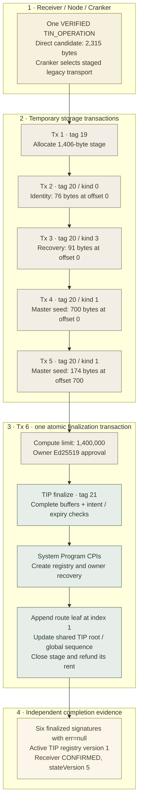

# EXP-20261102: successful staged TIN finalization

**Date: 2026-11-02. Outcome: VERIFIED for six successful Devnet transactions and active TIN registry creation; owner recovery and credit settlement unverified.** The user supplied a successful Cranker log after upgrading TIP and restarting Cranker. Independent read-only checks found all six transaction errors null and all six signatures finalized. Receiver separately held the matching `CONFIRMED` work item. The [Cranker transaction map](../cranker-transaction-map.md) explains every current daemon submission branch.

## Objective, preceding failure and setup

The objective was to establish what each transaction did and whether the final step really created the TIN registry. The reconstructed expectation was that a packet exceeding the legacy limit would use temporary uploads and then one owner-authorized finalization transaction, with permanent accounts/root changes appearing only after finalization.

The preceding run's uploads confirmed, but TIP finalization failed while decoding an existing shared route root. The [documented correction](../../DOCUMENTATION_STATUS.md#tip-existing-root-finalization-correction-2026-11-02) replaced the stack-heavy nested-array decoder with heap-backed loading while preserving the account layout and Poseidon relation. Offline SBF regression/replay and artifact matching are recorded there. The user subsequently completed TIP deployment through public Devnet RPC with QUIC after interrupting a slow RPC-transport attempt, then submitted a fresh XP request because the old owner approval had expired. This record preserves that context without rerunning a deployment or signing anything.

The supplied log ran `npm run tsn:cranker:start`, which resolves to the daemon's `tsx ./scripts/cranker.ts`. It selected local Receiver at `http://127.0.0.1:8010` with FILE storage and the existing RPC gateway at `http://127.0.0.1:8787`. Dependency/runtime details came from the inspected checkout. These are captured configuration observations, not guaranteed addresses for every operator.

## Work correlation and measurement method

| Field | Observed value |
| --- | --- |
| Receiver work ID | `32ccda54-4111-4273-9b48-28bac4b865b1` |
| Payload intent ID | `6f31d0e7-4e37-4ddc-b436-7a95fa80d5a5` |
| Work kind | `TIN_OPERATION` / `tin_creation` |
| Operator / transaction fee payer | `ATo2C5pesfsauFMKqXw2sXHD1v3PXb1wxqrnMLxFLCD9` |
| TIP program | `TinseNnU588NkmRZBe4ADJbxqrqQma92678UFP6VuwT` |
| Complete direct candidate | 2,315 bytes against a 1,232-byte legacy packet limit; candidate was not submitted |
| Encrypted upload lengths | Identity 76 bytes; owner recovery 91 bytes; master seed 874 bytes |
| Log processing interval | `14:13:43.976Z` lease to `14:14:07.292Z` accepted report; `15:13:43.976` to `15:14:07.292` Africa/Lagos |
| Independent evidence captured | `2026-11-02T14:23:37.159336Z`; account response slot `517883812` |

The stage-initialized log labels the payload intent ID as `workId`; normal lease/report lines use the Receiver work ID. Both belong to this same request. No second TIN operation should be inferred from that logging difference.

The read-only collector parsed the six public signatures from the supplied log, queried `getTransaction`/signature status and account headers through the existing gateway, and extracted allowlisted fields from the local Receiver record. Direct public Devnet reads timed out; the gateway succeeded. The evidence contains packet sizes from logs and fees/slots/compute/inner account allocations from transaction metadata. It retains no raw instruction payloads, account bytes, private TIN, envelopes or owner approval signature.

## Transaction-by-transaction record

All rows had `err=null` and `confirmationStatus=finalized` when independently read. Each transaction had the Cranker operator as its transaction signer and fee payer. The final transaction also verified the already signed owner approval through the Ed25519 instruction.

| Tx | Submission / TIP tag | Wire bytes | Slot / block time UTC | Fee, lamports | Compute units |
| --- | --- | --- | --- | --- | --- |
| [1: initialize](https://explorer.solana.com/tx/5Ny9uDYKry8BFmg5VYWHb37T4DjoyfZcwJY5YLGbLFpD22XSUwsGf7x1kwB8X6BxLmquZBbqowAfVqBXkyoVsTeu?cluster=devnet) | `tin-v1.stage.initialize`, tag 19 | 589 | 517881365 / 14:13:48 | 5,000 | 21,976 |
| [2: identity](https://explorer.solana.com/tx/MHpGbx1aL2HvERVnGdWUuSmFhHZdBsZYswP2eidax5AuwqpimZEW3ya5nhEzSv67mcWhczJoAzEwmKS2o3ZMovj?cluster=devnet) | `chunk.identity`, tag 20, kind 0 | 289 | 517881379 / 14:13:51 | 5,000 | 16,215 |
| [3: recovery](https://explorer.solana.com/tx/5kzX3dA3q5QGgHy2FKqYSGuDQNHoMmGi6jdky4RAb1YHiY4ULusW2yimAh1QxKrfYgJQcA21ZStUs4ShU5RRjTyT?cluster=devnet) | `chunk.owner_recovery`, tag 20, kind 3 | 304 | 517881391 / 14:13:54 | 5,000 | 16,244 |
| [4: seed part 1](https://explorer.solana.com/tx/3c8fPTi5CkogTJxu9zxAksfp4qsTzpKnn571RHtmeyYYgRBaQm4saRns2B4pmgFRTKcGS7Vqxatfc1dEkEiXAW2K?cluster=devnet) | `chunk.master_seed`, tag 20, kind 1 | 914 | 517881404 / 14:13:58 | 5,000 | 15,933 |
| [5: seed part 2](https://explorer.solana.com/tx/26owkpTa1Ejf9AnaWvDC1NSe9F6VX5JdV9uFzDVUxKoeRBmSuRXcJt9nYFL2pf5ahH6ZnWu5T8iYTqxcKwo6kB6s?cluster=devnet) | `chunk.master_seed`, tag 20, kind 1 | 388 | 517881419 / 14:14:01 | 5,000 | 15,933 |
| [6: finalize](https://explorer.solana.com/tx/4pthJa9Wn3SmyLfB1TnqUMGPM6tZfMzYBGxpzyBUhBXvxPv1maKRTh3946wgQeB6bP2Lhimt1eCRkhgVdF6SDgLu?cluster=devnet) | `tin-v1.stage.finalize`, tag 21 | 987 | 517881431 / 14:14:04 | 10,000 | 954,060 |

### Tx 1: allocate temporary staging storage

Tag 19 supplied Cranker payer, staging PDA and System Program. Its System Program CPI created a TIP-owned **1,406-byte** stage funded with **7,792,720 lamports**. The payer's balance delta was **−7,797,720**, including the 5,000-lamport transaction fee. Declared lengths and public intent/route fields initialized the buffers; no active registry was created at this step.

### Tx 2–5: write the encrypted buffers

Each tag 20 instruction supplied the signer and stage. Tx 2 wrote identity bytes `[0,76)` and Tx 3 wrote recovery bytes `[0,91)`. Tx 4 wrote master-seed bytes `[0,700)`; Tx 5 wrote `[700,874)`, completing its remaining 174 bytes. The 700-byte chunk cap explains why the seed needed two uploads. These transactions had no observed inner instructions or permanent-account allocation; each payer delta was its 5,000-lamport network fee.

### Tx 6: verify approval and finalize atomically

The top-level instructions were Compute Budget limit **1,400,000**, owner Ed25519 approval, and TIP finalize tag 21. Finalize supplied payer, global state, shared route root, registry, owner recovery PDA, instructions sysvar, System Program and stage. Its 954,060 measured compute units explain why the enlarged compute limit mattered.

TIP required complete buffers, validated the owner-bound request and used System Program CPIs to allocate the **1,273-byte registry** and **129-byte recovery account**. It appended the authenticated route at index **1**, updated the shared root/global sequence through the creation handler and closed the staging account. Registry/recovery allocation and stage closure happened within this one transaction; they were not three additional transactions. The observed final payer delta was **−639,920 lamports**, after permanent-account funding, stage-rent refund and the 10,000-lamport final fee.

## Account and cost evidence after finalization

| Account | Public address | Independent observation |
| --- | --- | --- |
| Registry | [EZLPHfpq1qiPk5tsYUDM8CEAwavst23mJAGBeBowHFX1](https://explorer.solana.com/address/EZLPHfpq1qiPk5tsYUDM8CEAwavst23mJAGBeBowHFX1?cluster=devnet) | TIP-owned; 1,273 bytes; version 1; active status byte 1; 7,117,080 lamports |
| Owner recovery | [7LeUdvbwKuRNWoT1Gb7ebBsmahhgxZAScQv2ft3zQXYL](https://explorer.solana.com/address/7LeUdvbwKuRNWoT1Gb7ebBsmahhgxZAScQv2ft3zQXYL?cluster=devnet) | TIP-owned; 129 bytes; version 1; 1,305,560 lamports |
| Temporary stage | `EJT2VhnLRyYBnXFTJpRFjkjXfua2rgfDxTc3S8hygT7J` | Absent after successful closure |
| Shared route root | [AtMjyHVYLyaPd7fpMZbdxLQ24BGyPUmJMD2vppc2Expk](https://explorer.solana.com/address/AtMjyHVYLyaPd7fpMZbdxLQ24BGyPUmJMD2vppc2Expk?cluster=devnet) | TIP-owned; 1,066 bytes; version 1; leaf count 2; existing rent 6,065,520 lamports |

The root read was `01971b68089c1e95637ee522bd72678df2e7d2c20e5d5fc7354b58122c94e63d`. This snapshot is a captured result for subsequent witness refresh, not a permanent current-root setting: another registration changes it. Its two-leaf history must be reconstructed in order before a matching credit witness can use it.

Total network fees were **35,000 lamports = 0.000035 SOL**. Net retained rent for the new registry and recovery accounts was **8,422,640 lamports**; stage rent was refunded. Total payer debit across the six transactions was therefore **8,457,640 lamports = 0.00845764 SOL**. The shared route root already existed and was not newly funded in this run. These are measured costs for this request, not a fixed TIN tariff or credit fee.

The successful registry's version is **1**, matching `TinV1Account::VERSION`. `CURRENT_VERSION=3` in TIP state belongs to global state; staging has version 4 and the recovery/root structures have version 1. Earlier documentation calling fresh registration “schema 3” conflated those contracts. A version byte alone does not establish that an old account has today's complete layout or scan-key fields.

## Receiver evidence and conclusion

The allowlisted local Receiver read matched work ID/kind, `status=CONFIRMED`, `stateVersion=5`, `verificationType=TSN_TIN_OPERATION`, a present Node attestation with `decision=VERIFIED`, and its input commitment matching the work. Its final signature matched Tx 6, result stage was `TIN_V1_REGISTRY_CREATED`, five staging signatures were recorded, and the Cranker lease was cleared. The independent read checked attestation presence/context; it did not reperform receipt signature cryptography. That cryptographic check is enforced by the inspected daemon.

This establishes successful fresh TIN issuance after the existing-root correction, with permanent account and shared-root effects. No owner envelope decryption, cross-device recovery, funding, native GPRU credit, DBrix V1 transport, reserve-liability transition or owner balance-history recovery was performed by these checks. The [later funding and authorization correction](../cranker-transaction-map.md#nodereceiver-lease-authorization) records subsequent evidence separately; native settlement remains unverified.

## Supporting evidence and next checks

The local [sanitized evidence JSON](../../../protocol-test-runs/cranker-transaction-map-20261102/evidence.json) and [read-only collector](../../../protocol-test-runs/cranker-transaction-map-20261102/capture.py) retain the measurement and procedure. The user attachment SHA-256 was `84cee5a8198f3605d624cdb7cac34d9acba579affcdc8ad4ab9e8e7cfa6f1649`. These ignored local artifacts may be absent in another clone; the public signatures, measured values and limits above preserve the durable record without publishing the raw attachment/store.

Source interpretation follows the [daemon](../../../tsn-protocol/services/tsn-cranker-op-daemon/scripts/cranker.ts), [TIP creation](../../../tsn-protocol/programs/transfer-identity-protocol/tin-registrar/program/src/processor/create_tin_v1.rs), [staging handler](../../../tsn-protocol/programs/transfer-identity-protocol/tin-registrar/program/src/processor/tin_v1_creation_staging.rs) and [account layouts](../../../tsn-protocol/programs/transfer-identity-protocol/tin-registrar/program/src/state.rs). The documentation checks submit no transactions and leave protocol source, keys, IDs and services unchanged.

Next engineering work is to reconcile the settlement authorization envelope, refresh ordered TIP/TCAP witness snapshots and current verifier/asset/reserve prerequisites, and then run a fresh owner-approved funding/credit test under operator control. That test needs separate funding and settlement signatures, successful proof/root/liability changes and validated owner Memo recovery. Existing [post-upgrade guidance](../operations-and-verification.md) defines those evidence requirements.
