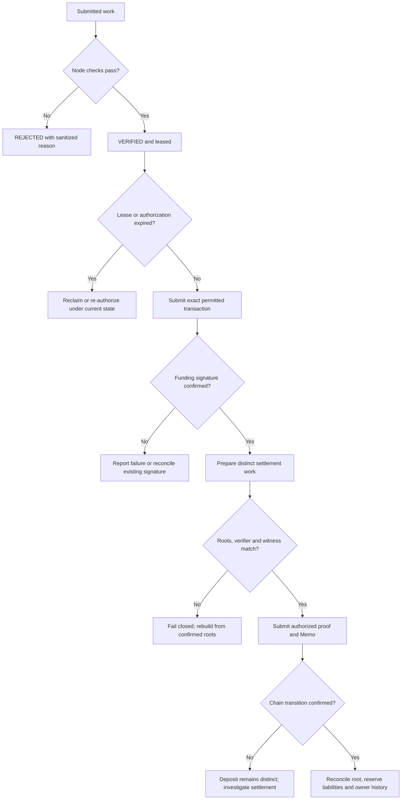

# Protocol invariants, state changes and recovery

**Status: CURRENT inspected checks; independent security review and live settlement remain separate verification tasks.** An invariant states a condition the implementation must preserve. Evidence that one check exists does not establish a complete security proof.

## Identity and owner authorization

The recipient TIN in the signed payment message must match the request, and `recipientHash` must equal the Node-resolved owner's 32-byte commitment. `recipientHash` is not the ten-digit TIN. TIP creation binds an owner authorization, keyed lookup commitment, encrypted identity/recovery data, route key material and policy commitment. Owner-indexed recovery does not replace the keyed identity registry.

The direct and staged TIN V1 paths remain valid implementation capabilities. Staging changes transaction size and temporary state; it must preserve the exact owner-authorized payload. The [existing issuance guide](../protocol-flows/tin-creation/README.md) documents this contract. A newly added scan key changes the route leaf and account schema; deployment alone does not migrate an older registration.

## Funding evidence and immutability

The current native funding mode is `tcap_deposit_v2`. Receiver rejects retired funding modes. Node verifies the exact signed deposit instruction, account graph, registered token and amount; settlement preparation rechecks the confirmed deposit. Cranker reserializes and verifies the signed wire before submitting it unchanged. A matching signature must be confirmed on the intended cluster before funding is treated as complete.

If an RPC does not recognize the signed blockhash, Cranker may try its configured alternate RPC with identical bytes. If the transaction has expired everywhere, the owner must approve a fresh authorization and sign a rebuilt deposit. Replacing only the blockhash invalidates the existing signature. Neither a lease nor an operator key grants permission to repair an owner signature.

## Node decision and lease binding

Receiver verifies Node's Ed25519 attestation over the work kind/id, decision, input/evidence/execution commitments, verification type and lease context. Cranker separately checks that signed projection. Both boundaries must agree on canonical JSON and the execution allowlist; hashing a richer object on one side can reject legitimate work, while omitting a relevant execution field weakens the binding.

The current settlement authorization endpoint checks the active Cranker lease and stored verified transition. A worker must not replace a proof with another valid route's proof after Node verification. Reclaiming an expired lease increments coordination state; it is not permission to alter wallet-signed funding or reuse an expired settlement authorization.

## Root, nullifier and accounting continuity

TCAP credit requires a nonzero previous root equal to its current root and a sequence exactly one greater than the stored sequence. The action, token and amount must agree across TSNP arguments, TCAP arguments and proof inputs. The authorization digest binds root account, old root, sequence, validity slots, token, amount and nullifier. TSNP verifies Mother authority and derives the TCAP signer PDA from that digest.

The circuit inserts the confirmed-deposit-derived nullifier into an authenticated map and advances the hidden head. The Node derives that nullifier deterministically from the deposit signature and TCAP program, so retries cannot safely create a new credit merely by changing the service work ID. A local counter is not the replay authority. Both reconstructed head and nullifier roots must match chain-selected state before proving.

TCAP checks active/approved asset policy, pause state, sufficient pending liability and reserve solvency. After GPRU verification, it subtracts the same amount from pending liability and adds it to settled confidential liability while advancing the shared root. This instruction does not make a new token payout to the recipient. If proof verification or any check fails, the root/accounting mutations in that transaction roll back together.

The confirmed-deposit nullifier is publicly computable from the deposit signature and TCAP program ID. Its replay-binding purpose therefore also makes funding and credit linkable; hiding the TIN witness is a separate property. This current-source tradeoff is recorded in [cryptography](cryptography.md) and must not be described as general transaction unlinkability.

## Proof and Memo continuity

GPRU checks twelve canonical BN254 public inputs, the approved caller context, canonical TIP/TCAP root accounts and verifier configuration. The following top-level instruction must be the canonical Memo program. The complete Memo hash and seven fixed prefix fields must agree with the proof. A mutable payload that happens to decrypt is not sufficient evidence of a valid settlement statement.

The owner-recoverable blinding delta is constrained to the Pedersen transition by the circuit's BabyJubjub ciphertext relation. The encrypted action body excludes a second independently supplied delta. Owner recovery validates action commitments, sequence and predecessor continuity against observable statements. Incomplete Memo history must not silently produce a claimed complete balance.

## Recovery branches

The diagram describes available checks and required evidence. It does not invent an automatic refund for failed native credit. Refund entrypoints in the separate epoch-slot family have different permits and accounts. No general rollback of an already confirmed reserve deposit is established by the hidden-head credit path.

## Source evidence

See [Node validation](../../tsn-protocol/services/tsn-node/server.py), [Receiver attestation verification](../../tsn-protocol/services/tsn-receiver/lib/node-verification.ts), [Cranker verification/submission](../../tsn-protocol/services/tsn-cranker-op-daemon/scripts/cranker.ts), [TCAP credit](../../tsn-protocol/programs/tcap-protocol/programs/tcap/src/instructions/credit_gpru_memo_v1.rs), [GPRU verification](../../tsn-protocol/programs/gpru/src/hidden_head.rs), [circuit](../../tsn-protocol/programs/gpru/circuits/hidden_head_v1/main.circom), and [owner history recovery](../../tsn-protocol/sdks/tsn-sdk/src/gpru/balance-history.ts).
