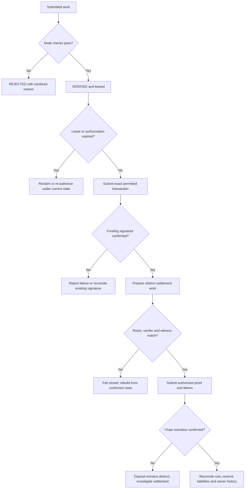

# Protocol invariants, state changes and recovery

**Status: CURRENT inspected checks; independent security review and live settlement remain separate verification tasks.** An invariant states a condition the implementation must preserve. Evidence that one check exists does not establish a complete security proof.

## Identity and owner authorization

The recipient TIN in the signed payment message must match the request, and `recipientHash` must equal the Node-resolved owner's 32-byte commitment. `recipientHash` is not the ten-digit TIN. TIP creation binds an owner authorization, keyed lookup commitment, encrypted identity/recovery data, route key material and policy commitment. Owner-indexed recovery does not replace the keyed identity registry.

The direct and staged TIN V1 paths remain valid implementation capabilities. Staging changes transaction size and temporary state; it must preserve the exact owner-authorized payload. The [existing issuance guide](../protocol-flows/tin-creation/README.md) documents this contract. A newly added scan key changes the route leaf and account schema; deployment alone does not migrate an older registration.

## Funding evidence and immutability

The current native funding mode is `tcap_funded_note_v1`. Receiver rejects retired funding modes. Node verifies the private opening against the commitment signed in the payment message and exact `deposit_private_funding_v1` wire, account graph, registered token and amount; settlement preparation rechecks the confirmed deposit. Cranker verifies and submits the signed wire unchanged. A matching signature must be confirmed on the intended cluster before funding is complete. TCAP appends the asset/observed-amount-bound leaf atomically with the successful deposit and accounting.

If an RPC does not recognize the signed blockhash, Cranker may try its configured alternate RPC with identical bytes. If the transaction has expired everywhere, the owner must approve a fresh authorization and sign a rebuilt deposit. Replacing only the blockhash invalidates the existing signature. Neither a lease nor an operator key grants permission to repair an owner signature.

## Node decision and lease binding

Receiver verifies Node's Ed25519 attestation over the work kind/id, decision, input/evidence/execution commitments, verification type and lease context. Cranker separately checks that signed projection. Both boundaries must agree on canonical JSON and the execution allowlist; hashing a richer object on one side can reject legitimate work, while omitting a relevant execution field weakens the binding.

The current settlement authorization endpoint checks the active Cranker lease and stored verified transition. A worker must not replace a proof with another valid route's proof after Node verification. Reclaiming an expired lease increments coordination state; it is not permission to alter wallet-signed funding or reuse an expired settlement authorization.

## Root, nullifier and accounting continuity

TCAP credit requires current nonzero shared root and exactly the next sequence. Action, token and blinded amount commitment agree across TSNP, TCAP and GPRU; authorization binds slots, roots, nullifier, epoch and sealed pool. The circuit privately binds positive u64 amount to funded membership and recipient arithmetic using fresh nonzero blinding. TSNP validates Mother and supplies its digest-derived signer.

The circuit proves exact funded-note membership and secret-derived nullifier insertion into the authenticated map. Retries retain the same note/nullifier. Head/nullifier snapshots must match the current shared root; the captured funding root is immutable, so later deposits do not invalidate its membership. A work ID or local counter supplies no replay authority.

Individual credit checks asset policy, pause state, released sealed pool and reserve solvency, then atomically advances the shared root and appends its blinded epoch transcript. It transfers no tokens and reclassifies no public liabilities. The separate epoch proof opens every accepted commitment in order, requires 2–64 credits and authenticates the total before one pending-to-settled reclassification. Total obligations, custody assets and uncredited pending deposits are preserved; failed proof, overflow, insufficient pending or replay leaves state unchanged.

The current credit excludes public note/leaf/index/opening and plaintext amount. Pool capture counts only positive unspent member notes and distinct wallets, with a two-wallet floor; dummy zero-value actors cannot increase eligibility. Aggregate epoch total, deposit amounts, timing, metadata, recipient/head correlations and Node knowledge remain privacy limits. Wallet count does not prove independent people. Historical settled state and receipt recovery remain separate from active serializers.

## Proof and Memo continuity

GPRU checks thirteen canonical BN254 public inputs, the approved caller context, canonical TIP/TCAP state and sealed-pool accounts and V2 verifier configuration. The following top-level instruction must be the canonical Memo program. The complete Memo hash and seven fixed prefix fields must agree with the proof. A mutable payload that happens to decrypt is not sufficient evidence of a valid settlement statement. Runtime accepts only the new proof layout; historical owner-history decoding is a distinct capability.

The owner-recoverable blinding delta is constrained to the Pedersen transition by the circuit's BabyJubjub ciphertext relation. The encrypted action body excludes a second independently supplied delta. Owner recovery validates action commitments, sequence and predecessor continuity against observable statements. Incomplete Memo history must not silently produce a claimed complete balance.

## Recovery branches

The diagram describes available checks and required evidence. It does not invent an automatic refund for failed native credit. Refund entrypoints in the separate epoch-slot family have different permits and accounts. No general rollback of an already confirmed reserve deposit is established by the hidden-head credit path.

## Source evidence

See [Node validation](../../tsn-protocol/services/tsn-node/server.py), [Receiver attestation verification](../../tsn-protocol/services/tsn-receiver/lib/node-verification.ts), [Cranker verification/submission](../../tsn-protocol/services/tsn-cranker-op-daemon/scripts/cranker.ts), [TCAP credit](../../tsn-protocol/programs/tcap-protocol/programs/tcap/src/instructions/credit_gpru_memo_v1.rs), [GPRU verification](../../tsn-protocol/programs/gpru/src/hidden_head.rs), [circuit](../../tsn-protocol/programs/gpru/circuits/hidden_head_v1/main.circom), and [owner history recovery](../../tsn-protocol/sdks/tsn-sdk/src/gpru/balance-history.ts).
