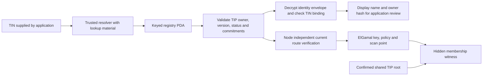
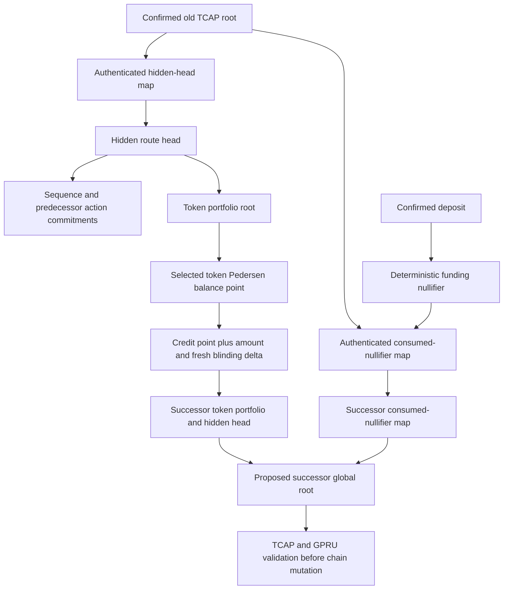
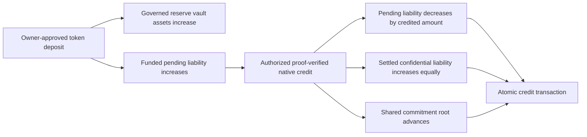
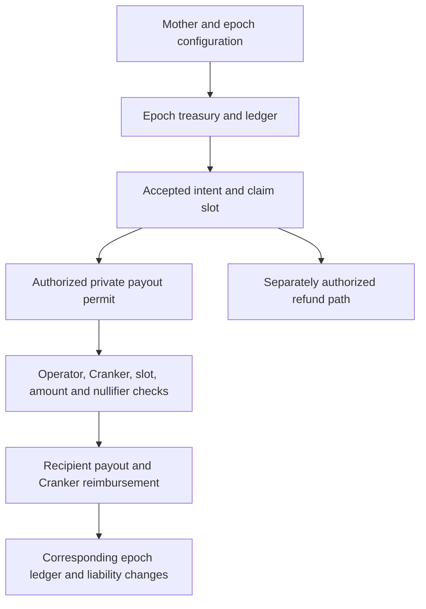

# Identity, proof state and separate treasury flows

**Status: CURRENT inspected native-credit structures; epoch flow is a retained source capability.** These diagrams complement the [complete payment sequence](architecture-map.md), [credit account/CPI contract](credit-abi.md) and [failure branches](invariants.md). They describe specific source relationships rather than a claim of live execution.

## Identity resolution and authenticated route

The application reviews display identity and signs the TIN-targeted payment; Node independently verifies the authenticated current route. Resolver material never becomes browser configuration. The TIP route leaf commits the ElGamal key, policy and two scan-point coordinates. A root filename does not establish membership; reconstruction must match the chain-selected root. See [TIP route-root source](../../tsn-protocol/programs/transfer-identity-protocol/tin-registrar/program/src/route_root.rs), [SDK resolution](../../tsn-protocol/sdks/tsn-sdk/src/tins.ts) and [Node verification](../../tsn-protocol/services/tsn-node/server.py).

## Hidden head, portfolio and consumed funding

The diagram shows logical authenticated state, not independent public per-TIN accounts. Node reconstructs the private maps and proves membership/transition against current roots. TCAP accepts the successor only after authorization, accounting and GPRU checks; saving a local candidate does not advance that root. See [witness reconstruction](../../tsn-protocol/services/tsn-node/hidden_head_witness.py), [circuit](../../tsn-protocol/programs/gpru/circuits/hidden_head_v1/main.circom) and [TCAP credit handler](../../tsn-protocol/programs/tcap-protocol/programs/tcap/src/instructions/credit_gpru_memo_v1.rs).

## Pooled reserve accounting

Funding and credit are distinct transactions. The native credit recognizes a confidential liability; it does not make a new recipient wallet payout. The same credited amount shifts between liability categories while the reserve's solvency checks continue to apply. See [deposit source](../../tsn-protocol/programs/tcap-protocol/programs/tcap/src/instructions/deposit_asset_v2.rs) and the credit handler above. The Node's native flow separately requires the credit to match its confirmed deposit context; aggregate reserve arithmetic does not relax that binding.

## Separate epoch payout and reimbursement capability

This is the retained epoch family described by [execute_private_payout](../../tsn-protocol/programs/tsn/protocol/programs/trustlink-escrow/src/tsn/instructions/execute_private_payout.rs) and [refund_epoch_claim](../../tsn-protocol/programs/tsn/protocol/programs/trustlink-escrow/src/tsn/instructions/refund_epoch_claim.rs). Its account/permit conditions do not follow from native hidden-head credit. Complete reachability and deployment tests for this family remain outside the verified native-credit evidence; it must not be drawn as a mandatory stage of that lifecycle.
