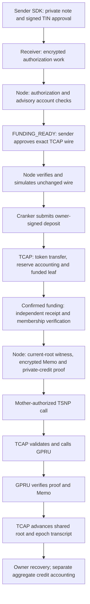
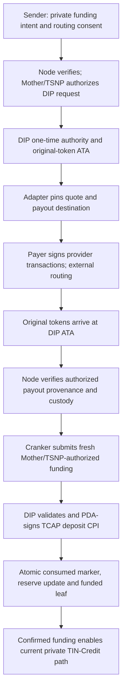

# DIP and MultiHopper architecture investigation

**Status: PROPOSED architecture; CURRENT source findings, reviewed November 24, 2026 (Africa/Lagos).** This is the initial investigation requested in the supplied discussion. It authorizes no implementation, program allocation, key creation, deployment, service operation, provider transfer or publication. MultiHopper statements below distinguish public documentation from the developer response supplied by the user. No routed deposit was executed.

## Recommended contract

DIP should own an authorized, single-use ingress request and its custody/lifecycle rules. MultiHopper is an optional adapter that delivers value to that request's token account. A successful arrival is independently verified by Node, authorized through the existing Mother/TSNP boundary, and swept by DIP through TCAP's existing `deposit_private_funding_v1`. Confirmed TCAP funding then enables the existing private TIN-Credit proof and settlement. Keep one Wallet Deposit Intent, a linked routing record, and a separate settlement work item.

For the initial implementation, use one approved classic SPL asset, one destination and an exact authorized net amount. Recommend a separate DIP program owning its ingress authorities and receipts, subject to review of cost and deployment ownership; a protocol does not inherently require a separate program. A TCAP-owned module is a viable alternative but would add ingress lifecycle and provider-facing concerns to TCAP. Do not reuse TIP/GPRU identity addresses, a shared reserve vault or retained public funding claims as deposit addresses.

This design reuses funded-note mathematics and TCAP's deposit ABI. New DIP execution, TSNP ingress authorization, service evidence profiles and SDK consent are required. It is not available by changing a destination URL or treating a webhook as funding confirmation.

## A. Current funding architecture and exact source references

Paths below are relative to the repository root. Function names and line numbers identify the inspected checkout, including existing uncommitted work; remote main-branch contents may differ.

1. **Sender consent and private note.** [SDK `src/gpru/funding-note.ts`](../../tsn-protocol/sdks/tsn-sdk/src/gpru/funding-note.ts), lines 26, 59, 65 and 73, implements note generation, Poseidon note/leaf commitments and secret-derived nullifiers. [SDK `src/contracts.ts`](../../tsn-protocol/sdks/tsn-sdk/src/contracts.ts), `CreateIntentRequest` at line 60 and `buildCreateIntentRequest` at line 154, admits the `tcap_funded_note_v1` source and requires `recipientTin`. [SDK `src/canonical-message.ts`](../../tsn-protocol/sdks/tsn-sdk/src/canonical-message.ts) and [payment authorization](../../tsn-protocol/sdks/tsn-sdk/src/payment-authorization.ts) bind displayed identity, TIN, asset, amount, fee, nonce, expiry and note commitment. The opening is available to authorized TSN processing, never to MultiHopper.
2. **Ingress.** [Node `api/handlers/post_intent.py`](../../tsn-protocol/services/tsn-node/api/handlers/post_intent.py), `post_intent` at line 22, forwards to Receiver. [Receiver `lib/work/receive.ts`](../../tsn-protocol/services/tsn-receiver/lib/work/receive.ts), `receive` at line 6, stores private funding contents in a Node envelope. [Envelope encryption](../../tsn-protocol/services/tsn-receiver/lib/security/node-envelope/encrypt-payload-for-node.ts), line 8, uses AES-256-GCM. Receiver can decrypt it; this is restricted storage within a trusted service boundary, not encryption excluding Receiver.
3. **Readiness.** [Node `verification/work/prepare_receiver_funding.py`](../../tsn-protocol/services/tsn-node/verification/work/prepare_receiver_funding.py), line 17, verifies the signed message and resolves registered deposit accounts. Its preparation expires at the earlier of the signed expiry and five minutes. [Account preparation](../../tsn-protocol/services/tsn-node/transactions/native/funding/prepare_funding_deposit_accounts.py) checks asset/config/reserve/vault/funding-root state and finds a sufficiently funded sender-owned token account. `FUNDING_READY` reserves no assets and supplies no Cranker execution.
4. **Wallet approval and attachment.** [SDK `src/funding-authorization.ts`](../../tsn-protocol/sdks/tsn-sdk/src/funding-authorization.ts), lines 37, 71 and 95, checks readiness, constructs completion and polls status. [SDK `src/tcap-gpru-credit.ts`](../../tsn-protocol/sdks/tsn-sdk/src/tcap-gpru-credit.ts), lines 58, 105 and 134, resolves accounts, builds and checks an exact owner-signed deposit. Its ATA resolver currently passes `allowOwnerOffCurve=false`; use a separately reviewed DIP derivation for PDA owners. [Node completion](../../tsn-protocol/services/tsn-node/api/handlers/post_complete_funding.py), line 28, and [Receiver attachment](../../tsn-protocol/services/tsn-receiver/lib/work/attach-signed-funding-transaction.ts), line 5, fence original identity, commitment and state version. Attachment atomically creates deterministic settlement work; its verification waits for funding confirmation. [XP](../../protocol-tests/ui/public/tsn-dapp.js), around lines 730–850, performs these staged approvals.
5. **Funding verification and submission.** [Node signed-deposit verifier](../../tsn-protocol/services/tsn-node/transactions/native/funding/verify_signed_tcap_deposit_contract.py), line 20, requires the precise nine accounts, 48 bytes, original wallet, amount and note. [Instruction selector](../../tsn-protocol/services/tsn-node/transactions/native/funding/select_tcap_private_funding_deposit.py) admits only that deposit plus supported compute settings. [Completed-funding verification](../../tsn-protocol/services/tsn-node/verification/work/verify_completed_funding.py) simulates the unchanged signed wire. [Cranker `scripts/cranker.ts`](../../tsn-protocol/services/tsn-cranker-op-daemon/scripts/cranker.ts), `processAuthorizedFunding` at line 485, calls [owner-signed funding](../../tsn-protocol/services/tsn-cranker-op-daemon/src/dbrix/owner-signed-funding.ts), preserves its bytes and reports its signature. A routing bundle or DIP CPI receipt cannot pass this profile unchanged.
6. **TCAP reserve funding.** [TCAP `deposit_private_funding_v1.rs`](../../tsn-protocol/programs/tcap-protocol/programs/tcap/src/instructions/deposit_private_funding_v1.rs), account contract at line 11 and handler at line 62, requires `depositor: Signer` and `source.owner == depositor`. Accounts are depositor, config, asset entry, reserve state, source token account, vault, mint, token program and global funding root. It checks pause/asset/risk/deposit gates, canonical custody and exact vault balance delta; atomically transfers tokens, increases `actual_assets` and `pending_liabilities`, and appends the asset/amount-bound leaf. It does not check a TSN user's payment message. That authorization is a separate Node/Mother responsibility.
7. **Roots and PDAs.** [TCAP `authority.rs`](../../tsn-protocol/programs/tcap-protocol/programs/tcap/src/authority.rs) defines `tcap:global-config:v1`, `tcap:asset-entry:v1`, reserve authority/state/vault domains, `tcap:commitment-root:v1` and `tcap:funding-root:v1`. Asset entry seeds also bind registry, token program and mint. Reserve/vault addresses come from the registered asset, not an invented derivation. [TCAP `private_funding.rs`](../../tsn-protocol/programs/tcap-protocol/programs/tcap/src/private_funding.rs), lines 18, 110 and 120, maintains the 6,209-byte global depth-32 funded-note tree and authenticated root history. One confirmed funded note suffices; no sealed pool or second deposit is required.
8. **Confirmed funding evidence.** [Node confirmed-deposit verifier](../../tsn-protocol/services/tsn-node/transactions/native/funding/verify_confirmed_tcap_deposit.py), line 19, reads a successful **confirmed** transaction and matches the original wire and signature. [Settlement context](../../tsn-protocol/services/tsn-node/verification/credit/settlement_funding_context.py), line 23, revalidates the wallet message, amount, registered asset, note and deposit. [Snapshot reconstruction](../../tsn-protocol/services/tsn-node/settlement/funding/ensure_funding_snapshot.py), line 18, and [append-event decoder](../../tsn-protocol/services/tsn-node/settlement/funding/decode_append_events.py) reconstruct authenticated TCAP leaves; the decoder already tracks invocation depth, which is useful for CPI funding. [Membership](../../tsn-protocol/services/tsn-node/settlement/funding/funding_membership.py) proves the actual note/token/amount leaf. Reusing the log decoder still requires testing the new CPI receipt and funding context.
9. **Private credit authorization and execution.** [TSNP authorization](../../tsn-protocol/programs/tsn/protocol/programs/trustlink-escrow/src/tsn/instructions/register_tcap_credit_authorization_v2.rs), account contract at line 41 and handler at line 81, implements `tsn_register_tcap_credit_authorization_v3`: Mother authority signs, the digest binds the exact transition, and a TSNP digest-derived PDA signs the TCAP CPI. [TCAP credit](../../tsn-protocol/programs/tcap-protocol/programs/tcap/src/instructions/credit_gpru_memo_v1.rs), line 84, validates root/sequence, asset, authorization, funding root and backing, calls GPRU, then advances the shared root and credit-epoch transcript. [GPRU](../../tsn-protocol/programs/gpru/src/hidden_head.rs), `verify_transition` at line 361, checks thirteen public inputs, current TIP/TCAP roots, funded root, Memo and Groth16 proof. [Circuit](../../tsn-protocol/programs/gpru/circuits/hidden_head_v1/main.circom), lines 284–307, binds note opening, funded membership, private amount and deterministic nullifier. Credit moves no reserve tokens; aggregate liability reclassification belongs to separate `account_credit_epoch_v1` work.
10. **Coordination and identity boundaries.** [Receiver attestation verifier](../../tsn-protocol/services/tsn-receiver/lib/security/node-attestation/assert-node-verification-attestation.ts), line 13, checks a configured Ed25519 verification key and work/input/evidence/execution/lease bindings. This is not an implemented threshold of independent nodes. Mother signing is a different role. [TIP creation](../../tsn-protocol/programs/transfer-identity-protocol/tin-registrar/program/src/processor/create_tin_v1.rs), lines 82 and 113, and [TIP route root](../../tsn-protocol/programs/transfer-identity-protocol/tin-registrar/program/src/route_root.rs) supply identity/PDA/membership patterns; their addresses carry identity meaning and should not custody DIP arrivals. Current GPRU guards private state/proof relations; a reusable temporary-deposit-address service was not found.

## B. Reuse and required changes

The accompanying review canvas contains the requested mechanism/purpose/DIP-use/change comparison. Direct reuse candidates are funded-note cryptography, TCAP's exact transfer/leaf append, registered-asset resolution, invocation-bound append decoding, private witness/proof preparation after funding, and Receiver lease/attestation/checkpoint principles. SDK PDA-owner ATA derivation, Node funding receipt validation, Receiver funding phases/dependencies, Cranker execution projection and owner consent need explicit new routed profiles.

Retained `deposit_with_funding_commitment_v2` supplies useful examples of expiry, nonce and one-time claim allocation but exposes settlement mode and claim metadata. It uses a different per-asset commitment chain and has no current claim settlement consumer. `deposit_asset_v2` adds backing without a native funded-note leaf. Neither can substitute for the current credit source. See the [Wallet Deposit Intent catalog](../../tsn-protocol/contracts/wallet-deposit-intent-v1.json) and [November 24 source review](WALLET-DEPOSIT-INTENT-20261124.md).

## C. Proposed DIP account, commitment and verification contract

### Accounts and authorization

All following names and seed domains are **illustrative proposed ABI**, not existing instructions or allocated accounts. Do not assign a program ID until implementation/deployment ownership is approved.

- **DIP config:** a unique configuration PDA, illustratively `["dip:config:v1"]`, pins approved TSNP/TCAP program identities, governance, pause rules and supported ingress policy. Provider transaction/program identities are validated by a separately versioned adapter policy. User-supplied executable accounts cannot replace these identities.
- **Deposit record and authority:** one DIP-owned PDA, illustratively `["dip:deposit:v1", randomDepositId32]`, can serve both roles. It records state, opaque authorization commitment, note commitment, mint/token program, authorized net amount, validity slots, refund-policy commitment, authorization revision and eventual TCAP append identity. A random identifier has no TIN/wallet-derived seed. An alternative separate authority PDA is unnecessary unless account-layout or signer review establishes a reason.
- **Ingress token account:** `ATA(mint, depositAuthority, tokenProgram)` is owned at the Solana account level by the token program; its token authority is the DIP PDA. It is not the PDA itself. Pre-create it if required by the verified provider interface, while rejecting wrong authority, mint, token program, delegate, close authority and unsupported extensions. The address remains unique even if the ATA is closed and later recreated by an outsider.
- **Terminal replay marker:** retain the deposit record as a tombstone, or replace it with a separately proven durable replay marker before closure. Closing the token account alone does not prevent the same seeds being initialized again. No silent address reuse is permitted.

Reuse Node verification and Receiver's signed execution projection. Add scoped TSNP ingress authorization that Mother signs and that invokes DIP using an authenticated, digest-derived TSNP signer. DIP validates that signer, the approved program, request revision, validity and exact allowed action before it can sign for custody. Creation, funding consumption and recovery need action-separated digests. This extends the existing authorization mechanism; it introduces no new Node quorum or consensus claim. The Node/Mother trust boundary authenticates the user's off-chain consent and provider provenance; a hash alone proves neither.

### Commitments and amount policy

Keep three distinct bindings: the private Wallet Deposit Intent commitment; the DIP authorization digest over the permitted on-chain projection; and the unchanged native funded-note commitment. Bind the DIP digest to network/genesis identity, DIP and TCAP programs, request/address, original private-intent commitment, mint/token program/asset entry, note commitment, exact net amount, validity/revision, and recovery-policy commitment. Use canonical domain-separated serialization, fixed widths or length prefixes and fresh independent randomness for private low-entropy fields. The exact new encoding and vectors require review; the existing note is not a commitment to all deposit conditions.

Do not publish the TIN, displayed recipient name, sender signature or note opening in a commitment opening used on chain. Only the enforceable funding projection is public. Amount/mint/account/timing are already visible at arrival and TCAP funding; hashing them does not make the action private. Retain sensitive authorization in the existing restricted service envelope, and bind Node/Mother decisions to that immutable payload.

**Recommended initial model: exact net amount.** Obtain an estimate, then inspect the accepted created/prepared route and its pinned net amount before final DIP authorization and wallet broadcast. The payer approves gross routing debit, provider fees/SOL budget and the exact intended net TIN funding separately. A quote change requires renewed consent; never subtract fees silently from the existing direct-payment amount. Use integers and registered decimals. Routing validity may be far longer than current five-minute funding readiness, so introduce an explicit route-arrival deadline and a short fresh sweep authorization; do not extend existing signed wires or service leases across the route.

An authorized min/max actual-received policy is possible later. It requires signed bounds, maximum fees, partial/top-up rules, exact observation ownership and binding the accepted amount to proof/accounting. It is not safe to credit the entire account balance. The initial exact model consumes only the authenticated route's net amount when account balance is at least that amount; surplus remains separate. Equal total balance does not prove authorized provenance.

Resolve quote ordering before implementation. Prefer deriving the random DIP authority address without allocation, obtaining a quote for that destination, inspecting the accepted/prepared terms, then obtaining final private funding/routing consent and confirming the bound on-chain DIP record before provider broadcast. If the provider requires a pre-existing destination for quotation/preparation, a nonconsumable preparation record would need a separately reviewed activation step. No proposed lifecycle may route the payer's assets before an authorized destination and its recovery terms exist.

### Observation, funding and atomicity

Node must authenticate the DIP record and original user consent, pin provider transfer/route/payout identity, verify independently successful Solana payout evidence, final original mint/token program, destination ATA/authority, actual net delivery and remaining validity, and check the deposit is unconsumed. A current balance is a custody check. It cannot establish the payer or transfer of origin. Reject an attacker's matching transfer as route completion unless the pinned provider payout is proven. Require a verified historical receipt or documented on-chain payout state with adequate provenance; balance polling is insufficient if archival evidence is missing.

For the initial design, Node/Mother attest the verified provider provenance through TSNP. DIP enforces authorization, custody, mint, amount, expiry and single-use state on chain. General Solana programs cannot read an arbitrary historical transaction merely from its signature. An independent on-chain provider-state decoder could strengthen provenance, but depends on verified MultiHopper payout layouts and cannot be claimed implemented. Compromise of Node/Mother remains a material source-authorization trust assumption.

In one proposed funding transaction, DIP consumes the request and invokes TCAP `deposit_private_funding_v1` with `invoke_signed` for its PDA. TCAP's current `Signer`/token-owner constraints permit this **ABI-level inference**; no separate private key is involved. Token movement, TCAP accounting/leaf append and DIP consumed status must roll back together on failure. Local validator/CPI tests must establish actual compatibility before deployment. Only the DIP program can sign for its PDA; neither Cranker nor TCAP can impersonate it from another program.

After a successful independent TCAP receipt check, normalize funding evidence for the existing witness/proof path, retaining the original note opening and nullifier. Add a routed evidence profile instead of faking a sender-signed TCAP wire. A nested TCAP instruction/append must be checked against the expected DIP/TSNP invocation and exact accounts/arguments. Report funding confirmation and settlement confirmation separately.

Solana can make multiple instructions/CPI effects atomic, but **atomic sweep plus private TIN credit is not established for this integration**. Existing preparation reads confirmed funding snapshots, and GPRU checks the TSNP/Memo instruction context. A combined transaction would need a prospective funding-root witness, exact top-level caller/Memo compatibility, race handling and transport/compute tests, and it would publicly link arrival funding to credit in one transaction. Recommend atomic DIP consumption plus TCAP funding first, followed by separately proved credit. The external multi-transaction route remains non-atomic.

### Recovery and rent

An authenticated pre-sweep payout can be returned under the original user's preauthorized recovery commitment, with action-separated Mother/TSNP authorization and single-use state. The caller never chooses an arbitrary recipient. Reveal/verify only the needed refund-address opening at execution. Initial recovery should return the original SPL asset on Solana; returning it through MultiHopper is a separately consented future route, not an automatic reverse operation.

Underpayments, wrong-mint arrivals, unproven payouts, unsolicited surplus and post-consumption arrivals enter quarantine. They must not trigger credit, automatic top-up or refund to the intended payer. The legitimate source of unsolicited tokens can be unknown; a reviewed claim/administrative recovery policy is an implementation gate, not an existing guarantee. Wrong-mint token accounts need separate authorized handling, never an unrestricted sweep-all instruction.

Cancel/expiry fences consumption but cannot stop an external route from delivering later. Retain the original address and permit recovery of authenticated late arrivals under a defined grace/recovery policy; do not silently reopen credit. A provider failure or refund status does not establish that DIP's account is empty. Verify actual provider and DIP custody independently, and distinguish locked provider funds (`recoverable`) from funds already delivered to DIP.

After TCAP funding, DIP no longer controls those tokens. Do not refund from TCAP while the funded note remains eligible for credit; that would risk double claims and broken backing. A funded but unsettled request remains pending/retryable subject to exact signed-attempt reconciliation. A future post-funding refund requires a separately audited note-invalidating TCAP contract. Existing Epoch Treasury/refund APIs do not supply that capability.

Close only zero-balance eligible token accounts and return rent to the consent-bound rent beneficiary. Keep replay protection and recovery policy available for late recreated ATAs. Specify pause behavior separately: stop new ingress/consumption while preserving an authenticated recovery path when the token program permits it. Frozen tokens, fees and provider downtime can prevent immediate recovery; there is no unconditional no-loss or automatic-refund guarantee.

## D. Intent relationship and proposed state machine

“Hop Intent” should be a linked DIP routing authorization record, not a third independent payment intent. Extend the canonical funding request with an explicit source profile; keep direct owner-signed funding supported as its distinct capability. Store provider attempts, quote versions and deposit identity under the same private funding authorization. Requotes before broadcast renew consent; partial signed/broadcast attempts require reconciliation before replacement. Provider IDs and statuses do not substitute for Receiver's work IDs, versions or states.

The labels below describe **proposed DIP state**, not additions already accepted by Receiver's `WorkStatus` enum. The routing record can span many short worker leases; a route wait should not monopolize the shared private-credit root lock. Settlement becomes eligible only after verified TCAP funding, using an atomic linkage update and deterministic dependency. Preserve signed execution checkpoints before broadcast and resolve ambiguous outcomes before re-signing.

```mermaid
stateDiagram-v2
  [*] --> Authorized: User consent verified; TSNP creates bound DIP record
  Authorized --> Routing: Payer-approved provider deployment accepted
  Authorized --> RecoveryOnly: Cancel or funding deadline passes
  Routing --> Observed: Webhook or polling finds possible arrival
  Routing --> RecoveryOnly: Failure, expiry or cancellation
  Observed --> Verified: Node proves pinned payout and deposit conditions
  Observed --> Quarantined: Mint, amount, provenance or validity mismatch
  Verified --> FundingPending: Fresh TSNP authorization; Cranker checkpoints transaction
  FundingPending --> Funded: Successful confirmed DIP and TCAP transaction
  FundingPending --> OutcomeUnknown: Broadcast or report outcome ambiguous
  OutcomeUnknown --> Funded: Exact receipt reconciled
  OutcomeUnknown --> Verified: Proven nonexecution; unchanged eligible request
  RecoveryOnly --> Refunded: Authenticated arrival returned under recovery policy
  Quarantined --> Refunded: Reviewed claim establishes authority and eligible amount
  Funded --> CreditPending: Independent funded-note verification
  CreditPending --> Credited: Confirmed private TIN-Credit
  Refunded --> [*]
  Credited --> [*]
```

`Observed` is an unauthoritative hint; `Verified` is an off-chain decision with a fresh lease-bound execution projection. On-chain records primarily need authorized/consumed/recovery/terminal state, not every provider progress event. `Funded` consumes DIP's request even if later credit fails. `OutcomeUnknown` cannot advance by timeout alone: require a matching receipt or explicit nonexecution evidence. The exact DIP nonexecution guard must be designed; the existing private-root resolver cannot simply be copied for custody transfers. Closing the provider route is independent of closing DIP custody accounts.

## E. MultiHopper mapping, contradictions and validation gates

Public resources were retrieved on November 24, 2026. They are provider-authored documentation, not independently verified deployment or security evidence.

- [Create transfer](https://dev-docs.multihopper.com/api-reference/transfers/create) documents `sourceOwner`, either `recipientWallet` or `destinations`, `externalId`, and net `recipientReceivesRaw`. Its examples show duplicate-ID conflict while prose describes returning an existing transfer; verify duplicate behavior and scope. Use a random provider alias bound privately to DIP, not a TIN, recipient hash or internal payment ID. API metadata is not settlement authorization.
- [Estimate](https://dev-docs.multihopper.com/api-reference/transfers/estimate) documents `hopAmountRaw`/net delivery and separate SOL requirements, including rent and screening. [Prepare](https://dev-docs.multihopper.com/api-reference/transfers/prepare) rechecks fees and can reject a changed tier (`MH_040`); it includes legacy and versioned transaction groups plus resumable preparation. [Agentic integration](https://dev-docs.multihopper.com/guides/agentic-integration) describes deployment order and recording keeper funding before subsequent groups. TSN must inspect decoded programs, resolved lookup-table accounts, mint, destination, gross/net costs and signers before each explicit payer approval, and reconcile each landed group before a refreshed unsigned bundle. Do not use the guide's autonomous private-key signing example in XP.
- [Multi-destination](https://dev-docs.multihopper.com/guides/multi-destination) describes destination payouts after the final hop and per-destination payout signatures. `completed` represents all destinations paid. SPL dispersion support depends on the deployed cluster version. It offers a possible one-destination dispersion experiment, but does not establish off-curve authority support. Restrict the initial adapter to a single proven destination; do not add batching solely for potential privacy.
- [Webhook events](https://dev-docs.multihopper.com/api-reference/webhooks/events) documents HMAC-SHA256 and **`x-multihopper-signature`**, conflicting with **`X-MH-Signature`** in the supplied developer discussion. Confirm the actual delivery header, hex encoding, exact raw-body signing, event identity and any timestamp scheme. Validate length/encoding before constant-time comparison, durably deduplicate events, bound body sizes and acknowledge only after persistence. Retries are bounded; periodic independent reconciliation is required. No webhook promotes a deposit to verified funding.
- [How it works](https://dev-docs.multihopper.com/protocol/how-it-works) describes original assets locked in a vault and route-specific Token2022 wrappers moving through hops, with final redemption. This differs from the supplied response's automatic plain original-token delivery description. Confirm whether the chosen API's payout executes redemption without recipient signature, which final token mint lands, and whether a PDA owner is supported. A wrapper balance is not a TCAP-accepted original asset. Native SOL delivery also differs from SPL arrival; exclude it initially.
- [Routes](https://dev-docs.multihopper.com/concepts/routes) describes public creator/source-owner information, route timing and amount fields. [Architecture](https://dev-docs.multihopper.com/protocol/architecture) supplies program/PDA descriptions but does not prove the exact active payout ABI. [Security model](https://dev-docs.multihopper.com/concepts/security) acknowledges publicly visible transfers and planned audits. Routing can complicate naive tracing; public route identity, wrapper metadata, equal amounts and timing can still correlate the payer and DIP destination. No wallet-to-TSN unlinkability claim is established.
- [Compliance](https://dev-docs.multihopper.com/concepts/compliance) describes TRM sanctions/risk screening of origin, hops and recipients where the gate is enabled, before hops execute; late payouts may be screened again. It describes a configured screening charge retained when principal is refunded. Treat this as provider policy and attested checks, not identity verification, clean-funds proof, TSN authorization or a legal compliance guarantee. Confirm PDA destinations and test-mode coverage; never infer a real Devnet transfer from `mh_test_*` simulation.

The [Devnet dashboard](https://devnet.multihopper.com/developer/dashboard) was inaccessible to the web reader. The dedicated transfer-get page also failed retrieval, though the other guides describe polling. No API credentials, live estimates, transfer creation, signing or provider chain state were inspected. Those facts remain UNVERIFIED.

Before implementing the payout adapter, establish: supported destination representation (PDA owner versus token account); ATA creation with off-curve owners; original-mint redemption without PDA private-key signing; active Devnet programs and payout layout; full receipt/route identity exposed for independent provenance; exact fees/requotes and expiry; actual webhook contract; duplicate external-ID behavior; and provider recovery/rent behavior. If payout requires an on-curve recipient, do not substitute a backend-held keypair and describe it as program-controlled custody. Ask the provider to support the required destination or explicitly review a different custody model.

The user's supplied response says routes cannot carry TCAP instructions/commitments or call TCAP at delivery. Public API schemas inspected expose value routing, not a generic destination-call interface. The design keeps all TSN commitments and TINs out of provider payloads. A future adapter can change delivery mechanics without changing DIP's core authorization/consumption rules.

## F. Threat model and required mitigations

- **Unauthorized or substituted request:** recompute exact commitment/PDA/account bindings; require original signed private consent, approved Node attestation and action-separated TSNP authorization. A received token balance does not create a request.
- **Fabricated completion or malicious provider response:** authenticate webhooks only as hints; decode payer-approved transactions and independently verify the pinned on-chain payout and actual custody. Missing evidence leaves funding ineligible. Provider source/layout/upgrade trust must be documented.
- **Dust, matching-amount injection or mint substitution:** distinguish authenticated payout value from total balance, pin original mint/token program, consume only authorized value, quarantine extras and reject unsupported token extensions. An attacker must not be able to satisfy net conditions by sending tokens before the real route completes.
- **Replay or concurrent Crankers:** use an on-chain single-use consumed state, immutable authorization revision and transaction-atomic TCAP leaf append; Receiver versions/leases and exact checkpoints reduce duplicate execution but do not replace the on-chain guard. Preserve the funded-note nullifier for later credit replay prevention.
- **Expiry, cancel and ordering races:** check chain slots/revision in every fund-moving instruction; one record chooses consumption or refund. Distinguish arrival deadline from short execution lifetime, leave late arrivals recoverable under original policy, and require proven nonexecution before transaction replacement.
- **Unauthorized withdrawal/refund/rent theft:** DIP alone signs token authority; pin delegates/close authority and refund/rent beneficiary commitments. Use action-specific digests and exact amount/state constraints. Never allow a Cranker-selected refund address or generic sweep-all path.
- **Partial provider deployment, missing webhooks and API outages:** persist each approved bundle and broadcast identity, reconcile per group, poll independent chain/provider state and distinguish provider-held from DIP-held funds. Do not begin a second funded route while the first outcome is unknown.
- **Failed credit after funding:** retain the source note, signed attempts and proof/root reconciliation; no automatic post-funding refund. Validate backing conservation across any future cancellation contract.
- **Privacy disclosure:** no TIN, opening or reusable private-intent identifier in provider payload, on-chain ingress record or public execution logs. Review every funding lifecycle projection; unique custody addresses remain publicly linked to the provider's delivery and subsequent TCAP deposit.
- **Program/token/authority compromise and resource exhaustion:** pin supported executables and account owners, review upgrade authority and deployment parity, reject unsupported frozen/fee/hook/delegate semantics, bound pending requests/webhook bodies/history scans, and budget PDA/ATA rent plus cleanup. Recoverability depends on authority, token and provider availability.

These are proposed mitigations and review obligations, not completed security tests or an audit certification.

## G. Implementation phases, dependencies and acceptance criteria

1. **Validate external delivery.** Obtain destination/payout ABI clarification and an independently verified Devnet original-token receipt to a synthetic off-curve authority's ATA. Confirm no recipient private-key signature, fees/net amount, wrappers, receipt provenance, recovery and actual webhook format. A simulated API status alone does not pass. Chain execution remains operator-authorized work.
2. **Approve canonical contract.** Decide DIP program ownership versus a TCAP module, exact-net policy, on-chain/public projection, provider provenance trust, state/expiry/refund/quarantine/rent rules, and routed source/receipt encodings. Acceptance: cross-layer accounts, required signers, digest vectors and failure invariants are reviewable without undefined custody or replay behavior.
3. **Implement custody core locally.** Add config, single-use record/authority, token-account validation and TSNP-authorized actions; test a PDA-signed CPI into the unchanged TCAP funded-note deposit. Acceptance: successful transfer updates backing/leaf/consumed state once; injected failures roll all three back; wrong mint/authority/expiry, replay and concurrent consumption fail. Do not allocate keys or deploy as a consequence of local tests.
4. **Integrate private consent and durable coordination.** Add routed funding consent/source and receipt profiles to SDK/XP, Node and Receiver; keep direct funding's exact-wire path. Use the Node directory's component/dependency standard. Acceptance: original recipient/note survives every phase; provider details and private data stay within approved projections; route waiting does not hold shared-root locks; retries cannot duplicate route funding.
5. **Integrate MultiHopper adapter and Cranker.** Add private quote/bundle handling, webhook inbox/reconciliation, pinned payout verification, fresh TSNP funding authorization and exact signed checkpoints. Acceptance: partial broadcasts, changed quote, mismatched destination, duplicate/out-of-order/lost events, fake matching deposits and ambiguous sends are handled without accidental credit or second debit.
6. **Validate credit and recovery.** Normalize the successful DIP/TCAP receipt into authenticated funded membership and use the current thirteen-input proof/Memo/credit path. Add pre-sweep refund/quarantine and rent tests. Acceptance: exactly one independently recovered TIN credit equals the authorized net amount; a stale root can be re-proved without a new note/nullifier; consumption and refund are mutually exclusive; late funds cannot reopen the deposit.
7. **Run operator-directed Devnet trial and readiness review.** Independently check deployed program/source/ABI parity and proving artifacts, then capture finalized provider arrival, DIP consumption, TCAP funding, credit and owner recovery, plus negative and refund cases. Review privacy correlations, failure economics, upgrade authority and security audit requirements before any mainnet proposal. A single successful route is scoped evidence, not general readiness.
8. **Synchronize documentation.** After an approved implemented contract, update existing DIP/internal component and ABI records, public `layers/dip`, funding/service/SDK integration guides, relevant README/XP examples and internal operator/troubleshooting steps in the same task. Preserve the Arc/CCTP research as historical design and correct its `deposit_asset_v2`/combined-credit assumptions rather than copying them into native funded-note ingress.

## Documentation impact and verification record

Reviewed [architecture map](../laboratory/architecture-map.md), [components](../laboratory/components.md), [credit ABI](../laboratory/credit-abi.md), [Wallet Deposit Intent](WALLET-DEPOSIT-INTENT-20261124.md), [internal operator guide](../RUN-YOUR-OWN-TSN.md), both README contexts, the public [DIP page](../../tsn-protocol/tsn-docs/layers/dip.mdx) and [Arc/CCTP draft](../dip/DIPIngress-design.md). The Arc draft explicitly has no Solana implementation and uses a different attested-delivery contract. The public DIP diagram's direct-reserve and per-credit liability shorthand must not describe the proposed staging path or current native credit accounting. Existing drafts are research inputs, not implementation authorization.

This investigation adds a review record and companion canvas only; it changes no runtime, SDK API, service/configuration, deployment or recovery procedure. Therefore the operator guide has no procedural change in this task. Public navigation and proposed capabilities are not promoted to implemented status. Existing unrelated source/docs changes were present in both Git boundaries and preserved. Scoped validation below supplements, rather than regenerates or overwrites, the existing pending documentation inventories.

On November 24, the existing command `node --test tsn-protocol/sdks/tsn-sdk/tests/funding-note.test.mjs tsn-protocol/sdks/tsn-sdk/tests/funding-authorization.test.mjs tsn-protocol/sdks/tsn-sdk/tests/signed-funding-deposit.test.mjs` passed **17/17**, with no skips. It checks installed SDK `dist` output using synthetic wallets/mocks; no fresh SDK build or live transaction was performed. Source was separately inspected. The cross-chain-shaped SDK fixture does not establish an enabled route. No new DIP tests exist because no DIP implementation was introduced.

Scoped artifact checks passed: **three Mermaid diagrams** parsed with Mermaid 11.12.3 and JSDOM 26.1.0; **43 local file links** resolved; the report had zero trailing-whitespace lines and zero question-containing prose paragraphs. The companion review passed the installed TypeScript compiler with `--ignoreConfig --noEmit --strict --skipLibCheck --target ES2021 --module ESNext --moduleResolution bundler --jsx react-jsx --lib ESNext,DOM`. A pre-artifact SHA-256 baseline of **1,661 source files** across programs, SDK, participating services, contracts and XP matched after the investigation. This checks the captured files, not new-file detection or the entirety of Git state. Browser rendering and remote-link availability beyond the retrieved provider pages were not verified.

Remaining verification: provider destination/receipt ABI, real Devnet routing, DIP CPI behavior, service profiles, program compilation/deployment parity, finalized end-to-end credit/refund, owner recovery, browser rendering and independent security/privacy review. No service start/stop, wallet access, real transaction signing/submission, deployment/migration, staging, commit, push or message to the MultiHopper team was performed.
