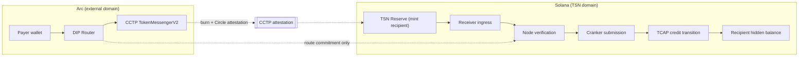

# DIP: Deposit Ingress Protocol

> The identity-free window where external stablecoin value becomes an internal TSN liability.

**Status:** design + Arc reference implementation (PoC). See [Evidence levels](#evidence-levels).

---

## Why DIP exists

TSN has an identity layer (TIP/TIN), a routing-privacy layer (GPRU), an asset layer (TCAP), and a
coordination layer (TSN). Every one of them assumes value is already *inside* the system. There is no
component that says how value enters from an external chain without dragging identity along with it.

That component cannot be TIP, because TIP is where identity lives and the whole point is that the entry
point knows nothing. It cannot be TCAP, because TCAP books liabilities against assets already in the
reserve. And it cannot be the TSN coordination layer, because coordination authorizes work on Solana, not
asset movement on a foreign chain.

**DIP is the protocol for ingressing value.** It defines: what a deposit is on the external chain, what a
deposit may and may not reveal, how the external asset is transported, how the corresponding credit is
bound to an existing TSN obligation, and which failure modes must fail closed.

DIP-Arc is the first implementation. The protocol is chain-agnostic; the Arc instance is specified here
because Arc is the first destination whose settlement asset and gas token are the same thing.

---

## Where DIP sits

| Layer | Question it answers | Knows identity? |
| - | - | - |
| **TIP** | Who is this payment for? | yes — by design |
| **GPRU** | How is the routing kept unlinkable and the credit transition verified? | no |
| **TCAP** | What assets exist, what are the reserves, what are the liabilities? | no |
| **TSN** | Who authorizes and who submits this work? | no |
| **DIP** | How does external value become an internal liability without identity? | **never** |



The dotted line is the important one. The identity-bearing fact travels through the Node, not through a
chain, and the only thing that ever joins the two sides is the `routeCommitment`.

---

## The bank analogy, stated carefully

TSN is best explained as **a settlement bank in a non-custodial world**, and the analogy is load-bearing
for the architecture, not just for the pitch:

| Banking concept | TSN |
| - | - |
| Account number | TIN (10 digits) |
| Ledger of customer liabilities | TCAP commitment state with encrypted balances |
| Core authorization / signature authority | Mother Node and node permits |
| Clearing and routing | GPRU |
| Settlement cycle | Epoch treasury and opaque epoch slots |
| Correspondent / agent that executes | Cranker nodes |
| **Branch counter where outside money is deposited** | **DIP** |

DIP is the branch. You can walk in with outside money, and the branch will take it — but the branch does
not learn your account number, and the teller's ledger records a commitment, not a customer.

Two cautions, because this analogy is easy to overrun:

1. **"Non-custodial" needs precision.** DIP does not hold user keys and never publishes identity, but the
   transported USDC does sit in a reserve on the destination chain, and internal balances are TCAP
   liabilities against that reserve. That is a solvency relationship between the reserve operator and TSN,
   not between an end user and a vault they control. Say "self-authorizing, identity-minimising settlement"
   in regulatory material, not "non-custodial deposits".
2. **Do not use "bank" in a licence application.** It is an explanatory model. Describing a service as
   deposit-taking has licensing consequences in most jurisdictions.

---

## Actors

| Actor | Role in a DIP deposit | Sees |
| - | - | - |
| Payer | Holds USDC on Arc, supplies a `routeCommitment` | its own TIN's counterparty |
| DIP Router (Arc) | Records the intent, takes USDC, calls CCTP | commitment, amount, payer address |
| CCTP | Burns on Arc, Circle attests, mints on Solana | amount, source, destination, mint recipient |
| TSN Reserve (Solana) | Mint recipient; holds the received USDC | amount, CCTP source domain |
| Receiver | Durably records ingress work | handoff payload |
| Node | Resolves commitment to a live route, verifies, signs | TIN, route, recipient — off-chain only |
| Cranker | Submits the authorized credit transaction | the bound transaction |
| TCAP | Advances the shared commitment root | ciphertext state |
| Recipient | Receives the liability increase | its own balance |

---

## The deposit flow

**1. Resolve (off-chain).** The payer supplies a 10-digit TIN. The Node resolves the current TIP route and
returns an opaque `routeCommitment`. The TIN does not leave the Node boundary. Nothing yet exists on chain.

**2. Commit (Arc).** The payer calls `deposit(routeCommitment, amount, expiry)` on the DIP Router. The
router derives `intentId`, records the intent, pulls USDC through the ERC-20 interface, and calls
`depositForBurn` with `mintRecipient = TSN reserve`. It emits:

```
IntentDeposited(bytes32 indexed intentId, address indexed payer, bytes32 routeCommitment, uint64 amount, uint64 expiry)
```

No TIN. No recipient. No destination address.

**3. Transport.** CCTP burns on Arc (domain 26) and Circle attests the burn. The attestation proves the
amount, the source, and the mint recipient — the money leg is proof-backed, not trust-backed.

**4. Mint (Solana).** The attestation is submitted on Solana and the reserve receives USDC. The reserve is a
pool address, identical for every deposit; it is the only meeting point between the two domains.

**5. Bind and credit.** The Receiver takes the handoff payload (`intentId`, `routeCommitment`, `amount`,
`expiry`, `payer`, `arcTxHash`). The Node resolves the commitment to a live route, confirms the corresponding
CCTP burn, and authorizes the credit. The Cranker submits it. TCAP advances the shared commitment root and
the recipient's encrypted balance increases.

**6. Receipt.** The Node issues an encrypted receipt envelope bound to the intent, readable only by the
parties. The on-chain record keeps the receipt commitment.

---

## What each domain knows

| Fact | Arc | Solana (public state) | Node |
| - | - | - | - |
| Payer address | yes | no | yes |
| Amount | yes | yes (mint) | yes |
| `routeCommitment` | yes | no | yes |
| TIN | **no** | **no** | yes |
| Recipient | **no** | **no** | yes |
| Recipient balance | **no** | ciphertext | partial |
| Link between payer and recipient | **no** | **no** | yes |

The design goal is one sentence: **the only place the two domains can be joined is the Node's own records,
and the Node is the party the user already trusts with their TIN.**

---

## Data model

```solidity
struct Intent {
    address payer;
    bytes32 routeCommitment;
    uint64  amount;        // USDC base units via the 6-decimal ERC-20 interface
    uint64  expiry;
    uint32  cctpDestinationDomain;
    Status  status;        // NONE | DEPOSITED
}
```

Handoff payload (off-chain, Node-facing):

```json
{
  "intentId": "0x…",
  "routeCommitment": "0x…",
  "amount": "500000",
  "expiry": 1767225600,
  "payer": "0x…",
  "arcTxHash": "0x…",
  "depositAt": "2026-10-30T09:12:44Z",
  "cctp": { "sourceDomain": 26, "destinationDomain": 5, "nonce": "0x…" }
}
```

---

## Privacy analysis: every surface where a link could form

| Surface | Leak | Mitigation | Residual |
| - | - | - | - |
| Arc transaction | payer + amount + commitment, public | none possible — the source chain is public and the payer signs | payer's Arc history is linkable to *that deposit*, not to a recipient |
| Commitment ↔ TIN | the join | held only by the Node; never on chain | Node compromise or subpoena reconstructs it — this is the trust boundary |
| Burn ↔ mint pair | CCTP is a public pipe | mint recipient is the shared reserve, not the recipient | the *amount* is visible end to end |
| Amount correlation | equal amounts on both sides correlate trivially | epoch batching; chunked credits; equal-denomination deposits | small amounts and unique amounts remain correlatable |
| Timing correlation | one Arc tx per one Solana credit | batch credits per epoch; enforce a minimum cohort (k ≥ 4) before crediting | low-traffic periods weaken it |
| Reserve balance delta | net inflow is public | aggregate across deposits; publish periodic solvency attestations instead of per-deposit | a single-deposit epoch is fully visible |
| Recipient's Solana address | would link to the mint if used as mint recipient | **never** use the recipient address as mint recipient | none, if the rule holds |

That last row is the one that must be enforced in code review, not just documented: if any deployment
configures `reserveMintRecipient` to a per-recipient address, DIP provides no privacy at all.

---

## Trust boundaries and failure modes

| Failure | Consequence | Required behaviour |
| - | - | - |
| CCTP attestation never arrives | USDC burned on Arc, nothing minted | intent stays `DEPOSITED`; recovery via CCTP's retry path, not via the router |
| Node never credits a valid burn | value sits in the reserve | fail-closed accounting: the reserve reconciliation must surface unclaimed credits; recovery is an operator process, not a contract function |
| Node credits an unknown commitment | value credited to a wrong or dead route | prerequisite: the commitment must resolve to a live TIP route, and the burn must match |
| Router paused mid-flight | deposits blocked | pause never blocks completion of already-burned intents |
| Reserve insolvent relative to TCAP liabilities | recipients' balances exceed backing | solvency attestation; the epoch treasury already models liability vs reserve, DIP must feed it |
| Payer sends a junk commitment | USDC donated to the reserve | accepted by design — junk deposits are cover traffic, and the Node simply refuses to credit |

**No refund path exists on the Arc side.** Once burned, the asset is in the other domain. This is a
deliberate choice for the PoC and a documented gap, not an oversight. A production DIP needs either a
pre-burn escrow with an operator confirmation step, or a return path (see the exit rail below).

---

## Invariants

1. No TIN, recipient address, or plaintext identity is written to the external chain — in state, events, or
   calldata.
2. `intentId` is unique; a tuple of (payer, commitment, amount, expiry) can be deposited once.
3. The mint recipient is the shared reserve and is never derived from a commitment or a recipient.
4. One credit per `intentId`; the Node refuses a second authorization for the same intent.
5. Credits never exceed the reserve's verified inflow for the epoch.
6. No admin path in the router can move user funds; the router holds no balance between transactions.
7. Pausing blocks new deposits only.
8. Amounts are handled in the token's 6-decimal ERC-20 units throughout; the 18-decimal native view is
   never used in accounting.

---

## DIP-Arc vs the Creditcoin destination path

| | Creditcoin destination route | DIP-Arc |
| - | - | - |
| Direction | outbound settlement to a destination | inbound deposit into TSN |
| Authenticity source | Attestcoin/USC proof of a source event | CCTP attestation of the burn |
| Identity on the external chain | `tinHash` present in `SettlementMessage` and its event | none |
| Sealed TIP head on the external chain | present | absent |
| Trust assumption on the identity leg | attestor / proof | Node-only, off-chain |
| Finality | destination-dependent | sub-second on Arc |
| Asset model | prefunded destination vault | reserve mint, then internal credit |

DIP is also the natural place to fix the first row: the outbound path leaks `tinHash` to every destination
chain. DIP demonstrates the correct pattern — bind identity inside the attestation or the Node's records,
publish only a commitment — and the same change belongs upstream in `TSNSettlementExecutor`.

---

## Evidence levels

| Level | Meaning | Status |
| - | - | - |
| Design | this document | complete |
| Source | `TSNArcDepositRouter.sol` in the Arc Studio project | to build |
| Tests | full suite green in the Studio workspace | to build |
| Testnet | deployed on Arc testnet, deposit executes | to build |
| Mainnet | deployed on Arc mainnet, USDC burned | to build |
| End to end | CCTP mint on Solana devnet + TCAP credit visible | to build |

Do not describe DIP as live until the last row is true. Program source and a confirmed end-to-end
transaction are different evidence levels, exactly as with the rest of TSN.

---

## Known limits of the layer beneath

DIP inherits TSN's current limits and does not fix them: the wired credit path has no authoritative per-TIN
latest-head state, so the shared root prevents replay of a global transition but does not prove the supplied
predecessor is the latest ciphertext; and confidential debit and exit are proof-gated and not established
end to end. DIP's contribution is narrower and honest: it makes the *entry* identity-free, and it keeps the
external chain out of the privacy story entirely.

---

## Roadmap

1. **Epoch batching.** Credit a cohort per epoch with k ≥ 4, so timing and amount correlation stop being
   decisive. This is the single change that turns the property from theoretical into real.
2. **Equal-denomination deposits.** Fixed chunk sizes so amounts carry less signal.
3. **The exit rail (reverse DIP).** Outbound settlement to a one-time address, reusing the same
   commitment-not-identity rule.
4. **APS.** When Arc's Privacy Sector ships, move the deposit amount inside confidential execution. Arc
   becomes the only external domain where the amount itself is not public, and TSN supplies the identity
   layer APS lacks. This is the Circle-Grant-scale argument.
5. **Agent binding.** A TIN bound to an ERC-8004 agent identity on Arc, so a service can pay a TIN
   programmatically without either side publishing the other.

---

## Naming

**DIP — Deposit Ingress Protocol.** It reads as the mirror of TIP: TIP is how identity enters, DIP is how
value enters, and neither sees the other. It sits in the same naming family as TIP, GPRU, and TCAP, and it
describes the layer rather than the implementation, so a Solana-native deposit or a Base-native deposit is
still DIP.

Alternates, if the family prefers different emphasis: **CIR (Correspondent Ingress Rail)** if the
correspondent-banking framing is the story you want to tell; **TSN Branch** if the doc set is meant for
non-technical readers. Avoid "gateway", "bridge", and "vault" — each already means something specific in
this stack or in Circle's own terminology.
