# Transfer Settlement Network

TSN lets applications address value with a ten-digit Transfer Identity Number
(TIN), obtain wallet approval and track funding separately from private credit.
The current experimental integration is on Solana. This subtree contains Solana programs, TSN SDKs, Receiver and Node services,
RPC gateway, Cranker operators and the public documentation handbook. TSN is
hybrid, decentralized settlement infrastructure for the Internet of Value (IoV); TSNP is its on-chain settlement authorization
program. TIP, GPRU, TCAP and DIP have distinct roles, while Circle CCTP is an
external integration. Solana provides execution, ordering, consensus and
finality. The project is still developing its experimental first release,
**v1**, with a mobile money experience as its goal.

Native wallet-to-TIN credit separates an exact sender-signed reserve deposit
from a later independently verified hidden-head state transition. Receiver
coordinates work and leases, Node verifies funding and prepares the proof,
Cranker submits permitted transactions, and Mother authority co-signs
settlement. The diagram describes current source, with configuration and live
evidence limits below.

Planned lower-fee EVM evaluation prioritizes Base, Arbitrum and Polygon; gas still applies, Ethereum Layer 1 is outside the current scope, and no enabled cross-network destination is claimed. Resolved TIN names are owner-provided; issuer-backed attestations remain planned. See the [public integration guidance](tsn-docs/sdk/integrations.mdx) and [canonical integration plan](https://github.com/bigdreamsweb3/trustlink-pay/blob/main/docs/CROSS-NETWORK-PAYMENTS-BUILD-PLAN.md).

The [offline private-transfer core](programs/gpru/circuits/hidden_head_transfer_v1/README.md) uses the sender's approval/opening and atomically credits the recipient's authenticated balance point with a separate twenty-input circuit. The recipient supplies no opening or signature and can remain offline; encrypted records support later recovery. It has no deployed instruction, payment API or XP flow, and existing wallet deposit/credit behavior and the following credit diagram are unchanged.

## Wallet-to-TIN credit flow and data boundaries

```mermaid
flowchart TB
    subgraph DEVICE["1. Sender device — TSN XP and SDK"]
        direction TB
        A["Review recipient identity<br/>TIN, display name and resolved owner commitment"]
        B["Create private funding note; approve payment<br/>TIN, asset, amount, fee, nonce, expiry and note commitment"]
        C["After Node readiness: explicitly approve funding<br/>Fresh blockhash and exact TCAP deposit signature"]
        A --> B
    end

    subgraph INGRESS["2. TSN Receiver — durable ingress and leases"]
        direction TB
        D["Node POST /intents forwards message-only ingress"]
        E["Create AUTHORIZED_FUNDING: AUTHORIZATION<br/>No settlement or Cranker eligibility yet"]
        F["Node leases funding verification<br/>Versioned work and authenticated payload"]
        D --> E --> F
    end

    subgraph NODE["3. TSN Node — funding verification"]
        direction TB
        G["Verify signed intent, recipient and asset<br/>Read advisory wallet balance; sign FUNDING_READY"]
        GD["Attach same-intent signed deposit atomically<br/>Create settlement; verify unchanged deposit"]
        H["Return final signed VERIFIED projection<br/>Cranker receives permitted execution fields"]
        G --> C --> GD --> H
    end

    subgraph FUNDING["4. First Solana transaction — reserve funding"]
        direction TB
        I["Cranker checks attestation and leases funding<br/>Submit unchanged owner-signed wire"]
        J["TCAP verifies exact vault transfer delta<br/>Append funded leaf; increase assets and pending liability atomically"]
        K["Receiver records funding CONFIRMED<br/>Linked settlement becomes eligible for Node verification"]
        I --> J --> K
    end

    subgraph PROVING["5. TSN Node — independent settlement verification"]
        direction TB
        L["Lease linked settlement and recheck funding<br/>Read TIP, TCAP state/funding roots and matching verifier"]
        M["Synchronize membership and select matching state<br/>Prove funding, asset/amount and secret-derived nullifier; bind Memo"]
        N["Return signed VERIFIED settlement<br/>Thirteen public inputs and bound Memo"]
        L --> M --> N
    end

    subgraph SUBMISSION["6. Cranker and Mother authority — settlement submission"]
        direction TB
        O["Cranker checks attestation and leases settlement<br/>Obtain authorization bound to current lease"]
        P["Build exact TSNP call followed by Memo<br/>Mother validates then signs final fresh blockhash"]
        Q["Cranker signs and submits second transaction<br/>Mother authorization is distinct from Node decision signing"]
        O --> P --> Q
    end

    subgraph PROGRAMS["7. Solana — nested validation and atomic credit"]
        direction TB
        subgraph CHECKS["TSNP → TCAP → GPRU"]
            direction TB
            R["TSNP checks Mother authority and digest<br/>Invokes TCAP with authorization signer"]
            S["TCAP checks asset, reserves, slots and shared root<br/>Invokes GPRU before root and epoch mutation"]
            T["GPRU checks roots, verifier and Groth16 proof<br/>Binds action and immediately following Memo"]
            R --> S --> T
        end
        U["TCAP atomically advances shared root<br/>Append blinded epoch digest; reserve unchanged"]
        T --> U
    end

    subgraph EVIDENCE["8. Confirmation and owner recovery"]
        direction TB
        V["Confirm settlement signature and chain result<br/>Reconcile shared root and owner action"]
        W["Owner SDK scans and validates encrypted Memo history<br/>Recover action delta and reconcile private balance"]
        V --> W
    end

    B -->|"Signed message-only request"| D
    F --> G
    H --> I
    K -->|"Funding confirmation gates proving"| L
    N --> O
    Q --> R
    U --> V
    U --> AA["Eligible accepted-credit epoch<br/>Node proves every ordered opening"]
    AA --> AB["Receiver verifies and leases accounting work<br/>Cranker obtains Mother signature and submits"]
    AB --> AC["GPRU verifies the complete epoch proof<br/>TCAP reclassifies aggregate liabilities once"]
    G -->|"Invalid authorization"| X["Reject funding work<br/>No verified Cranker execution"]
    GD -->|"Invalid signed deposit"| X
    M -->|"Missing snapshots, artifacts or account prerequisites"| Y["Fail closed; resolve prerequisites<br/>Reverify before settlement submission"]
    T -->|"Invalid proof or binding"| Z["Credit transaction fails atomically<br/>Earlier confirmed funding remains separate"]

    classDef device fill:#edf3ec,stroke:#284c36,color:#17251b;
    classDef receiver fill:#f6f0df,stroke:#8b7131,color:#30240d;
    classDef node fill:#e9efed,stroke:#4e6e60,color:#14241c;
    classDef funding fill:#f2eee6,stroke:#6b6254,color:#211f1a;
    classDef chain fill:#e7eee9,stroke:#1f5038,color:#10251a;
    classDef evidence fill:#fbf6e9,stroke:#8b7131,color:#30240d;
    class A,B,C device;
    class D,E,F,K receiver;
    class G,GD,H,L,M,N node;
    class I,O,P,Q funding;
    class J,R,S,T,U chain;
    class V,W,X,Y,Z evidence;
    class AA node;
    class AB receiver;
    class AC chain;
```

The SDK signs a canonical TIN-targeted authorization using resolved display
identity and owner commitment; credentials are not invented message fields.
Its reserve-deposit wire binds depositor, config, asset entry, reserve state,
source, vault, mint, token program, global funding root and note commitment. Node validates the actual message,
signature, registered decimals, amount/accounts and simulation before a
Cranker can submit that unchanged wire. Message-only ingress first reaches signed
Node readiness; explicit funding approval obtains a fresh hash and completes the
same intent. Receiver creates the linked settlement reference at attachment, and confirmed funding gates Node's settlement
verification lease.

Settlement preparation rechecks confirmed funding, TIP/current private state and a current or retained authenticated funding root in the canonical global TCAP account. Node binds an encrypted owner record and freshly blinded amount commitment, proves locally and returns the attested public execution. Cranker obtains lease-bound Mother signing and submits `tsn_register_tcap_credit_authorization_v3` followed by Memo. TSNP → TCAP → GPRU advances root/epoch transcript, with readonly reserve and no individual liability reclassification. TCAP owns the separate aggregate accounting; GPRU verifies its complete 2–64-credit proof. No pool capture or two-depositor wait remains. See [ABI](https://github.com/bigdreamsweb3/trustlink-pay/blob/main/docs/laboratory/credit-abi.md).

The first credit for an asset/accounting epoch can create a shared 136-byte TCAP epoch account. Further credits in that epoch reuse it. Node considers accounting when 2–63 credits are at least 120 slots old from the first credit, or immediately at 64 credits; the 120-slot threshold is scheduling maturity, not account expiry or an on-chain deadline. A singleton remains open. At 64, further credits wait for accounting, which advances the reserve epoch; the next epoch's first credit can create another account. Accounted epoch accounts remain on chain. This transcript currently records credits only; adding mixed credit/debit/exit actions requires a separate replacement contract.

The credit call takes shared roots and verifier accounts, without a public
recipient TIN registry, per-TIN latest tip or recipient token account. It does
not initialize TIP on first credit or pay a recipient wallet. TIP registration
is a separate identity operation; direct/staged version-1 registry creation authenticates
the scan public point. Older registrations and proof keys require their own
compatibility review rather than an assumed migration.

## Privacy, readiness and recovery

The primary privacy target is to hide TIN participation from public observers and prevent linking TCAP actions, including intended TIN-to-TIN transfers. Trusted Node access to verification routes/openings and public wallet funding are accepted boundaries. Deposits expose wallets, token/amount and signature. Individual credit exposes a blinded amount commitment, token, roots, nullifier, successor points and ciphertext; its reserve does not change. One genuine confirmed deposit suffices for credit, and singleton funding history may be source-linkable. Epoch accounting exposes a complete 2–64-credit total. Known amounts/spends, timing and public registry/head history can still support inference. [Cryptography](https://github.com/bigdreamsweb3/trustlink-pay/blob/main/docs/laboratory/cryptography.md) records these limits; historical public disclosures remain on chain.

The experimental replacement has pinned witness/prover adapters, isolated real credit/epoch proof tests and native verification. [November 7 evidence](https://github.com/bigdreamsweb3/trustlink-pay/blob/main/docs/laboratory/experiments/EXP-20261107-private-credit-epoch.md) preserves the earlier offline checks and activation gaps. [November 16 Devnet evidence](https://github.com/bigdreamsweb3/trustlink-pay/blob/main/docs/laboratory/experiments/EXP-20261116-private-credit-epoch.md) records two confirmed private credits in one epoch and its successful aggregate accounting. That scoped result does not establish public-observer action unlinkability, owner-history completeness, debit/exit or provider rewards. November 2–5 receipts belong to older amount-public ABIs.

An expired wallet-signed funding wire requires a rebuilt transaction and fresh
wallet signature. A stale root/proof or lease requires current-state
re-verification before settlement submission. A failed settlement transaction
rolls back its credit changes and cannot undo an earlier confirmed deposit.
Confirm funding, settlement result/root/liabilities and owner Memo recovery
separately; an accepted request or a visible signature alone is insufficient.

## Distinct retained capabilities

Epoch Treasury/AcceptedIntent, Settlement DNA, private payout/refund and Cranker
reimbursement are a separate retained program family. TCAP one-time-tip,
funding-commitment, debit/exit and external-route surfaces have independent
accounts, authorization and reachability requirements. Their existence does
not prove live delivery, and native-credit evidence must not be generalized
to them. [State and route diagrams](https://github.com/bigdreamsweb3/trustlink-pay/blob/main/docs/laboratory/state-and-route-diagrams.md)
and [component records](https://github.com/bigdreamsweb3/trustlink-pay/blob/main/docs/laboratory/components.md) explain these
boundaries. ZK-PRU is retired historical context, not an integration target.

## Start here

The [repository security record](https://github.com/bigdreamsweb3/trustlink-pay/blob/main/docs/REPOSITORY-SECURITY.md) describes disabled automatic Git imports/writes, dependency install-script defaults and verification limits. Review source and lock changes before executing dependency or project code.

- [Laboratory architecture and source map](https://github.com/bigdreamsweb3/trustlink-pay/blob/main/docs/laboratory/architecture-map.md)
- [Identity and TIN](https://github.com/bigdreamsweb3/trustlink-pay/blob/main/docs/identity-and-tin.md)
- [Native credit accounts and proof ABI](https://github.com/bigdreamsweb3/trustlink-pay/blob/main/docs/laboratory/credit-abi.md)
- [Invariants and recovery](https://github.com/bigdreamsweb3/trustlink-pay/blob/main/docs/laboratory/invariants.md)
- [Public protocol and SDK handbook](tsn-docs/README.md)
- [Architecture terminology](https://github.com/bigdreamsweb3/trustlink-pay/blob/main/.agents/architecture-terminology.md)
- [Documentation maintenance manual](https://github.com/bigdreamsweb3/trustlink-pay/blob/main/docs/DOCUMENTATION_MAINTENANCE.md)

These links target the actual workspace documentation tree. Consult applicable
[repository instructions](https://github.com/bigdreamsweb3/trustlink-pay/blob/main/AGENTS.md) and current executable contracts before
editing protocol behavior, and preserve user-managed keys, deployments and
services.
