# Transfer Settlement Network

This folder contains the TSN SDK, Mother Node services, RPC gateway, Cranker
operator, and Solana programs. TSN is TrustLink Labs' complete settlement
infrastructure. TSNP (Transfer Settlement Network Protocol) is the on-chain
settlement protocol program; TIP, GPRU, TCAP, and DIP are distinct protocol
layers. CCTP is Circle's separate Cross-Chain Transfer Protocol and is used
only at explicitly supported integrations.

The current wallet-to-TIN credit flow separates the sender-authorized token
deposit from the later GPRU-verified TCAP state transition. The SDK signs the
payment authorization and reserve deposit. The Node resolves the recipient's
TIP route and builds the GPRU proof and TCAP transition. The Cranker submits
the unchanged deposit, then submits a lease-bound settlement transaction after
Node and Mother authorization.

## Wallet-to-TIN credit flow and data boundaries

```mermaid
flowchart TB
    subgraph DEVICE["1. Sender device — TSN XP and SDK"]
        direction TB
        A["Resolve display identity<br/>Request: recipient TIN<br/>Response: display name and verified credentials"]
        B["Prepare and sign payment<br/>Canonical message: TIN, amount, fee,<br/>display identity, credentials, nonce, expiry<br/>Wallet signature: Ed25519 over exact message"]
        C["Build reserve deposit<br/>Signed wire: TCAP deposit_asset_v2,<br/>base-unit amount, mint, asset entry,<br/>reserve, source token account, vault, token program"]
        A --> B --> C
    end

    subgraph INGRESS["2. TSN Receiver — ingress and durable work"]
        direction TB
        D["POST /intents<br/>Payload: payment ID, recipient TIN/hash,<br/>mint, amount, signed message/signature,<br/>nonce/expiry, signed deposit wire, funding mode"]
        E["Validate request shape and sender signature<br/>Create AUTHORIZED_FUNDING work<br/>State: RECEIVED"]
        D --> E
    end

    subgraph NODE["3. Mother Node — verification and transition construction"]
        direction TB
        F["Lease AUTHORIZED_FUNDING from Receiver<br/>Input: authenticated work payload and lease"]
        G["Verify authorization and deposit<br/>Check message signature, nonce/expiry,<br/>TIN identity/credentials, token decimals,<br/>deposit amount/accounts and simulation"]
        H["Resolve recipient TIP/GPRU and TCAP state<br/>Read TIP registry route/key, TCAP asset entry,<br/>current TIP commitment/sequence and policy"]
        I["Construct Node-owned transition<br/>TIP root, predecessor/successor, sequence,<br/>token ID, policy, scope, nullifier, DNA,<br/>one-time ElGamal key and DLEQ proof,<br/>key commitment, validity and auth digest"]
        I2["After funding confirms, verify settlement<br/>Match confirmed signature, mint and amount;<br/>recheck current TIP predecessor and sequence"]
        F --> G --> H --> I
    end

    subgraph FUNDING["4. First Solana transaction — reserve funding"]
        direction TB
        J["Receiver records Node verification<br/>AUTHORIZED_FUNDING: VERIFIED<br/>SETTLEMENT remains RECEIVED"]
        K["Cranker leases funding work<br/>Receives: exact owner-signed deposit wire<br/>and funding mode"]
        L["Cranker submits unchanged deposit wire<br/>Solana result: signature and confirmation status"]
        M["Receiver records deposit as CONFIRMED<br/>Settlement can now be verified<br/>Internal reference: funding work ID"]
        J --> K --> L --> M
    end

    subgraph SETTLEMENT["5. Node-authorized settlement work"]
        direction TB
        N["Cranker leases VERIFIED SETTLEMENT<br/>Request to Node: settlement work ID,<br/>Cranker public key and active lease"]
        O["Node returns verified authorization<br/>Transition fields plus lease ID/version/expiry"]
        P["Cranker builds exact transaction<br/>Accounts: Mother Escrow, TCAP config/asset,<br/>TIP root/TIP state, GPRU program and TIP registry<br/>Data: commitments, sequence, nullifier,<br/>DNA key/proof, validity, digest<br/>First credit: TIP initialization in same transaction"]
        Q["Mother Node co-signs exact message<br/>Cranker submits with its own signature"]
        N --> O --> P --> Q
    end

    subgraph PROGRAMS["6. Solana programs — TSNP, GPRU and TCAP"]
        direction TB
        R["TSN checks Mother authority and bindings<br/>Invokes GPRU with TIP registry, DNA,<br/>ephemeral/one-time public keys and DLEQ proof"]
        S["GPRU validates TIP route account and proof<br/>against its registered ElGamal scan key"]
        T["TSN invokes TCAP credit instruction<br/>TCAP checks approved asset, policy, sequence,<br/>predecessor, nullifier and authorization window"]
        U["TCAP updates TIP state<br/>Stores successor commitment, sequence<br/>and last transition nullifier"]
        R --> S --> T --> U
    end

    V["Cranker reports settlement signature<br/>Receiver records final work status and evidence"]

    C -->|"Payment request and signed reserve wire"| D
    E -->|"RECEIVED work; message and deposit"| F
    I -->|"Verified payload and Node-built transition"| J
    M -->|"Confirmed deposit evidence"| I2
    I2 -->|"Verified settlement transition"| N
    O -->|"Lease-bound fields for exact transaction"| P
    Q -->|"Signed settlement transaction"| R
    U -->|"Confirmed signature and updated TIP state"| V

    classDef device fill:#edf3ec,stroke:#284c36,color:#17251b;
    classDef receiver fill:#f6f0df,stroke:#8b7131,color:#30240d;
    classDef node fill:#e9efed,stroke:#4e6e60,color:#14241c;
    classDef funding fill:#f2eee6,stroke:#6b6254,color:#211f1a;
    classDef chain fill:#e7eee9,stroke:#1f5038,color:#10251a;
    classDef evidence fill:#fbf6e9,stroke:#8b7131,color:#30240d;
    class A,B,C device;
    class D,E,J,M receiver;
    class F,G,H,I,I2,O node;
    class K,L,N,P,Q funding;
    class R,S,T,U chain;
    class V evidence;
```

The first transaction publicly funds the TCAP reserve from the sender's wallet;
its mint, amount, source account and signature are visible on Solana. The later
settlement transaction carries a stable TCAP TIP account, the TIP registry
account, commitments, sequence/nullifier data, one-time public key material and
the GPRU proof. These fields are not ciphertext, and the current TCAP credit
instruction does not store an encrypted amount or balance. It advances opaque
TIP commitment state after checking the authorized transition. This flow
therefore validates the registered GPRU key and binds its one-time key
commitment, but does not by itself provide unlinkability or confidential
balance arithmetic.

## Boundaries

- The SDK creates the sender-signed payment authorization and wallet-signed
  reserve deposit; it does not derive the recipient's TCAP TIP account or
  construct the GPRU proof.
- The Mother Node verifies, reserves, queues, and tracks public work. The
  source directory `tsn-node` is the runtime implementation; the public
  architecture role is Mother Node.
- A Cranker Node pays Solana fees and submits exact authorized transactions. It
  does not select sources, replan, decrypt envelopes, or sign for users.
- The TSNP program checks Mother authority and transaction bindings, invokes
  GPRU to validate the registered TIP route and one-time key proof, then
  authorizes the TCAP transition.
- Solana validators provide execution, ordering, consensus, and finality. They
  are not Mother Nodes or Cranker Nodes.

TSNP is the on-chain settlement protocol program within the wider TSN
infrastructure; TIP, GPRU, TCAP, and DIP remain separate protocol layers.

## Start here

The canonical documentation is in the repository root:

- [docs/protocol-architecture.md](https://github.com/Trustlink-Labs/TSN-Protocol/blob/main/docs/protocol-architecture.md)
- [docs/identity-and-tin.md](https://github.com/Trustlink-Labs/TSN-Protocol/blob/main/docs/identity-and-tin.md)
- [docs/CURRENT-ARCHITECTURE.md](https://github.com/Trustlink-Labs/TSN-Protocol/blob/main/docs/CURRENT-ARCHITECTURE.md)
- [docs/execution-plan.md](https://github.com/Trustlink-Labs/TSN-Protocol/blob/main/docs/execution-plan.md)
- [docs/network-and-runtime.md](https://github.com/Trustlink-Labs/TSN-Protocol/blob/main/docs/network-and-runtime.md)
- [docs/security-model.md](https://github.com/Trustlink-Labs/TSN-Protocol/blob/main/docs/security-model.md)
- [docs/operations-and-testing.md](https://github.com/Trustlink-Labs/TSN-Protocol/blob/main/docs/operations-and-testing.md)

TCAP currently maintains opaque TIP commitments, sequence numbers and the last
transition nullifier for credits. Its credit instruction does not store an
encrypted amount or balance. Confidential debits and exits are not implemented.
