# Transfer Settlement Network

This subtree contains Solana programs, TSN SDKs, Receiver and Node services,
RPC gateway, Cranker operators and the public documentation handbook. TSN is
the complete infrastructure; TSNP is its on-chain settlement authorization
program. TIP, GPRU, TCAP and DIP have distinct roles, while Circle CCTP is an
external integration. Solana provides execution, ordering, consensus and
finality.

Native wallet-to-TIN credit separates an exact sender-signed reserve deposit
from a later independently verified hidden-head state transition. Receiver
coordinates work and leases, Node verifies funding and prepares the proof,
Cranker submits permitted transactions, and Mother authority co-signs
settlement. The diagram describes current source, with configuration and live
evidence limits below.

For installation, fresh initialization, persistent service settings and failure recovery, use [Build and operate your own TSN](../docs/RUN-YOUR-OWN-TSN.md) and the [public operator entry](tsn-docs/operators/run-your-own-tsn.mdx).

## Wallet-to-TIN credit flow and data boundaries

```mermaid
flowchart TB
    subgraph DEVICE["1. Sender device — TSN XP and SDK"]
        direction TB
        A["Review recipient identity<br/>TIN, display name and resolved owner commitment"]
        B["Create private funding note; approve payment<br/>TIN, asset, amount, fee, nonce, expiry and note commitment"]
        C["Refresh blockhash after amount approval<br/>Sign exact TCAP reserve deposit<br/>deposit_private_funding_v1; wallet-signed wire"]
        A --> B --> C
    end

    subgraph INGRESS["2. TSN Receiver — durable ingress and leases"]
        direction TB
        D["Node POST /intents forwards ingress<br/>Authorization and signed deposit"]
        E["Create AUTHORIZED_FUNDING: RECEIVED<br/>Pre-create linked SETTLEMENT: RECEIVED"]
        F["Node leases funding verification<br/>Versioned work and authenticated payload"]
        D --> E --> F
    end

    subgraph NODE["3. TSN Node — funding verification"]
        direction TB
        G["Verify signed message and recipient binding<br/>Registered asset, decimals, exact deposit and simulation"]
        H["Return signed VERIFIED projection<br/>Cranker receives permitted execution fields"]
        G --> H
    end

    subgraph FUNDING["4. First Solana transaction — reserve funding"]
        direction TB
        I["Cranker checks attestation and leases funding<br/>Submit unchanged owner-signed wire"]
        J["TCAP verifies exact vault transfer delta<br/>Append funded leaf; increase assets and pending liability atomically"]
        K["Receiver records funding CONFIRMED<br/>Linked settlement becomes eligible for Node verification"]
        I --> J --> K
    end

    subgraph PROVING["5. TSN Node — independent settlement verification"]
        direction TB
        L["Lease linked settlement and recheck funding<br/>Read TIP, TCAP state/funding roots and V2 verifier"]
        M["Synchronize membership and select matching state<br/>Prove funding, asset/amount and secret-derived nullifier; bind Memo"]
        N["Return signed VERIFIED settlement<br/>Thirteen public inputs and bound Memo"]
        L --> M --> N
    end

    subgraph SUBMISSION["6. Cranker and Mother authority — settlement submission"]
        direction TB
        O["Cranker checks attestation and leases settlement<br/>Obtain authorization bound to current lease"]
        P["Build exact TSNP call followed by Memo<br/>Mother authority co-signs inspected message"]
        Q["Cranker signs and submits second transaction<br/>Mother authorization is distinct from Node decision signing"]
        O --> P --> Q
    end

    subgraph PROGRAMS["7. Solana — nested validation and atomic credit"]
        direction TB
        subgraph CHECKS["TSNP → TCAP → GPRU"]
            direction TB
            R["TSNP checks Mother authority and digest<br/>Invokes TCAP with authorization signer"]
            S["TCAP checks asset, reserves, slots and shared root<br/>Invokes GPRU before root and epoch mutation"]
            T["GPRU checks roots, verifier and Groth16 proof<br/>Binds action and immediately following Memo"]
            R --> S --> T
        end
        U["TCAP atomically advances shared root<br/>Append blinded epoch digest; reserve unchanged"]
        T --> U
    end

    subgraph EVIDENCE["8. Confirmation and owner recovery"]
        direction TB
        V["Confirm settlement signature and chain result<br/>Reconcile shared root and owner action"]
        W["Owner SDK scans and validates encrypted Memo history<br/>Recover action delta and reconcile private balance"]
        V --> W
    end

    C -->|"Signed request"| D
    F --> G
    H --> I
    K -->|"Funding confirmation gates proving"| L
    N --> O
    Q --> R
    U --> V
    U --> AA["Grouped accepted-credit openings<br/>Node proves complete 2–64-credit epoch"]
    AA --> AB["Receiver verifies and leases accounting work<br/>Cranker obtains Mother signature and submits"]
    AB --> AC["TCAP and separate GPRU epoch verifier<br/>One authenticated liability reclassification"]
    G -->|"Invalid authorization or deposit"| X["Reject funding work<br/>No verified Cranker execution"]
    M -->|"Missing snapshots, artifacts or account prerequisites"| Y["Fail closed; resolve prerequisites<br/>Reverify before settlement submission"]
    T -->|"Invalid proof or binding"| Z["Credit transaction fails atomically<br/>Earlier confirmed funding remains separate"]

    classDef device fill:#edf3ec,stroke:#284c36,color:#17251b;
    classDef receiver fill:#f6f0df,stroke:#8b7131,color:#30240d;
    classDef node fill:#e9efed,stroke:#4e6e60,color:#14241c;
    classDef funding fill:#f2eee6,stroke:#6b6254,color:#211f1a;
    classDef chain fill:#e7eee9,stroke:#1f5038,color:#10251a;
    classDef evidence fill:#fbf6e9,stroke:#8b7131,color:#30240d;
    class A,B,C device;
    class D,E,F,K receiver;
    class G,H,L,M,N node;
    class I,O,P,Q funding;
    class J,R,S,T,U chain;
    class V,W,X,Y,Z evidence;
    class AA node;
    class AB receiver;
    class AC chain;
```

The SDK signs a canonical TIN-targeted authorization using resolved display
identity and owner commitment; credentials are not invented message fields.
Its reserve-deposit wire binds depositor, config, asset entry, reserve state,
source, vault, mint, token program, global funding root and note commitment. Node validates the actual message,
signature, registered decimals, amount/accounts and simulation before a
Cranker can submit that unchanged wire. Receiver pre-creates the linked
settlement reference at ingress, and confirmed funding gates Node's settlement
verification lease.

Settlement preparation rechecks confirmed funding, TIP/current private state and a released immutable sealed funding pool. Node binds an encrypted owner record and freshly blinded amount commitment, proves locally and returns the attested public execution. Cranker obtains lease-bound Mother signing and submits `tsn_register_tcap_credit_authorization_v3` followed by Memo. TSNP → TCAP → GPRU advances root/epoch transcript, with readonly reserve and no individual liability reclassification. Separate complete epoch work authenticates the 2–64-credit total and accounts once. See [ABI](../docs/laboratory/credit-abi.md).

The credit call takes shared roots and verifier accounts, without a public
recipient TIN registry, per-TIN latest tip or recipient token account. It does
not initialize TIP on first credit or pay a recipient wallet. TIP registration
is a separate identity operation; direct/staged version-1 registry creation authenticates
the scan public point. Older registrations and proof keys require their own
compatibility review rather than an assumed migration.

## Privacy, readiness and recovery

Deposits expose wallets, token/amount and signature. Individual credit exposes a blinded amount commitment, token, roots, nullifier, successor points and ciphertext; its reserve does not change. Sealed pool capture requires two positive unspent members and two source wallets, and common release windows adapt to traffic. Epoch accounting exposes a complete 2–64-credit total. Known amounts/spends, timing, recipient-registry history and Node knowledge can still support inference. [Cryptography](../docs/laboratory/cryptography.md) records these limits; historical public disclosures remain on chain.

The experimental replacement has pinned witness/prover adapters, isolated real credit/epoch proof tests and native verification. [November 7 evidence](../docs/laboratory/experiments/EXP-20261107-private-credit-epoch.md) separates those checks from unverified SBF build, operator activation and complete live credit/accounting. November 2–5 receipts belong to older amount-public ABIs. Retained payout/exit and provider rewards require separate implementation or execution review.

An expired wallet-signed funding wire requires a rebuilt transaction and fresh
wallet signature. A stale root/proof or lease requires current-state
re-verification before settlement submission. A failed settlement transaction
rolls back its credit changes and cannot undo an earlier confirmed deposit.
Confirm funding, settlement result/root/liabilities and owner Memo recovery
separately; an accepted request or a visible signature alone is insufficient.

## Distinct retained capabilities

Epoch Treasury/AcceptedIntent, Settlement DNA, private payout/refund and Cranker
reimbursement are a separate retained program family. TCAP one-time-tip,
funding-commitment, debit/exit and external-route surfaces have independent
accounts, authorization and reachability requirements. Their existence does
not prove live delivery, and native-credit evidence must not be generalized
to them. [State and route diagrams](../docs/laboratory/state-and-route-diagrams.md)
and [component records](../docs/laboratory/components.md) explain these
boundaries. ZK-PRU is retired historical context, not an integration target.

## Start here

- [Laboratory architecture and source map](../docs/laboratory/architecture-map.md)
- [Identity and TIN](../docs/identity-and-tin.md)
- [Native credit accounts and proof ABI](../docs/laboratory/credit-abi.md)
- [Invariants and recovery](../docs/laboratory/invariants.md)
- [Public protocol and SDK handbook](tsn-docs/README.md)
- [Architecture terminology](../.codex/architecture-terminology.md)
- [Documentation maintenance manual](../docs/DOCUMENTATION_MAINTENANCE.md)

These links target the actual workspace documentation tree. Consult applicable
[repository instructions](../AGENTS.md) and current executable contracts before
editing protocol behavior, and preserve user-managed keys, deployments and
services.
