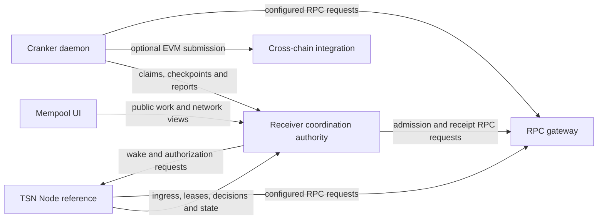

# MCES candidate assessment

**Status: CURRENT source assessment, November 17, 2026.** The recommendation and extraction boundaries are PROPOSED. This task assesses the existing services; it does not refactor them, change their configurations or establish live service availability. Read the [ranking](candidate-ranking.md) for the comparative decision and the [implementation plan](next-refactoring-plan.md) for the proposed next task.

## Scope and discovery

The inspected `tsn-protocol/services/` directory contains `tsn-node`, `tsn-receiver`, `tsn-cranker-op-daemon`, `tsn-rpc-gateway`, `tsn-crosschain` and `tsn-mempool-ui`. Node is the completed reference rather than a new candidate. All five remaining service directories are assessed below, including the small UI and mixed-language integration boundary. `tsn-protocol/solutions/` does not exist in this checkout, so there are no discovered solution candidates; no other workspace directory was substituted for it.

Dependency installations, generated `.next`/`dist`/`build`/`target` outputs, caches and private credential/state files are excluded from the authored-source comparison. Cross-chain Solidity contracts are included as existing responsibility and interface boundaries, but generated contract artifacts and the adapter template are not independent candidates. No directory qualifies merely because it has many files or functions.

This is a working-tree assessment, including existing uncommitted work. The reviewed source can differ from the published repositories. The [canonical architecture](https://github.com/bigdreamsweb3/trustlink-pay/blob/main/docs/laboratory/architecture-map.md), [component record](https://github.com/bigdreamsweb3/trustlink-pay/blob/main/docs/laboratory/components.md) and [credit ABI](https://github.com/bigdreamsweb3/trustlink-pay/blob/main/docs/laboratory/credit-abi.md) supply protocol context; the inspected service implementations determine the modularity findings.

## Reference standard

The [Node instructions](../../services/tsn-node/AGENTS.md), [architecture](../../services/tsn-node/docs/architecture.md), [verification record](../../services/tsn-node/docs/verification.md) and [component inventory](../../services/tsn-node/core/component_inventory.json) already establish the modular pilot. No reference-document update is necessary to designate it again.

The reference has these substantive properties:

- Every authored Python function, including methods, callbacks and test fixtures, has one implementation file. Models, constants, class shells and explicit package exports may be function-free; file splitting is paired with functional ownership.
- `core/runtime.py` is the composition root. Stateful implementations accept a narrow local `Dependencies` Protocol; pure implementations receive direct inputs. Components do not import the HTTP server to discover mutable state.
- `server.py`, `main.py` and original import facades preserve public entrypoints while binding the same implementations. A facade is an interface, not a second runtime or fallback implementation.
- Package documentation and inventories identify inputs, outputs, dependencies, errors, source ownership and existing test relationships. Static test references are distinguished from measured execution coverage.
- Verification separately checks source organization, imports, public HTTP/schema contracts, fixture behavior and operating prerequisites. Structural extraction does not authorize protocol redesign or external-system operations.

For TypeScript/JavaScript candidates, adopt the same ownership, explicit dependency and single-implementation principles through normal named exports and typed ports. Do not mechanically reproduce Python descriptor binding or introduce runtime namespace assembly. Preserve framework-required route files as stable entrypoints; a proposed function-file policy must specify how exported HTTP handlers delegate to their single implementation.

The Node inventory records 560 production Python files and 387 authored functions, with 173 function-free files. Its November 16 verification record reports 141 checks: 137 passing, four opt-in proof skips and no failures/errors, plus isolated loopback startup and HTTP baseline equality. Those are retained results, not a suite or startup rerun in this assessment. They do not establish live Receiver/prover/chain execution, owner recovery or complete per-function coverage. The present assessment independently checks the inventoried production files for existence, Python syntax and function concentration; the result is recorded under validation below.

## Dependency ownership and sequencing

Receiver owns durable work, leases, state versions and execution projections. Node consumes that coordination contract and supplies signed decisions/authorizations. Cranker consumes the verified execution projection, authenticates its reports and submits permitted transactions. These are bidirectional operational relationships, not an acyclic runtime call graph.

The diagram shows dependency roles rather than verified endpoint availability. HTTP contracts allow Receiver internals to change independently if the existing Node and Cranker request/response fixtures remain stable. Receiver's RPC consumers also have source-defined fallback behavior; preserve it rather than requiring a simultaneous gateway refactor. Cranker's direct imports from the SDK and cross-chain source create stronger code-level dependencies than Receiver's Node HTTP boundary. The UI should follow the durable projection contract, rather than become the place where that contract is redesigned.

## Receiver

**Directory:** `tsn-protocol/services/tsn-receiver/`. **Primary responsibility:** durable ingress, encrypted Node payload retention, versioned work/leases, Cranker sessions, execution projection and receipt/recovery coordination. **MCES suitability:** very high. **Estimated complexity:** high; medium for the initial pure components. **Operational risk:** high. **Expected benefit:** a reusable, testable coordination foundation shared by the existing Node and Cranker.

Architectural complexity comes from responsibility density rather than an undifferentiated application. The `app/api/` route structure and focused envelope, wake, retry and reconciliation libraries already identify useful boundaries. Nevertheless, [lib/store.ts](../../services/tsn-receiver/lib/store.ts) combines ingress/idempotency, encrypted payload selection, queries, lease reclamation/selection, shared-root serialization, lease renewal, authorization attachment, signed checkpoints and transitions. Its 487 physical lines contain 36 function bodies when callbacks are included; `lease` and `transition` span approximately 102 and 96 lines. These are useful concentration signals, not coverage or complexity scores.

[lib/work-contract.ts](../../services/tsn-receiver/lib/work-contract.ts) combines models, allowlists, ingress approval validation, canonical commitments, payload delta reconstruction and audience-specific projections. [lib/cranker-auth.ts](../../services/tsn-receiver/lib/cranker-auth.ts) combines challenge/session persistence, request signatures/replay counters, rate limiting and on-chain Mother/Cranker DNA admission. Each family is identifiable, but extracting it must preserve its exact existing security decisions.

Component isolation is practical: deterministic projection/validation can move before transaction-backed commands. Dependency coupling is moderate: libraries import `db` and `workCollection` from [firebase.ts](../../services/tsn-receiver/lib/firebase.ts), whose module initialization selects hosted Firebase or the explicitly gated local adapter. Route handlers import shared store functions directly. Existing tests transpile source into temporary modules and replace Firebase, envelope, attestation, wake or framework dependencies, demonstrating useful seams while revealing how much setup is currently needed to isolate a store operation.

Reusability is high for work contracts, projections, lease guards and transaction commands. These components can support both current consumers without giving Node a new database or making Cranker a coordination authority. Operational criticality remains high because a non-atomic extraction could admit duplicate work, lose a signed-attempt lock, change a privacy projection or wake execution before durable persistence.

Verification readiness is the strongest of the candidates. Twelve test files cover contracts, encrypted envelopes, local storage/locking/transaction queries, lease renewal, native Cranker leases, private coordination, retry, authorization forwarding and receipt/nonexecution recovery. The current assessment ran all of them: **46 tests passed, zero failed or skipped**, and a separate non-emitting typecheck passed. Several tests stub attestation, Firebase or receipt inputs; that establishes fixture behavior, not hosted Firestore parity, complete session authentication coverage or finalized-chain reconciliation.

The main MCES opportunity is to make deterministic contracts and explicit transaction ports independently replaceable, then reduce `store.ts` to its stable facade. Add missing characterization coverage for Cranker admission/session behavior and hosted transaction semantics before extracting those high-risk families. Receiver ranks first despite the risks because its coordination ownership and existing verification provide a stronger foundation for subsequent consumer work.

## Cranker operator daemon

**Directory:** `tsn-protocol/services/tsn-cranker-op-daemon/`. **Primary responsibility:** Receiver-authenticated leasing, verification of Node-approved execution, owner-signed deposit broadcast, native settlement/accounting and TIN execution, and optional Creditcoin submission. **MCES suitability:** very high. **Estimated complexity:** high. **Operational risk:** very high. **Expected benefit:** independently testable execution branches and reusable signing, transport and reporting components.

[scripts/cranker.ts](../../services/tsn-cranker-op-daemon/scripts/cranker.ts) concentrates session state, endpoint selection, attestation verification, RPC selection, lease/report requests, funding, settlement, accounting, direct/staged TIN creation and the long-running loop. Its 1,196 physical lines contain 50 function bodies, including nested callbacks. `processTinOperation`, `processSettlement` and `submitStagedTinV1Creation` span approximately 165, 147 and 124 lines respectively. The concern is the mixture of distinct execution responsibilities and shared process state, not the line count alone.

Component isolation is already demonstrated by [src/dbrix/](../../services/tsn-cranker-op-daemon/src/dbrix/) and [src/receiver/](../../services/tsn-cranker-op-daemon/src/receiver/): Mother response validation, funding-root decoding, Memo construction, V1 submission, unsigned retry and confirmed-report handling are distinct helpers. The remaining daemon imports the SDK source directly and imports `CreditcoinCranker` from its neighboring service. It also retains active Receiver/session state and lazily constructed EVM configuration. That coupling makes package/interface isolation harder than Receiver's HTTP-bound Node integration.

Reusability is high for transport and evidence reporting. Operational criticality is greater than Receiver's initial pure extraction because the daemon handles payer signing, exact sender-approved bytes, final blockhash/lifetime checks, persisted attempt identity and broadcast ordering. Direct and staged TIN creation, native epoch accounting and optional EVM execution are distinct existing capabilities; structural work must preserve each.

Five `.test.ts` files provide meaningful offline coverage for funding roots, Mother signing responses, native retries, confirmed reports and settlement transport. **22 tests passed, zero failed or skipped** in this assessment. Some assertions inspect daemon source text, and these tests do not execute the complete long-running dispatch/session loop or every TIN/EVM branch. `tests/settlement-v1-fixture.ts` is a separate unsigned serialization fixture used by the Node runner, not an additional test suite. The package has no aggregate `test` or daemon `typecheck` script.

Cranker ranks second. It has more immediate concentration pressure, but freezing Receiver's coordination/projection seam first and capturing additional session/dispatcher behavior gives its later extraction a safer upstream contract. Do not refactor its setup, signer or SDK packages concurrently with Receiver.

## RPC gateway

**Directory:** `tsn-protocol/services/tsn-rpc-gateway/`. **Primary responsibility:** shared Solana HTTP JSON-RPC and WebSocket transport, provider selection, health learning and safe endpoint presentation. **MCES suitability:** high for focused transport internals. **Estimated complexity:** medium. **Operational risk:** high. **Expected benefit:** isolated request/error policies, provider state and listener adapters usable by existing hosts.

The project already separates [config.mjs](../../services/tsn-rpc-gateway/config.mjs), [provider-pool.mjs](../../services/tsn-rpc-gateway/provider-pool.mjs), [gateway.mjs](../../services/tsn-rpc-gateway/gateway.mjs), [server.mjs](../../services/tsn-rpc-gateway/server.mjs) and [worker.mjs](../../services/tsn-rpc-gateway/worker.mjs). The exported `createRpcGatewayApp` and `createProviderPool` factories are useful interfaces. Consumers generally use HTTP rather than importing this service, though the manifest also exports `gateway.mjs` as a package entrypoint.

Function concentration remains significant inside those modules. `gateway.mjs` mixes response helpers, an approximately 132-line dashboard renderer, account-data checks, RPC error classification, single/batch proxying and request routing. `createProviderPool` contains nested provider/probe/leader methods over closure-owned mutable state. `server.mjs` combines Node request conversion, CORS, WebSocket pairing/failover and shutdown. Extracting callbacks requires explicit ownership of the same pool, timers and configuration rather than copying state into new globals.

Isolation and reuse are good, with moderate coupling to Fetch/AbortSignal, timers, Node HTTP and `ws`. Operational criticality is high because provider retries, signed transaction bytes, `minContextSlot`, subscription behavior and credential redaction affect several consumers. A structurally cleaner gateway must not refresh signed messages, weaken signature checks or change bank-error classification.

Verification readiness is limited. The package's `check` command passed syntax checks for its six modules, but no gateway-local behavior test suite was discovered. Syntax does not verify fallback ranking, batch order, CORS, WebSocket teardown, timeouts or signed-request preservation. Build fake upstream/clock/socket characterization tests before selecting its stateful components. It ranks third: the shared transport role matters, but its existing separation and weaker behavior evidence reduce its immediate advantage over Receiver.

## Cross-chain integration

**Directory:** `tsn-protocol/services/tsn-crosschain/`. **Primary responsibility:** Creditcoin/EVM authorization consumption, route/liquidity validation, proof workers, destination execution contracts and deployment/configuration tooling. **MCES suitability:** selective for off-chain adapters; a whole-directory function-file transplant is unsuitable. **Estimated complexity:** very high across the complete directory. **Operational risk:** very high. **Expected benefit:** reusable route, receipt/proof and submission adapters once their contracts have dedicated tests.

The directory already distinguishes `src/`, `worker/`, `scripts/` and twelve authored Solidity contracts under `contracts/`, including direct Creditcoin, onward-destination, liquidity, proof/registry and token responsibilities. Solidity's contract/storage/event structure must remain intact; it is not equivalent to the Node's Python function layout. Generated deployments/artifacts, credentials and the adapter template are boundaries or outputs, not extraction targets.

[src/creditcoin-cranker.ts](../../services/tsn-crosschain/src/creditcoin-cranker.ts) combines provider/wallet/contract construction, SDK route evidence, authorization validation, transaction submission and receipt-event parsing. [src/settlement.ts](../../services/tsn-crosschain/src/settlement.ts) defines the signed payout contract, while [src/destination-liquidity.ts](../../services/tsn-crosschain/src/destination-liquidity.ts) isolates route/observation guards. Deployment scripts repeat compiler/import-resolution, configuration and signer work; workers combine proof service/precompile calls with event/receipt processing and side-effectful entrypoints.

Isolation is possible for those off-chain responsibilities, but coupling is strong: direct SDK-source imports, `ethers`, `@gluwa/usc-sdk`, `@gluwa/asc-contracts`, Solidity/OpenZeppelin imports, deployed ABIs, registry policy and external proof infrastructure all participate. Reusability is high for route/evidence adapters. Criticality includes replay, signer authorization, liquidity reservation and destination vault release, so changes need contract/storage/event and signature-byte verification in addition to off-chain unit tests.

No local test suite was discovered. The existing non-emitting TypeScript build passed for `src/**/*.ts` and `scripts/**/*.ts`; its `tsconfig.json` does not include `worker/**/*.ts`, and the command does not compile Solidity or verify deployments/proofs. The [existing integration documentation](../../services/tsn-crosschain/docs/README.md) is context, not evidence that every described route currently executes. Cross-chain ranks fourth and should wait for off-chain fixtures and explicit contract/worker verification boundaries. No on-chain or route redesign is proposed by this assessment.

## Mempool UI

**Directory:** `tsn-protocol/services/tsn-mempool-ui/`. **Primary responsibility:** a small status page and public Receiver/network projection proxy. **MCES suitability:** low for full adoption at its current size. **Estimated complexity:** low for a targeted cleanup. **Operational risk:** low for presentation, moderate for public-field handling. **Expected benefit:** small; a focused proxy/projection contract would be more valuable than a broad new package hierarchy.

The authored application consists of [app/page.tsx](../../services/tsn-mempool-ui/app/page.tsx), its layout and [app/api/mempool/route.ts](../../services/tsn-mempool-ui/app/api/mempool/route.ts). The 71-line proxy route already contains distinguishable endpoint selection, opaque-ID projection and aggregate response assembly. The 17-line page has inline asynchronous callbacks and a table renderer, but there is no large independent domain runtime to extract.

Isolation is straightforward and dependency coupling is light at the code level, through Next/React and Receiver HTTP responses. Functional reusability is modest. The client `Intent` shape and proxy `publicWork` shape differ, so future work should characterize the displayed field mapping rather than infer a working end-to-end UI from the README or JSX. The proxy's treatment of verification/result fields also requires explicit privacy fixtures; the displayed privacy description is not itself an enforcement proof.

No local tests were found. A non-emitting typecheck was attempted but could not start because the service-local TypeScript compiler is absent; no dependencies were installed to change that condition. Live data/display and consumer integration remain unverified. UI ranks fifth: preserve the framework entrypoints, establish response/rendering fixtures and perform targeted improvements after Receiver's public projection is frozen. Do not impose the Node's entire hierarchy solely for consistency.

## Validation and limitations

The comparison used directory discovery, source/import/AST inspection, manifests, existing documentation and the reference inventory. JavaScript/TypeScript function counts include methods and nested/arrow callbacks with bodies; declaration-only signatures are excluded. Line figures count physical source lines including comments and blanks, without an added trailing empty line. They support the responsibility findings but do not measure branch coverage, operational load or person-days.

Checks performed on November 17, 2026:

- Receiver: non-emitting TypeScript check passed with `--incremental false`; `node --experimental-strip-types --test tests/*.test.mjs` passed 46 tests with no failures/skips.
- Cranker: `node --import tsx --test tests/*.test.ts` passed 22 tests with no failures/skips. This covers the existing helper suites, not the daemon's full runtime or the separate stdin serialization fixture.
- Gateway: `npm run check` passed six syntax checks; behavior testing remains missing.
- Cross-chain: `node node_modules/typescript/bin/tsc -p tsconfig.json --noEmit --pretty false --incremental false` passed its configured `src`/`scripts` scope; workers and Solidity remain outside it.
- UI: service-local non-emitting typecheck was blocked by a missing TypeScript installation; this is an unavailable check, not a diagnosed source type error.
- Node reference: all 560 inventoried production files were present and parsed successfully; their 387 authored function bodies included no multiple-function implementation file. All 1,111 baseline service source/test/configuration/documentation hashes remained unchanged, and the three assessment documents passed local-link, fence and whitespace checks. No Node suite or startup was rerun.

Evidence logs and metadata are retained locally in `C:\Users\codepara\AppData\Local\Temp\trustlink-mces-assessment-20261117-m7v5_da0`. The source baseline fingerprints 1,111 pre-existing authored source, test, configuration and documentation files within services, excluding generated/private material. These local artifacts are unavailable to another clone; commands and bounded results above make their scope explicit. Source preservation does not establish service availability, transaction acceptance, consensus, cryptographic privacy or hosted-storage equivalence.

The assessment adds only the three requested files under `docs/mces/`. Existing Node reference documentation already identifies the pilot, so it is preserved. Both internal canonical records and the public service/Receiver/Node documentation were reviewed for impact; no interface, configuration, startup, integration or recovery procedure changes are proposed for immediate execution. The internal operator guide therefore needs no new operating step, and no internal self-hosting guide is published or promoted here.
