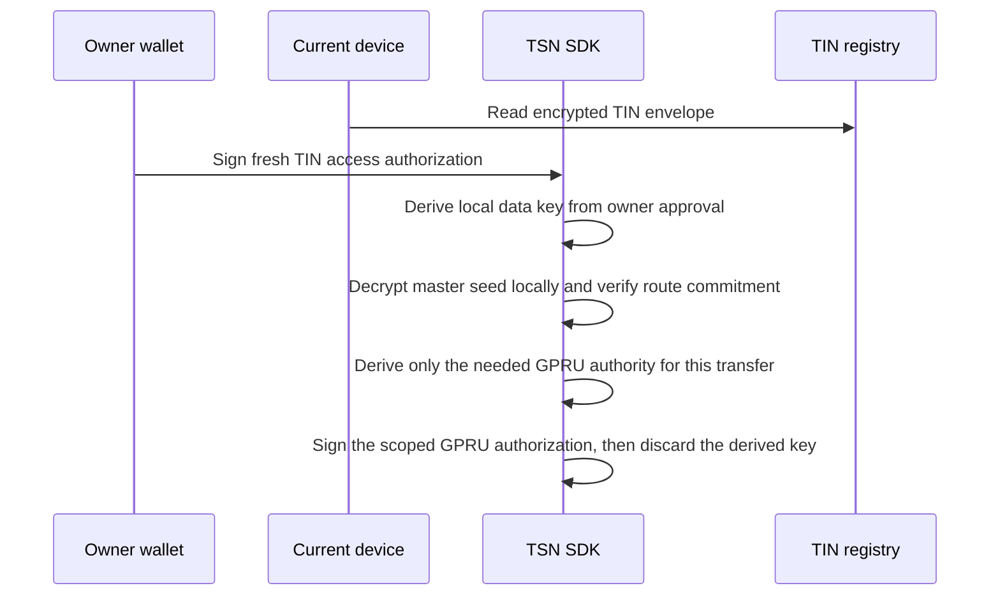

TSN separates _who the payment is for_ from _what accounts move on Solana_. The Transfer Identity Protocol (TIP) manages transfer identities and their routing. A Transfer Identity Number (TIN) is one 10-digit identity within TIP; it is not the protocol itself. GPRU carries transfer-scoped routing and authorization data. Neither TIP, a TIN, nor GPRU takes custody of funds or keys.

## TIN: Transfer Identity Number

A **Transfer Identity Number (TIN)** is a portable, 10-digit payment identity issued and resolved by the **Transfer Identity Protocol (TIP)**. A sender uses the recipient's TIN to discover an authorized payment route, without asking the recipient to share a wallet address.

<Info>
  A TIN is a payment identity, not a wallet or private key. It resolves to permitted routing metadata; it never owns a token account by itself.
</Info>

### TIN vs. a wallet address

| Wallet address | TIN |
| --- | --- |
| Public cryptographic account identifier | TSN payment identity and route-discovery identifier |
| Identifies a public key or account authority | Resolves permitted payment routing metadata |
| May own token accounts | Does not itself hold tokens or act as a private key |
| Usually exposes the address directly | Binds to GPRU public, TIP root, and policy commitments |

A TIN does not replace every Solana address. The final settlement transaction still uses public keys, token accounts, PDAs, and program accounts as required by Solana.

### TIN V1 record and ownership

TIN V1 creation is owner-authorized and binds the registry record to the
owner through an owner commitment. The main registry account stores that
commitment and has no standalone owner-public-key field. A separate owner-recovery
PDA stores the owner public key and encrypted TIN recovery envelope for wallet
recovery. It is derived from the `tin-v1-owner-recovery` seed and owner wallet
public key. The registry PDA is derived from a keyed lookup commitment,
not directly from the raw TIN or wallet address. The trusted issuer and Node
share a high-entropy `TINS_LOOKUP_SECRET`; there is no public all-zero fallback.
An absent or invalid secret blocks issuance and resolution. Receiver and
Cranker receive encrypted identity fields, not the lookup secret or plaintext
TIN from the creation operation. Node is a trusted resolution boundary: it
holds the secret and can decrypt the identity envelope when performing a
requested resolution.

The registry also binds the current TIN V1 TIP route: a GPRU public commitment,
its blinded TIP root commitment, a TIP-specific route version, and a policy
commitment. It stores a separately versioned GPRU route commitment derived
locally from the owner-held master seed. The seed is not published, and the
existing TIP root remains active during this GPRU development stage. The new
commitment binds future GPRU proofs to the owner's route but is not itself proof
of ownership. Legacy PRU configuration is rejected by current creation; prior
registry account layouts remain readable.

### Resolution flow

<Steps>
  <Step title="Sender enters the recipient TIN">
    The sender supplies the 10-digit TIN to the application and requests the
    display identity through the authenticated TSN Node service boundary.
  </Step>
  <Step title="Node resolves the identity">
    Node derives the commitment-based registry address using its protected
    lookup secret, validates the current TIN V1 account and TIP route,
    and decrypts the user-approved display identity. The secret is not exposed
    to the application, Receiver, or Cranker.
  </Step>
  <Step title="Application builds the sender authorization">
    The SDK builds the canonical sender authorization for the recipient TIN,
    resolved display identity, amount, fee, expiry, and nonce. The sender does
    not sign a route commitment supplied by a client.
  </Step>
  <Step title="Node validates payment routing independently">
    On intent ingress, Node resolves the current TIN V1 route from on-chain
    state and constructs the TCAP transition from that authoritative route.
  </Step>
</Steps>

Resolution returns identity disclosure for the requested TIN; it is not a
public registry scan and never returns plaintext seed material or private
keys. Applications should apply appropriate access control and rate limiting.

### Wallet ownership and private identity lookup

The trusted issuer generates the TIN, derives its keyed commitment and
identity envelope, and creates an issuer HMAC proof using the protected secret.
The owner separately signs the exact TIN creation intent. Receiver stores the
owner-authorized ciphertext and proof; Node verifies the proof, canonical
intent, owner signature, and route relationship before work is eligible for
Cranker execution.

A separate owner-recovery PDA, distinct from the main TIN registry account,
stores the owner public key and encrypted recovery envelope. It provides a
wallet-indexed locator and is created alongside the registry during TIN
creation. On recovery, the SDK derives this PDA from the connected wallet,
fetches the envelope, and decrypts the TIN locally after a separate
domain-separated wallet signature. This recovery PDA is the wallet-recovery
record; there is no need to add an owner-public-key field to the main registry
account. Previously created master-seed envelopes may still include
`ownerPublicKey` in plaintext; the SDK no longer writes it to newly created
envelopes, and existing on-chain accounts are not rewritten by this change.
The one-per-owner PDA prevents multiple recovery locators for the same wallet.
The encrypted master seed is a separate owner-protected item.
Plaintext seed material and derived child private keys must not be sent to
Receiver, Node, or Cranker.

<Warning>
  A TIN is not a username, a bank-account number, or a legal identity on its own. Any legal-name, business, phone, or verification context is optional enrichment and must not be confused with payment authorization.
</Warning>

### Encrypted master seed and GPRU authorization

Each TIN carries an **encrypted master seed** stored inside the TIN registry as ciphertext. It is random local root material that never appears in plaintext on-chain and never leaves the owner device once decrypted. It is not a replacement wallet, and it does not turn the Receiver, Node, or Cranker into a custodian of the TIN.

This seed is the private root from which the SDK derives **GPRU scope authorities** for a specific transfer. Without a fresh owner-wallet approval that unlocks the seed on the current device, no GPRU authorization signature can be produced. This is what binds GPRU authorization to the TIN owner rather than to whichever operator holds the TIN's public state.

| Item | Storage | Boundary |
| --- | --- | --- |
| Owner-wallet binding | TIN registry, public | Public integrity metadata |
| Encrypted master-seed envelope | TIN registry, ciphertext | Sealed to the owner wallet under `wallet-owner-signature-v1` |
| Route commitment and route version | TIN registry, public | Bound into the signed intent |
| Owner-key commitment | TIN registry, public | Verifies the wallet that can unlock the envelope |
| Plaintext master seed | Owner device only, transiently | Never sent to Receiver, Node, Cranker, or backend |
| Derived GPRU authority | Owner device only, per transfer | Signs the scoped authorization, then discarded |

The flow the SDK uses on the current device is:

Two properties make this safe under a compromised operator:

- The registry only holds ciphertext. Reading the TIN registry account gives an attacker the envelope but not the seed; the envelope is sealed to the owner wallet.
- The GPRU authority derived from the seed is transfer-scoped. Even if a derived signing key were captured on a compromised device, the resulting signature is bound to that transfer's commitments. It cannot be lifted onto a different intent.

<Note>
  Older `tsn-device-envelope-v1` records were device-bound. They remain readable only by a device that can already unlock them, until the owner performs a one-time upgrade to the wallet-owned envelope. New and upgraded TINs use the wallet-owned model above.
</Note>

## GPRU: authorization and routing scope

**GPRU** carries the authorization and routing scope of a transfer. It is deliberately non-custodial: it never holds funds, balances, or custody keys. GPRU is derived from a TIN privacy-receiving root, a settlement commitment, epoch context, and authorization scope, using separate domain tags for identity derivation and authorization signing.

The chain sees only fixed-length commitments and derived PDAs. TIN encrypted metadata stays encrypted off-chain; the public account state carries only its hash.

What GPRU does:

- Scopes what a transfer is permitted to do (destination binding, amount context, epoch, policy).
- Binds the authorization message so that a valid signature cannot be lifted onto a different transfer.
- Provides the `gpru_scope_commitment` that TSN and TCAP check together against the receipt.

What GPRU does not do:

- Hold or transfer funds.
- Own a token account.
- Grant permission to construct an arbitrary transaction from a resolved route.

## TIP route commitments

TIP associates a TIN with its privacy route through a GPRU public commitment, a TIP root commitment derived from that public commitment, a TIP-specific route version, and a policy commitment. It separately stores a versioned GPRU route commitment derived locally from the owner's master seed. That seed is not sent to TIP or GPRU, the existing TIP root remains in use for this rollout, and the new commitment alone does not prove ownership or route membership. The on-chain registry never receives policy plaintext, a static PRU list, pre-generated receiving wallets, or a maximum-PRU field. See [TCAP](/architecture/tcap) for how the current settlement program consumes the TIP root and policy commitments.

## What is public vs. private

| Public on-chain | Private / off-chain |
| --- | --- |
| TIN number and display metadata (resolution subject to controls) | Plaintext seeds and child private keys |
| Route commitment and route version | Plaintext route map and recipient wallet map |
| Owner-key commitment, state version | Snapshot decryption keys |
| GPRU scope commitment carried in receipts | Privacy-receiving root and derivation material |
| GPRU public, TIP root, and policy commitments with TIP route version; GPRU route commitment with its own version | Encrypted TIN envelope contents |

## Historical note: ZK-PRU is retired

Earlier revisions of TIN used a ZK-PRU public-route model with funded PRU receiving units. That model is retired. New TCAP/GPRU accounts reject legacy PRU configuration and route-envelope data. See [Current Technology](/about/current-technology) for the live scope and [Architecture Overview](/overview/architecture) for the layer map.

## Related pages

<CardGroup cols={2}>
  <Card title="Mother Authority" icon="shield-halved" href="/architecture/mother-authority">
    How Mother authorizes intent acceptance and settlement DNA above the identity layer.
  </Card>

  <Card title="TCAP" icon="lock" href="/architecture/tcap">
    How TIP route commitments become tip PDAs and owner-encrypted snapshots.
  </Card>

  <Card title="Payment Intent Lifecycle" icon="signature" href="/developers/payment-intent-lifecycle">
    Where the resolved TIP route and GPRU scope enter the signed intent.
  </Card>

  <Card title="Architecture Overview" icon="cubes" href="/overview/architecture">
    Identity and routing in the context of the five TSN layers.
  </Card>
</CardGroup>
