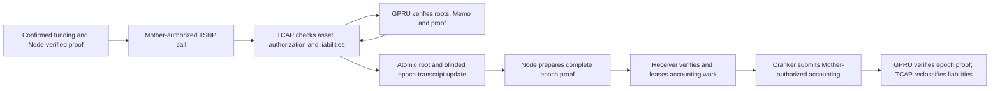

For a balance-changing action, GPRU is intended to guard the integrity and privacy of the user's private state presented to TCAP. Its proof should establish that the hidden state is current and that the proposed transition follows from it. TCAP governs accepted assets, authorization, and liquidity, then applies a valid change atomically.

The proof does not make GPRU a custodian and does not replace TCAP's settlement checks. Encrypted Memo records can preserve transaction details for the owner to recover, while the on-chain proof and authorization establish whether a state transition is valid.

## Availability and limits

The [November 16 Devnet record](https://github.com/bigdreamsweb3/trustlink-pay/blob/main/docs/laboratory/experiments/EXP-20261116-private-credit-epoch.md) establishes two confirmed native private credits and their complete epoch accounting. This scoped result does not establish owner-history completeness, confidential debit/exit or public-observer action unlinkability. Confirm the applicable transaction and resulting state on the target cluster.

The experimental native-credit statement uses a secret-derived funded-note nullifier and a freshly blinded amount commitment. It omits the plaintext amount, note opening and private route/predecessor witness; individual credit updates shared head/root and epoch transcript without changing reserve liabilities. TCAP owns that credit-only transcript and reclassifies its aggregate after GPRU proof verification. Node's maturity/capacity scheduling and shared account reuse are described in [the TCAP lifecycle](/layers/tcap#native-credit-epoch-lifecycle). Trusted Node access to private openings/routes and public wallet funding are accepted boundaries. Public epoch totals, assets, roots, successor points, accounts, ciphertext, timing and registry/head history can still correlate TCAP actions; see [the privacy limits](/security/threat-model).

The proof statement, Memo format, verifier, and service integration are documented in the [repository's GPRU and TCAP technical notes](https://github.com/bigdreamsweb3/trustlink-pay/tree/main/docs).
