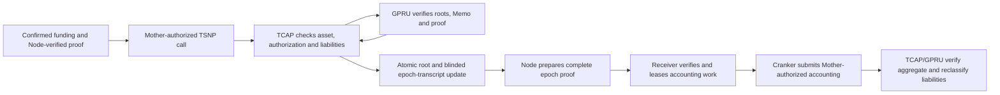

For a balance-changing action, GPRU is intended to guard the integrity and privacy of the user's private state presented to TCAP. Its proof should establish that the hidden state is current and that the proposed transition follows from it. TCAP governs accepted assets, authorization, and liquidity, then applies a valid change atomically.

The proof does not make GPRU a custodian and does not replace TCAP's settlement checks. Encrypted Memo records can preserve transaction details for the owner to recover, while the on-chain proof and authorization establish whether a state transition is valid.

## Availability and limits

The hidden-head proof flow is not established as an end-to-end settlement capability. Do not represent confidential credit, debit, or exit as available based only on a source file, SDK helper, or transaction submission. Confirm the applicable transaction on the target cluster.

The experimental native-credit statement uses a secret-derived funded-note nullifier and a freshly blinded amount commitment. It omits the plaintext amount, note opening and private route/predecessor witness; individual credit updates shared head/root and epoch transcript without changing reserve liabilities. Public deposits, epoch totals, assets, roots, successor points, accounts, ciphertext and timing can still correlate payments. Node knows private openings and routes, and recipient-registry/head linkage remains unresolved. Matching deployed binaries/keys and live multiwallet accounting remain unverified; see [the privacy limits](/security/threat-model).

The proof statement, Memo format, verifier, and service integration are documented in the [repository's GPRU and TCAP technical notes](https://github.com/bigdreamsweb3/trustlink-pay/tree/main/docs).
