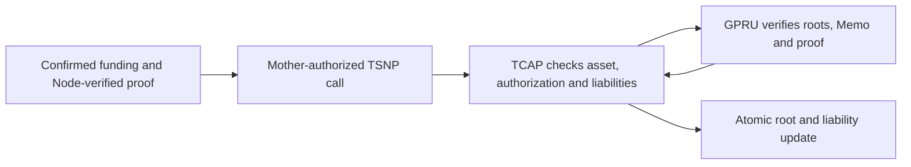

For a balance-changing action, GPRU is intended to guard the integrity and privacy of the user's private state presented to TCAP. Its proof should establish that the hidden state is current and that the proposed transition follows from it. TCAP governs accepted assets, authorization, and liquidity, then applies a valid change atomically.

The proof does not make GPRU a custodian and does not replace TCAP's settlement checks. Encrypted Memo records can preserve transaction details for the owner to recover, while the on-chain proof and authorization establish whether a state transition is valid.

## Availability and limits

The hidden-head proof flow is not established as an end-to-end settlement capability. Do not represent confidential credit, debit, or exit as available based only on a source file, SDK helper, or transaction submission. Confirm the applicable transaction on the target cluster.

The native-credit proof hides the TIN route and predecessor witness from the on-chain statement, but its amount, asset, shared roots, nullifier, successor point and encrypted Memo remain public. The published nullifier is derived from public deposit data, so funding and credit can be linked. The Node resolves private routing and constructs the witness, so this boundary does not establish owner-only knowledge or immunity to timing and transaction correlation. Direct wallet transfers expose their endpoints; confidential debit and exit require separate execution evidence. See [the privacy limits](/security/threat-model) for the current encoding and trust assumptions.

The proof statement, Memo format, verifier, and service integration are documented in the [repository's GPRU and TCAP technical notes](https://github.com/bigdreamsweb3/trustlink-pay/tree/main/docs).
