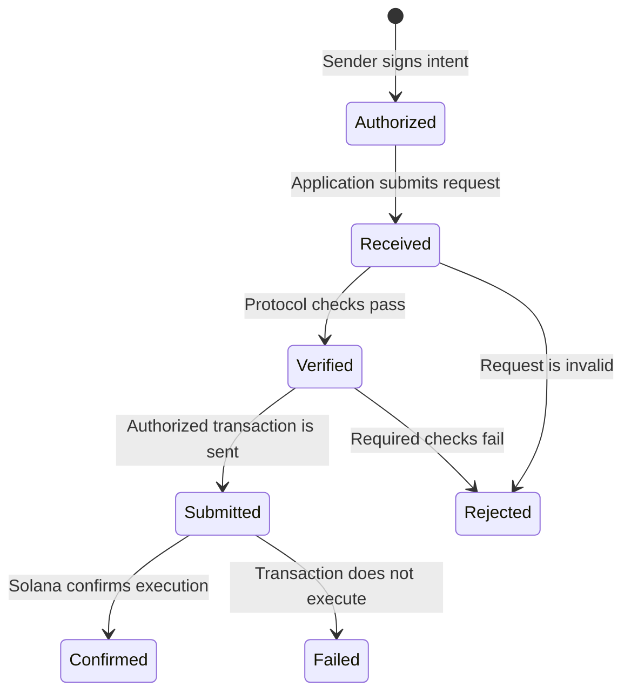
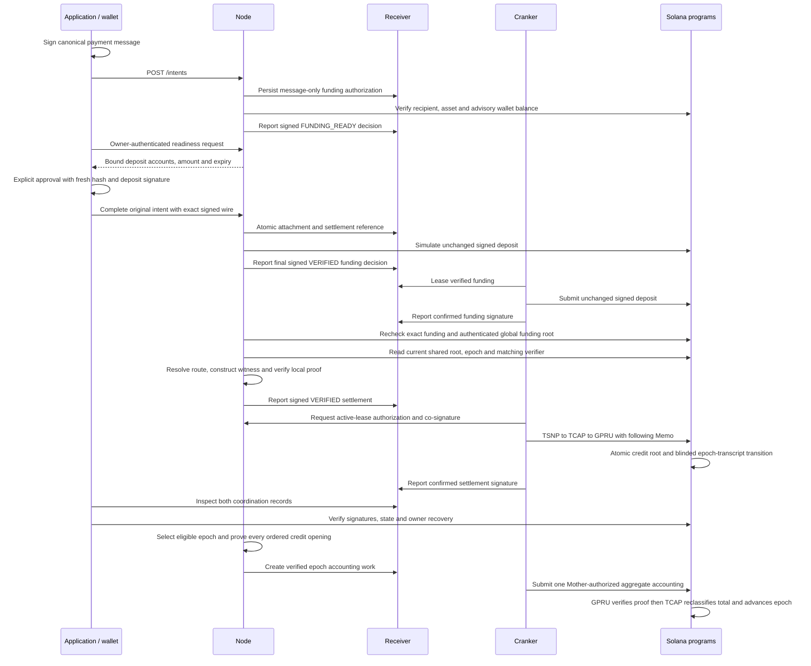

A TSN payment passes through several distinct stages. An application should display each stage accurately: a request being received does not mean it was verified, and a submitted transaction does not mean it succeeded.

| Stage | Meaning for the application |
| --- | --- |
| Authorized | The sender reviewed and signed the requested payment details. |
| Received | The service accepted the request for processing. |
| Verified | Required authorization and payment checks passed for the next step. |
| Submitted | An authorized transaction was sent to Solana. |
| Confirmed | Solana confirmed successful execution of that transaction. |
| Rejected or failed | The request or transaction did not complete; the reported reason determines the next safe action. |

Some flows use separate transactions for funding and the subsequent credit. Each signature confirms only its own transaction. A confirmed funding transaction does not prove that the later TCAP transition completed.

## Current native-credit sequence

The sender first approves the canonical message. The application posts a message-only request with the resolved owner hash and private note to Node's `/intents`; Node forwards it to Receiver. Receiver stores idempotent funding in phase `AUTHORIZATION`. Node checks the signed intent, recipient, asset and advisory token balance, then reports a signed `FUNDING_READY` decision. No settlement is created or Cranker work enabled at this stage.

The application shows readiness and offers explicit funding approval. It reads the owner-authenticated preparation, obtains a fresh blockhash, requests the transaction signature and completes the same intent through `/network/funding/complete`. Receiver atomically attaches the immutable wire/context, enters `SIGNED_DEPOSIT` and creates the settlement reference. Node reuses the signed preparation and validates/simulates exactly one funded-note deposit; canonical wallet ComputeBudget settings remain permitted, while extra payment actions are rejected. Only its final `VERIFIED` decision enables Cranker, which submits the unchanged signed deposit. Node matches the entire successful receipt wire and signature before preparing settlement.

After the exact funded deposit confirms, Node resolves the TIP route, reads current private state/verifier/epoch and the canonical global funding account, reconstructs membership and generates/reverifies the private-amount proof. A single deposit is eligible; no pool account, capture transaction or release window is required. Current or retained funding roots remain usable within the bounded history, while current shared spending state protects against replay. Cranker obtains current-lease Mother co-signing and submits the TSNP call with its bound Memo. TCAP/GPRU acceptance atomically advances shared head/root and blinded epoch transcript without token movement or individual reserve-liability change.

The sequence describes the experimental source contract. TCAP owns the shared credit-epoch transcript and aggregate accounting, while GPRU verifies its complete proof. Node prepares separate `TCAP_EPOCH_ACCOUNTING` work for 2–63 credits once at least 120 slots have elapsed since the first credit, or immediately at 64 credits. A singleton stays open; the threshold is scheduling maturity, not expiry. At 64, further credits wait for accounting. Receiver coordinates leases and Cranker submits the Mother-authorized transaction, after which TCAP marks the epoch accounted and advances the reserve epoch. The first credit in each asset epoch can create a shared account; later credits reuse it, and accounted accounts remain on chain. See [the TCAP lifecycle](/layers/tcap#native-credit-epoch-lifecycle).

Matching binaries, explicit credit rekey, separate epoch-verifier enrollment, active reserve/roots and persistent prover/opening settings remain prerequisites. Offline proofs and host tests have a different scope from the [November 16 Devnet record](https://github.com/bigdreamsweb3/trustlink-pay/blob/main/docs/laboratory/experiments/EXP-20261116-private-credit-epoch.md), which establishes two confirmed private credits and their complete epoch accounting. Owner recovery and public-observer action unlinkability require separate evidence; trusted Node verification access is an accepted boundary.

## Status and reconciliation

Receiver work uses `RECEIVED`, `NODE_VERIFYING`, `FUNDING_READY`, `VERIFIED`, `REJECTED`, `CRANKER_LEASED`, `SUBMITTED`, `CONFIRMED`, and `FAILED`. Readiness is an authorization decision, not funding execution. SDK intent status uses a separate lower-case vocabulary; applications must read the actual response type instead of equating the two models.

Receiver provides `GET /api/work-status/<funding-work-id>` with operation ID, kind, status, verification type, sanitized decision reason and `result.signature`. Funding status additionally includes a nested `settlement` object with its independent status/result. TIN operation status is supported separately. This is a coordination view; verify successful transaction results and expected TCAP root/reserve changes on the selected cluster.

Confirmed funding with settlement still `RECEIVED` can be waiting behind an older unresolved signed shared-root transition. Node verification must complete before Cranker can lease settlement. Preserve the existing deposit while the operator reconciles that holder; a restricted nonexecution resolution exists for expired credit with an unchanged finalized predecessor root. Applications should read the nested settlement decision reason separately from funding rejection reasons. See [Receiver recovery](/operators/receiver).

`waitForTsnFundingReadiness` observes initial readiness using a supplied public-status fetch function. `TsnHttpClient` has no dedicated `waitForSettlement`; its intent listing/status-update helpers serve worker-authorized endpoints. Applications observe later funding/settlement status using the Receiver route and their own fetch/timeout policy, without exposing worker credentials.

Owner recovery additionally requires owner-held scan material and validated Memo history. The SDK checks action and predecessor continuity; a scanner must supply complete enough history. A single confirmed signature does not establish that all owner records were indexed or reconstructed.

## Safe retries

Before retrying, check the transaction signature and the latest status. If a transaction may have succeeded but the response was lost, do not create a replacement payment until its chain result is known. A stale or expired sender-signed transaction must be rebuilt and approved again by the sender; an operator must not modify its authorization.

Already confirmed funding remains distinct if settlement fails. The native-credit path does not establish an automatic refund of that deposit; epoch-family refunds use different permits/accounts. A root change requires proof reconstruction and authorization against current state. See [typed payment examples](/sdk/payment-guide) and [troubleshooting](/sdk/troubleshooting).

The native epoch currently records credits only. A mixed credit/debit/exit transcript is proposed work, and retained TSNP Epoch Treasury/payout/refund APIs have separate contracts. The November 16 credit/accounting result does not establish those distinct execution paths.

For application request and response types, see the [TSN SDK reference](/api-reference/sdk/tsn-sdk). Service implementation and operations belong in the [repository documentation](https://github.com/bigdreamsweb3/trustlink-pay/blob/main/docs/laboratory/README.md).
