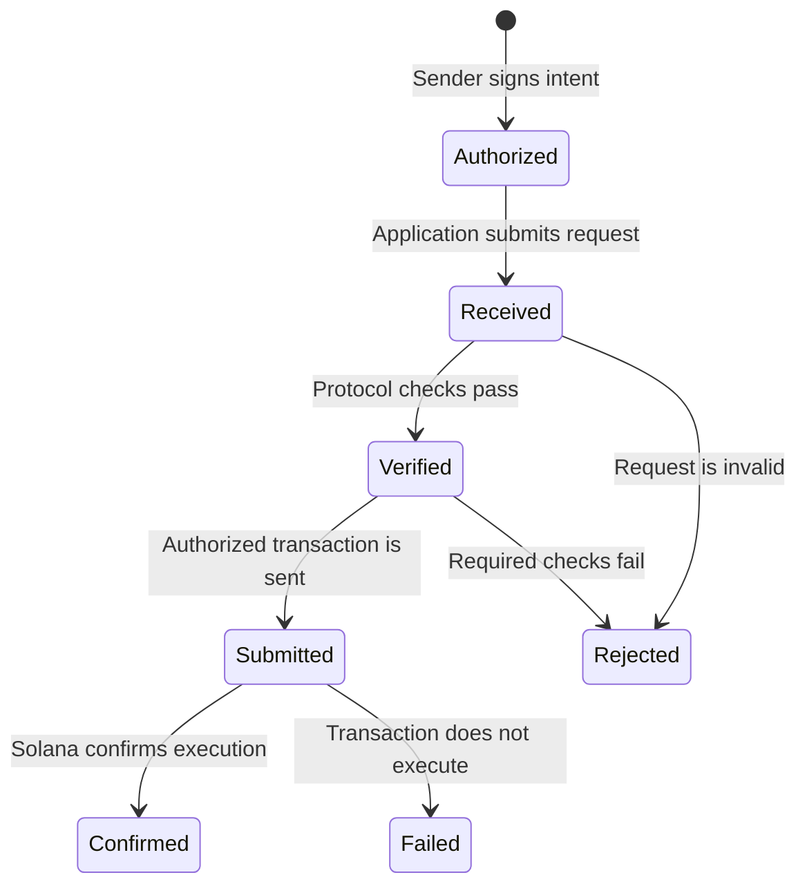

A TSN payment passes through several distinct stages. An application should display each stage accurately: a request being received does not mean it was verified, and a submitted transaction does not mean it succeeded.

| Stage | Meaning for the application |
| --- | --- |
| Authorized | The sender reviewed and signed the requested payment details. |
| Received | The service accepted the request for processing. |
| Verified | Required authorization and payment checks passed for the next step. |
| Submitted | An authorized transaction was sent to Solana. |
| Confirmed | Solana confirmed successful execution of that transaction. |
| Rejected or failed | The request or transaction did not complete; the reported reason determines the next safe action. |

Some flows use separate transactions for funding and the subsequent credit. Each signature confirms only its own transaction. A confirmed funding transaction does not prove that the later TCAP transition completed.

## Safe retries

Before retrying, check the transaction signature and the latest status. If a transaction may have succeeded but the response was lost, do not create a replacement payment until its chain result is known. A stale or expired sender-signed transaction must be rebuilt and approved again by the sender; an operator must not modify its authorization.

GPRU is intended to guard the private state presented to TCAP, while TCAP governs funds and applies authorized changes atomically. That hidden-head proof flow is not established end to end; the lifecycle stages above do not imply that it is enabled.

For application request and response types, see the [TSN SDK reference](/api-reference/sdk/tsn-sdk). Service implementation and operations belong in the [repository documentation](https://github.com/bigdreamsweb3/trustlink-pay/tree/main/docs).
