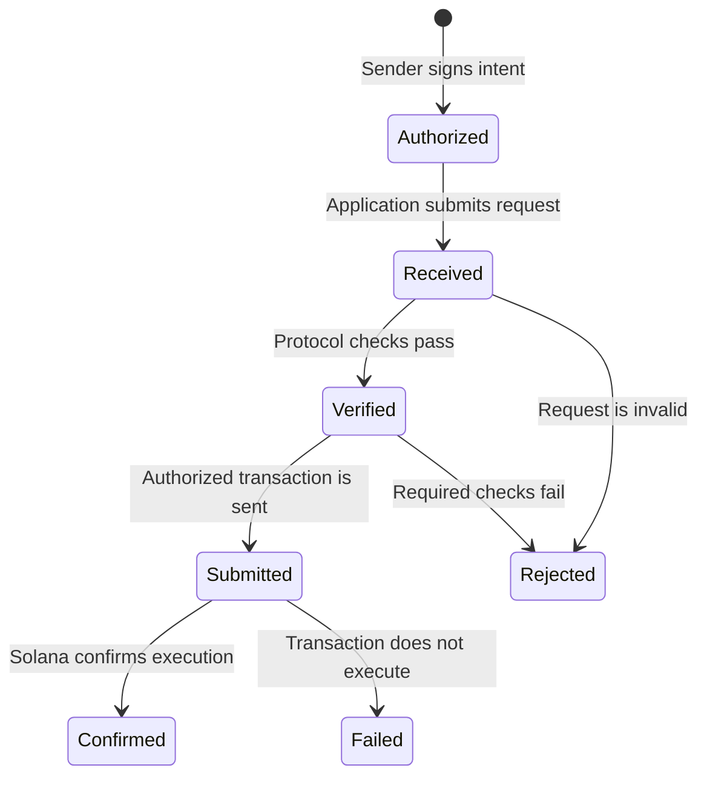
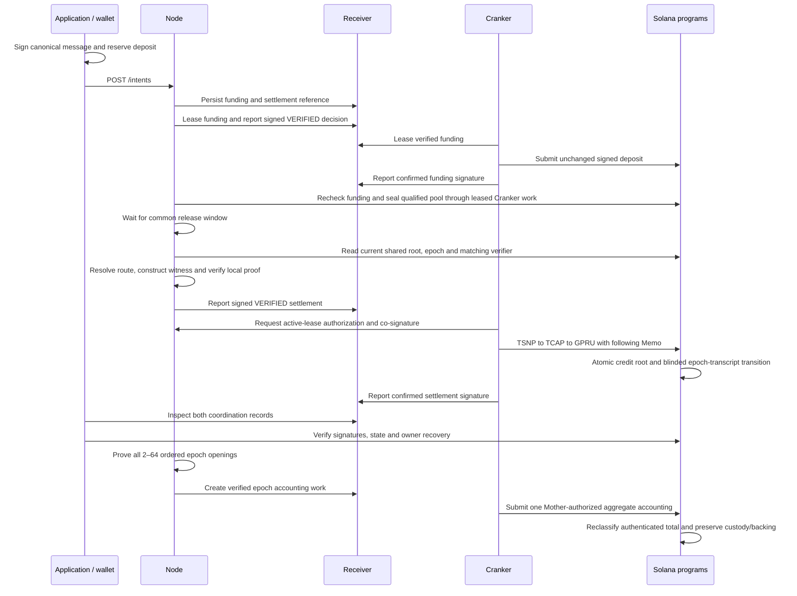

A TSN payment passes through several distinct stages. An application should display each stage accurately: a request being received does not mean it was verified, and a submitted transaction does not mean it succeeded.

| Stage | Meaning for the application |
| --- | --- |
| Authorized | The sender reviewed and signed the requested payment details. |
| Received | The service accepted the request for processing. |
| Verified | Required authorization and payment checks passed for the next step. |
| Submitted | An authorized transaction was sent to Solana. |
| Confirmed | Solana confirmed successful execution of that transaction. |
| Rejected or failed | The request or transaction did not complete; the reported reason determines the next safe action. |

Some flows use separate transactions for funding and the subsequent credit. Each signature confirms only its own transaction. A confirmed funding transaction does not prove that the later TCAP transition completed.

## Current native-credit sequence

The sender approves the canonical message and exact TCAP reserve-deposit transaction. The application builds a request using the resolved owner hash and posts it to Node's `/intents`. Node forwards it to Receiver. Receiver stores idempotent funding work and pre-creates an internal RECEIVED settlement reference; that reference is not executable before confirmed funding.

Node leases funding and checks the sender signature/message, current recipient, registered asset and exact deposit. Its signed decision binds input, evidence, execution projection and lease. Cranker claims only verified funding, independently checks the attestation and submits the unchanged signed deposit. Node rechecks the resulting successful confirmed transaction before preparing settlement.

After positive funded notes from at least two wallet sources qualify, Node prepares sealed-pool work for Receiver verification and Cranker submission. Its immutable funding root and common adaptive release window govern settlement eligibility; zero-value actors cannot qualify it. Node resolves the TIP route, reads current roots/verifier/epoch, reconstructs the witness, encrypts the owner action and generates/reverifies the private-amount proof. Cranker obtains current-lease Mother co-signing, then submits the TSNP call and bound Memo. TSNP invokes TCAP/GPRU before atomically advancing shared head/root and blinded epoch transcript, without tokens moving or reserve liabilities changing.

The sequence describes the experimental source contract. Node creates separate TCAP_EPOCH_ACCOUNTING work for every complete 2–64-credit transcript; Receiver coordinates verification/leases and Cranker submits one proof-verified aggregate reclassification. A singleton carries forward. Matching binaries, explicit credit rekey, separate epoch-verifier enrollment, active reserve/roots and persistent prover/opening settings are required. Offline proofs and host tests do not establish SBF execution or live accounting.

## Status and reconciliation

Receiver work uses `RECEIVED`, `NODE_VERIFYING`, `VERIFIED`, `REJECTED`, `CRANKER_LEASED`, `SUBMITTED`, `CONFIRMED`, and `FAILED`. SDK intent status uses a separate lower-case vocabulary; applications must read the actual response type instead of equating the two models.

Receiver provides `GET /api/work-status/<funding-work-id>` with operation ID, kind, status, verification type, sanitized decision reason and `result.signature`. Funding status additionally includes a nested `settlement` object with its independent status/result. TIN operation status is supported separately. This is a coordination view; verify successful transaction results and expected TCAP root/reserve changes on the selected cluster.

There is no dedicated `waitForSettlement` or public payment-status polling helper in the current `TsnHttpClient`. Its intent listing/status-update helpers serve worker-authorized endpoints. An application can call the documented Receiver work-status route with its own fetch/timeout policy, without exposing worker credentials.

Owner recovery additionally requires owner-held scan material and validated Memo history. The SDK checks action and predecessor continuity; a scanner must supply complete enough history. A single confirmed signature does not establish that all owner records were indexed or reconstructed.

## Safe retries

Before retrying, check the transaction signature and the latest status. If a transaction may have succeeded but the response was lost, do not create a replacement payment until its chain result is known. A stale or expired sender-signed transaction must be rebuilt and approved again by the sender; an operator must not modify its authorization.

Already confirmed funding remains distinct if settlement fails. The native-credit path does not establish an automatic refund of that deposit; epoch-family refunds use different permits/accounts. A root change requires proof reconstruction and authorization against current state. See [typed payment examples](/sdk/payment-guide) and [troubleshooting](/sdk/troubleshooting).

GPRU is intended to guard the private state presented to TCAP, while TCAP governs funds and applies authorized changes atomically. That hidden-head proof flow is not established end to end; the lifecycle stages above do not imply that it is enabled.

For application request and response types, see the [TSN SDK reference](/api-reference/sdk/tsn-sdk). Service implementation and operations belong in the [repository documentation](https://github.com/bigdreamsweb3/trustlink-pay/tree/main/docs).
