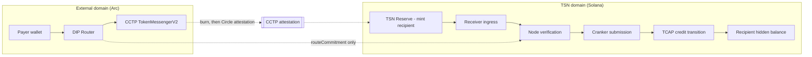

**In plain English:** DIP is how money gets *into* TSN from another blockchain. A person holding USDC on
an outside chain enters a 10-digit TIN. DIP turns that TIN into an opaque commitment, moves the USDC
across with Circle's CCTP, and TSN credits the recipient's private balance on Solana. The outside chain
records a payer, an amount, and a commitment — never the TIN and never the recipient.

DIP is the mirror of TIP. TIP is how identity enters the system; DIP is how value enters it; neither layer
sees the other's data.

## Where DIP sits

| Layer | Question it answers | Knows identity? |
| - | - | - |
| [TIP and TIN](/layers/tin) | Who is this payment for? | yes, by design |
| [GPRU](/layers/gpru) | How is routing kept unlinkable and a credit transition verified? | no |
| [TCAP](/layers/tcap) | What assets exist, what are the reserves and liabilities? | no |
| [TSNP](/layers/tsnp) | Which on-chain protocol authorizes and coordinates settlement? | no |
| **DIP** | How does external value become an internal liability? | **never** |



The dotted path is the design. The identity-bearing fact travels through the Node, not through a chain.

## How DIP fits the banking model

TSN is best understood as settlement infrastructure with bank-like division of labour. The analogy is
architectural, not regulatory.

| Banking concept | TSN |
| - | - |
| Account number | TIN |
| Ledger of customer liabilities | TCAP encrypted balances against a shared commitment root |
| Core authorization | Mother Node and node permits |
| Clearing and routing | GPRU |
| Settlement cycle | [Epoch treasury](/architecture/epoch-treasury) and opaque epoch slots |
| Agent that executes | Cranker nodes |
| **Branch counter where outside money is accepted** | **DIP** |

<Note>
"You deposit at the branch, but the teller records a commitment, not a customer." Do not describe DIP as
non-custodial deposit-taking in regulatory material: transported USDC sits in a reserve, and internal
balances are TCAP liabilities against that reserve.
</Note>

## The deposit flow

<Steps>
<Step title="Resolve">
The payer supplies a TIN to the application. The Node resolves the current TIP route and returns an opaque
`routeCommitment`. The TIN does not leave the Node boundary, and nothing exists on chain yet.
</Step>

<Step title="Commit">
The payer calls `deposit(routeCommitment, amount, expiry)` on the DIP Router. The router derives `intentId`,
records the intent, pulls USDC through the ERC-20 interface, and calls CCTP `depositForBurn` with
`mintRecipient` set to the TSN reserve.
</Step>

<Step title="Transport">
CCTP burns on the source domain and Circle attests the burn. The money leg is proof-backed: the attestation
binds amount, source, and mint recipient.
</Step>

<Step title="Mint">
The attestation is submitted on Solana and the reserve receives USDC. The reserve is one pool address shared
by every deposit; it is the only meeting point between the two domains.
</Step>

<Step title="Bind and credit">
The Receiver takes the handoff payload (`intentId`, `routeCommitment`, `amount`, `expiry`, `payer`,
`arcTxHash`). The handoff does not carry a CCTP nonce; the Node reads it from Circle's attestation for
`arcTxHash`. The Node resolves the commitment to a live route, confirms the matching CCTP burn, and
authorizes the credit. The Cranker submits it. TCAP advances the shared commitment root and the recipient's
encrypted balance increases.
</Step>

<Step title="Receipt">
The Node issues an encrypted receipt envelope bound to the intent, readable only by the parties. The chain
keeps the receipt commitment.
</Step>
</Steps>

## What each domain knows

| Fact | External chain | Solana public state | Node |
| - | - | - | - |
| Payer address | yes | no | yes |
| Amount | yes | yes (mint) | yes |
| `routeCommitment` | yes | no | yes |
| TIN | no | no | yes |
| Recipient | no | no | yes |
| Recipient balance | no | ciphertext | partial |
| Link between payer and recipient | no | no | yes |

The only place the two domains can be joined is the Node's own records — the party the user already trusts
with their TIN.

## Data model

```solidity
struct Intent {
    address payer;
    bytes32 routeCommitment;   // opaque commitment to the resolved TIP route
    uint64  amount;            // USDC base units, 6-decimal ERC-20 interface
    uint64  expiry;
    uint32  cctpDestinationDomain;
    Status  status;            // NONE | DEPOSITED
}
```

Emitted on every deposit:

```text
IntentDeposited(bytes32 indexed intentId, address indexed payer, bytes32 indexed routeCommitment, uint64 amount, uint64 expiry)
```

No TIN field, no recipient field, no destination address. A deposit cannot be reversed by the router: once
burned, the value is in the other domain.

## Privacy: every surface where a link could form

| Surface | Leak | Mitigation | Residual |
| - | - | - | - |
| Source transaction | payer, amount, commitment are public | none possible: the payer signs on a public chain | the payer's history links to *that deposit*, not to a recipient |
| Commitment to TIN | the join itself | held only by the Node, never written on chain | Node compromise or legal compulsion reconstructs it: this is the trust boundary |
| Burn and mint | CCTP is a public pipe | mint recipient is the shared reserve, not the recipient | the amount is visible end to end |
| Amount correlation | equal amounts on both sides correlate | epoch batching, equal-denomination deposits | unique or small amounts remain correlatable |
| Timing correlation | one credit per deposit | credit a cohort per epoch, with a minimum cohort before crediting | low-traffic periods weaken it |
| Reserve delta | net inflow is public | aggregate across deposits, publish periodic solvency attestations | a single-deposit epoch is fully visible |
| Recipient address as mint target | would join the payer to the recipient | the mint recipient is never derived from a commitment or a recipient | none, while this rule holds |

<Warning>
The last row is an invariant, not a preference. If any deployment configures the mint recipient as a
per-recipient address, DIP provides no privacy at all.
</Warning>

## Invariants

1. No TIN, recipient address, or plaintext identity is written to the external chain: not in state, not in
   events, not in calldata.
2. `intentId` is unique; a (payer, commitment, amount, expiry) tuple deposits once.
3. The mint recipient is the shared reserve and is never derived from a commitment or a recipient.
4. One credit per `intentId`; the Node refuses a second authorization for the same intent.
5. Credits never exceed the reserve's verified inflow for the epoch.
6. No admin path in the router can move user funds; the router holds no balance between transactions.
7. Pausing blocks new deposits only. Already-burned intents still complete.
8. Amounts are handled in the token's 6-decimal ERC-20 units; the 18-decimal native view is never used in
   accounting.

See [security invariants](/security/invariants) for the shared list.

## Failure modes

| Failure | Consequence | Required behaviour |
| - | - | - |
| Attestation never arrives | value burned, nothing minted | intent stays `DEPOSITED`; recovery through CCTP's retry path, not the router |
| Node never credits a valid burn | value sits in the reserve | reconciliation must surface unclaimed credits; recovery is an operator process, not a contract function |
| Node credits an unknown commitment | value credited to a wrong or dead route | the commitment must resolve to a live TIP route and the burn must match |
| Junk commitment deposited | USDC donated to the reserve | accepted by design: junk deposits are cover traffic, and the Node simply refuses to credit |
| Reserve insolvent against TCAP liabilities | balances exceed backing | solvency attestation; the epoch treasury already models liabilities against reserves, and DIP must feed it |

## Relationship to the outbound destination path

| | Outbound destination route (Creditcoin) | DIP (inbound) |
| - | - | - |
| Direction | settlement out to a destination | deposit into TSN |
| Authenticity source | Attestcoin/USC proof of a source event | CCTP attestation of the burn |
| Identity on the external chain | `tinHash` present in the settlement message and event | none |
| Sealed TIP head on the external chain | present | absent |
| Asset model | prefunded destination vault | reserve mint, then internal credit |

DIP also demonstrates the fix the outbound path needs: bind identity inside the attestation or the Node's
records, and publish only a commitment.

## Current status

<Note>**Status: design and Arc reference implementation. Not live.**</Note>

| Level | Meaning | Status |
| - | - | - |
| Design | this page | complete |
| Source | `TSNArcDepositRouter.sol` in the Arc Studio project | in progress |
| Tests | full suite green in the workspace | in progress |
| Testnet | deployed on Arc testnet, deposit executes | in progress |
| Mainnet | deployed on Arc mainnet, USDC burned | in progress |
| End to end | CCTP mint on Solana devnet plus a confirmed TCAP credit | in progress |

Program source, a successful build, a deployment, and a confirmed end-to-end transaction are separate
evidence levels, as everywhere else in this documentation.

## Limits inherited from TSN

DIP does not fix the current credit path's limits. There is no authoritative per-TIN latest-head state, so
the shared TCAP root prevents replay of a global transition but does not prove the supplied predecessor is
the latest ciphertext. Confidential debit and exit remain proof-gated and are not established end to end.
DIP's own claim is narrower: the *entry* is identity-free, and the external chain stays out of the privacy
story entirely.

## Roadmap

1. **Epoch batching.** Credit a cohort per epoch with a minimum cohort size, so timing and amount
   correlation stop being decisive. This is the change that turns the property from theoretical into real.
2. **Equal-denomination deposits.** Fixed chunk sizes so amounts carry less signal.
3. **The exit rail.** Outbound settlement to a one-time address, reusing the same commitment-not-identity
   rule in the other direction.
4. **Arc Privacy Sector.** When confidential execution ships, move the deposited amount inside it. Arc then
   becomes the first external domain where the amount itself is not public, with TSN supplying the identity
   layer APS does not have.
5. **Agent binding.** A TIN bound to an agent identity on the external chain, so a service can pay a TIN
   programmatically without either side publishing the other.

## Terminology

DIP is the protocol, not the implementation: a Solana-native deposit or a Base-native deposit would still be
DIP. The Arc instance is **DIP-Arc**. Preferred alternate names if the family prefers different emphasis:
**CIR (Correspondent Ingress Rail)** for the correspondent-banking framing, or **TSN Branch** for a
non-technical audience. Avoid "gateway", "bridge", and "vault": each already means something specific in this
stack or in Circle's terminology.
