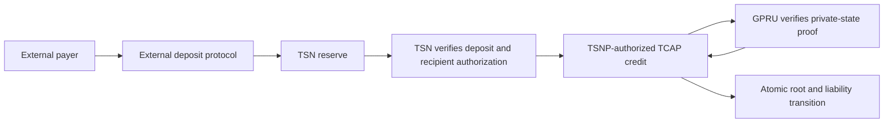

**DIP (Deposit Ingress Protocol)** is TSN's protocol for bringing value into the network from an external payment domain. Its design separates the public deposit record from the recipient's TIN and private balance state.

At a high level, an external deposit is authenticated in its source domain, delivered to an approved TSN reserve, and matched to an authorized recipient route before TCAP applies a credit. TIP provides identity resolution, GPRU guards the private state presented for that balance change, and TCAP governs the accepted asset and reserve transition.

## Status and privacy boundary

DIP's cross-chain ingress is a design and reference integration, not a live end-to-end TSN capability. Do not treat an external deposit as a completed TIN credit until the corresponding TCAP transition is confirmed.

Public chains expose transaction timing, source-side payer information, amounts, and protocol data. A commitment can avoid publishing a TIN directly, but it does not prevent correlation by timing, amount, or other public metadata. DIP does not claim that an external deposit is untraceable.

The Arc-specific ingress design, contract details, trust assumptions, and implementation status belong in the [repository's DIP design documentation](https://github.com/bigdreamsweb3/trustlink-pay/tree/main/docs/dip).
