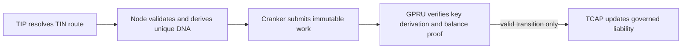

# TCAP: Transfer Confidential Asset Protocol

TCAP governs approved token assets, reserve vaults, and protocol liability accounting. Its target integration with GPRU applies confidential credit and debit transitions only after the GPRU program verifies the encrypted-state proof and replay controls.

## Current source and deployment status

The TCAP program source and deployed instructions define current behavior. The existing credit path advances opaque TIP-rooted commitment state; that commitment alone does not establish an available balance. Confidential debit and exit remain proof-gated and disabled. The standalone GPRU program, per-transaction DNA accounts, encrypted balance proof system, and atomic GPRU-to-TCAP handoff are not yet deployed.

## Target GPRU integration

For a wallet-to-TIN credit, the sender authorizes the reserve deposit and payment details. Node resolves the recipient route and constructs the GPRU transition; recipient TIP resolution is not a sender-device task. A unique DNA and one-time ElGamal public key are used for each transaction. The recipient later derives the corresponding private key locally from owner-held secret material.

For a TIN debit, GPRU must verify that the encrypted prior balance covers the debit and that the successor reflects the correct subtraction. For a TIN-to-TIN transfer, a proof must establish source/destination value conservation while hiding the amount and using separate DNA outputs. TCAP updates aggregate reserve liabilities only when the verified transition succeeds atomically.

## Reserve and privacy boundary

TCAP maintains governed reserve assets and protocol liability accounting. The exact liability representation and instruction accounts must be defined in the GPRU/TCAP ABI before this target is enabled. Public wallet deposits and exits remain visible at their wallet boundary. A unique DNA is intended to reduce stable recipient-route linkability; it does not hide public transaction metadata.

## Security requirements

- Verify one-time ElGamal key derivation against the TIP scan key and DNA.
- Verify the encrypted balance successor, range, and conservation proofs on chain.
- Enforce asset, policy, sequence, and nullifier rules.
- Apply GPRU state and TCAP liabilities atomically.
- Keep owner secrets and plaintext balances on the owner device.
- Keep Cranker limited to submitting immutable authorized work.

A public-key commitment, signature, hash, or ciphertext shape is not a balance proof. The owner SDK may perform local checks for user feedback, but TCAP authorization must rely on on-chain verified evidence.

## Related pages

<CardGroup cols={2}>
  <Card title="GPRU" icon="route" href="/layers/gpru">Unique DNA and confidential transition verification.</Card>
  <Card title="Identity and routing" icon="id-card" href="/architecture/identity-and-routing">TIP, TIN, and the public scan key.</Card>
  <Card title="GPRU confidential state" icon="lock" href="/architecture/gpru-confidential-balances">Credit and debit target flow.</Card>
  <Card title="TCAP credit API" icon="coins" href="/developers/tcap-tip-credits">Current SDK and instruction reference.</Card>
</CardGroup>
