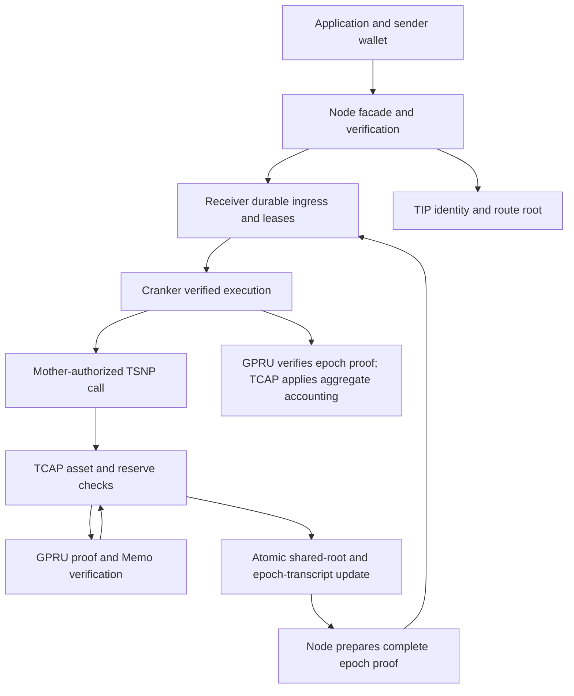

TSN separates the identity used to address a transfer from the private state used to validate a balance change and the assets governed by settlement. This separation gives each protocol layer a distinct responsibility.

As hybrid infrastructure organized around a decentralized settlement protocol for the **Internet of Value**, TSN coordinates identity, requests and verification through off-chain services, then relies on on-chain programs to enforce authorization and settlement rules. The architecture is designed for interoperable value transfer across applications and blockchain networks; [the roadmap](/overview/cross-network-roadmap) records current integration priorities and route-evidence requirements.

## Responsibility boundaries

- **TIP** manages transfer identities. A **TIN** is one 10-digit identity managed by TIP; it is not a wallet key or a store of funds.
- **GPRU** guards the user's private state as it is presented to TCAP. Its proof is intended to show that the hidden state is current and that the proposed transition follows from it.
- **TCAP** governs accepted assets, reserve liquidity, and the balance-changing action. It owns the native credit-epoch transcript and applies proof-verified aggregate accounting atomically.
- **TSNP** enforces its on-chain authorization and settlement rules. **TSN** names the complete infrastructure, including the protocol layers and supporting services.

The proof does not grant custody or payment authority to GPRU. Settlement requires the applicable authorization and TCAP checks as well as a valid proof.

## Privacy boundary

The public-observer privacy target is to hide which TIN participates in a TCAP action and prevent grouping actions as belonging to the same TIN, including intended TIN-to-TIN transfers. Trusted Node access to verification routes/openings and public wallet funding are accepted boundaries. Current native credit hides the recipient route/head witness and uses shared TIP/TCAP roots instead of a public latest-balance account per TIN, but those structural choices do not establish action unlinkability.

Solana exposes transaction accounts, signatures, action kind, token ID, blinded amount commitment, roots, nullifier, proof points, encrypted Memo bytes, timing and ordering. Wallet deposit amounts and complete epoch totals remain public; individual credit has no plaintext amount or reserve-liability delta. TIP registration publicly associates registries with registration owner keys. Current-source controls reproduce recipient-registry dictionary and cross-asset correlations under known-genesis or maintained-history assumptions; the two November 16 real credits were not matched. Retained exit payout publishes a destination owner/token account and does not establish an unlinkable private exit. See [the threat model](/security/threat-model).

The [November 16 Devnet record](https://github.com/bigdreamsweb3/trustlink-pay/blob/main/docs/laboratory/experiments/EXP-20261116-private-credit-epoch.md) establishes two confirmed private credits and complete accounting of their shared epoch. Local proof verification, deployment, these transactions and owner-history recovery have distinct evidence scopes. The native epoch is credit-only; mixed credit/debit/exit accounting remains proposed, and TSNP's retained Epoch Treasury APIs remain a separate family. See the [complete lifecycle](/developers/payment-intent-lifecycle), [TCAP epoch boundary](/layers/tcap#native-credit-epoch-lifecycle), and [internal source-backed map](https://github.com/bigdreamsweb3/trustlink-pay/blob/main/docs/laboratory/architecture-map.md) for ownership, source links and dated observations.
