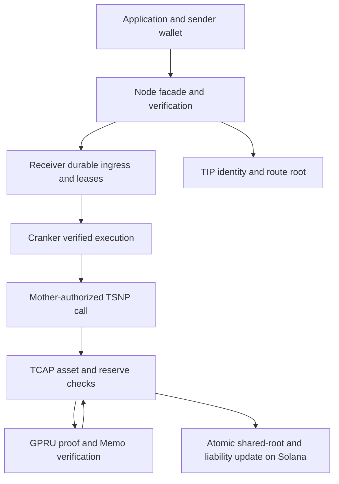

TSN separates the identity used to address a transfer from the private state used to validate a balance change and the assets governed by settlement. This separation gives each protocol layer a distinct responsibility.

As hybrid infrastructure for the **Internet of Value**, TSN coordinates identity, requests, and verification through off-chain services, then relies on on-chain programs to enforce authorization and settlement rules. The architecture is designed for interoperable value transfer across applications and blockchain networks; each route's live status depends on its deployment and verification evidence.

## Responsibility boundaries

- **TIP** manages transfer identities. A **TIN** is one 10-digit identity managed by TIP; it is not a wallet key or a store of funds.
- **GPRU** guards the user's private state as it is presented to TCAP. Its proof is intended to show that the hidden state is current and that the proposed transition follows from it.
- **TCAP** governs accepted assets, reserve liquidity, and the balance-changing action. It applies an authorized transition atomically.
- **TSNP** enforces its on-chain authorization and settlement rules. **TSN** names the complete infrastructure, including the protocol layers and supporting services.

The proof does not grant custody or payment authority to GPRU. Settlement requires the applicable authorization and TCAP checks as well as a valid proof.

## Privacy boundary

The current native-credit proof hides the recipient route/head witness and uses shared TIP/TCAP roots instead of a public latest-balance account per TIN. The owner retains the private record lineage. The credit ABI does not encode a plaintext TIN or private predecessor pointer; that structural property does not prove that public metadata, timing, application records or authorized Node knowledge cannot correlate payments.

Solana exposes transaction accounts, signatures, action kind, token ID, amount, roots, nullifier, proof points, encrypted Memo bytes, timing and ordering. Funding wallets and direct wallet transfers expose their endpoints. Confidential debit/exit is a separate unverified execution path; an exit's output wallet and amount would remain public.

The hidden-head proof flow is not currently established as an end-to-end settlement capability. Local proof verification is a separate evidence level from deployed verification and confirmed settlement. See the [complete lifecycle](/developers/payment-intent-lifecycle), [glossary](/glossary/index), and [internal source-backed map](https://github.com/bigdreamsweb3/trustlink-pay/blob/main/docs/laboratory/architecture-map.md) for detailed ownership, source links and dated observations.
