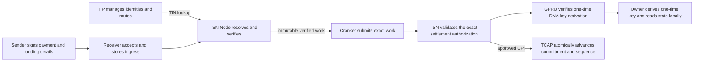

# Protocol architecture

TrustLink separates transfer identity, payment authorization, service verification, transaction submission, and asset accounting. These are distinct responsibilities with different privacy boundaries.

## TIP and TIN

TIP is the Transfer Identity Protocol. It manages transfer identities and their routing metadata. A TIN is one 10-digit Transfer Identity Number issued within TIP. Node resolves the recipient's TIN and current route; the sender SDK does not resolve recipient TIP state or construct recipient confidential state.

TIP V1 currently stores a versioned GPRU ElGamal scan public key and its integrity commitment, alongside TIP route and policy commitments. The scan key is stable for that route and is public. The owner retains the matching secret material.

## GPRU transaction routing

For each output, Node uses fresh randomness, the DNA, and the TIP scan key to derive an ephemeral public point and a one-time ElGamal public key. The recipient later combines the public derivation data with owner-held secret material to recover the matching private key locally. During TCAP credit settlement, TSN invokes GPRU to verify the derivation proof.

The source includes the derivation primitive, owner recovery helper, and GPRU proof instruction used by TSN. This proof validates the one-time key derivation, not an encrypted balance update. A key commitment or signature alone does not prove a valid balance transition.

## TSN service roles

- **Sender SDK** collects payment details and creates the sender's authorization and reserve-funding transaction.
- **Receiver** accepts and stores signed ingress work.
- **TSN Node** independently resolves TIP, validates the request, and constructs recipient transition data before releasing authorized work.
- **Cranker** submits the exact immutable work and cannot change its bound fields.

Receiver acceptance, Node verification, Cranker submission, and chain confirmation are distinct lifecycle events.

## TCAP asset accounting

TCAP governs approved assets and reserve vaults. The current credit instruction checks authorization, asset and policy, predecessor commitment, and sequence, then advances the opaque commitment state atomically. The funding-derived commitment binds the authorization to the signed reserve deposit; TCAP does not create a spent-funding PDA. Confidential debit and TIN-to-TIN conservation proofs remain future work.

Current TSN, GPRU, and TCAP instruction and account layouts define chain behavior. The credit path verifies the one-time key derivation and advances opaque TCAP state. Encrypted-balance proof verification is not implemented, and confidential debit and exit remain disabled. Wallet deposits and exits remain public at their wallet boundaries.

For protocol status and limits, see [GPRU and TCAP confidential state](/architecture/gpru-confidential-balances) and [Current technology](/about/current-technology).
