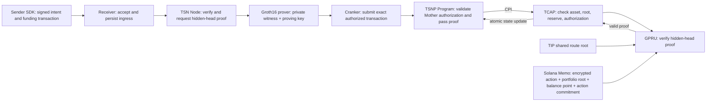

# Protocol architecture

TIP identifies transfer identities and routes. TSNP enforces on-chain authorization and settlement rules; TSN services coordinate work. GPRU verifies cryptographic proofs. TCAP governs approved assets, reserves, and shared replay state. The checked-in TSNP/TCAP credit ABI is proof-shaped, while Node fails closed until a prover and setup artifacts are configured.

## TIP and TIN

TIP is the Transfer Identity Protocol. It manages transfer identity records and route metadata. A TIN is one 10-digit Transfer Identity Number within TIP. The TIN registry stores encrypted identity fields and route commitments, including the versioned GPRU scan public key and its commitment. TIP source also maintains a shared route Merkle root.

## Proof-shaped credit path in source

TSN's `register_tcap_credit_authorization_v2` validates the Mother authorization and passes proof arguments to TCAP `credit_gpru_memo_v1`. TCAP checks the approved asset, authorization signer, time window, shared-root predecessor and sequence, pending liability, and reserve solvency, then invokes GPRU `verify_hidden_head_transition_v1`. GPRU checks the canonical roots and binds the proof to the following Memo instruction before Groth16 verification. TCAP advances the shared root and reserve liabilities only after successful verification.

The proof uses the protocol-wide TIP route root and hides the selected route/head witness. TCAP does not create a per-TIN tip PDA; the Memo remains transaction instruction data. The Node settlement authorization endpoint currently returns `GPRU_GROTH16_PROVER_NOT_CONFIGURED`, so the service flow cannot produce an authorized settlement yet.

## Prover and circuit status

The updated Circom source declares nine public inputs: old/new TCAP roots, Memo commitment, action commitment, nullifier, TIP route root, successor portfolio root, and successor balance point X/Y. Its private witness covers TIP route membership, one hidden per-TIN outer head, a nested per-token commitment map, nullifier-map paths, and balance openings. The balance state uses Pedersen commitments; the DBrix Memo body carries an owner-encrypted action record for recovery. The circuit has not been recompiled or reviewed after this change. Matching proving/verifying keys, a validated key converter, witness provider, initialized verifier account, and end-to-end proof evidence are not established. See [GPRU Groth16 prover setup](/developers/groth16-hidden-head).

All transitions write the same TCAP root account. That common writable account and the public action fields, nullifier, roots, Memo commitment, route root, successor point, timing, and transaction accounts expose protocol-level linkage. The design is not zero-linkability.

## Service lifecycle

Receiver acceptance, Node verification, Cranker submission, and Solana confirmation are separate milestones. A confirmed reserve funding transaction is not itself confirmation of the later TCAP state transition. Use transaction and account evidence from the correct cluster to claim settlement completion.

See [GPRU and TCAP state](/architecture/gpru-confidential-balances) and [Current technology](/about/current-technology) for exact limits.
