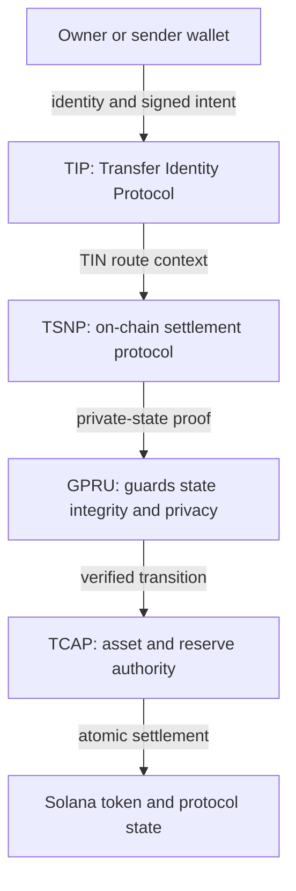

TSN separates the identity used to address a transfer from the private state used to validate a balance change and the assets governed by settlement. This separation gives each protocol layer a distinct responsibility.

As hybrid infrastructure for the **Internet of Value**, TSN coordinates identity, requests, and verification through off-chain services, then relies on on-chain programs to enforce authorization and settlement rules. The architecture is designed for interoperable value transfer across applications and blockchain networks; each route's live status depends on its deployment and verification evidence.

## Responsibility boundaries

- **TIP** manages transfer identities. A **TIN** is one 10-digit identity managed by TIP; it is not a wallet key or a store of funds.
- **GPRU** guards the user's private state as it is presented to TCAP. Its proof is intended to show that the hidden state is current and that the proposed transition follows from it.
- **TCAP** governs accepted assets, reserve liquidity, and the balance-changing action. It applies an authorized transition atomically.
- **TSNP** enforces its on-chain authorization and settlement rules. **TSN** names the complete infrastructure, including the protocol layers and supporting services.

The proof does not grant custody or payment authority to GPRU. Settlement requires the applicable authorization and TCAP checks as well as a valid proof.

## Privacy boundary

Encryption and zero-knowledge proofs can protect selected values, but they do not hide the existence or timing of a public-chain transaction. Solana observers can see transaction accounts, signatures, instruction data, and ordering. The current shared TCAP state reference can also provide a correlation point, so TSN does not claim zero linkability.

The hidden-head proof flow is not currently established as an end-to-end settlement capability. This page describes the protocol's responsibility boundaries, not a claim that every layer is deployed or operational. Source-level design and deployment evidence are maintained in the [repository documentation](https://github.com/bigdreamsweb3/trustlink-pay/tree/main/docs).
