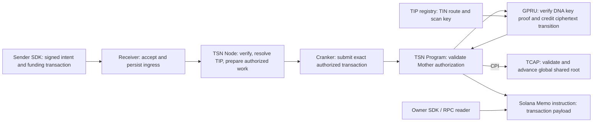

# Protocol architecture

TIP identifies transfer identities and routes. TSN coordinates authorization and settlement work. GPRU checks key and encrypted-credit relations. TCAP governs approved assets and advances shared replay state. These roles are distinct, but the hidden-head design is not yet wired into the active settlement caller.

## TIP and TIN

TIP is the Transfer Identity Protocol. It manages transfer identity records and route metadata. A TIN is a single 10-digit Transfer Identity Number within TIP. The TIN registry stores encrypted identity fields and route commitments, including the versioned GPRU scan public key and its commitment. TIP source also maintains an append-only shared route Merkle root for the hidden-head proof design.

## Credit path currently wired in source

TSN's `register_tcap_credit_authorization_v2` verifies the Mother authorization and GPRU DNA-key proof, invokes GPRU `apply_credit_transition_v1`, then invokes TCAP `credit_gpru_memo_v1`. GPRU validates initial encryption or later ElGamal addition against a supplied predecessor ciphertext. TCAP checks the approved asset, authorization signer, time window, shared-root predecessor, and next global sequence before advancing the single TCAP commitment-root account. The Memo instruction is bound by commitment and contains transaction data; TCAP does not store the Memo history or ciphertext in a per-TIN account.

The active instruction passes the TIP registry account into GPRU. The global TCAP root prevents reapplying a stale global transition, but GPRU does not persist a per-TIN head in this path. Therefore this path does not prove that the supplied per-TIN ciphertext is the latest one. It also exposes route-account reuse and transaction metadata to chain observers.

## Hidden-head proof path in source

GPRU has a separate Groth16 verifier entrypoint and circuit source. Its private witness represents route membership, a per-route-and-asset head, sequence progression, and nullifier-tree paths. Public inputs bind the old/new global TCAP roots, Memo commitment, action commitment, nullifier, and TIP shared route root. TCAP's `advance_gpru_hidden_head_v1` invokes GPRU and advances the same global root.

Node, SDK, Cranker, and the active TSN credit instruction do not call this path. The source does not provide verified circuit compilation, generated proving keys, an initialized verifier, a proof service, or end-to-end transaction evidence. The circuit does not prove balance arithmetic or debit affordability, and current instruction arguments expose action kind, token ID, and amount.

All hidden-head transitions would write the same TCAP root account. The account provides shared atomic ordering but is a common public linkage point; the design does not provide zero linkability.

## Service lifecycle

Receiver acceptance, Node verification, Cranker submission, and Solana confirmation are separate milestones. A confirmed reserve funding transaction is not itself confirmation of the later TCAP state transition. Use transaction and account evidence from the correct cluster to claim settlement completion.

See [GPRU and TCAP state](/architecture/gpru-confidential-balances) and [Current technology](/about/current-technology) for exact limits.
