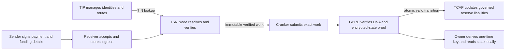

# Protocol architecture

TrustLink separates transfer identity, payment authorization, service verification, transaction submission, and asset accounting. These are distinct responsibilities with different privacy boundaries.

## TIP and TIN

TIP is the Transfer Identity Protocol. It manages transfer identities and their routing metadata. A TIN is one 10-digit Transfer Identity Number issued within TIP. Node resolves the recipient's TIN and current route; the sender SDK does not resolve recipient TIP state or construct recipient confidential state.

TIP V1 currently stores a versioned GPRU ElGamal scan public key and its integrity commitment, alongside TIP route and policy commitments. The scan key is stable for that route and is public. The owner retains the matching secret material.

## GPRU transaction routing

GPRU is being developed as a standalone protocol for transaction-specific DNA and confidential-state transitions. For each output, Node uses fresh randomness, the DNA, and the TIP scan key to derive an ephemeral public point and a one-time ElGamal public key. The recipient later combines the public derivation data with owner-held secret material to recover the matching private key locally.

The current source contains the derivation primitive and owner recovery helper. GPRU does not yet have a deployable program or on-chain proof verification. A key commitment binds public derivation inputs but does not prove a valid balance update.

## TSN service roles

- **Sender SDK** collects payment details and creates the sender's authorization and reserve-funding transaction.
- **Receiver** accepts and stores signed ingress work.
- **TSN Node** independently resolves TIP, validates the request, and constructs recipient transition data before releasing authorized work.
- **Cranker** submits the exact immutable work and cannot change its bound fields.

Receiver acceptance, Node verification, Cranker submission, and chain confirmation are distinct lifecycle events.

## TCAP asset accounting

TCAP governs approved assets and their reserve vaults. The target design updates confidential liabilities only after GPRU verifies the encrypted-state transition and replay rules in the same atomic transaction. A debit proof must establish that the prior balance covers the amount and that the successor is correct. A TIN-to-TIN transfer must prove value conservation without disclosing the amount or linking the two DNA outputs.

Existing TCAP instructions and deployed account layouts define current chain behavior. The GPRU DNA flow and its TCAP handoff are not deployed, and confidential debit and exit remain disabled. Wallet deposits and exits remain public at their wallet boundaries.

For protocol status and limits, see [GPRU and TCAP confidential state](/architecture/gpru-confidential-balances) and [Current technology](/about/current-technology).
