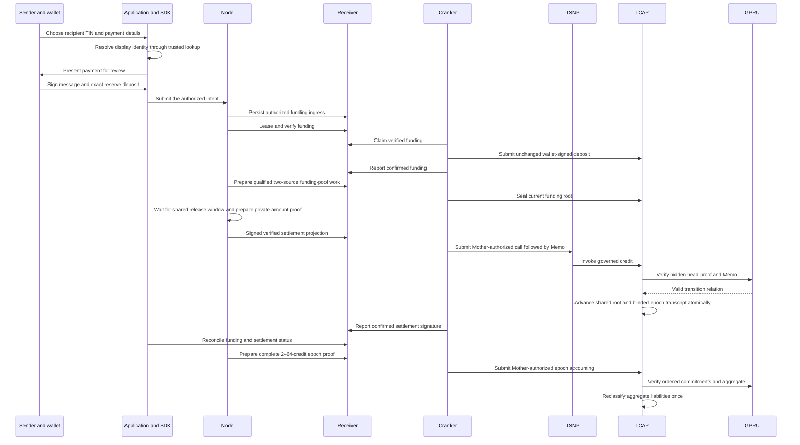

A TSN transfer begins with an identity the recipient can share and ends with an on-chain settlement governed by TCAP. The sender reviews the resolved recipient and authorizes the payment; protocol services verify the request and prepare it for execution.

This is TSN's hybrid model: applications and protocol services coordinate the request off chain, while TSNP and TCAP enforce applicable authorization, asset, and settlement rules on chain. This model is intended to connect value transfer across the Internet of Value, while the status of each cross-network route remains specific to its verified deployment.

GPRU protects the integrity and privacy of the user's private state presented to TCAP: its proof is intended to show that the hidden state is current and that the proposed change follows from it. TCAP remains responsible for the funds and applies a valid authorized change atomically.

## What confirmation means

An accepted request means the application delivered the intent. Verification means the protocol services accepted it for processing. A submitted transaction is not yet a confirmed transaction. Settlement is confirmed only when the relevant Solana transaction succeeds; for a flow with separate funding and credit transactions, each signature represents a separate stage.

The experimental sequence separates funding, private credit and aggregate accounting. Credit omits plaintext TIN, private predecessor and amount, using a blinded commitment and secret-derived nullifier; it leaves reserve assets/liabilities unchanged. Node prepares every opening for a complete 2–64-credit epoch, Receiver coordinates work and Cranker submits one proof-verified reclassification. Public deposits/epoch totals, metadata, timing and Node knowledge can still correlate payments. SBF/activation/live accounting and confidential debit/exit remain unverified; see [the security boundary](/security/threat-model).