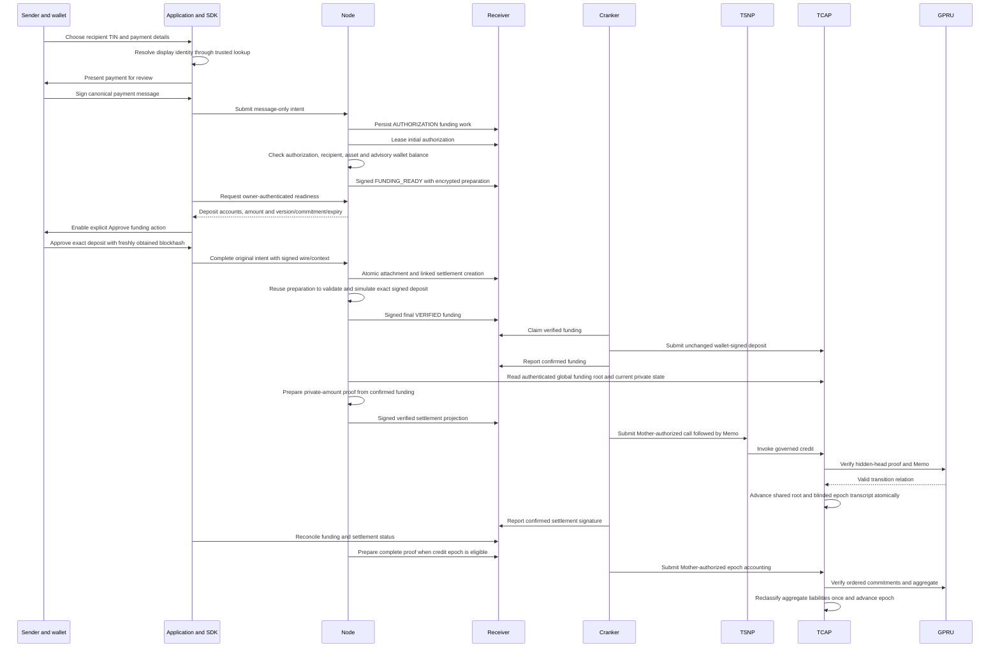

A TSN transfer begins with an identity the recipient can share and ends with an on-chain settlement governed by TCAP. The sender reviews the resolved recipient and authorizes the payment; protocol services verify the request and prepare it for execution.

This is TSN's hybrid model: applications and protocol services coordinate the request off chain, while TSNP and TCAP enforce applicable authorization, asset, and settlement rules on chain. This model is intended to connect value transfer across the Internet of Value, while the status of each cross-network route remains specific to its verified deployment.

GPRU protects the integrity and privacy of the user's private state presented to TCAP: its proof is intended to show that the hidden state is current and that the proposed change follows from it. TCAP remains responsible for the funds and applies a valid authorized change atomically.

## What confirmation means

An accepted request means the application delivered the intent. `FUNDING_READY` means Node checked its initial authorization and deposit prerequisites; the advisory balance read reserves no funds and enables no Cranker execution. The user then explicitly approves funding, and final `VERIFIED` permits submission of that exact signed deposit. A submitted transaction is not yet confirmed. Settlement is confirmed only when the relevant Solana transaction succeeds; separate funding and credit signatures represent separate stages.

The experimental sequence separates funding, private credit and aggregate accounting. Credit omits plaintext TIN, private predecessor and amount, using a blinded commitment and secret-derived nullifier; it leaves reserve assets/liabilities unchanged. TCAP owns the complete 2–64-credit epoch accounting and invokes GPRU's proof verifier. Node considers 2–63 credits eligible after 120 slots from the first credit, or 64 immediately; a singleton stays open, and 64 blocks further credit until accounting succeeds. These are scheduling and capacity rules, not epoch expiry. Receiver coordinates work and Cranker submits the transaction. See [the TCAP lifecycle](/layers/tcap#native-credit-epoch-lifecycle).

The [November 16 Devnet record](https://github.com/bigdreamsweb3/trustlink-pay/blob/main/docs/laboratory/experiments/EXP-20261116-private-credit-epoch.md) establishes two confirmed private credits and complete accounting of that epoch. Trusted Node access to verification routes/openings and public wallet funding are accepted boundaries. Public epoch totals, metadata, timing and registry/head history can still correlate TCAP actions. Owner recovery, confidential debit/exit and public-observer unlinkability require separate evidence; see [the security boundary](/security/threat-model).
