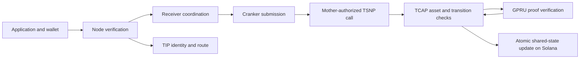

**TSN (Transfer Settlement Network)** is being built to let payment applications address value to a ten-digit recipient identity, obtain wallet approval and settle under on-chain rules. It is hybrid infrastructure organized around a decentralized settlement protocol for the **Internet of Value**: identity resolution, verification and work coordination run off chain, while Solana programs enforce authorization, asset and state-transition checks. [TrustLink Labs](/about/trustlink-labs) is developing the experimental first release, **v1**, with a mobile money experience as its goal.

The current application flow is wallet-to-TIN credit on Solana. A sender resolves the recipient's owner-provided name, reviews the payment, signs its message and separately approves the wallet deposit. Confirmed funding then supports the recipient's private credit. [Solana integration](/overview/solana-integration) explains this flow and its bounded Devnet evidence; [the integration roadmap](/overview/cross-network-roadmap) covers planned lower-fee EVM destinations.

The protocol separates identity, private-state verification, and asset governance. **TIP (Transfer Identity Protocol)** manages transfer identities, including the 10-digit **TIN (Transfer Identity Number)**. **GPRU (Guarded Privacy Routing Unit)** guards the integrity and privacy of the user's private state presented to TCAP for a balance-changing action. **TCAP (Transfer Confidential Asset Protocol)** governs accepted assets, reserves, and liquidity, then applies authorized transitions atomically. A GPRU proof alone cannot move custody or authorize a payment.

**TSNP (Transfer Settlement Network Protocol)** is TSN's on-chain authorization program. Receiver coordinates durable work and leases; Node resolves the recipient and verifies authorization, funding and proofs; Cranker submits permitted transactions. Mother authority co-signs inspected native settlement and is distinct from Node's decision-signing role.

## How the layers work together

This diagram summarizes the native settlement checks. The [complete lifecycle](/developers/payment-intent-lifecycle) adds wallet funding, confirmation and aggregate accounting to this program-level view.

## Build a payment experience

Payment-app developers can use the TypeScript SDK to resolve a TIN, prepare the sender's approved request, check configured services and reconcile funding and settlement status. Begin with [SDK setup](/sdk/getting-started), then use [the payment guide](/sdk/payment-guide) and [the complete lifecycle](/developers/payment-intent-lifecycle) to connect wallet callbacks and confirmation handling.

Identity providers can review [TIP and TIN](/layers/tin) and the proposed [credential-attestation extension](/overview/identity-attestations). The current display name is owner-provided; an optional verified personal or business name needs an implemented issuer-verification and consent policy. Builders evaluating cross-network payouts can use [the EVM roadmap](/overview/cross-network-roadmap) to assess asset, liquidity, finality and receipt requirements before implementing a route.

## Current capability boundary

The current native-credit ABI does not encode a plaintext recipient TIN or private predecessor pointer. It uses shared TIP/TCAP roots, and the owner retains private record lineage. The privacy target is to hide TIN participation from public observers and prevent linking TCAP actions; trusted Node verification and public wallet funding are accepted boundaries. Public action fields, encrypted Memo bytes, accounts, signatures, ordering and registration history can still support correlation. The [November 16 Devnet record](https://github.com/bigdreamsweb3/trustlink-pay/blob/main/docs/laboratory/experiments/EXP-20261116-private-credit-epoch.md) establishes two confirmed private credits and their complete TCAP epoch accounting. Owner-history completeness, confidential debit/exit and public-observer action unlinkability require separate evidence; see the [security boundary](/security/threat-model).

TrustLink Labs develops TSN and TSN XP, a reference application for interacting with the protocols and SDKs. For source-level design, integration decisions, operator procedures, and deployment guidance, use the repository's [root documentation](https://github.com/bigdreamsweb3/trustlink-pay/tree/main/docs).
