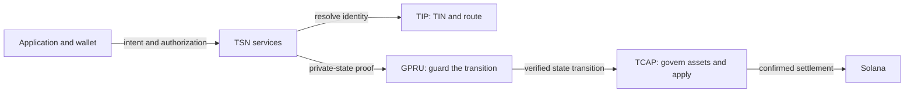

TrustLink Labs is building foundational infrastructure for the **Internet of Value** through **TSN (Transfer Settlement Network)**, a hybrid settlement network for identity-aware, privacy-preserving value transfer. TSN is designed to make value transfer interoperable across applications and blockchain networks. Its architecture combines off-chain coordination and verification with on-chain authorization and settlement enforcement; cross-network interoperability is a design direction, not a claim that every route is live. Built on Solana by [TrustLink Labs](/about/trustlink-labs), TSN is the team's implementation of the **Decentralized Settlement Protocol (DESP)**. **TSNP (Transfer Settlement Network Protocol)** names the on-chain settlement protocol within the wider TSN infrastructure. The design separates payment authorization, identity resolution, transaction verification, and submission so an operator cannot change what the sender signed.

The protocol separates identity, private-state verification, and asset governance. **TIP (Transfer Identity Protocol)** manages transfer identities, including the 10-digit **TIN (Transfer Identity Number)**. **GPRU (Guarded Privacy Routing Unit)** guards the integrity and privacy of the user's private state presented to TCAP for a balance-changing action. **TCAP (Transfer Confidential Asset Protocol)** governs accepted assets, reserves, and liquidity, then applies authorized transitions atomically. A GPRU proof alone cannot move custody or authorize a payment.

In TSN's settlement model, the Mother Node verifies and reserves authorized work, TSNP enforces the applicable authorization and reimbursement rules on chain, and independent Crankers pay Solana fees to submit the exact authorized transactions. The sender authorizes a payment against a portable identity rather than relying on a raw public key as the recipient-facing identifier.

## How the layers work together

GPRU's proof is designed to establish that the hidden user state is current and that the proposed transition follows from it, without making GPRU a custodian. TCAP remains responsible for the funds and the atomic balance-changing action.

## Use the SDK

The TypeScript SDK gives applications helpers for checking configured network services, working with TIN identity, preparing wallet-authorized payment intents, and following their status. Start with [Build with the TSN SDK](/sdk/index), then follow the [payment lifecycle](/developers/payment-intent-lifecycle).

## Current capability boundary

The hidden-head proof flow is not yet available as an end-to-end settlement feature. Confidential debit and exit are also not established as available. Public transaction data can reveal timing, transaction accounts, and other submitted fields; TSN does not claim zero linkability. The [GPRU](/layers/gpru), [TCAP](/layers/tcap), and [security](/security/threat-model) pages explain these boundaries in plain language.

TrustLink Labs develops TSN and TSN XP, a reference application for interacting with the protocols and SDKs. For source-level design, integration decisions, operator procedures, and deployment guidance, use the repository's [root documentation](https://github.com/bigdreamsweb3/trustlink-pay/tree/main/docs).
