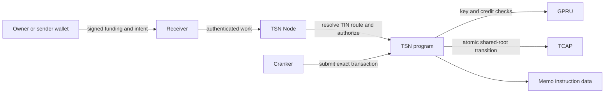

The current TIN credit path assigns different work to identity, service, and settlement layers. TIP stores TIN identity and route data; a TIN is one 10-digit identity within the Transfer Identity Protocol. TSN accepts and verifies payment work, GPRU checks one-time key and encrypted-credit relations, and TCAP governs approved assets and advances its shared commitment root.

## Payment path

Receiver stores and leases work; it does not prove settlement. Node verification constructs authorized work; it does not itself move TCAP assets. Cranker submission can fail or remain pending. Only confirmation of the program transaction establishes that the TCAP state transition executed.

## State boundary

The current TSN credit caller passes the supplied encrypted-credit transition through GPRU validation, then asks TCAP to check and advance one shared global root and sequence. The Memo remains transaction instruction data bound by commitment. The current path does not store the Memo in a per-TIN account or authenticate a latest head for each TIN. The shared root rejects stale global transitions but does not prove that a caller supplied the latest ciphertext for a particular TIN.

## Privacy and security boundary

Solana exposes transaction accounts, instruction arguments, Memo ciphertext, fee payer, signatures, and ordering. The common writable TCAP root creates visible protocol-level linkage. The current TSN/TCAP source ABI carries the GPRU hidden-head proof, but its circuit, setup, prover, and runtime remain unverified; debit and exit are not established end to end. The architecture therefore does not claim zero linkability or live confidential debit/exit.

Epoch treasury, opaque slot, `SettlementDna`, payout, and refund instructions are separate TSN program capabilities; they must not be mixed into a description of the current TIN credit transaction unless that transaction invokes them.
